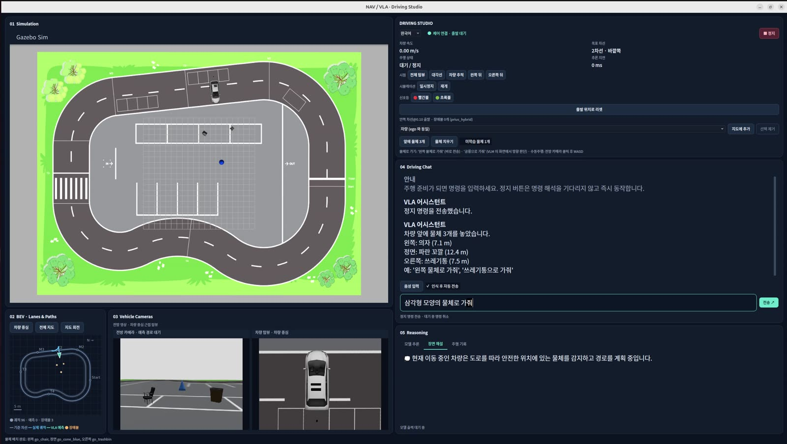
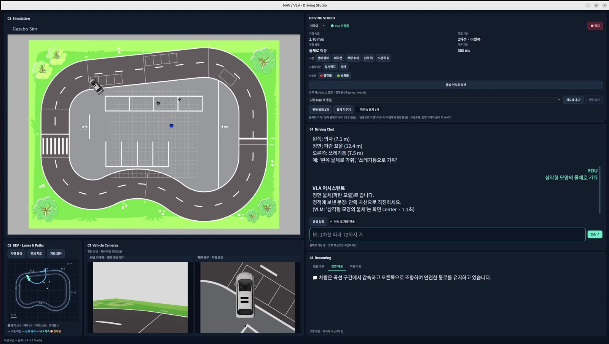
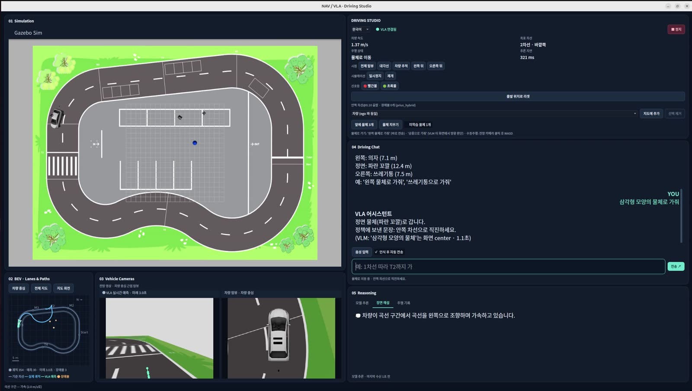
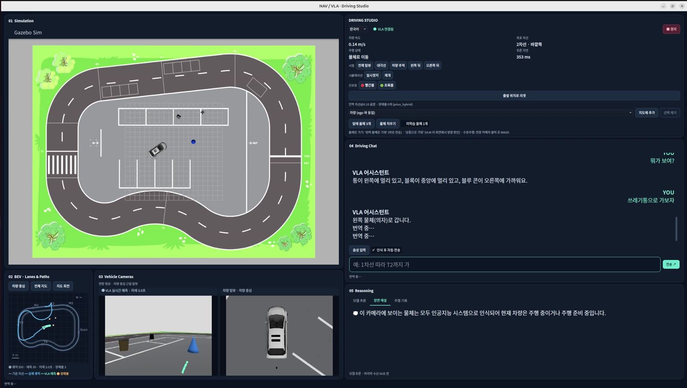
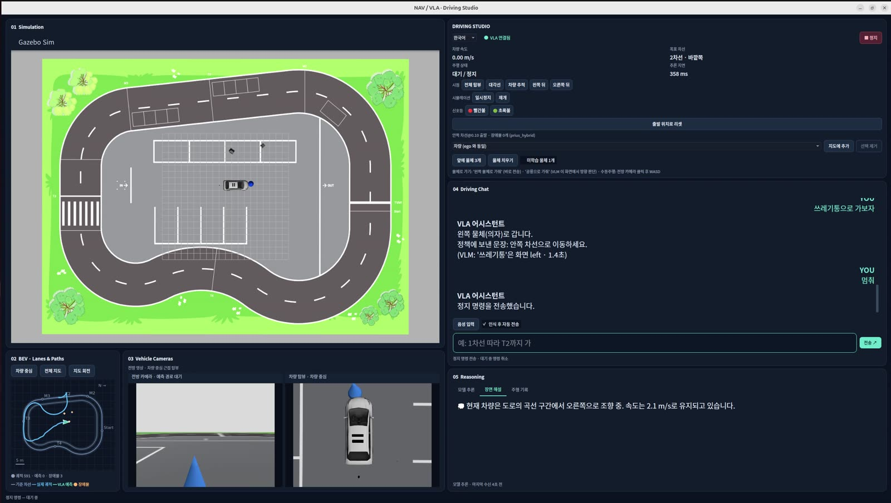

# 강좌 GUI 물체로 가기 시험 영상 검토 — 인지는 VLM, 이동은 VLA (2026-10-08 22:38)

이전 단계: [20261008_1014 §7](20261008_1014_sector-s1-s0-inherited-from-base.md#7-오른쪽-쏠림-진단--s1-은-r26-과-같은-출력-오프라인-프로브는-차이만-쟀다-10-08-1533-추가)
(s1 출력 = 베이스 r26 출력, 절대 위치 프로브와 사전 기각선). 같은 시각의 [20261008_2237](20261008_2237_g4-void-s2-negative-s3-plan.md) 과 함께 읽는다.

> **정정 (10-08 22:50).** [20261008_2237](20261008_2237_g4-void-s2-negative-s3-plan.md) 에 따르면 **s1 은 섹터 데이터를 학습하지
> 않았다**(변환이 Stanley 109 ep 만 담음). 그래서 이 영상은 "섹터 학습한 정책의 실패"가 아니라 **차선 주행 모델(r26 + Stanley)을 물체
> 가기 과제에 올린 결과**다. 오른쪽으로 꺾어 트랙을 찾는 것은 차선 주행 모델로서는 당연한 행동이다. 아래 3절의 "섹터 학습이 정책을
> 바꾸지 못했다"는 문장은 이 정정에 맞게 고쳤고, 5절의 재학습 계획은 밤샘 `s3`/`s3n` 로 대체됐다.

한 줄 요약: 강좌 GUI 에서 두 번 시험했다. **VLM 은 대상 방향을 두 번 다 맞혔고, 정책(s1)은 받은 문장과 상관없이
두 번 다 오른쪽으로 꺾었다.** 막힌 곳은 "방향 → 차량 움직임"을 맡은 VLA 정책 하나다. GUI 표시 버그 두 개는 고쳤다.

**방향 결정 (사용자, 10-08 22:38).** 인지(어떤 물체가 화면 어디에 있나)는 VLM 이 맡아도 되지만, **물체까지의 이동은 VLA 가
한다. 규칙 기반 주행기(pure-pursuit 등)로 대신하지 않는다.** 따라서 해결은 정책 재학습으로만 한다.

---

## 1. 시험 조건

| 항목 | 값 |
|---|---|
| 실행 | `sh lecture_test.sh --goto` (회피 감독 끔, 장애물 없음, 출발 0.1) |
| 정책 | s1 = `runs/course/navvla_reasoning_s1/checkpoints/010000` (베이스 r26, 섹터 문장 10k step, 비전 고정, lr 1e-5) |
| 인지 | Qwen2.5-VL 7B (랩서버 Ollama, 11501 터널), 전방 카메라 한 장 + 사용자 문장 → `left / center / right` |
| 정책 입력 | VLM 결과를 섹터 학습 문장으로 바꿈: `"Go to the object on the left."` / `"... straight ahead."` / `"... on the right."` |
| 영상 | [media/20261008_gui_goto_test.mp4](media/20261008_gui_goto_test.mp4) (1분 55초, 원본 `~/Videos/VLA_물체이동.mp4`) |

## 2. 영상에서 본 것

### 1회차 (0:00 ~ 0:45) — "삼각형 모양의 물체로 가줘"

주차 영역에서 `앞에 물체 3개` → 왼쪽 의자 7.1 m, 정면 파란 꼬깔 12.4 m, 오른쪽 쓰레기통 7.5 m.

| 시각 | 화면 | 그림 |
|---|---|---|
| 0:14 | 물체 3개가 차 앞에 놓임. 전방 카메라에 세 물체가 다 보임 |  |
| 0:22 | VLM: `'삼각형 모양의 물체'는 화면 center · 1.1초` → 정면 문장 전송. **차는 오른쪽으로 꺾기 시작** |  |
| 0:30 | 물체를 오른쪽 뒤로 두고 트랙 가장자리로 감 |  |
| 0:42 | 트랙에 올라가 차선을 따라 주행 |  |

- 인지: 맞음(삼각형 = 파란 꼬깔 = 가운데).
- 이동: 실패. 정면 12.4 m 의 꼬깔로 가지 않고 오른쪽으로 돌아 트랙을 찾아 주행했다. 차선이 거의 안 보이는 화면에서 시작했는데도
  그렇다.

### 2회차 (0:50 ~ 1:55) — 수동주행으로 옮긴 뒤 "뭐가 보여?" → "쓰레기통으로 가보자"

| 시각 | 화면 | 그림 |
|---|---|---|
| 1:40 | 대화 답: "통이 왼쪽에 멀리, 블록이 중앙에 멀리, 블루 콘이 오른쪽에 가까워요". VLM: 쓰레기통은 화면 **left**. GUI 안내는 "왼쪽 물체(**의자**)로 갑니다" |  |
| 1:52 | 왼쪽 문장을 받았는데 오른쪽으로 꺾어 파란 꼬깔 바로 앞에서 섬 |  |

- 인지: 맞음(화면에서 쓰레기통은 왼쪽).
- 이동: 실패. 왼쪽 문장에도 오른쪽으로 갔다.
- 차를 옮긴 뒤라 학습 조건(물체를 놓은 자리에서 바로 출발)과 다르다. 그래서 2회차만으로 정책을 판단하지는 않는다. 1회차는 학습 조건 그대로다.

## 3. 문제를 층별로 나누면

| 층 | 문제 | 상태 |
|---|---|---|
| **정책 (VLA)** | 문장과 상관없이 오른쪽으로 꺾어 트랙을 찾는다 | **미해결 — 근본 원인** |
| GUI 표시 | "정책에 보낸 문장"이 화면 번역기를 거쳐 "안쪽 차선으로 직진하세요"로 바뀌어 보였다. 실제로 보낸 문장은 `Go to the object straight ahead.` | 고침 |
| GUI 대상 이름 | 차를 옮긴 뒤에도 놓을 때의 좌/정면/우 이름표를 써서 쓰레기통을 "의자"라고 안내했다 | 고침 |
| 장면 해설 | 주차장에서도 "곡선 구간에서 오른쪽으로 조향" 같은 차선 주행 문장을 말한다 | 미해결(사소) |
| 대화 답변 | 내용은 대체로 맞으나 의자 → "블록", 꼬깔 → "블루 콘"으로 어색함 | 미해결(사소) |

### 정책 쪽이 근본 원인이라고 보는 근거

영상 1회는 근거로 약하지만, 같은 모양이 학습 데이터 측정에서 이미 나왔다
([10-08 §7](20261008_1014_sector-s1-s0-inherited-from-base.md), 절대 위치 프로브, 학습 에피소드 90 개, 30 스텝 끝 횡 위치).

| 모델 | 왼쪽 (시연 +0.39 m) | 정면 (시연 +0.01 m) | 오른쪽 (시연 −0.38 m) |
|---|---|---|---|
| r26 (섹터 학습 전) | −0.29 m · 시연 쪽 6/28 | −0.86 m · 14/31 | −1.36 m · 30/31 |
| s1 (GUI 에 올린 모델) | −0.27 m · 5/28 | −0.89 m · 14/31 | −1.57 m · 30/31 |

- s1 은 학습 데이터 안에서도 "왼쪽"을 받으면 오른쪽에서 끝난다. 영상의 두 실패와 같은 모양이다.
- s1 과 r26 의 차이는 0.2 m 안이다. ~~섹터 학습이 정책을 사실상 바꾸지 못했다~~ → **s1 은 섹터 데이터를 학습하지 않았으므로
  같은 것이 당연하다**(정정, [2237 §1](20261008_2237_g4-void-s2-negative-s3-plan.md)). 섹터 데이터를 제대로 학습한 s2/s2n 은 r26 의
  방향 반응까지 잃었다(예측/시연 0.82 → 0.04 / 0.16).
- 행동 복원 통계 버그(10-05 왼쪽 쏠림의 원인)는 아니다. s1 의 통계는 학습 데이터 g4 와 일치한다.

### 이번에 확인된 것: 인지는 된다

VLM 판단은 영상 2회 모두 맞았고, 저장된 폐루프 화면에서 잰 결과도 같은 수준이다(섹터 배치·한국어 이름 29/30, 학습 안 한
로봇을 "안드로이드 마스코트"로 묘사 15/20, 한 번 약 0.5~1 초). **"말 → 대상 방향"은 지금 구조로 된다.**

## 4. GUI 수정 (10-08 22:30)

- `dashboard_language.py`: `정책에 보낸 문장:` 으로 시작하는 줄은 번역하지 않는다. 정책이 실제로 받은 영어 문장이 따옴표 안에
  그대로 보인다.
- `driving_dashboard.py`: 물체를 놓을 때의 차 위치(`goto_origin`)를 기억한다. 그 뒤 1 m 넘게 움직였거나 15° 넘게 돌았으면,
  지금 차 위치에서 VLM 이 말한 방향(왼쪽 +20° / 정면 0° / 오른쪽 −20°)에 가장 가까운 물체를 대상으로 잡는다. 그리고
  "정책은 놓은 자리에서 본 배치로만 학습했으니 '앞에 물체 3개'를 다시 눌러 주세요"라고 알린다.
- 테스트: `test_goto_target_follows_the_car_when_it_moved_after_placement` 추가. 대시보드 테스트 22 통과, 2 실패(번역 테스트,
  이번 수정 전부터 실패).

이 수정은 화면이 사실대로 말하게 할 뿐이다. 차가 오른쪽으로 꺾는 것은 바뀌지 않는다.

## 5. 다음 — 물체 가기 전용 VLA (밤샘 `s3`/`s3n`)

구조는 그대로 둔다: **VLM 이 방향을 고르고, 그 방향 문장을 받은 VLA 가 직접 운전한다.** 규칙 기반 주행기는 쓰지 않는다.

이 문서를 쓸 때 적었던 재학습 후보(r26 베이스에서 비전 고정 해제·lr 상향 등)는 **폐기한다.** r26 위에서 goto 미세조정을 하면 방향
반응이 무너진다는 것이 이미 확인됐기 때문이다(s2/s2n). 대신 차선 주행·차선 변경 모델과 분리해 **stock smolvla_base 에서 물체 가기
전용 모델**을 새로 학습하고 있다 — 계획·판정 기준·일정은 [20261008_2237 §4](20261008_2237_g4-void-s2-negative-s3-plan.md) 참조
(`tools/overnight_s3_chain.sh`, 22:25 기동, 10-09 08:00 완료 예정).

이 문서 쪽에서 덧붙이는 확인 순서:

1. `s3` 가 대조군 `s3n` 을 유의하게 넘는지(2237 판정 기준).
2. 넘으면 GUI 의 `--goto` 체크포인트(`lecture_test.sh` 의 `REMOTE_CKPT`, 지금은 s1)를 `s3` 로 바꿔 이 영상과 **같은 순서로 다시 찍는다**
   (주차 영역 · 앞에 물체 3개 · "삼각형 모양의 물체로 가줘" / 수동주행 후 이름 지정). 같은 조건 전후 비교가 된다.
3. 절대 위치 프로브(`code/course/probe_goto_absolute.py`)도 s3·s3n 에 돌려, 문장 사이 차이뿐 아니라 경로가 지시한 쪽에서 끝나는지를
   같이 본다(10-08 §7 에서 확인한 측정 구멍).

## 6. 데이터 양 — 왜 차선 없는 곳에서도 차선을 찾으러 가나 (10-09 10:58 추가)

질문: 영상의 정책이 주차 영역에서도 오른쪽으로 돌아 트랙을 찾는 것은 차선 주행을 더 많이 학습해서인가? 모델마다 학습 데이터가
얼마였나?

출처: 서버 학습 로그 `logs/navvla_reasoning_r26.log`, `logs/course/navvla_reasoning_{s1,s2,s2n}.log` 의 `dataset:` 줄,
`logs/kickoff_v3y.log.gz`, `logs/convert_v3y.log.gz`.

| 모델 | 출발점 | 차선 주행 데이터 | 물체 가기 데이터 | 학습 step |
|---|---|---|---|---|
| v3y | smolvla_base | 39,593 프레임 (173 ep) | 0 | 40,000 (bs 8) |
| r26 (데모 기본) | v3y | 73,215 프레임 (v3y 포함 차선·회피·Stanley) | 0 | 25,000 |
| **s1 (영상 속 모델)** | r26 | Stanley 25,335 프레임 (109 ep) | **0** | 10,000 |
| s2 / s2n | r26 | Stanley 25,335 | 섹터 54,794 (292 ep) | 10,000 |
| s3 / s3n (계획) | **stock smolvla_base** | Stanley 25,335 | 섹터 packed_sec 292 ep + packed_sec2 400 ep | 15,000 (bs 8) |

### 읽는 법

- **영상 속 s1 은 물체 가기 데이터를 한 프레임도 보지 않았다.** v3y → r26 → s1 로 약 75,000 step 을 학습했고 전부 트랙 위 차선
  주행 장면이다. "차선 데이터가 몇 배 많다"가 아니라 **물체 가기 데이터가 0** 이다. 주차 영역에서 물체 쪽으로 가는 장면을 본 적이
  없으니, 처음 보는 화면에서 아는 행동(차선 찾기)을 한 것이다.
- 그 차선 찾기가 왜 **오른쪽** 인지는 분리하지 않았다. 트랙 주행 방향 때문이라는 추정만 있다.
- **물체 가기 데이터를 더 많이 넣은 s2 도 실패했다.** 마지막 10k step 의 데이터는 섹터 68 % · 차선 32 % 로 물체 가기가 더
  많았다. 그런데도 방향 반응은 r26 의 0.82 에서 0.04 로 떨어졌고, 대조군 s2n 과 구별되지 않았다(p = 0.672,
  [2237 §3](20261008_2237_g4-void-s2-negative-s3-plan.md)). 따라서 원인은 마지막 단계의 데이터 비율보다, **차선 주행으로만
  65,000 step(v3y 40,000 + r26 25,000)을 쌓은 출발점** 쪽일 가능성이 크다. s3 를 stock 베이스에서 시작하는 이유가 이것이다.
  이 해석은 s3 와 s2 를 비교해야 확인된다.

### 물체 가기 데이터 안의 구성

- 섹터 292 ep 중 **차선이 보이는 곳에서 출발 66 ep, 주차·평지 출발 226 ep.** 트랙 위에서 물체로 가는 장면은 적다.
- s3 에도 Stanley 차선 데이터 25,335 프레임이 섞인다. 차선 화면에서 물체 대신 차선을 따라가는 습관이 다시 생기는지는
  대조군 s3n 비교와 **차선 출발 시행을 따로 집계** 해서 본다.

### 밤샘 학습 상태 (10-09 10:43)

`eval_out/course/overnight_s3.log` 기준. 10:19 서버 여유 2 G 로 중단됐고, 10:25 재기동했다. 섹터 재수집은 450 ep 목표 중
400 ep(`packed_sec2`)로 들어갔고, `g6` 변환 중이다. s3/s3n 학습은 아직 시작 전이다.

## 7. s2 GUI 시험 — 물체 앞에 서지 않고 옆으로 지나감 (10-09 추가)

**관찰 (사용자).** `REMOTE_CKPT` 를 s2 로 바꿔 `POLICY_GPU=1 sh lecture_test.sh --goto` 로 시험했다(s3 가 서버 GPU0 에서 학습
중이라 정책은 GPU1). 차가 지정 물체 쪽으로 가기는 하지만 **앞에 서지 않고 옆으로 지나간다.** 목표는 차량 전방 카메라 화면
가운데에 물체가 오도록 서는 것이다.

### 7.1 시연 데이터에는 "가운데 두고 선다"가 들어 있다

로컬 `packed_sec` 292 ep + `packed_sec2` 400 ep, 모두 성공 에피소드. 끝 프레임의 차 자세와 목표 물체 좌표로 계산.

| 항목 | 값 |
|---|---|
| 끝날 때 목표 방향 (차 진행 방향 기준) | **692 ep 모두 ±10° 안**, 중앙값 0° (±5° 안 178/400, packed_sec2) |
| 끝날 때 거리 (차 중심 ~ 물체 중심) | 3.85 ~ 4.46 m, 중앙값 4.0 m (교사 standoff 3.8 m) |
| 끝에 서 있는 시간 | 에피소드당 중앙값 약 6 초 (packed_sec 꼬리 정지 프레임 중앙값 60.5, 10 Hz) |
| 정지 프레임 비율 | packed_sec 14,475 / 50,706 = **29 %** |

시연은 항상 물체를 화면 가운데에 두고 약 4 m 앞에서 6 초 서 있다. **데이터가 없어서 못 서는 것은 아니다.**

### 7.2 시험 기록

`eval_out/demo/bridge.log`: `"Go to the object on the right."`, `"Go to the object straight ahead."` 두 번 모두 정책이 멈추지 않아
**GUI 의 60 초 제한으로 끝났다**(지시 후 약 55~60 초 뒤 빈 지시로 리셋). 추론 지연은 168 ms 로 정상. 궤적은 기록되지 않아
옆을 지나간 거리는 재지 못했다.

### 7.3 원인 후보 (분리 안 됨)

1. **베이스 습관.** s2 는 r26 에서 시작했다. r26 계열은 같은 화면에서 경로가 오른쪽으로 약 1 m 치우친다(§3 표). 조준이 1 m
   빗나가면 물체 옆을 지나는 경로가 된다. → s3(stock 베이스)가 같은 증상을 보이는지로 가린다.
2. **빗나갔을 때 되돌아오는 시연이 없다.** 시연은 오라클이 정확히 조준해 들어가는 장면뿐이다. 물체가 옆에 있는 상태에서 다시
   가운데로 맞추는 장면이 없으므로, 한 번 빗나가면 학습 분포 밖이 되고 "서야 할" 화면이 오지 않는다. 2237 문서의 폐루프 정차
   STRICT 0/150 과 같은 모양이다.
3. **계획을 너무 오래 따라간다.** `refill_at 0.3` 이면 한 계획을 최대 약 2 초 화면 확인 없이 따라가 2~4 m 를 간다. 정차 지점을
   지나치기 쉽다. 2237 §6-3 이 `refill_at 0.8`·`max_speed 1.2` 를 데이터로 정당화되는 수정으로 적어 두었다.

### 7.4 강좌 조건: 출발 위치를 고정할 수 없다

실제 강좌는 실물 트랙에 차와 물체를 두고 하므로 **매번 같은 자리·같은 배치로 시작할 수 없다.** 그런데 지금 학습 데이터의
출발 배치는 거의 고정이다.

| 섹터 | ep | 출발 시 목표 거리 | 출발 시 목표 방향 |
|---|---|---|---|
| 왼쪽 | 222 | 7.0 ~ 12.5 m | **+17 ~ +23°** |
| 정면 | 245 | 7.4 ~ 12.5 m | **−3 ~ +3°** |
| 오른쪽 | 225 | 7.0 ~ 12.5 m | **−23 ~ −17°** |

방향이 세 개의 좁은 띠(±3°)뿐이다. 실제 강좌에서 물체가 10°나 35°에 있거나 5 m 앞에 있으면 학습에서 본 적 없는 출발이다.
이것은 7.3-2(되돌아오는 시연 없음)와 같은 문제의 다른 면이다 — 둘 다 "정해진 자리에서 정해진 경로"만 보여 준 데이터다.

**GUI 수정 (10-09).** §4 에서 넣은 "물체를 놓은 뒤 차가 움직였으니 '앞에 물체 3개'를 다시 눌러 주세요" 채팅 경고를 없앴다.
강좌에서는 위치가 늘 다르므로 사용자에게 다시 놓으라고 할 이유가 없다. 현재 차 위치 기준으로 대상을 다시 고르는 동작은
그대로 두고, 그 사실은 주행 기록(이벤트 로그)에만 한 줄 남긴다. 대시보드 테스트 22 통과(2 실패는 이전부터의 번역 테스트).

### 7.5 다음 (VLA 가 운전하는 구조 안에서)

1. **s3 결과를 먼저 본다.** 같은 증상이면 원인 1(베이스)은 아니다.
2. **수집 분포를 넓힌다.** 출발 방향을 세 띠 대신 연속 범위(예: ±35°)로, 거리를 4~12.5 m 로 뽑는다. 그리고 수집 중 오라클
   경로에 일부러 횡 오차를 넣어 **빗나간 상태에서 다시 가운데로 맞춰 들어가 서는 장면**을 기록한다. 섹터 문장은 VLM 이 "지금
   화면에서" 고르므로, 라벨은 프레임별 현재 섹터(2237 §2 `--sector-per-frame`)를 그대로 쓴다.
3. **서빙 설정.** `refill_at 0.8`, `max_speed 1.2`. 정책은 그대로이고 계획을 더 자주 새로 받는다.
4. **판정 기준 (사전 기각선, 데이터에서 잰 값).** 문장대로 갔는지와 별도로, 정차 시 ① 목표 방향 ±10° 안 ② 목표 중심까지
   3.8 ~ 4.5 m ③ 1 초 이상 정지. 출발 배치는 학습 띠 안(고정형)과 띠 밖(강좌형)을 **따로 집계**한다. 띠 밖에서 띠 안의 절반에도
   못 미치면 강좌 조건에서는 안 된다고 본다.

**정해야 할 것.** 2237 §5 는 정차를 "사용자 결정에 따라 브리지 기하 게이트로 분리"한다고 적었다. 브리지가 차를 세우는
방식이다. "이동은 VLA 로" 결정(10-08)과 함께 쓸지, 정차까지 정책이 해야 하는지 정해야 한다. 실물 트랙에서는 물체 좌표를
모르므로 기하 게이트를 그대로 쓸 수 없다는 점도 고려해야 한다.
