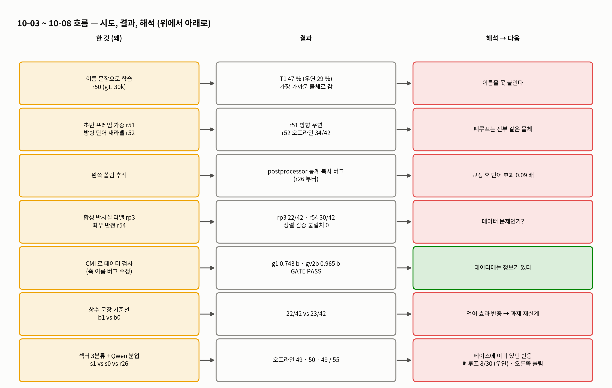
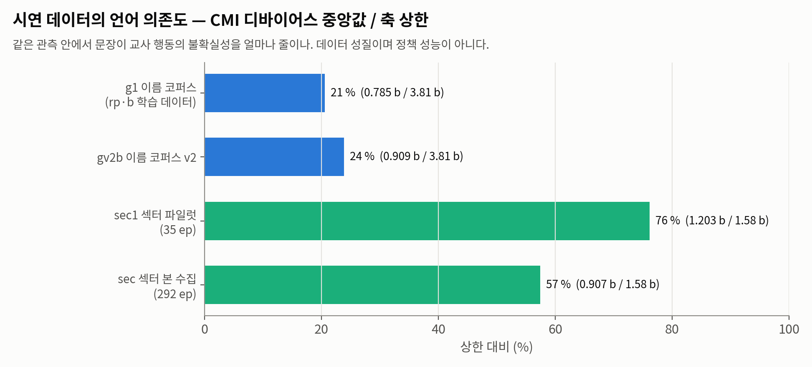
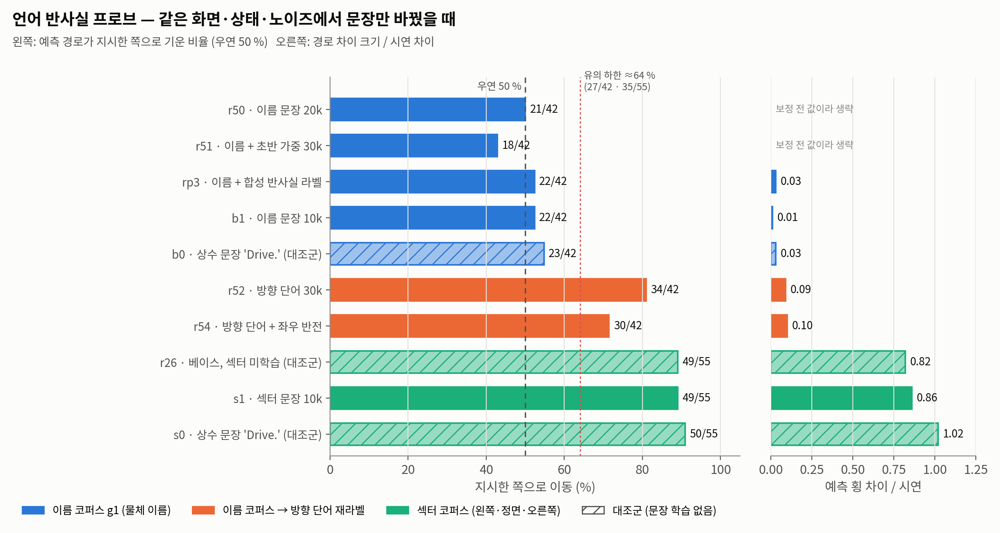

# 연구 경과 보고서 — 2026-10-03 ~ 10-08: 회피 실험 정리와 "말로 지정한 물체로 가기"

> 작성: 2026-10-08. 이 기간의 날짜별 기록을 하나로 묶은 보고서다. 세부 수치와 재현 명령은 각 날짜 문서에 있다.
> 대상 문서: `experiments/goto_object/20261003_1334` ~ `20261008_1014`, `experiments/avoidance/20261003_*`.

## 목차

0. [한 페이지 요약](#0-한-페이지-요약)
1. [출발점 — 10-03 아침까지의 상태](#1-출발점--10-03-아침까지의-상태)
2. [방향 전환 — 왜 "말로 지정한 물체로 가기"인가](#2-방향-전환--왜-말로-지정한-물체로-가기인가)
3. [측정 방법 — 이 기간에 쓴 세 가지 자](#3-측정-방법--이-기간에-쓴-세-가지-자)
4. [단계별 경과](#4-단계별-경과)
5. [이 기간에 발견한 버그와 측정 함정](#5-이-기간에-발견한-버그와-측정-함정)
6. [현재 상태 (10-08 오전)](#6-현재-상태-10-08-오전)
7. [문제 정리 — 원인 후보와 해결 방향](#7-문제-정리--원인-후보와-해결-방향) · [7.1 가설 점검과 사전 기각선](#71-가설-점검--더-모으면-붙는다와-사전-기각선-10-08-1340-추가)
8. [강좌와 논문에 대한 의미](#8-강좌와-논문에-대한-의미)
9. [다음 할 일](#9-다음-할-일)
10. [범위와 주의](#10-범위와-주의)
11. [모델·데이터 이름표](#11-모델데이터-이름표)

---

## 0. 한 페이지 요약

**질문.** SmolVLA(약 450M) 주행 정책에게 문장으로 물체를 지정하면, 그 물체로 가는가?
학습하지 않은 물체("공룡", "멸종한 생물")까지 갈 수 있는가?

**답 (지금까지).**

| # | 단계 | 결과 | 결론 |
|---|---|---|---|
| 1 | 물체 **이름** 문장으로 학습 (r50·r51) | 폐루프 성공 47 %, 우연 29 %. 대부분 가장 가까운 물체로 감. 문장만 바꾸는 프로브에서 지시한 쪽으로 움직인 비율 21/42 (우연) | 정책은 이름을 화면 속 물체에 붙이지 못한다 |
| 2 | 이름을 **방향 단어**로 바꿈 + Qwen 이 이름→방향 변환 (r52) | 오프라인 34/42 로 방향은 맞춘다. 하지만 폐루프에서는 문장과 상관없이 30 회 중 28~30 회가 같은 물체로 감 | 반응 크기가 시연의 0.09 배라 폐루프 결과를 못 바꾼다 |
| 3 | 증폭(guidance)·좌우 반전(r54)·합성 반사실 라벨(rp3) | 어느 것도 반응 크기를 키우지 못함 | 학습 트릭으로는 안 풀린다 |
| 4 | **데이터 검사** (CMI) | 이름 데이터에도 문장 정보가 0.743 bit 있다 (GATE PASS) | 데이터는 원인이 아니다 |
| 5 | **상수 문장 대조군** b0 vs 이름 문장 b1 | 23/42 vs 22/42 — 구별 안 됨 | 이름 문장 학습 효과는 측정되지 않는다 (반증) |
| 6 | 과제 재설계: **왼쪽·정면·오른쪽 3분류** + Qwen 분업 (s1) | 오프라인 49/55, 크기 0.86 배. 그러나 대조군 s0 50/55, 베이스 r26 49/55 | 방향 단어 반응은 차선 주행 때 이미 배운 것. 섹터 학습의 기여는 아직 안 보인다 |
| 7 | 폐루프 SEC 평가 (s1) | 맞는 물체 8/30 = 27 % (우연 33 %). 30 회 중 20 회가 오른쪽 물체 | 섹터 학습도 폐루프 선택을 못 바꾼다. 오른쪽 쏠림이 다음 문제 |

**그 사이 고친 측정 버그 5 개** (5 절): 행동 복원 통계 복사(r26 부터 모든 모델), CMI 축 이름 불일치(CMI 가 한 번도 실행 안 됨),
학습 중 베이스 체크포인트 삭제, 성공 판정이 부풀려진 지표, 장시간 수집 중 리셋 실패 증가.

**이 기간에 가장 크게 배운 것.** 대조군 없이 본 "효과"는 두 번 다 착시였다.
- 10-05: r52 의 "왼쪽 습관"은 정책 문제가 아니라 통계 버그였다.
- 10-08: s1 의 "섹터 학습 효과"는 베이스에 원래 있던 반응이었다.

그래서 이제는 모든 학습을 **상수 문장 대조군과 베이스 모델을 같이** 재는 방식으로 돌린다.

---

## 1. 출발점 — 10-03 아침까지의 상태

### 1.1 시스템

- 정책: SmolVLA = SigLIP 비전 인코더 + SmolVLM2-500M 의 16 층 + action expert(폭 0.75).
  - 입력: 카메라 1 장(512×512 → 시각 토큰 64 개), 문장, 차량 상태.
  - 출력: 30 스텝 × [dx, dy, dyaw] 행동 청크를 flow matching 10 스텝으로 만든다.
- 학습은 2 단계다([finetuning-recipe](../avoidance/20261003_1014_finetuning-recipe.md)).
  - **1 단계 (v3y):** `smolvla_base` 에서 시작해 비전 인코더까지 전체 학습. 손실은 행동만.
  - **2 단계 (r 시리즈):** 비전 인코더는 **고정**. 언어 모델·action expert 는 1e-5, 해설(추론) 헤드는 5e-5. 손실은 행동 + 해설 문장 CE.
- 주행 데모 모델은 **r26** 이다. 이 기간의 모든 학습은 r26 에서 시작했다.
- 추론은 랩서버 GPU(3090 / 4070 Ti), 시뮬은 노트북 Gazebo.

### 1.2 회피 연구의 결론 (10-01 ~ 10-03)

10-03 전까지는 "학습 안 한 물체도 피하는가"를 E2E 로 풀고 있었다. 요약은
[회피 모델 종합표](../avoidance/20261002_1354_avoidance-models-summary.md)와 [지름길 학습](../avoidance/20261002_1414_shortcut-learning.md)에 있다.

| 발견 | 근거 |
|---|---|
| 회피를 배운 것처럼 보인 모델이 실제로는 **트랙 자리**를 외웠다 | 빈 차선에서도 같은 자리에서 꺾음, 출발 거리를 바꿔도 같은 자리(r44) |
| 같은 자리 직진 짝 시연을 넣자 자리 습관은 사라졌다 | r43·r45·r46 빈 차선 0/20 |
| 그러나 장애물 고유 반응은 +0.14~0.27 m 로, 차선 변경 1.8 m 에 한참 못 미친다 | r46 회피 0/20 |
| 짝을 286 쌍·물체 5 종으로 늘리자(r47) 반응은 오히려 줄고, 장애물과 무관하게 **왼쪽으로 1.1 m 쏠렸다** | 모든 회피 시연이 2차선 출발 → 왼쪽이라서 생긴 방향 편향 |
| 해설 헤드는 장애물을 말하지만 행동은 안 바뀐다 | action expert 는 해설 토큰을 읽지 않는 구조 |

10-03 에는 관련 연구 정리도 했다([관련 연구](../avoidance/20261003_0944_vla-shortcut-related-work.md), [문제점 28 가지](../avoidance/20261003_0958_vla-failure-modes-and-fixes.md)).
LIBERO-PRO·LIBERO-Plus 는 표준 점수 90 % 이상인 VLA(OpenVLA, π0)가 **지시문을 무의미한 문자열로 바꿔도 같은 행동을 한다**고 보고했다.
이 "지시문 무시"가 이후 goto 실험에서 그대로 나타났다.

---

## 2. 방향 전환 — 왜 "말로 지정한 물체로 가기"인가

**계기 (10-03 교수님 피드백).**
- 장애물 회피는 YOLO·라이다 규칙으로도 된다. 그래서 VLA 강좌 실습의 중심이 될 수 없다.
- 일반 주행도 YOLO 주행과 눈으로 보면 차이가 없다.
- 1 시간이라도 **VLA 로만 되는 것**을 보여 달라. "공룡 인형을 두고 '멸종한 생물로 가' → 공룡 앞으로" 구상을 좋게 보셨다.

**VLA 로만 되는 것.** 규칙 기반 주행은 명령을 받을 입력이 없다. 반면 VLA 는 문장이 입력이므로 이론상 다음이 가능하다.
1. 같은 화면에서 문장만 바꿔 다른 행동을 하게 한다.
2. 백본 VLM 의 사전학습 지식으로 학습 안 한 이름·설명("멸종한 생물")을 이해한다.

**강좌 실습 계획** (`docs/course/단기강좌.md` 5 페이지):

| 단계 | 내용 |
|---|---|
| ① | 학습한 물체를 이름으로 지정 |
| ② | "차선 따라" vs "곧장" |
| ③ | 학습 안 한 물체 이름 |
| ④ | 설명으로 지정. SmolVLA 단독 vs Qwen2.5-VL + SmolVLA 계층형 비교 |

**일정 제약.** 시뮬 작업은 10-16 까지다. 그 뒤에는 실제 트랙 테스트와 강의 영상 촬영이 있다.

**회피 연구는 정지했다.** 10-03 아침에 시작한 다장애물 120 바퀴 수집 이후 학습·스윕은 하지 않았다.
기록은 `docs/experiments/avoidance/` 에 따로 있다.

---

## 3. 측정 방법 — 이 기간에 쓴 세 가지 자

결과를 읽으려면 무엇을 재는지 먼저 알아야 한다. 세 가지 자는 각각 다른 질문에 답한다.

### 3.1 폐루프 평가 (`goto_trial.py`, `goto_stat_eval.sh`)

시뮬에 물체 2~4 개를 놓고 정책이 실제로 운전하게 한다. 고정 시드로 배치를 만들고 단계별로 30 회씩 돈다.

| 단계 | 내용 | 우연 기준 |
|---|---|---|
| T1 | 학습한 물체, 새 배치 | 1 / 물체 수 (평균 29 %) |
| T2 | 같은 목표에 "곧장" vs "차선 따라" | 45 % |
| E | 물체 2 개를 좌우에 두고 "왼쪽" / "오른쪽" 을 한 번씩 | 짝 두 문장 모두 맞음 25 % |
| SEC | 섹터마다 물체 1 개, 3 문장 | 33 % |

**주의.** "성공"은 목표 중심에서 standoff + 1.5 m 안에 멈춘 경우다. 다른 물체 옆에 서도 목표가 가까우면 성공으로 센다.
그래서 **"목표에 가장 가까이 끝남(chosen_right)"**을 같이 봐야 한다(5.4 절).

### 3.2 언어 반사실 프로브 (`probe_goto_language.py`)

같은 출발에서 문장만 다른 두 에피소드를 짝으로 모아 두었다. 한 에피소드의 3 번째 프레임과 차량 상태, 노이즈 시드를 고정한다.
그 상태에서 문장만 두 에피소드의 것으로 바꿔 행동 청크를 두 번 예측한다. **화면·상태·노이즈가 같으므로 차이는 문장에서만 나온다.**

- **지시한 쪽으로 이동 k/n:** 두 목표가 서로 반대편인 짝에서, 예측 경로의 3 초 뒤 횡 위치가 지시한 쪽으로 기운 비율.
  우연은 50 %. n=42 면 27/42, n=55 면 35/55 이상이어야 우연과 유의하게 다르다(단측 이항검정 p<0.05).
- **예측 횡 차이 / 시연 횡 차이:** 문장을 바꿨을 때 예측 경로가 갈라지는 크기를, 실제 두 시연이 갈라진 크기로 나눈 값.
  1 이면 시연만큼 갈라진다.

방향은 맞아도 크기가 0.1 배면 폐루프에서는 다른 요인(배치, 습관)에 묻힌다. r52 가 그랬다.

### 3.3 조건부 상호정보량 CMI (`measure_cmi.py`)

**정책이 아니라 데이터**를 잰다. 화면·상태가 비슷한 프레임끼리 같은 버킷에 묶는다. 각 버킷 안에서 문장이 교사 행동의 불확실성을 얼마나 줄이는지 bit 로 잰다.

- 0 bit: 화면만 보면 행동이 정해진다. 문장을 읽을 필요가 없는 데이터다.
- 상한 log2(문장 종류 수): 화면이 같아도 문장이 행동을 완전히 결정한다.
- **디바이어스:** 문장을 무작위로 섞은 셔플 대조값을 뺀 값. 표본이 적어 생기는 가짜 정보를 지운다.

CMI 가 높다는 것은 "이 데이터로는 문장을 읽어야 시연을 흉내 낼 수 있다"는 뜻이다. 정책이 실제로 읽는다는 뜻은 아니다.

---

## 4. 단계별 경과

### 4.1 P0 — 자산·오라클·백본 확인 (10-03 오후) · [문서](../goto_object/20261003_1442_goto-p0-assets-oracle-backbone.md)

**왜 백본부터 봤나.** "공룡"을 정책이 알아들으려면 백본 VLM 이 먼저 알아야 한다. 학습 전에 비용 없이 확인할 수 있는 상한이다.

**만든 것.**

| 항목 | 내용 |
|---|---|
| 물체 자산 | 색 꼬깔 5 색, Google Scanned Objects 장난감(공룡 3 종·강아지·말·로봇 피규어), 소화전·의자·쓰레기통 |
| 학습 / 제외 | 학습 플릿 14 종. 제외: 초록 꼬깔(색 일반화), 공룡 3 종(물체 일반화), 로봇 피규어, 사람·초록 해치백 |
| 오라클 | `route_oracle` 에 점 목표(`point`)와 차선 따라 점 목표(`lane_point`) 추가 |
| 수집기 | `collect_corpus --goto-groups`: 같은 출발·같은 배치에서 **목표만 다른 짝** 2 개 |

**백본 확인 결과 (G0).**

| 모델 | 이름 듣고 위치 고르기 | 설명 → 이름 |
|---|---|---|
| SmolVLM2-500M (32 층 전체) | 10/26 = 38 % (우연 33 %) | 0/14 |
| Qwen2.5-VL-3B (서버) | — | **"extinct animal" → "dinosaur" 4/4**, 이름 대기 8/11 |

- SmolVLA 는 SmolVLM2 의 16 층만 쓰므로, 정책이 이름을 접지할 여지는 처음부터 작았다.
- Qwen 이 설명을 이름으로 바꿀 수 있으므로 ④ 계층형을 진행하기로 했다.

**문제와 해결.**
- 출발 yaw 부호가 틀려 시범 에피소드가 전부 반대로 출발했다 → `YAW_OFFSET = -π/2` 로 수정.
- 경로 간섭 검사를 직선으로 했는데 오라클은 원호로 달려 꼬깔에 부딪혔다 → 원호 기준 검사로 변경. 시범 19/20 성공.

### 4.2 r50 — 물체 이름 문장으로 학습 (10-03 ~ 10-04) · [문서](../goto_object/20261004_1534_goto-r50-language-blind.md)

**왜 이 방식인가.** 차선 주행에서 "inner / outer lane" 같은 단어를 짝 시연으로 가르쳤을 때 잘 됐다(분리 27 배).
같은 방식으로 "같은 화면, 다른 이름 → 다른 물체" 짝을 모으면 이름도 배울 것으로 기대했다.

**데이터 g1.** 19 시간 수집, 1 400 회 시도에서 825 ep 를 얻었다. 리셋 실패 40 % 는 gz CLI 가 시간이 지나며 느려진 탓으로 추정한다(5.5 절).
순항 109 ep 를 섞어 953 ep 가 됐다.

**학습.** r26 베이스, 30k step, 3.1 h.

**결과.**

| 지표 | 값 | 우연 |
|---|---|---|
| T1 성공 | 14/30 = 47 % | 29 % |
| T1 에서 가장 가까운 물체로 감 | 19~20/30 | 목표가 가장 가까운 경우는 2/30 뿐 |
| T2 곧장 vs 차선 따라 경로 차이 | 1.25 vs 1.30 m (같음) | — |
| 프로브: 지시한 쪽 | **21/42** | 50 % |
| 프로브: 예측 횡 차이 | 0.023 m (시연 0.545 m) | — |

**해석.** 정책은 문장과 상관없이 **가장 가까운 물체**로 간다. 시연에서 목표가 가장 가까운 물체인 경우가 37 % 로 가장 흔한 단일 패턴이었으므로,
문장을 읽지 않고 고를 수 있는 최선의 전략을 배운 것으로 보인다(지름길 학습).

### 4.3 r51 — 초반 프레임 가중 (10-04)

**왜.** 어느 물체로 갈지는 출발 직후 몇 프레임에서 정해진다. 나머지 프레임은 목표를 향해 직진하므로 문장 없이도 풀린다.
그래서 goto 에피소드의 처음 20 프레임을 6 배로 샘플링했다(`--goto-early-boost`).

**결과.** 반응 크기는 0.02 → 0.06 m 로 조금 커졌지만, 방향은 20/42 → 30k 에서 18/42 로 여전히 우연이다.
문장이 경로를 흔들기는 하지만 지시한 쪽으로 흔들지는 않는다.

### 4.4 r52 — 방향 단어로 바꾸고 Qwen 에게 이름을 맡김 (10-04 ~ 10-05) · [문서](../goto_object/20261005_0028_goto-r52-closed-loop-left-bias.md)

**왜.** 정책이 배운 적 있는 말은 차선 단어(왼쪽·오른쪽)다. 그래서 역할을 나눴다.
- **Qwen(System 2):** 이름·설명 → "왼쪽 물체 / 정면 / 오른쪽, 더 가까운 / 더 먼".
- **SmolVLA(System 1):** 방향 단어만 따른다.

같은 825 ep 에서 문장만 바꿨다(`relabel_goto_pos.py`). Qwen 의 방향 판정은 학습 프레임 16 장에서 15/16 이 맞았다.

**결과.**

| | 값 |
|---|---|
| 오프라인 프로브 (30k) | **34/42** — 처음으로 방향이 우연을 넘음 |
| 폐루프 T1 (오라클 방향 문장 / Qwen 경유) | 둘 다 14/30. **30 회 모두 같은 물체에서 끝남** |
| r50 과 비교 | 30 회 중 28 회 같은 물체 |

문장을 바꿔도, 모델을 바꿔도 같은 물체로 갔다. **폐루프 결과는 배치(화면)가 정한다.**

**증폭(guidance) 시도.** 방향 문장 청크와 방향 없는 문장 청크의 차이를 w 배 키웠다: 청크 = null + w·(cond − null).
- 오프라인: w=3 이면 크기 0.91 배.
- 폐루프 E: 짝 두 문장 모두 맞은 경우 0/20. 거의 매번 **왼쪽 물체**로 갔다.

**왼쪽 쏠림 추적 → 버그 발견.** E 화면 20 장에서 모든 문장의 기준 경로가 0.6~0.9 m 왼쪽이었다. "right" 문장은 20 장 중 한 번도 오른쪽으로 가지 않았다.
- 처음에는 데이터 불균형(왼쪽 목표 278 / 오른쪽 211)과 반시계 트랙 습관을 의심해 좌우 반전 학습 r54 를 준비했다.
- 그런데 좌우를 뒤집은 화면에서도 쏠림이 똑같았다. 화면 내용과 무관하다는 뜻이다.
- 원인: `train_reasoning.py` 가 행동을 원래 단위로 되돌리는 통계(postprocessor)를 **베이스 체크포인트에서 그대로 복사**하고 있었다(5.1 절).
- 교정하자 기준 경로가 ±0.02 m 로 돌아왔다.

**교정 후 재평가.**

| | r52 30k | r54 15k (좌우 반전 + null 문장) |
|---|---|---|
| 프로브 방향 | 34/42 | 30/42 |
| 프로브 크기 (w=1) | **0.09 배** | 0.10 배 |
| 폐루프 E 짝 모두 맞음 (우연 25 %) | 4/20 | 2/20 |
| T1:pos 목표에 가장 가까이 끝남 (우연 29 %) | 13/40 = 33 % | 11/40 = 28 % |

**결론.** 방향 단어는 오프라인에서 방향은 맞추지만, 크기가 시연의 0.1 배라 폐루프 선택을 바꾸지 못한다.
좌우 반전과 null 문장 학습도 크기를 키우지 못했다.

### 4.5 rp1 ~ rp3 — 합성 반사실 행동 라벨 (10-05) · [문서](../goto_object/20261005_2131_cf-align-gv2b-cmi.md)

**왜.** 실제 짝 시연은 한 배치에서 2 개뿐이다. 운동학 교사(`goto_kinematic`)로 "같은 화면에서 다른 물체를 지정했으면 이렇게 갔을 것"이라는
행동 라벨을 모든 프레임·모든 물체에 대해 합성하면, 정책이 같은 화면에서 문장마다 다른 행동을 더 많이 보게 된다(cf-sidecar).

**결과.** rp3(10k) 이름 프로브 **22/42**, 크기 0.03 배. r52 보다도 나쁘다.

**버그부터 의심 → 정렬 검사.** 라벨이 엉뚱한 프레임에 붙었을 수 있어 `cf_align.py` 로 8 ep × 7 지점을 대조했다.
**불일치 0.** 모든 ep 에서 행 수가 정확히 15 적은 것은 꼬리의 고정 절단이다. 따라서 rp3 의 음성 결과는 실제 결과다.

**유력한 원인 (분리 안 됨).** 운동학 교사가 굽은 접근에서 횡 이동을 실제보다 약 55 % 적게 낸다(실제 0.497 / 0.482 m vs 교사 0.292 / 0.216 m, n=3).
가르치려는 "이름이 바뀌면 경로가 이만큼 달라진다"는 대조 자체가 작았다.

**부수 사고.** rp2 는 5000 step 첫 저장에서 죽었다. 디스크 정리 중 베이스 rp1 을 지웠기 때문이다(5.3 절).

### 4.6 데이터 검사 — CMI (10-05 ~ 10-07)

**왜.** 여러 방식이 다 실패했다. 남은 가능성 중 하나는 "**데이터 자체에 문장을 읽어야 할 이유가 없다**"는 것이다.
예를 들어 대부분의 장면에서 화면만 봐도 목표가 정해진다면, 정책이 문장을 무시하는 것이 합리적이다.

**발견: CMI 가 한 번도 실행된 적이 없었다.** 에피소드 메타의 축 이름(`goto_target`)과 측정 스크립트의 축 이름(`ordinal`)이 달라 전부 걸러졌다.
그런데 메시지는 늘 "리샘플을 먼저 돌려라"여서 다른 문제로 보였다(5.2 절).

**새 수집 gv2b (68 ep).** gv2pilot 은 verify FAIL 이었다. 세 가지를 고쳐 PASS 했다.
- 물체 간 최소 각도를 물체 수별로 18/14/11° 로 설정. 평탄 16° 면 물체 4 개 배치 성공률이 0.5 % 라 불가능했다.
- 플릿을 그룹마다 회전 선택. 무작위로 고르면 큰 물체(차량)가 배치에서 자주 탈락했다.
- 수집 중 시뮬 창 보기를 허용하고, 그때는 RAM 하한을 2.0 G 로 자동 상향.

**CMI 결과.**

| 코퍼스 | 디바이어스 평균 / 중앙값 | 셔플 대조 | 상한 | GATE |
|---|---|---|---|---|
| **g1** (r50·rp·b 의 학습 데이터) | **0.743 / 0.785 b** | 0.104 b | 3.81 b | PASS |
| gv2b | 0.965 / 0.909 b | 0.195 b | 3.81 b | PASS |

**결론.** 실패한 모델들이 학습한 g1 에도 문장 정보가 0.743 bit 있다. **"데이터에 언어 의존성이 없어서"는 원인이 아니다.**
그래서 11 시간짜리 본 수집을 돌리지 않고 기준선부터 돌렸다.

### 4.7 기준선 b1 / b0 — 핵심 결과 (10-07) · [문서](../goto_object/20261007_1010_vision-action-baseline.md)

**왜.** 지금까지 "언어 효과가 작다"고만 말할 수 있었다. 문장에 반응할 수 없는 모델의 프로브 값을 모르니, 0.03 배가 측정 노이즈인지 작은 효과인지 구별할 수 없었다.

**설계.** 데이터(g1)·베이스(r26)·step(10k)·배치(16)·CE 가중(0.2)을 모두 같게 하고 **딱 하나**만 바꿨다.
b0 은 모든 학습 샘플의 문장을 상수 `Drive.` 로 덮었다(`--blank-task`).

**먼저 배선 점검.** 이 프로젝트에서 "모델이 X 를 못 배운다"가 두 번이나 배선 버그였다. 그래서 `reasoning_policy.forward` 를 먼저 읽었다.
언어 토큰은 prefix 에 있고 action expert 가 그 prefix 에 어텐션한다. stock SmolVLA 와 같았다.

**결과.**

| 런 | 문장 | 지시한 쪽 | 크기 |
|---|---|---|---|
| b1 | 이름 문장 | **22/42** | 0.01 배 |
| b0 | 상수 `Drive.` | **23/42** | 0.03 배 |

b0 은 문장에 조건화된 적이 없으므로 23/42 가 이 프로브의 **노이즈 하한**이다. b1 은 정확히 그 하한에 있다.
**이 설정에서 "이름 문장이 행동에 기여한다"는 반증됐다.**

**한 가지 비대칭 (엄밀하지 않음).** 같은 프로브를 r52 의 `goto_mode`(곧장 vs 차선 따라) 축에 적용하면 크기가 **0.67 배**였다.
같은 체크포인트의 이름 축은 우연이다. 정책은 "화면 전체에 걸린 2 지 결정"은 따르고, "화면 속 여러 물체 중 하나를 이름으로 고르기"는 못 한다.
단 r52 의 상수 문장 대조군이 없어 학습량 때문인지 축이 쉬워서인지 분리되지 않았다.

### 4.8 과제 재설계 — 섹터 3분류 + VLM 분업 (10-07)

**사용자 결정 (10-07).**
- 실습을 "측정과 분석 수업"으로 바꾸는 안은 제외. 학생은 "이게 VLA 구나"를 눈으로 봐야 한다. 음성 결과는 논문 재료로 보존한다.
- 목표를 state 좌표 채널로 주는 안은 폐기. v8g 에서 "채널은 들리는데 도달 실패"였고, 픽셀 전용 정책 전제를 버리는 비용이 크다.
- 이산 모드(실습 1)는 이미 제작 완료.
- **실습 2 = 왼쪽·정면·오른쪽 3지 방향 + VLM 분업** 을 채택.

| 담당 | 하는 일 | 근거 |
|---|---|---|
| Qwen2.5-VL (서버) | 장면에서 지시 대상이 어느 섹터인지 판단 → 왼쪽/정면/오른쪽 | "extinct animal" → "dinosaur" 4/4, 방향 판정 15/16 |
| SmolVLA | 3지 방향 → 선회 → 접근 → 정차 | 접근·정차는 r50 에서 이미 됨 |

**r52 와 무엇이 다른가 (성공 조건).** r52 도 방향 단어였지만 "왼쪽" 안에 14° 6 m 물체와 25° 10 m 물체가 섞여 있었다.
같은 단어에 대한 시연 경로가 제각각이었다. 차선 단어가 잘 된 것은 그 반대로, 단어 하나에 경로가 사실상 하나였기 때문이다.
그래서 **같은 단어 안의 경로 차이를 줄이도록 배치를 설계**했다.

| 설계 | 값 | 이유 |
|---|---|---|
| 섹터 중심 | −20° / 0° / +20°, 띠 ±3° | 카메라에서 쓸 수 있는 방위는 ±25.1° 뿐 |
| 배치 | 섹터마다 물체 정확히 1 개 | 단어와 물체가 1 대 1 |
| 거리 | 가까운 띠 7~8 m / 먼 띠 11.5~12.5 m 를 매번 섞어 배정 | 거리로 섹터를 맞힐 수 없게. 등거리면 인접 물체가 너무 붙어 배치 불가(4d 절 계산) |
| 문장 | 섹터만 말하고 물체 이름은 절대 넣지 않음. 영어 5 + 한국어 3 | 이름 접지를 과제에서 빼기 위해 |
| 차량 제외 | 반지름이 커서 어떤 물체와도 간격 확보 불가 | 2 만 회 추첨에서 배치 위반 0 |

**파일럿 sec1 (35 ep).** verify PASS, 문장 균형 1.1 배. CMI 중앙값 **1.203 b = 상한 1.58 b 의 76 %**.
이름 코퍼스는 21~24 % 였다. 학습 문제 자체가 훨씬 잘 정의됐다.

**사용자 지적 (16:00).** 거리 띠를 섞으면 같은 "정면" 안에서도 제동 시점이 달라진다. 조향 분산은 줄였지만 속도 분산은 못 줄였다.
띠를 8.5~9.5 / 12~13 m 로 좁히는 타협안을 계산해 두었다. 하지만 본 수집이 진행 중이었고, 효과를 따로 구별하려고 이번에는 바꾸지 않았다.

### 4.9 섹터 본 수집과 s1 / s0 학습 (10-07 저녁 ~ 10-08) · [문서](../goto_object/20261008_1014_sector-s1-s0-inherited-from-base.md)

**수집.** 600 ep 중 588 성공(98 %). 첫 finalize 는 FAIL 이었고, 문제 ep 를 뺀 313 ep 로 다시 돌려 PASS 했다.
최종 `packed_sec` 292 ep, 105 그룹 전부 완성, 문장 균형 1.0 배. CMI 중앙값 0.907 b(상한의 57 %). 파일럿 76 % 보다 낮지만 이름 코퍼스보다 높다.

**학습.** 처음부터 대조군과 짝으로 돌렸다. s1(섹터 문장)과 s0(상수 `Drive.`), 둘 다 r26 에서 10k.

**결과와 오늘 확인한 것.**

| 모델 | 섹터 데이터 | 지시한 쪽 (n=55) | 크기 |
|---|---|---|---|
| s1 | 학습 | 49/55 | 0.86 배 |
| s0 (대조군) | 학습, 문장은 상수 | 50/55 | 1.02 배 |
| **r26 (베이스, 오늘 측정)** | **안 봄** | **49/55** | 0.82 배 |

처음 s1 의 49/55 를 보면 "섹터 설계가 통했다"고 읽기 쉽다. 그러나 문장을 학습하지 않은 s0 도, 섹터 데이터를 본 적 없는 r26 도 같다.
**이 반응은 r26 이 차선 주행 때 배운 "왼쪽/오른쪽" 단어에서 온다.** 섹터 문장에 같은 단어가 들어 있다.
s0 의 학습 문장 `Drive.` 에는 방향 단어가 없으므로 10k step 동안 그 반응이 지워지지도 않았다.

이것이 의미하는 바는 두 가지다.
- 좋은 소식: SmolVLA 는 **이미** 방향 단어에 크게 반응한다(시연의 0.8 배). 이름 축의 0.01~0.03 배와 차원이 다르다.
- 아직 모르는 것: 섹터 데이터가 무엇을 더했는가. 폐루프에서 s1 이 s0·r26 보다 맞는 물체로 더 잘 가는지 봐야 한다.

**r52 와의 차이는 미해결이다.** 같은 r26 베이스인데 r52 는 이름 코퍼스 짝에서 크기 0.09 배였다. 섹터 짝은 베이스만으로 0.82 배다.
목표 방위 분포의 차이, 문장 형식, r52 의 30k 추가 학습 중 무엇이 원인인지 확인하지 않았다.

---

## 5. 이 기간에 발견한 버그와 측정 함정

결과 해석을 두 번 뒤집은 원인이 모두 측정 쪽에 있었다. 앞으로 같은 실수를 막으려고 따로 모은다.

| # | 버그 | 증상 | 영향 범위 | 조치 |
|---|---|---|---|---|
| 5.1 | **postprocessor 통계 복사** — `train_reasoning.py` 가 행동 복원 통계를 베이스에서 복사 | 모든 화면·문장에서 3 s 에 +0.6 m 왼쪽, 속도 약 3 배 | **r26 부터 모든 r 모델** | `fix_postproc_stats.py` 로 r50~r54 교정, 트레이너 수정. r26 은 데모 모델이라 손대지 않음 |
| 5.2 | **CMI 축 이름 불일치** | CMI 가 늘 "리샘플 먼저" 메시지로 빈 결과 | 지금까지 모든 goto 수집 | `AXIS_ALIAS` 추가, 빈 결과 메시지 두 경우로 분리 |
| 5.3 | **베이스 삭제** — `save()` 가 저장 때마다 베이스에서 부수 파일을 읽음 | rp2 가 5000 step 첫 저장에서 사망 | rp2 | 시작 시 스냅샷. b1·b0 에서 저장 통과 확인 |
| 5.4 | **성공 지표 부풀림** — standoff + 1.5 m 안이면 성공 | r52 T1:pos 성공 73 % 인데 맞는 물체 선택은 33 %(우연 29 %) | 모든 goto 폐루프 | "가장 가까이 끝남(chosen_right)"을 주 지표로 |
| 5.5 | **장시간 리셋 실패** — gz CLI 조회 지연 추정 | 100 ep 당 리셋 실패 0 → 84 로 증가 | g1 수집 (40 % 손실) | 조회 타임아웃 6 s·2 회, 평가 리셋 3 회 재시도 |
| 5.6 | 평가 에러 출력이 grep 에 걸러짐 | T3b·T4·T3a 가 10 초 만에 결과 없이 끝남 | r52 단계 | Traceback 을 남기게 수정. 재실행은 안 함 |
| 5.7 | `--floor-groups` 가 goto 가 아니라 주차 요청으로 하한을 만듦 | 하한이 1.1 m 로 커져 goto 짝이 줄줄이 FAIL | 수집 검증 | 0 으로 둠. goto 기반 하한은 미구현 |

**공통 교훈.**
1. 결과가 "모델이 못 한다"로 나오면, 먼저 측정·배선 버그를 의심한다. 이 기간에만 두 번 그랬다.
2. 버그를 고친 뒤에도 **대조군 없이 본 효과는 믿지 않는다.** b0·s0·r26 이 없었다면 두 번 다 틀린 결론을 냈다.
3. 오프라인 프로브의 방향이 맞아도 크기가 작으면 폐루프는 안 바뀐다. 두 자를 같이 본다.

---

## 6. 현재 상태 (10-08 오전)

**폐루프 SEC 평가**, s1 10k, 30 회 (`eval_out/course/goto_eval/s1_sec_SEC.jsonl`).

**결과 (10:26 종료, n=30).**

| 지표 | 값 | 우연 |
|---|---|---|
| 목표에 가장 가까이 끝남 (chosen_right) | **8/30 = 27 %** [14, 45] (Wilson 95 %) | 33 % |
| 성공 (standoff + 1.5 m, 부풀려진 지표) | 11/30 | — |
| 엄격 성공 | 0/30 | — |
| 종료 형태 | 정차 19 · 시간초과 8 · 충돌 2 · 트랙 밖 1 | — |
| 문장별 맞음 | 왼쪽 2/10 · 정면 1/10 · **오른쪽 5/10** | — |
| 실제로 간 물체의 섹터 (출발 방향 기준 추정) | **오른쪽 20** · 왼쪽 6 · 정면 4 | — |

- **우연 수준이다.** 오프라인 49/55 의 방향 반응이 폐루프 선택으로 이어지지 않았다. r52 와 같은 그림이다.
- 문장과 상관없이 **오른쪽 물체로 가는 쏠림**이 있다(30 회 중 20 회). 통계 교정 후 r52 폐루프 E 에서도 "거의 매번 오른쪽"이었다. 원인은 확인하지 않았다.
- 섹터 방위는 출발 경로의 첫 두 점으로 추정한 값이라 대략적이다.
- s0·r26 폐루프는 아직 돌리지 않았다. s1 이 우연이므로 섹터 학습 효과를 따지기 전에 **왜 오른쪽으로 가는지**가 먼저다.
- `goto_analyze.py` 가 SEC 단계 이름을 숫자로 읽다가 실패했다(`int(tier[1])`). 위 수치는 jsonl 에서 직접 계산했다.

**서버 상태:** 디스크 여유 5.5 G(학습 체크포인트 하나 1.05 GB). 남은 학습 런은 r52·rp3·b0·b1·s0·s1.

**3 시간 루프:** `tools/goto_loop_chain.sh` 가 새 체크포인트를 자동으로 통계 교정하고 프로브한다. 시뮬이 떠 있으면 수집·폐루프는 건드리지 않는다.

---

## 7. 문제 정리 — 원인 후보와 해결 방향

| 문제 | 지금까지의 근거 | 원인 후보 | 시도 | 상태 | 다음 |
|---|---|---|---|---|---|
| **이름 → 물체 접지 실패** | b1 22/42 = b0 23/42, 데이터 CMI 0.743 b | (a) 백본 16 층의 이름 위치 접지 능력이 우연 수준(G0 10/26) (b) 시각 토큰 64 개, 20 m 물체가 한 칸의 1/4 (c) 2 단계에서 비전 인코더 고정 | 초반 가중, 합성 라벨, 좌우 반전, 증폭 | **반증됨** (이 설정에서) | 정책에서 이름 접지를 빼고 VLM 에 맡김 (섹터 분업) |
| 방향 단어 반응이 폐루프를 못 바꿈 (r52) | 오프라인 34/42 인데 크기 0.09 배 | 같은 단어 안 경로 분산이 큼 | 증폭 w=3, r54 | 크기 안 커짐 | 섹터 설계로 분산 축소 |
| **섹터 학습 효과가 베이스와 구별 안 됨** | s1 49 = s0 50 = r26 49 /55 | 방향 단어 반응은 r26 이 이미 가짐 | — | s1 폐루프 27 % (우연) | 오른쪽 쏠림 원인부터, 그다음 s0·r26 비교 |
| 같은 섹터 안 제동 시점 분산 | 거리 띠 7~8 / 11.5~12.5 m | 사용자 지적 | 띠 좁힌 안 계산 | 보류 | 폐루프에서 정차 실패가 많으면 다음 수집에서 띠 축소 |
| 해설은 장애물·물체를 말하지만 행동은 안 바뀜 | r38 해설 43~47 %, 행동 무반응 | action expert 가 해설 토큰을 안 읽는 구조 | — | 확인만 | 같은 프레임 두 문장의 해설이 지시한 이름을 내는지(학습 불필요) |
| 수집 효율 | g1 리셋 실패 40 %, sec 완성 그룹 100/200 | gz CLI 지연, 그룹 하나만 빠져도 미완성 | 타임아웃·재시도 | 일부 해결 | sec 첫 finalize FAIL 원인 확인 |
| 서버 디스크 | 여유 5.5 G | 런마다 체크포인트 1 GB | 10-05 USB 아카이브(77 G) | 빠듯함 | 끝난 런 정리(승인 후) |

### 7.1 가설 점검 — "더 모으면 붙는다"와 사전 기각선 (10-08 13:40 추가)

회피(10-02 결정)부터 goto 까지 다음 단계는 여러 번 "더 수집"이었다. 그 밑에는 **"언어·장애물 반응이 안 붙는 건 데이터가 부족하거나 덜
깨끗해서다"** 라는 가설이 깔려 있었다. 이 가설은 한 번도 기각선을 정해 두고 시험한 적이 없다. 지금까지 나온 숫자는 아래와 같다.

| 데이터를 늘리거나 바꾼 실험 | 고유 반응 (대조군과의 차이) | 대조군 쪽 변화 |
|---|---|---|
| 회피 스윕, 박스 5 → 80 개 (10-01) | +0.5 ~ 0.7 m 에 머묾 | 빈 차선 위치 습관 80 개에서 2.3 m 로 커짐 |
| r46 → r47, 짝 137 → 286, 물체 5 종 (10-03) | +0.27 → **+0.14 m** 로 줄어듦 | 빈 차선 쏠림 +0.42 → **+1.10 m** |
| r43, 같은 자리 직진 짝 (10-02) | 회피 3/97 | 빈 차선 꺾음 0/100 — 습관과 함께 회피도 사라짐 |
| g1 이름 문장 b1 vs 상수 문장 b0 (CMI 0.743 b) | 22/42 vs 23/42 — 차이 없음 | — |
| 섹터 본 수집 s1 vs s0 vs 베이스 r26 (CMI 0.891 b) | 49 vs 50 vs 49 /55 — 차이 없음 | 폐루프 s1 8/30, 오른쪽 20/30 |

가설이 맞다면 "데이터를 늘리면 고유 반응이 커지고 대조군은 평평하다"가 나와야 한다. 한 번도 나오지 않았다. 나온 것은 그 반대인
"고유 반응은 그대로거나 줄고, 장애물·문장과 무관한 쏠림이 커진다"이다.

**대안 가설.** 학습 손실을 줄이는 가장 싼 길이 화면 자리·방향 사전확률·베이스에 이미 있던 반응이면 모델은 그 길로 간다. 문장을 읽어야만
손실이 줄어드는 학습 목표를 준 적이 없다. 이 가설은 위 표 전체와 함께 다음 두 가지도 설명한다.
- 2 지 전역 모드 단어는 듣는데 이름 접지는 못 한다.
- 섹터 반응은 r26 의 차선 단어에서 물려받은 것이다.

**단서.** 시험한 규모는 g1 185 635 프레임(회피 v47r 232 230 프레임)까지다. 사전학습 규모에 비하면 작으므로 "충분히 크면 된다"가
엄밀히 반증된 것은 아니다. 그렇다고 기각선 없이 두면 이 가설은 반증할 수 없는 주장이 된다. 그래서 아래 기각선을 먼저 적는다.

**사전 기각선 (실험 전에 고정, 결과를 본 뒤 바꾸지 않는다).**

| 항목 | 값 |
|---|---|
| 설정 | g1 goto 설정 고정: r26 베이스, 10k step, bs16, ce 0.2. 바꾸는 것은 데이터 양 N 하나 |
| 짝 | 모든 N 에서 **b1(이름 문장)과 b0(`--blank-task Drive.`)을 같은 조건으로** 학습 |
| 측정 | `probe_goto_language.py` 이름 축, 같은 프레임 세트(n=42) |
| **기각 1** | 가장 큰 N 에서 b1 이 유의선 **27/42**(n=55 프로브면 **35/55**) 미만이면 기각 |
| **기각 2** | 가장 큰 N 에서 b1 − b0 가 b0 끼리 시드만 바꾼 차이보다 크지 않으면 기각 |
| **기각 3** | N 이 커질 때 b1 − b0 가 커지는 추세가 없으면(작은 N 보다 크지 않으면) "더 모으기"는 근거 없음 |
| 기각되면 | 수집량을 늘리는 다음 단계는 쓰지 않는다. 학습 목표·구조(대조 손실, 비전 동결 해제, VLM 번역 경로)로 간다 |

원래 기각선은 "4N(g1 의 4 배)에서 b1 < 35/55 면 기각"이었다. 4N 은 약 74 만 프레임이다. g1 수집 속도(19 시간에 825 ep)로는
추가 수집만 60 시간 안팎이 걸려 10-16 전에 불가능하다. 그래서 먼저 **있는 데이터로 N/4 · N/2 · N 을 잰다(기각 3).**
이 범위에서 추세가 없으면 4N 까지 모을 근거가 없다. 추세가 있으면 그때 4N 수집 여부를 다시 정한다.

---

## 8. 강좌와 논문에 대한 의미

### 8.1 강좌

- **실습 1 (이산 모드, 차선·속도·곧장/차선 따라):** 제작 완료. 차선 단어 분리 27 배라는 측정값이 있다.
- **실습 2 (말로 지정한 물체):** "Qwen 이 이름·설명을 방향으로 → SmolVLA 가 그 방향으로 접근·정차" 계층형으로 설계.
  - 강좌에서 정직하게 말해야 할 것: 세상 지식("멸종한 생물 = 공룡")은 **Qwen** 이 제공한다. SmolVLA 는 3지 방향 단어를 따른다.
  - 오늘 결과로 서술이 하나 더 바뀔 수 있다. 방향 단어 반응이 섹터 학습이 아니라 **차선 주행 학습에서 이미 생긴 것**이라면, 그렇게 말해야 한다.
- 10-02 의 "E2E 만, 인지 분리형 금지"는 **회피 과제**에 대한 결정이었다. goto 실습 2 의 계층형은 10-07 사용자 지시로 의도적으로 번복됐다.

### 8.2 논문·연구 재료

같은 설정에서 다음 세 가지를 한 묶음으로 잰 음성 결과는 흔하지 않다.
1. **데이터에 정보가 있다:** CMI 디바이어스 0.743 b, 셔플 대조 0.104 b.
2. **토큰이 도달한다:** 문장을 바꾸면 출력이 0 이 아니게 변하고, 배선은 stock 과 같다.
3. **그런데도 상수 문장 기준선과 구별되지 않는다:** 22/42 vs 23/42.

여기에 다음 대비가 붙는다.
- 이름 접지는 실패한다.
- 방향·모드 같은 화면 전역의 이산 결정은 크게 반응한다(0.67~0.86 배).

이 대비는 LIBERO-PRO·Plus 가 큰 VLA 에서 보고한 "지시문 무시"를 소형 VLA 폐루프 주행에서, **대조군과 데이터 측정을 갖춰** 보인 사례가 된다.
단 조건 하나(r26 베이스, 10k, 특정 플릿)에서의 결과임을 함께 적어야 한다.

---

## 9. 다음 할 일

우선순위 순. 10-16 시뮬 마감 기준이다.

1. **오른쪽 쏠림 진단.** s1 폐루프가 30 회 중 20 회 오른쪽 물체로 갔다. r52 때처럼 SEC 출발 화면에 왼쪽/정면/오른쪽 문장을 넣어
   기준 경로가 어느 쪽으로 기우는지 본다(`probe_frames.py`, 학습 불필요). 통계 불일치·데이터 편향·서빙 쪽 차이를 차례로 배제한다.
2. **그다음 폐루프 SEC 를 s0 · r26(통계 교정 사본)으로 같은 시드에서 비교.** s1 이 우연이므로 셋이 같을 가능성이 높지만, 대조군 없이 결론 내지 않는다.
3. **Qwen → 섹터 → 정책 전체 경로 폐루프 시험.** (1 이 풀린 뒤) 공룡(학습 제외)으로 "멸종한 생물로 가" T4 를 섹터 배치에서 돌린다. 강좌 시연의 본체다.
4. 해설 프로브(학습 불필요): 같은 프레임·다른 이름 문장에서 해설이 지시한 이름을 내는지.
5. ~~정차 분산이 문제로 보이면 거리 띠를 8.5~9.5 / 12~13 m 로 좁혀 재수집.~~ → **수집을 다음 단계로 쓰기 전에 7.1 절 기각선부터 잰다.**
   g1 의 N/4 · N/2 · N 에서 b1/b0 짝(N 은 b1·b0 이 이미 있으므로 새 런 4 개). 기각되면 재수집 항목은 지운다.
   - 같은 원칙으로 cf-sidecar 재시도: 운동학 교사의 횡 이동을 실제 시연 수준(굽은 접근 약 0.49 m, 4.5 절)으로 맞춰 다시 학습해,
     rp3 의 실패가 대조 라벨 방식 탓인지 약한 교사 탓인지 가른다. 기각선: 맞춘 교사로도 이름 프로브가 b0 과 구별되지 않으면(27/42 미만) 대조 라벨 방식을 기각.
6. 섹터 수집 첫 finalize FAIL 원인 확인, goto 요청 기반 노이즈 하한 구현.
7. 실제 트랙 이전 준비: 카메라 시점·조명 무작위화(문제점 28 가지 C 절이 실제 트랙에서 가장 큰 위험으로 꼽은 항목).

---

## 10. 범위와 주의

- 프로브 수치는 모두 **오프라인 한 프레임**(같은 화면·상태·노이즈, n=42 또는 55 짝)에서 잰 것이다. 폐루프 수치는 표에 따로 표시했다.
- CMI 는 **시연 데이터**의 성질이다. 정책의 언어 이해에 대한 근거가 아니다.
- 지시는 열린 자연어가 아니다. 이름 축은 학습 플릿 14 종 중 시야 안 2~4 개, 섹터 축은 3 개 단어 묶음이다.
- "반증됐다"는 r26 베이스·10k step·bs16·ce 0.2·g1 데이터라는 조건 하나에서의 결론이다. 다른 백본·학습량·조건화 방식에 일반화하지 않는다.
- r26 의 측정값은 통계 불일치가 있는 원본으로 쟀다. 방향 판정은 영향이 작지만 크기 값은 그대로 믿을 수 없다.

---

## 11. 모델·데이터 이름표

| 이름 | 무엇 | 베이스 / step | 핵심 결과 |
|---|---|---|---|
| r26 | 차선 주행 데모 모델 (추론 공동학습) | v3y 계열 | 모든 goto 학습의 시작점, 섹터 프로브 49/55 |
| g1 | 이름 코퍼스 825 ep + 순항 109 + 시범 19 | — | CMI 0.743 b |
| g2 / g3 | g1 문장을 방향 단어로 / + null 문장 사본 206 | — | — |
| gv2b | 이름 코퍼스 v2 (68 ep, 서버 미전송) | — | CMI 0.965 b |
| packed_sec (g4) | 섹터 코퍼스 292 ep + 순항 | — | CMI 0.891 b (중앙값 0.907) |
| r50 | g1 이름 문장 | r26 / 30k | T1 47 %, 프로브 21/42 |
| r51 | r50 + 초반 6 배 가중 | r26 / 30k | 18/42 |
| r52 | g2 방향 단어 + 초반 가중 | r26 / 30k | 34/42, 0.09 배, 폐루프 우연 |
| r54 | g3 + 좌우 반전 0.5 | r52 / +15k | 30/42, 0.10 배 |
| rp1~rp3 | 합성 반사실 라벨(cf-sidecar) | r26 / 5k~10k | rp3 22/42, rp2 사망 |
| b1 / b0 | g1 이름 문장 / 상수 `Drive.` | r26 / 10k | 22/42 / 23/42 |
| s1 / s0 | 섹터 문장 / 상수 `Drive.` | r26 / 10k | 49/55 / 50/55 |
| Qwen2.5-VL-3B | 서버 System 2 | — | 설명 → 이름 4/4, 방향 15/16 |

그림 생성: `python3 docs/experiments/reports/figures/src/fig_report_1008.py` (study 의 공통 스타일 사용).
