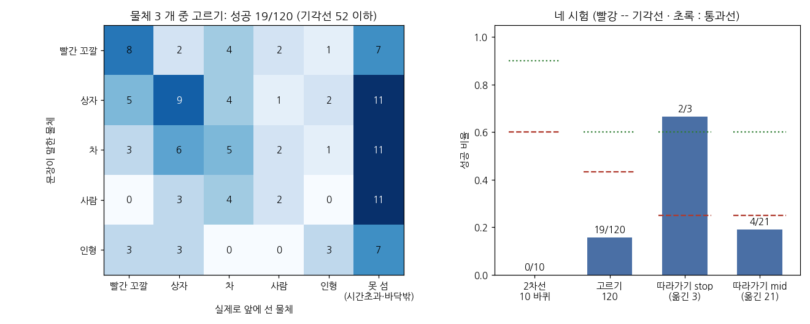

# 오프라인 실습 다시: 물체 3 개 + 문장 두 개 방식 학습 → 고르기 · 움직이는 물체 따라가기 (사전 등록)

2026-11-16 14:26 · 앞 점검 [20261116_1057](20261116_1057_online-offline-practice-pipeline-prereg.md) 의 오프라인 쪽을 멈추고 지운 뒤 새로 한다.

## 왜 다시 하나
- 앞 점검은 오프라인 물체 과제를 **물체 1 개 앞에 서기**로 줄였다. 이건 과제를 잘못 줄인 것이다.
- 사용자 정정 (11-16 오후):
  - 오프라인 과제 = 물체 3 개 중 말한 물체로 가서 서기.
  - 물체 1 개로만 학습하면 "그냥 물건 앞으로 가기"만 배운다. 그래서 세 물체 이름을 말해도 모두 한 물체로 간다.
  - 그래서 학습은 물체 3 개 장면에 문장 두 개 방식 (반사실 이름 손실, gcf300 112/120) 으로 했다.
  - "물체 앞으로 가 줘" 했을 때 물체가 움직이면 따라가는지는 **학습하지 않는다.** 일반화로 확인만 한다.
- 지운 것 (14:14):
  - 오프라인 에피소드 70 개, 모델 lane2+stop1-nostate-colab-20laps50ep, 평가 녹화, 업로드 zip.
  - 서버 쪽 변환본 · 원본 · 체크포인트 (학습 로그만 남김).
  - 그때까지의 결과:

    | 시험 | 결과 |
    |---|---|
    | 2차선 | 10/10 |
    | 물체 1 개 앞 서기 | 6/33 에서 멈춤 (대부분 시간 초과, 물체를 지나쳐 뒤쪽 150°) |

- 온라인 쪽은 그대로 둔다 (drive-colab-30laps).

## 1. 바꾼 것 (ros2_vla, 11-16 14시)

| 곳 | 바꾼 것 |
|---|---|
| `commands.py` 오프라인 과정 | `oracle_k` 1 → **3**, `name_cf: True` |
| 수집 GUI 오라클 | 물체 3 개 조합 (5C3 = 10) 을 차례로. 장면 안 물체마다 한 번씩 목표 → 30 ep 마다 물체마다 목표 6 번. 다시 띄워도 이어서 셈 |
| 변환 `convert_to_lerobot.py` | 오프라인이면 `--ground-labels` 를 저절로 켬 (정답 방위 파일). 물체 문장에 이름이 없으면 경고, 실차 (위치 없음) 녹화는 보조 손실에서 빠진다고 알림 |
| `colab/train_ground.py` (새, tools 판 복사) | 반사실 이름 손실. **Colab 판은 반사실 패스의 영상 인코더를 기울기 없이** 계산 (T4 한도 14.7 GB 에서 batch 4 가 메모리 부족이었음, 14:21) |
| `train_fp16.py` | 데이터 폴더에 `ground_labels.npy` 가 있으면 `train_ground.py` 를 저절로 씀 (W 0.5 = gcf300) |
| `pack_for_colab.py` · `dataset.py` | 오프라인 요약에 목표 물체별 수 · 장면 물체 수 · 이름 없는 문장 경고 |
| **노트북 학습 스튜디오** `./train_studio.sh` (새) | 모은 데이터 확인 (문장 · 물체별 수 · 경고) → Colab 용 zip → Colab 학습 화면 열기 → 받은 모델 zip 가져오기 (md5) → 시험 주행 (`ros2vla.sh up --course`) |
| **Colab 학습 화면** `colab/train_studio.ipynb` (새) | 셀 2 개. 버튼 화면: ① 풀고 확인 → ② 학습 시작 (변환 + 전체 학습, loss 그래프 · 남은 시간 · 멈추기 · 이어서) → ③ 모델 받기. 명령은 `train_smolvla.ipynb` 와 같다 |
| `tools/check_follow_move.py` (새) | 움직이는 물체 따라가기 시험 (아래) |

**T4 한도 확인 (서버 3090 을 14.7 GB 로 묶음)**
- 처음엔 batch 4 가 메모리 부족이었다.
- 영상 인코더를 기울기 없이 바꾼 뒤 batch 4 가 들어갔다: 12.9 GB, 0.43 s/step.
- 문장 두 개 방식 없이는 0.32 s/step 이었다.

## 2. 점검 모델

| 새 이름 | 데이터 (오라클) | 학습 |
|---|---|---|
| **lane2+pick3-namecf-nostate-colab-20laps150ep** | 2차선 20 바퀴 + 물체 3 개 장면 150 ep (조합 10 가지 × 5 바퀴, 물체마다 목표 30 번) | Colab 화면과 같은 명령: 변환 `--trim-still --keep-after 10` (오프라인 → 상태 6 칸 0, 정답 방위 저절로), `train_fp16.py` 전체 학습 + 반사실 이름 손실 W 0.5, batch 4, 6,000 step, 시드 1000, 메모리 14.7 GB 한도 |

- 물체 문장 = 물체마다 학습 꼴 5 가지를 차례로 (`check_name_goto.trained_text` 와 같은 꼴).
- 데이터 양 · step 은 사용자가 골랐다 (150 ep, batch 4 × 6,000).
- gcf300 과 다른 점은 셋이다:

  | | gcf300 | 이번 |
  |---|---|---|
  | 물체 에피소드 | 300 | 150 |
  | 학습량 | batch 8 × 10,000 | batch 4 × 6,000 (본 샘플 수 약 0.3 배) |
  | 그 밖 | — | 2차선 데이터 섞음, 상태 6 칸 0, 반사실 패스 영상 기울기 없음 |

## 3. 평가와 기각선 (실행 전 고정)

| 시험 | 방법 | 통과 | 기각 | 사이 |
|---|---|---|---|---|
| 2차선 | `check_lane_laps.py --lane 2` 10 바퀴 | 9/10 이상 | 6/10 이하 | 결론 없음 |
| 물체 3 개 중 고르기 | `check_name_goto.py --k 3 --scenes 20 --seed 20261109` = 120 시행 (학습 꼴 60 + 시험 전용 문장 60) | 72/120 이상 | 52/120 이하 | 결론 없음 (gcf300 과 같은 선) |
| 따라가기 (선 뒤 옮김) | `check_follow_move.py --when stop --scenes 30` | 옮긴 시행 중 60 % 이상 다시 섬 (옮긴 시행 10 개 이상일 때) | 25 % 이하 | 결론 없음 · 옮긴 시행 10 개 미만이면 판단 안 함 |
| 따라가기 (가는 중 옮김) | `check_follow_move.py --when mid --scenes 30` | 같은 선 | 같은 선 | 보조 |

**판정 기준**
- 서기 성공 = 섬, 목표 물체가 정면 15° 안, 앞 간격 −1 ~ +1 m (지금까지와 같음).
- 옮기기:
  - 언제: 처음 서기에 성공한 뒤 (`stop`), 또는 목표 간격 3 m 이하가 된 순간 (`mid`).
  - 어디로: 차 진행 방향 ±25° · 8 ~ 11 m 자리 (없으면 6 ~ 11 m). 다른 물체와 겹치지 않고 가는 길을 막지 않는 곳.
  - 문장 · 정책은 그대로 둔다.
- 따라가기 성공 = 40 초 안에 옮긴 자리 기준으로 위 서기 성공.
- 따라가기 기각선은 근거가 없는 첫 선이다. 이번 결과로 고쳐 쓰지 않는다.

## 4. 예상 (실행 전)
- **2차선:** 통과.
- **고르기:** 결론 없음 쪽. 반사실 이름 손실이 이름을 듣게 했지만, 데이터는 gcf300 의 1/2 이고 학습량은 약 0.3 배다.
- **따라가기 `stop`:** 기각 쪽.
  - 상태 입력이 없어서, 선 뒤 영상에 목표가 없어지면 그 자리에 머물 것 같다.
  - 옮긴 물체가 정면 ±25° 안이라 영상에는 보인다. 그래서 다시 출발할 수도 있다.
- **따라가기 `mid`:** `stop` 보다 높을 것 같다. 달리는 중이라 계속 따라가기 쉽다.

## 5. 다음 단계 (결과 전 고정)
- **고르기 통과:** 오프라인 학생 경로로 확정. 따라가기는 결과 그대로 "학습 없이 되는 범위" 로 적는다.
- **고르기 결론 없음 · 기각:** 같은 데이터로 12,000 step. 그래도 안 되면 300 ep.
- **따라가기 기각:** 따라가기를 과제로 넣을지는 사용자가 정한다. 넣는다면 옮기는 장면을 수집하는 쪽.

## 6. 말할 수 있는 범위
- 시뮬, 이 트랙, 오라클 데이터, 물체 5 종, 이 데이터 양 · 학습량, 학습 꼴 문장 + 시험 전용 문장 2 꼴.
- 학생 수동주행 · 실차 (위치가 없어 반사실 이름 손실을 못 씀) · 실제 T4 속도는 말할 수 없다.

## 7. 실행 기록
- 14:17 물체 3 개 수집 시험 6 ep:
  - 조합 (빨간 꼬깔 · 상자 · 차) → (빨간 꼬깔 · 상자 · 사람) 차례.
  - 장면마다 물체 셋이 한 번씩 목표가 됐다.
  - 문장 꼴이 물체마다 돌았다 (`Go to the box.` → `Drive to the box.`).
- 14:21 서버 시험 학습 (6 ep, 300 step, 14.7 GB 한도):
  - 반사실 이름 손실 켬. 예: `go to the red cone` → `go to the box` (방위 4.0°).
  - 2 step 째 메모리 부족. 반사실 패스의 영상 인코더를 기울기 없이 바꿨다.
- 14:22 다시: batch 4 로 0.43 s/step · 12.9 GB.
- 14:28 따라가기 도구 확인 (s50 모델, 처음 서기와 상관없이 옮기는 확인용 옵션 `--force-move`):
  - 옮긴 시행에서 물체가 set_pose 로 20° · 10.5 m 자리로 옮겨졌다.
  - 차가 7.5 m 따라가 그 앞에 섰다 (정면 4.4°, 간격 −0.7 m).
  - 옮길 자리를 못 찾은 시행이 1 개 있어서 6 ~ 11 m 까지 넓혔다 (판정 전 변경).
- 15:59 수집을 121 ep 에서 멈춤 (체인도 멈춤). 물체별 목표 수가 벌어졌다:

  | 물체 | 빨간 꼬깔 | 상자 | 차 | 사람 | 인형 |
  |---|---|---|---|---|---|
  | 목표 수 | 25 | 26 | 22 | 23 | 25 |

  - 원인: 녹화가 폐기되면 (시간 초과 · 시뮬 물체 확인 실패) 그 목표를 다시 찍지 않고 다음으로 넘어갔다.
  - 고침 (`collect_studio.py`): 장면 = 저장된 수가 가장 적은 물체 3 개. `COURSE_ORACLE_QUOTA=30` 이면 30 에 닿은 물체는 목표로 안 찍는다.
  - 16:00 `tools/offline_pick3_topup.sh` 로 물체마다 30 (합 150) 까지 채운 뒤, 체인을 수집 없이 이어 간다 (`SKIP=collect`). 모델 · 평가 · 기각선은 그대로.
- 16:08 채우기 끝: 30 · 30 · 30 · 30 · 인형 31. 인형 하나가 넘친 것은 이렇다:
  - 목표를 고를 때는 29 였다.
  - 수집 스크립트는 10 초마다 수를 센다. 그 사이에 하나가 더 저장됐다.
  - 마지막 인형 에피소드 (`20261116_160802`) 를 `episodes_smoke/offline_extra` 로 빼서 물체마다 30.
  - 이미 시작한 학습은 멈추고 서버 쪽을 지운 뒤, 16:09 에 `SKIP=collect` 로 다시 시작했다.
- 17:02 학습 끝 (53 분, 0.84 에포크, 마지막 loss 1.40 = 행동 + 이름 손실, 행동만 0.02 ~ 0.04).
- 17:06 ~ 19:09 평가.

## 8. 결과 (11-16 19:10)

| 시험 | 결과 | 판정 |
|---|---|---|
| 2차선 10 바퀴 | **0/10** (모두 출발 5 ~ 17 초 만에 이탈, 오프셋 1.6 m) | 기각 |
| 물체 3 개 중 고르기 | **19/120** (학습 꼴 8/60 · 시험 전용 11/60) | 기각 (우연 40 보다도 낮음) |
| 따라가기 `stop` | 처음 서기 3/30 → 옮긴 시행 3, 다시 섬 2/3 | 판단 안 함 (옮긴 시행 10 개 미만) |
| 따라가기 `mid` | 옮긴 시행 21, 다시 섬 4/21 (19 %) | 기각 (25 % 이하) |

**고르기에서 본 것**
- 120 번 중 47 번은 못 섰다 (시간 초과 39 · 바닥 밖 8). 물체를 지나쳐 뒤쪽 110 ~ 170° 에 두고 끝났다.
- 선 73 번 중 문장이 말한 물체 앞은 27 번 (37 %). 물체 3 개 중 우연히 고르는 것 (33 %) 과 비슷하다.
- 장면 40 개 중 14 개에서는 세 문장 모두 같은 물체 앞에 섰다. 이름을 듣지 않고 가까운 물체로 간다.

**예상과 비교**
- 2차선 '통과' 예상이 틀렸다. 앞 점검에서 같은 2차선 20 바퀴에 물체 1 개 50 ep 를 섞은 모델은 10/10 이었다.
- 고르기 '결론 없음' 예상도 틀렸다. 기각선 아래, 우연 수준이다.

**원인 (아직 모름)**

물체 1 개 점검 모델과 다른 점은 셋이다:
1. 물체 데이터 50 → 150 ep, 장면 물체 1 → 3 개.
2. 반사실 이름 손실 켬 (Colab 판: 반사실 패스의 영상 인코더 기울기 없음).
3. 0.84 에포크 (물체 1 개 점검은 1 에포크 넘음).

2차선 데이터는 같은데 2차선이 0/10 이 됐다. 그래서 데이터 양보다 2 (이름 손실) 쪽을 먼저 의심한다. 하지만 가르지 않았다.

**사전 등록 다음 단계와의 관계**
- §5 는 "고르기 결론 없음 · 기각 → 12,000 step" 이다. 하지만 2차선까지 무너진 경우는 적어 두지 않았다.
- 원인을 가르기 전에 step 만 늘리는 것은 보류하고, 사용자에게 묻는다.
