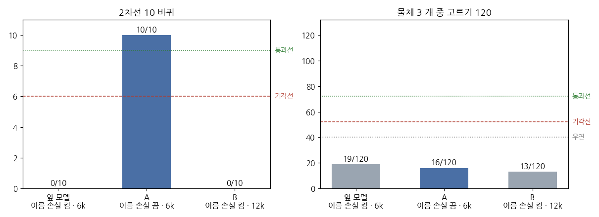

# 오프라인 물체 3 개 실패 원인 가르기: 이름 손실 끔 (A) · 학습량 2 배 (B) (사전 등록)

2026-11-16 20:10 · 앞 점검 [20261116_1426](20261116_1426_offline-pick3-namecf-follow-prereg.md) §8 의 기각에 이어서.

## 왜
- 앞 모델 `lane2+pick3-namecf-nostate-colab-20laps150ep` 결과:
  - 2차선 0/10
  - 고르기 19/120
  - 따라가기 `mid` 4/21
- 학습에 쓴 프레임을 다시 넣어 보면, 2차선 회전 예측과 정답의 상관이 0.45 이다. 오차 0.080 이 정답 크기 0.092 와 비슷하다.
  물체 프레임은 속도 예측 0.33, 정답 0.73 이다. → 덜 배운 모델이다.
- 같은 2차선 데이터 · 같은 6,000 step 의 물체 1 개 모델은 2차선 10/10 이었다.
  - 의심 1: 반사실 이름 손실이 행동 학습을 방해한다.
  - 의심 2: 학습량 부족 (0.84 에포크).

## 모델 (데이터 · 나머지 설정 모두 앞 모델과 같음: 170 ep, 상태 6 칸 0, batch 4, 시드 1000, T4 한도)

| 이름 | 바꾼 것 | 서버 |
|---|---|---|
| **A** `lane2+pick3-nonamecf-nostate-colab-20laps150ep` | 이름 손실 끔 (`GROUND_W=0`), 6,000 step | GPU 1 |
| **B** `lane2+pick3-namecf-nostate-colab12k-20laps150ep` | 이름 손실 켬 (W 0.5), **12,000 step** (1.7 에포크) | GPU 0 |

- 앞 모델 = 이름 손실 켬 + 6,000 step (2차선 0/10 · 고르기 19/120).
- 조향은 앞 모델과 같게 둔다 (조향 제한 없음). 애커만 안전 노드는 아직 빌드하지 않는다.

## 평가 (각 모델, 앞과 같은 도구 · 시드)
- 2차선: `check_lane_laps.py --lane 2` 10 바퀴.
- 고르기: `check_name_goto.py --k 3 --scenes 20 --seed 20261109` = 120.
- 따라가기 (`stop` · `mid` 30 장면): 고르기 72/120 이상인 모델만.

**기각선 (앞과 같음)**

| 시험 | 통과 | 기각 |
|---|---|---|
| 2차선 | 9/10 이상 | 6/10 이하 |
| 고르기 | 72/120 이상 | 52/120 이하 |

## 읽는 법 (결과 전 고정)

| A 2차선 | B 2차선 | 읽기 |
|---|---|---|
| 통과 | 기각 | 이름 손실이 차선 주행을 방해한다. 학습량을 늘려도 안 풀린다 |
| 통과 | 통과 | 학습량 부족이었다. 이름 손실은 시간이 더 들 뿐이다 |
| 기각 | 통과 | 학습량 부족이다. 이름 손실은 원인이 아니다 |
| 기각 | 기각 | 둘 다 아니다. 데이터 (물체 150 ep 가 차선 비율을 낮춤) 쪽을 본다 |

- **고르기:**
  - A 는 이름 손실이 없으니 낮게 나올 것이다 (m300 46/120 처럼). 이건 이름 손실이 필요하다는 확인이다.
  - B 가 통과하면 오프라인 학생 학습 기본값을 12,000 step 으로 한다.
    T4 실제 시간 = 0.43 s/step × 12,000 ≈ 1.4 시간 (3090 기준이라 실제 T4 는 더 걸릴 수 있음).

**예상 (실행 전):** B 가 2차선 통과, A 도 2차선 통과. 고르기는 A 기각 · B 결론 없음.

## 말할 수 있는 범위
앞 문서와 같다: 시뮬 · 오라클 데이터 · 조향 제한 없음 · 이 데이터 양.

## 실행 기록
- 20:10 체인 시작 (`tools/offline_pick3_ab_chain.sh`, 로그 `data/log/offline_pick3_ab_chain.log`).
  - `course_train_colab.sh` 가 `GROUND_W` 를 서버로 넘기게 고침.
- 20:19 서버 학습 확인:
  - A = "반사실 이름 손실 끔" (GPU 1, 11.9 GB).
  - B = "반사실 이름 손실 켬 (W 0.5)" (GPU 0, 13.1 GB).
  - 서버 디스크 여유 6.5 GB.
- 20:55 A 학습 끝 (loss 0.015). 21:43 B 학습 끝 (1.68 에포크, loss 1.19 — 대부분 이름 손실 항).
- 23:49 평가 끝.

## 결과 (11-16 23:50)

| 모델 | 2차선 | 고르기 (학습 꼴 · 시험 전용) | 고르기 끝 |
|---|---|---|---|
| 앞 모델 (이름 손실 켬 · 6k) | 0/10 | 19/120 (8 · 11) | 멈춤 73 · 시간 초과 39 · 바닥 밖 8 |
| **A** (이름 손실 끔 · 6k) | **10/10 통과** (최대 오프셋 중앙값 0.6 m) | 16/120 기각 (9 · 7) | 멈춤 88 · 시간 초과 32 |
| **B** (이름 손실 켬 · 12k) | **0/10 기각** (출발 직후 이탈) | 13/120 기각 (5 · 8) | 멈춤 66 · 시간 초과 47 · 바닥 밖 7 |

**판정 (§ 읽는 법):** A 통과 · B 기각 → **이름 손실이 차선 주행을 방해한다. 학습량을 늘려도 안 풀린다.** 학습량 부족은 원인이 아니다.

**정답 라벨 확인 (서버 변환본, 23:55):**
- 정답 방위 파일 28,519 칸 = 프레임 수.
- 차선 프레임 16,744 개 중 정답이 붙은 것 0.
- 물체 프레임 11,775 개는 모두 정답 있음.
- → 차선 프레임에 잘못된 정답이 섞인 버그는 아니다. 이름 손실 항 (W 0.5 × 약 2 ~ 4) 이 행동 손실 (약 0.02) 보다 수십 배 커서, 같은 VLM 을 차선 행동과 다른 쪽으로 끌고 간 것으로 본다. 이 부분은 측정하지 않았다.

**예상과 비교**
- A 2차선 통과: 맞음.
- B 2차선 통과: 틀림.
- A 고르기 기각: 맞음.
- B 고르기 결론 없음: 틀림 (기각).
- 이름 손실을 켠 두 모델은 고르기도 우연 이하였다. 차선과 섞인 데이터에서는 이 손실이 이름 고르기도 만들지 못했다. gcf300 (물체만 300 ep, batch 8 × 10k) 112/120 과 다른 조건이다.
