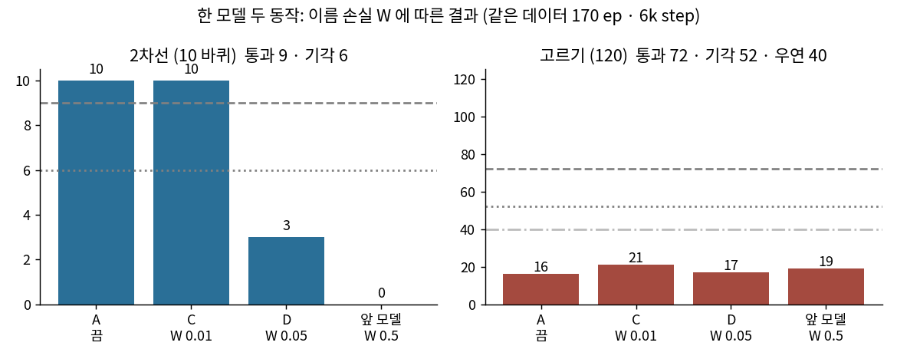

# 오프라인 한 모델 두 동작: 이름 손실 크기 낮추기 C (W 0.01) · D (W 0.05) (사전 등록)

2026-11-17 10:33 · 앞 점검 [20261116_2010](20261116_2010_offline-pick3-ab-cause-prereg.md) 에 이어서.

## 왜
- 오프라인 실습은 **한 모델이 두 동작 (2차선 주행 + 물체 3 개 중 말한 물체 앞에 서기) 을 함께 배워야** 한다.
  모델을 둘로 나누면 "주행 중 물체를 보고 서기" 같은 새 동작이 한 모델에서 나왔다고 말할 수 없다 (11-17 사용자).
- 앞 점검 결과:
  - A (같은 섞인 데이터, 이름 손실 끔): 2차선 10/10. → 두 동작을 섞은 것 자체는 차선을 망가뜨리지 않았다.
  - 이름 손실 W 0.5 를 켠 두 모델: 2차선 0/10, 고르기 19 · 13/120.
- 이름 손실 항 (W 0.5 × 약 2 ~ 4) 이 행동 손실 (약 0.02) 보다 수십 배 크다.
  같이 쓰는 VLM 가중치가 이름 맞히기 쪽으로 크게 움직여 차선 장면 특징까지 바뀐 것으로 본다 (측정 안 함).
- 그래서 W 를 낮춰 두 손실 크기를 맞춘다.

## 모델 (데이터 · 나머지 설정은 앞과 같음: 170 ep = 2차선 20 + 물체 150 (물체마다 30), 상태 6 칸 0, batch 4, 6,000 step, 시드 1000, T4 한도, 조향 제한 없음)

| 이름 | 이름 손실 W | 이름 손실 크기 (예상) | 서버 |
|---|---|---|---|
| **C** `lane2+pick3-namecfw001-nostate-colab-20laps150ep` | 0.01 | 약 0.02 ~ 0.04 (행동 손실과 비슷) | GPU 1 |
| **D** `lane2+pick3-namecfw005-nostate-colab-20laps150ep` | 0.05 | 약 0.1 ~ 0.2 (행동의 5 ~ 10 배) | GPU 0 |

## 평가 (각 모델, 앞과 같은 도구 · 시드)
- 2차선: `check_lane_laps.py --lane 2` 10 바퀴.
- 고르기: `check_name_goto.py --k 3 --scenes 20 --seed 20261109` = 120.
- 따라가기 (`stop` · `mid` 30 장면): 고르기 72/120 이상인 모델만.

**기각선 (앞과 같음)**

| 시험 | 통과 | 기각 |
|---|---|---|
| 2차선 | 9/10 이상 | 6/10 이하 |
| 고르기 | 72/120 이상 | 52/120 이하 |

## 읽는 법 (결과 전 고정)

| 2차선 | 고르기 | 읽기 |
|---|---|---|
| 통과 | 통과 | 한 모델이 두 동작을 배웠다. 이 W 를 오프라인 기본값으로 하고 따라가기 결과를 본다 |
| 통과 | 기각 | W 를 낮추니 차선은 지켰으나 이름 고르기가 안 생겼다. 다음 후보 = 물체 데이터 · 학습량 늘리기 (gcf300: 물체 300 ep, batch 8 × 10k, 112/120) |
| 기각 | 통과 | 이 W 에서도 차선을 방해한다. 더 낮은 W 를 본다 |
| 기각 | 기각 | 크기만의 문제가 아니다. 이름 손실이 차선에 주는 영향을 다른 쪽에서 본다 |

- C 와 D 가 다르게 나오면 (예: C 차선 통과 · D 기각) W 크기에 따라 차선이 망가진다는 근거가 된다.

**예상 (실행 전):** C 2차선 통과 · 고르기 기각. D 2차선 결론 없음 · 고르기 결론 없음.

## 말할 수 있는 범위
앞 문서와 같다: 시뮬 · 오라클 데이터 · 조향 제한 없음 · 이 데이터 양.

## 실행 기록
- 10:33 체인 시작 (`tools/offline_pick3_cd_chain.sh`, 로그 `data/log/offline_pick3_cd_chain.log`). 서버 디스크 여유 7.7 GB, GPU 0 · 1 비어 있음.
- 11:05 서버 학습 확인:
  - C = "반사실 이름 True · W 0.01" (GPU 1, 13.1 GB). 3k step 에서 loss 0.059.
  - D = "반사실 이름 True · W 0.05" (GPU 0, 13.1 GB). 3k step 에서 loss 0.169.
- 11:27 C 저장 실패: 6,000 step 학습은 끝났으나 체크포인트 저장 중 서버 디스크 부족 (`No space left on device`).
  - 원인: C · D 를 같은 step 수로 동시에 돌려, 체크포인트 두 개 (각 약 4.7 GB) 를 거의 동시에 저장. 어제 A/B 는 step 수가 달라 차례로 저장 · 정리되었다.
  - D 는 저장 성공.
- 11:28 C 다시 학습 (`tools/offline_pick3_c_retry.sh`, 같은 설정 · 같은 시드):
  - D 모델을 받아 서버를 정리한 뒤 시작한다.
  - 실패한 C 폴더는 `_failed_nospace_1127` 로 옮기고, 노트북에서 다시 만들 수 있는 사본 (풀어 둔 에피소드 · 변환본) 만 지운다.
  - 평가는 cd 체인의 D 평가가 끝난 뒤 한다.
- 11:29 D 모델 받음 (loss 0.15). 11:30 ~ 13:00 D 평가.
- 12:22 C 다시 학습 끝 (loss 0.041). 13:01 ~ 14:35 C 평가.

## 결과 (11-17 14:35)

| 모델 | 이름 손실 W | 2차선 | 고르기 (시험 전용 · 학습 꼴) | 고르기 끝 | 정면 물체 = 목표 |
|---|---|---|---|---|---|
| A (11-16) | 끔 | 10/10 통과 | 16/120 기각 (7 · 9) | 멈춤 88 · 시간 초과 32 | – |
| **C** | 0.01 | **10/10 통과** (최대 오프셋 중앙값 0.55 m) | **21/120 기각** (11 · 10) | 멈춤 80 · 시간 초과 40 | 42/120 |
| **D** | 0.05 | **3/10 기각** (최대 오프셋 중앙값 1.6 m) | **17/120 기각** (8 · 9) | 멈춤 83 · 시간 초과 37 | 46/120 |
| 앞 모델 (11-16) | 0.5 | 0/10 기각 | 19/120 기각 (11 · 8) | 멈춤 73 · 시간 초과 39 · 바닥 밖 8 | – |

**판정 (§ 읽는 법):**
- C: 2차선 통과 · 고르기 기각 → **W 를 낮추니 차선은 지켰으나 이름 고르기가 생기지 않았다.**
- D: 기각 · 기각.
- 2차선은 W 에 따라 갈린다: 끔 · 0.01 → 10/10, 0.05 → 3/10, 0.5 → 0/10. 이름 손실이 클수록 차선을 망가뜨린다는 근거다.
- 고르기는 W 와 상관없이 네 모델 모두 16 ~ 21/120 이다. 서는 자리 정면 물체가 목표인 비율도 약 1/3 (우연 수준) 이다.
  → 이 데이터 (물체 150 ep) · 이 학습량 (6k step, batch 4) 에서는 이름 손실 크기를 어떻게 두어도 이름 고르기가 생기지 않았다.

**예상과 비교**
- C 2차선 통과: 맞음. C 고르기 기각: 맞음.
- D 2차선 결론 없음: 틀림 (기각). D 고르기 결론 없음: 틀림 (기각).

**다음 후보 (아직 결정 안 함)**
- 고르기가 안 되는 원인이 (1) 차선 데이터와 섞인 것인지, (2) 물체 데이터 · 학습량이 gcf300 (물체 300 ep, batch 8 × 10k) 보다 적은 것인지 아직 가르지 못했다.
- C 설정 (W 0.01, 차선 유지) 을 바탕에 두고 물체 데이터 · 학습량을 늘리는 쪽이 사전 등록 읽는 법의 다음 칸이다.
