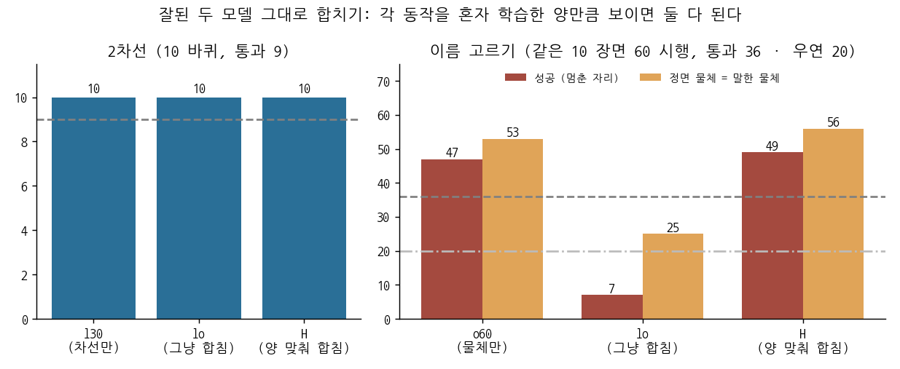

# 잘된 두 모델을 그대로 합치기: H (차선 30 바퀴 + 물체 60 회, 물체 ×5 로 1:1, batch 8 × 30k) (사전 등록)

2026-11-17 20:57 · 앞 문서: [l30 · o60 · lo (11-12)](../강좌_3_주행물체임무/1_차선과물체_한모델/20261112_1505_l30-o60-lo-same-input-prereg.md), [F · G (11-17)](20261117_1756_offline-pick3-F-objonly-G-lowW-b8-prereg.md)

## 왜
- 사용자 (11-17 20:55): 각각의 모델은 되는데 합치면 안 된다. 학생 자원은 생각하지 말고, 각각 된 그대로 학습해서 **합치는 것만** 한다. 두 동작을 각자 학습한 양에 맞춰 학습한다.
- 각각 된 모델 (11-12, 같은 입력 · 같은 학습 방식):
  - `lane2-30laps` (l30): 2차선 10/10. 차선 30 바퀴, batch 8 × 15,000 = 샘플 12 만.
  - `pick3-namecf-3kinds-60` (o60): 이름 고르기 109/120. 물체 60 회 (상자 · 차 · 사람), 반사실 이름 W 0.5, batch 8 × 15,000 = 샘플 12 만.
- 11-12 에 그냥 합친 `lane2+pick3-30laps-60` (lo): 차선 10/10 · 이름 48/120 (우연 약 40).
  - 그때는 프레임 비중이 차선 25,131 : 물체 5,940 (약 4 : 1) 이고 batch 8 × 15,000 이었다.
  - 그래서 물체 프레임은 샘플 약 2.3 만만 보았다. 혼자 학습 때 (12 만) 의 약 1/5 이다.

## 모델

| 이름 | 데이터 | 학습 |
|---|---|---|
| **H** `lane2+pick3-objx5-30laps-60` | lo 와 같은 녹화 90 개 (USB `lo.tar` 에서 꺼냄, `data/episodes_lo`). 물체 녹화 60 개를 5 번씩 넣음 (`data/episodes_lo_objx5`, 330 개). 프레임 차선 25,131 : 물체 29,700 (자르기 전) | lo 와 같음 (smolvla_base 전체 학습, lr 1e-4, warmup 1000, 감쇠 30000, 묶음 30, 반사실 이름 W 0.5, `--trim-still --keep-after 10 --zero-state yaw_rate,front_distance --name-tasks --ground-labels`, 시드 1000). **batch 8 × 30,000 step** → 차선 · 물체 샘플이 각각 약 12 만 (혼자 학습 때와 같음) |

- lo 와 다른 점은 물체 녹화 반복 (×5) 과 step 수 (15k → 30k) 둘뿐이다.
- 입력 = 속도 · 멈춰 있던 시간 (l30 · o60 · lo 와 같음). 조향 제한 없음.
- 서버 3090 (GPU 1), 1.1 step/s 로 약 7.5 시간.

## 평가 (lo 와 같은 도구 · 시드)
- 2차선: `check_lane_laps.py --lane 2` 10 바퀴.
- 이름 고르기: `check_name_goto.py --models ob_box,parked_car,go_person --k 3 --scenes 10 --seed 20261110 --tpl same --record` = 60 (lo · o60 의 120 중 앞 60 과 같은 장면).
- **조기 중단 (사용자 규칙 11-17):** 고르기 앞 10 시행에서 성공 5 미만이면 중단 = 기각 (`tools/eval_early_stop.sh`).

**기각선**

| 시험 | 통과 | 기각 |
|---|---|---|
| 2차선 | 9/10 이상 | 6/10 이하 |
| 고르기 (60, 성공 = 멈춘 자리) | 36/60 이상 | 26/60 이하 또는 앞 10 에서 5 미만 |

## 읽는 법 (결과 전 고정)

| 2차선 | 고르기 | 읽기 |
|---|---|---|
| 통과 | 통과 | 각 동작을 혼자 배울 때만큼 보여 주면 한 모델로 둘 다 된다. lo 실패는 물체 학습량 부족이었다 |
| 통과 | 기각 | 학습량을 맞춰도 합치면 이름 고르기가 깎인다. 학습량이 아닌 다른 원인 (차선 프레임의 행동 손실이 이름 쪽을 덮음 등) |
| 기각 | 통과 | 물체를 늘리니 차선이 깎였다. 비중을 차선 쪽으로 조금 되돌린다 |
| 기각 | 기각 | 합치기 자체가 이 방식으로 안 된다 |

**예상 (실행 전):** 2차선 통과 · 고르기 결론 없음.

## 말할 수 있는 범위
시뮬 · 이 두 동작 (2차선 · 물체 3 종 중 이름 고르기) · 오라클 데이터 · 시드 1 개 · 서버 3090 학습 (T4 아님).

## 실행 기록
- 20:57 체인 시작 (`tools/lo_merge_h_chain.sh`, 로그 `data/log/lo_merge_h_chain.log`). G 평가가 끝난 뒤 H 평가 (시뮬 하나).
- 조기 중단 기록 줄은 `data/log/offline_pick3_fg_chain.log` 에 남는다 (도구가 그 로그에 씀).
- 21:12 서버 학습 시작 (GPU 1, 22 GB): 변환 후 48,591 프레임 = 차선 25,131 + 물체 23,460 (자른 뒤, 거의 1 : 1). 0 으로 둔 칸 = 도는 속도 · 라이다 앞 거리. 약 7.4 시간 → 11-18 04:35 쯤 끝.
- 21:57 (결과 전) 사용자 지시: **H 는 조기 중단 없이 고르기 60 시행을 끝까지 평가한다** (실패해도 결과를 본다). `tools/eval_early_stop.sh` 에서 H 만 건너뛰게 함. 기각선 (36 통과 · 26 이하 기각) 은 그대로.
- 11-18 05:02 학습 끝 (loss 0.004, 4.9 에포크). 05:03 노트북 서버: 상수 상태 칸 [1, 2, 3, 4] (속도 · 멈춰 있던 시간만, l30 · o60 과 같음).
- 05:19 2차선 끝. 05:45 고르기 60 끝 (조기 중단 없음).

## 결과 (11-18 05:45)

| 모델 | 2차선 | 고르기 성공 (같은 10 장면 60) | 정면 물체 = 말한 물체 | 물체별 성공 (상자 · 차 · 사람, 각 20) | 끝 |
|---|---|---|---|---|---|
| l30 (차선만) | 10/10 (LA 0.43 · LR 0.51 m) | — | — | — | — |
| o60 (물체만) | — | 47 | 53 | 18 · 19 · 10 | 멈춤 57 · 시간 초과 2 · 바닥 밖 1 |
| lo (그냥 합침, 15k) | 10/10 (0.57 · 0.58 m) | 7 | 25 | 5 · 2 · 0 | 멈춤 17 · 시간 초과 43 |
| **H (물체 ×5, 30k)** | **10/10 (0.46 · 0.46 m)** | **49** (시험 전용 24/30 · 학습 꼴 25/30) | **56** | **20 · 17 · 12** | 멈춤 54 · 시간 초과 6 |

- o60 · lo 는 11-12 ~ 13 의 120 시행에서, 같은 시드 · 같은 앞 10 장면 (60 시행) 만 다시 셌다 (`data/eval/name_goto_*.json`).
- H 결과 파일: `ros2_vla/data/eval/name_goto_lane2+pick3-objx5-30laps-60_20261118_051910.json`, 차선 `data/log/cc_eval_lane2+pick3-objx5-30laps-60_lane2.log`.

**판정 (§ 읽는 법 첫째 줄):** 2차선 통과 · 고르기 통과 → **각 동작을 혼자 배울 때만큼 보여 주면, 한 모델로 2차선 주행과 3 개 중 말한 물체 앞에 서기를 둘 다 한다.** 11-12 lo 의 실패는 물체 학습량 (혼자 학습의 약 1/5) 부족이었다.
- 고르기는 물체만 학습한 o60 (47) 과 같은 수준이다 (49).
- 차선 오프셋도 차선만 학습한 l30 과 비슷하다 (0.46 m).
- 사람이 가장 낮다 (12/20). o60 도 10/20 으로 같은 경향이다.

**예상과 비교:** 2차선 통과 → 맞음. 고르기 결론 없음 → 틀림 (통과).

**말할 수 있는 범위:** 시뮬 · 이 두 동작 · 물체 3 종 (상자 · 차 · 사람) · 오라클 데이터 · 시드 1 개 · 서버 3090 batch 8 × 30k (T4 · 학생 시간은 아님). 이 모델이 "주행 중 물체를 보고 서기" 같은 새 동작을 하는지는 아직 재지 않았다.
