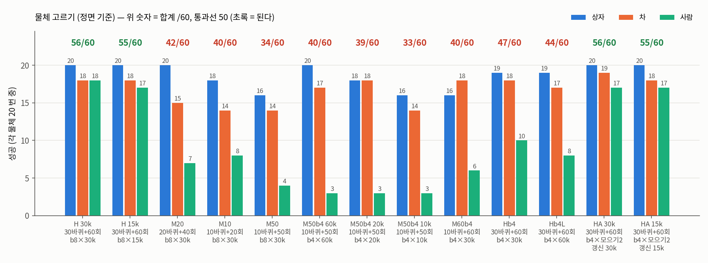
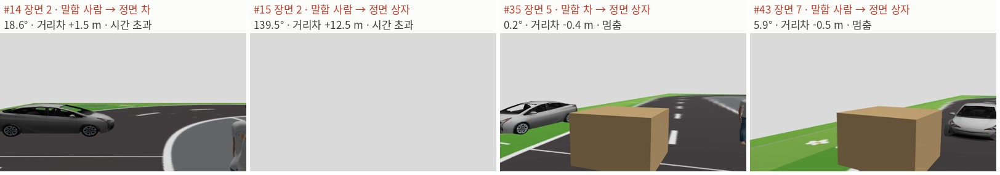
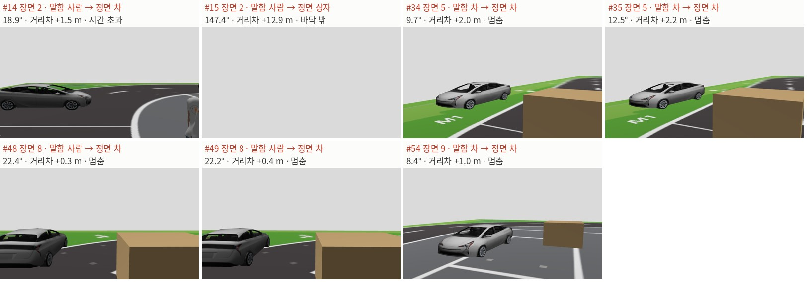
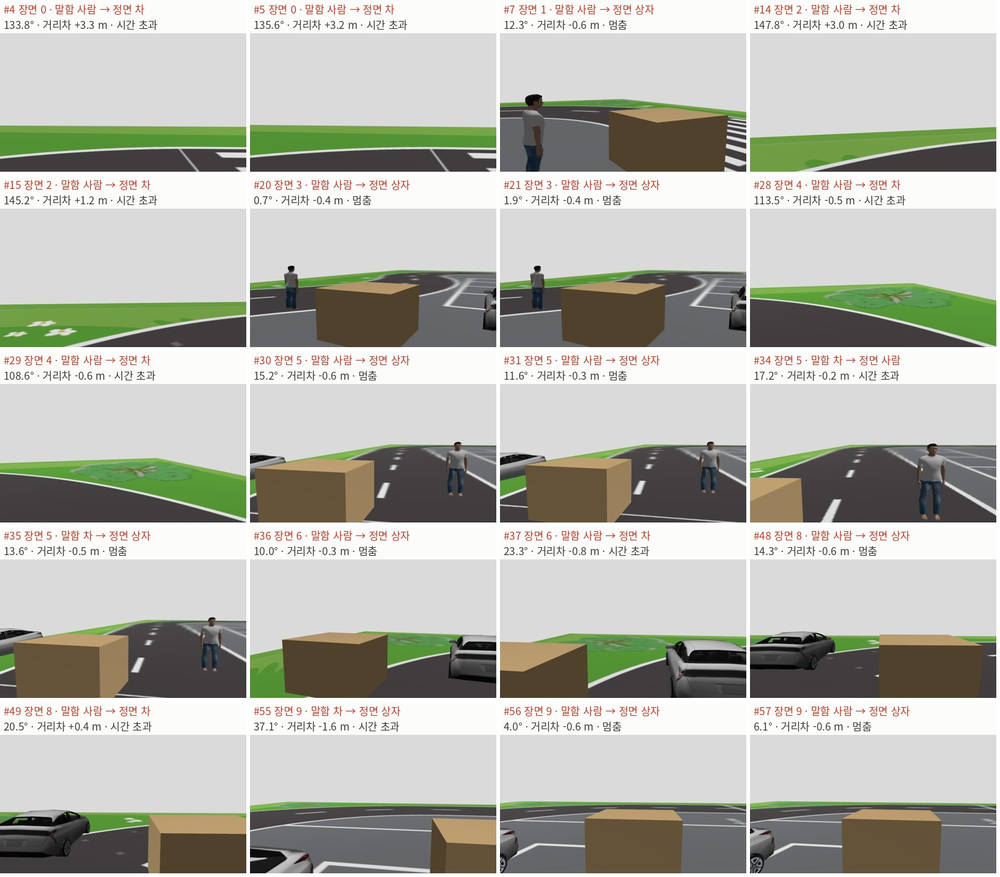
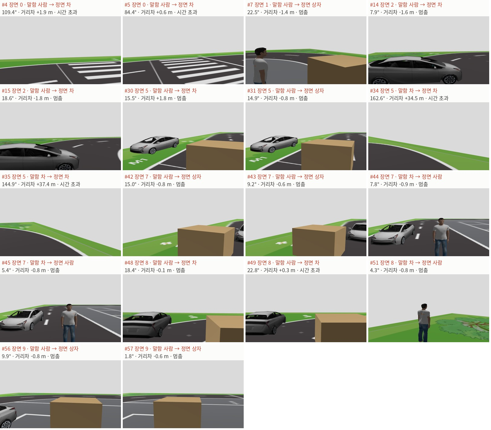

# 합친 한 모델의 최소 데이터 · 최소 step: 차선 몇 바퀴 · 물체 몇 회 · 몇 step 이면 되는가 (사전 등록 · 결과)

2026-11-18 10:17 사전 등록 · 11-19 16:52 정리 · 앞 문서: [H (11-17)](20261117_2057_lo-merge-balanced-30k-prereg.md) · 관련: [학생 노트북 메모](20261118_2135_student-laptop-training-memo.md)

## 지금 결론 (11-23 23:20)

| 모델 | 데이터 (차선 + 물체) | 학습 | 2차선 | 고르기 정면 기준 (엄격) | 상자 · 차 · 사람 | 판정 |
|---|---|---|---|---|---|---|
| H 30k | 30 바퀴 + 60 회 (×5) | batch 8 × 30k | 10/10 | **56** (49) | 20 · 18 · 18 | **된다** |
| H 15k | 30 + 60 (×5) | batch 8 × 15k | 10/10 | **55** (47) | 20 · 18 · 17 | **된다** |
| M20 | 20 + 40 (×5) | batch 8 × 30k | 10/10 | 42 (34) | 20 · 15 · 7 | 안 된다 |
| M10 | 10 + 20 (×5) | batch 8 × 30k | 10/10 | 40 (24) | 18 · 14 · 8 | 안 된다 |
| M50 | 10 + 50 (×2) | batch 8 × 30k | 10/10 | 34 (24) | 16 · 14 · 4 | 안 된다 |
| M50b4 | 10 + 50 (×2) | batch 4 × 60k (20k · 10k 도) | 10/10 | 40 · 39 · 33 | 20 · 17 · 3 (60k) | 안 된다 |
| **M60b4** | 10 + 60 (×2) | batch 4 × 30k | 10/10 | **40** (30) | 16 · 18 · **6** | 안 된다 |
| **Hb4** | 30 + 60 (×5) = H 데이터 | batch 4 × 30k | 10/10 | **47** (34) | 19 · 18 · **10** | 안 된다 |
| **Hb4L** | 30 + 60 (×5) = H 데이터 | batch 4 × 60k | **5/10** | **44** (30) | 19 · 17 · **8** | 안 된다 |
| **HA 30k** | 30 + 60 (×5) = H 데이터 | batch 4 × 모으기 2, 갱신 30k (작은 step 60k) | 10/10 | **56** (33) | 20 · 19 · 17 | **된다** |
| **HA 15k** | 30 + 60 (×5) = H 데이터 | batch 4 × 모으기 2, 갱신 15k (작은 step 30k) | 10/10 | **55** (48) | 20 · 18 · 17 | **된다** |

- 판정 (지금 기준): 2차선 9/10 이상 그리고 고르기 **정면 기준 50/60 이상** (아래 "판정 기준" 참고). 고르기 60 시행 = 장면 10 × 물체 3 × 문장 2 (학습 꼴 · 시험 전용).
- **차선:** 합친 모델에서 차선 10 바퀴면 2차선은 10/10 (batch 8 · batch 4 × 30k 모두). **예외: Hb4L (batch 4 × 60k) 만 5/10** (성공한 바퀴도 오프셋 1.3 ~ 1.5 m). 같은 날 H 30k 대조는 10/10 (0.46 m) 이라 환경 탓 아님.
- **물체:** 20 · 40 · 50 회는 안 되고, **물체 60 회도 차선 10 바퀴와 합치면 안 된다 (M60b4 40/60, 사람 6/20)**. 30 바퀴 + 60 회 (H) 는 15k 에서도 된다. 지금 확인된 최소는 **"30 바퀴 + 60 회"**.
- **실패는 거의 사람:** 상자 + 차 (40 중) 는 모든 모델이 30 ~ 38 로 비슷, 사람 (20 중) 은 H 17 ~ 18 vs 나머지 3 ~ 8. 사람 녹화는 H 와 M60b4 가 같은 19 회인데 사람 17 ~ 18 vs 6 → **물체 녹화 수가 아니다.** H 15k 와 M60b4 는 샘플 수 (12 만) · 물체 녹화가 같고, 다른 점은 차선 30 vs 10 바퀴 · batch 8 vs 4 · 물체 반복 ×5 vs ×2 (물체 프레임 비중은 54 vs 59 % 로 비슷) 셋.
- **실패는 진짜 실패:** 끝 화면을 보면 다른 물체 앞에 서거나 (상자가 사람과 차 사이인 장면에서 상자로) 물체를 지나쳐 돌아 나감. 판정이 너그러워 생긴 억울한 실패 없음.
- **과적합 아님:** M50b4 를 에포크 2.5 · 4.9 · 14.8 로 평가해도 33 · 39 · 40.
- **batch 4:** 16 GB GPU 는 이 방식에서 batch 4 만 들어감. 10 바퀴 + 50 회에선 batch 4 × 60k (40) 가 batch 8 × 30k (34) 보다 나쁘지 않았지만, **H 데이터에선 batch 4 × 30k (Hb4 47) 가 같은 샘플 수의 batch 8 × 15k (H 15k 55) 보다 8 낮음** (사람 10 vs 17). 시드 하나.
- **넓은 장면** (출발 10 ~ 12.5 m · 물체 간격 20° 이상): H 30k 52 · M10 44 — 장면을 넓혀도 오르지 않음 (H 는 4 낮음). 지금 장면이 판정을 흐린 것이 아님.
- 강좌로 옮기면 (사용자 11-19): 합친 학습은 2 일차 밤사이에 돌리므로 학습 시간보다 1 · 2 일차 **수집량** 이 제약. 지금 확인된 조합은 차선 30 바퀴 + 물체 60 회 (batch 8). 차선을 10 바퀴로 줄이면 사람이 안 된다 (M60b4).
- **batch 4 + 기울기 모으기 2 (HA, 11-23):** 16 GB GPU 에서 batch 4 를 두 번 모아 한 번 갱신 (= batch 8 계산) 하면 H 와 같다 — 갱신 30k 56/60 · 갱신 20k 56 · 갱신 15k 55 · 갱신 10k 49 (안 됨), 모두 2차선 10/10. 같은 환경 H 30k 기준선 55. **학생 16 GB 조건에서 처음 통과한 조합 = 차선 30 바퀴 + 물체 60 회, batch 4 × 모으기 2, 갱신 15k (작은 step 30k, 약 3.5 시간).** 시드 하나.
- **남은 것:** 3 일차 일반화 시험은 이 모델들에서 아직 안 잼. 기울기 모으기는 `ros2_vla/tools/train_ground.py` 에만 있고 Colab 쪽 (`colab/train_ground.py`) 엔 아직 없음.

## 판정 기준 (바뀐 순서)
1. 11-18 10:17 사전 등록: 2차선 9/10 · 고르기 **엄격** (멈춤 · 정면 15° · 거리 차 ±1 m) 36/60.
2. 11-18 20:56 사용자 (실패 영상을 보고): **정면 기준** — 끝 정면 물체 = 말한 물체 · 35° 이하 · (거리 − standoff) ≤ +1 m · 바닥 밖 아님 (멈춤 · 시간 초과 묻지 않음). 결과를 본 뒤 바꾼 기준.
3. 11-18 22:05 사용자: 통과선 **50/60** (정면 기준). 이후 모든 판정. 조기 중단 (앞 10 에서 5 미만) 은 그대로.

## 사전 등록 원문 (11-18 10:17, 결과 전)
### 왜
- 사용자 (11-18): 두 동작을 합칠 때 최소 데이터로 어느 정도 학습해야 하는지 확인. 최소 몇 바퀴 · 물체 몇 회 · 최소 몇 step.
- H (차선 30 바퀴 + 물체 60 회, 물체 ×5, batch 8 × 30k) 는 2차선 10/10 · 고르기 49/60 으로 통과했다. 여기서 데이터와 step 을 줄여 본다.

### 모델 (H 와 같은 학습 방식, 데이터만 줄임)
공통: smolvla_base 전체 학습, lr 1e-4, warmup 1000, **감쇠 30000**, 묶음 30, 반사실 이름 W 0.5, `--trim-still --keep-after 10 --zero-state yaw_rate,front_distance --name-tasks --ground-labels`, 시드 1000, **batch 8 × 30,000 step**, 서버 3090 (GPU 1). 물체 녹화는 H 처럼 5 번씩 넣어 프레임이 거의 1 : 1.

| 이름 | 차선 | 물체 (상자 · 차 · 사람) | 프레임 (자르기 전, 차선 : 물체 ×5) | 데이터 폴더 |
|---|---|---|---|---|
| H (끝남) | 30 바퀴 | 60 회 (21 · 20 · 19) | 25,131 : 29,700 | `data/episodes_lo_objx5` |
| **M20** `lane2+pick3-objx5-20laps-40` | 20 바퀴 | 40 회 (14 · 13 · 13) | 16,753 : 20,060 | `data/episodes_lo20_40_objx5` |
| **M10** `lane2+pick3-objx5-10laps-20` | 10 바퀴 | 20 회 (7 · 7 · 6) | 8,377 : 9,905 | `data/episodes_lo10_20_objx5` |

- 녹화는 모두 H (lo) 녹화의 일부다. 차선은 시간순 앞에서부터 (10 바퀴면 문장 10 가지가 한 번씩), 물체는 종류마다 시간순 앞에서부터.
- 차선 · 물체를 같은 비율로 줄여 1 : 1 을 유지한다. 어느 쪽이 모자란지는 이 두 모델로 가르지 않는다 (필요하면 다음 단계).

**순서 (적게 쓰는 쪽부터):**
1. H 의 15k 체크포인트 (서버에 남아 있음) 를 바로 평가한다 = 30 바퀴 + 60 회의 step 축 점 하나 (학습 없음).
2. M10 학습 (5k 마다 저장). M10 30k 가 통과하면 M20 은 학습하지 않는다 (데이터를 늘려서 나빠질 일은 없다고 봄).
3. M10 30k 가 통과 못 하면 M20 학습 (5k 마다 저장).

**step 찾기 (한 모델 안):** 30k → 20k → 10k → 5k 순서로 평가하다 처음 통과 못 하는 곳에서 멈춘다. 마지막 통과와 처음 실패가 10k 차이면 그 가운데 (25k 또는 15k) 를 하나 더 평가한다.
- 주의: 중간 체크포인트는 감쇠 30000 스케줄의 중간이라 학습률이 아직 덜 내려가 있다. 처음부터 그 step 수로 짜서 학습한 것보다 불리할 수 있다. 그래서 여기서 찾은 최소 step 은 **"이 이하로는 아직 안 됨"이 아니라 "이만큼이면 됨"의 위쪽 값**으로 읽는다.

### 평가 (H 와 같은 도구 · 시드)
- 2차선: `check_lane_laps.py --lane 2` 10 바퀴.
- 고르기: `check_name_goto.py --models ob_box,parked_car,go_person --k 3 --scenes 10 --seed 20261110 --tpl same --record` = 60.
- 조기 중단 (사용자 규칙 11-17): 고르기 앞 10 시행에서 성공 5 미만이면 중단 = 기각. (H 의 예외는 H 30k 에만 해당. 여기는 모두 조기 중단 적용.)

**기각선 (H 와 같음)**

| 시험 | 통과 | 기각 |
|---|---|---|
| 2차선 | 9/10 이상 | 6/10 이하 |
| 고르기 (60) | 36/60 이상 | 26/60 이하 또는 앞 10 에서 5 미만 |

- **"된다" = 2차선 통과 그리고 고르기 통과.** 그 사이 (결론 없음) 는 "된다" 로 세지 않는다.

### 읽는 법 (결과 전 고정)

| M10 30k | M20 30k | 읽기 |
|---|---|---|
| 된다 | (학습 안 함) | 최소 데이터 ≤ 10 바퀴 + 20 회. 더 줄일지는 사용자 결정 |
| 안 된다 | 된다 | 최소 데이터는 10 바퀴 + 20 회 와 20 바퀴 + 40 회 사이. 깨진 쪽 (차선 / 고르기) 을 보고 그 축만 줄인 모델로 가른다 |
| 안 된다 | 안 된다 | 최소 데이터는 20 바퀴 + 40 회 와 H (30 + 60) 사이 |

- 최소 step = 통과한 모델 중 가장 작은 데이터에서, 통과한 가장 작은 체크포인트.
- H 15k: 된다 → 30 + 60 에서는 15k (샘플 12 만, 과제마다 약 6 만) 면 충분. 안 된다 → 30 + 60 은 15k ~ 30k 사이가 필요.

**예상 (실행 전):**
- H 15k: 된다.
- M10 30k: 2차선 통과 · 고르기 통과 못 함 (물체 20 회는 적다) → M20 학습.
- M20 30k: 된다. 최소 step 은 20k 쯤.

## 시간순 기록

### H 15k 결과 (11-18 11:08)
- 2차선 **10/10** (LA 5/5 · LR 5/5, 최대 오프셋 중앙값 0.46 m).
- 고르기 **47/60** (시험 전용 23/30 · 학습 꼴 24/30, 앞 10 시행 8/10), 정면 물체 = 말한 물체 55/60, 물체별 상자 20/20 · 차 16/20 · 사람 11/20, 끝 멈춤 52 · 시간 초과 8.
- **판정: 된다.** 30 바퀴 + 60 회에서는 batch 8 × 15k (과제마다 샘플 약 6 만) 면 충분하다. H 30k (49/60) 와 거의 같다.
- 예상 (된다) 과 맞음.

### 추가 (11-18 11:44, M10 결과 전): M5
- 사용자 (11-18 11:40): 오프라인 실습은 1 일차 주행 · 2 일차 물체 이동을 각각 학습하고, 2 일차가 끝나면 학생이 두 데이터를 합쳐 학습해 3 일차에 일반화 시험을 한다. **그래서 동작하는 최소 데이터가 매우 중요하다.**
- 그래서 M10 30k 가 "된다" 이면 한 단계 더 줄인다 (사용자 결정 기다리지 않고 바로, M10 이 안 되면 학습 안 함).

| 이름 | 차선 | 물체 (상자 · 차 · 사람) | 프레임 (자르기 전, 차선 : 물체 ×5) | 데이터 폴더 |
|---|---|---|---|---|
| **M5** `lane2+pick3-objx5-5laps-10` | 5 바퀴 (차선 문장 5 가지) | 10 회 (4 · 3 · 3) | 4,189 : 4,920 | `data/episodes_lo5_10_objx5` |

- 학습 · 평가 · 기각선 · step 찾기는 위와 같다. M10 30k 판정이 나오는 즉시 서버 학습을 시작하고, 평가는 M10 평가가 끝난 뒤 (시뮬 하나).
- 체인 `ros2_vla/tools/merge_min5_chain.sh` (로그 `data/log/merge_min5_chain.log`). 앞 체인은 실행 중이라 고치지 않았다.
- **예상 (실행 전):** M5 는 안 된다 (차선 문장 5 가지 · 물체 종류당 3 ~ 4 회).
- 읽기: M5 된다 → 최소 데이터 ≤ 5 바퀴 + 10 회. 안 된다 → 5 + 10 과 10 + 20 사이.
- 주의: 여기 기각선은 학습한 두 동작만 잰다. 3 일차 일반화 시험 (주행 중 물체 보고 서기 등) 이 최소 데이터 모델에서도 되는지는 따로 재야 한다.

### M10 결과 (11-18 18:33)
- 18:08 학습 끝 (loss 0.003, 14.8 에포크).
- 30k: 2차선 **10/10** (LA 5/5 · LR 5/5, 최대 오프셋 중앙값 0.45 · 0.46 m). 고르기 앞 10 시행 **3/10** → 조기 중단 · 기각.
- **판정: 안 된다** (2차선은 되고 고르기가 깨짐). 30k 가 안 되어 더 작은 체크포인트는 평가하지 않음. 사전 등록대로 M5 는 학습하지 않고 M20 학습으로 넘어감.
- 예상 (2차선 통과 · 고르기 안 됨) 과 맞음. 차선 10 바퀴는 합친 모델에서도 2차선에 충분했고, 모자란 쪽은 물체 20 회다 (차선 쪽만 줄인 시험은 아직 안 함).
- 18:41 M20 서버 학습 시작 (변환 후 32,633 프레임 = 차선 16,753 + 물체 15,880, 1.08 step/s → 11-19 02:10 쯤 끝).
- (기록) M5 체인의 판정 읽기 줄에서 2차선 숫자를 두 개 잡아 셸 오류가 났으나, 결과는 "M10 안 됨 → M5 학습 안 함" 으로 사전 등록과 같게 갔다.

### 추가 (11-18 20:56): 고르기 판정을 "정면 물체 기준" 으로 (사용자 판단, 결과를 본 뒤 바꾼 기준)
- 사용자 (11-18 20:50, H 15k 실패 영상을 보고): 사람으로 가서 마지막 화면에 사람이 중앙은 아니어도 제일 많이 보이면 성공으로 봐도 된다. 다른 물체 (차 등) 로 간 것은 실패.
- 실패 영상: `ros2_vla/docs/실험영상/7_차선물체_합친모델/2026-11-18_물체고르기_실패시행/`
- **새 판정 (정면 기준, 이후 평가는 이것으로):** 끝 자리에서 정면 (방위가 가장 작은) 물체 = 말한 물체 · 그 방위 35° 이하 (카메라 반화각 31°) · (거리 − standoff) ≤ +1.0 m (덜 간 것은 실패, 더 다가간 것은 허용) · 바닥 밖 아님. 멈춤 · 시간 초과는 묻지 않음.
- 옛 판정 (엄격: 멈춤 · 15° · ±1 m) 도 같이 적는다. 기각선 숫자는 그대로 (고르기 36/60 이상 통과, 26/60 이하 기각, 앞 10 에서 5 미만 조기 중단) — 세는 기준만 바뀜.
- 이미 한 평가를 새 판정으로 다시 세면:

| 모델 | 엄격 | 정면 기준 | 앞 10 (정면 기준) |
|---|---|---|---|
| H 30k | 49/60 | **56/60** | 10/10 |
| H 15k | 47/60 | **55/60** | 10/10 |
| M10 30k | 3/10 (조기 중단) | **8/10** | 8/10 → 조기 중단 대상 아님 |

- 실패로 남는 것 (H 30k): 차를 말했는데 상자 앞 (장면 5, 2 번) · 사람을 말했는데 차 쪽 (장면 8, 2 번). H 15k 는 여기에 사람을 말했는데 상자 쪽 41° (장면 9, 1 번).
- 주의: 정면 기준 성공 중 사람 쪽은 standoff (3.9 m) 보다 더 다가가 사람에게서 1.9 ~ 2.8 m 에서 끝났다 (시간 초과는 계속 천천히 다가감). 실차에서는 안전 노드 · 정지 거리 확인이 따로 필요.
- **그래서 M10 30k 를 60 시행 끝까지 다시 평가한다** (2차선은 이미 10/10, 고르기만). 녹화 폴더 `data/eval_rec/lane2+pick3-objx5-10laps-20-s30k-full`.
  - 예상 (실행 전): 정면 기준 통과 (40/60 쯤). 통과하면 M10 은 "된다" 로 바뀌고, 다음은 더 작은 step (20k → 10k → 5k) 과 M5 를 정면 기준으로 본다 (학습 착수는 사용자 결정).
- M20 체인 (실행 중, 고치지 않음) 의 step 찾기는 엄격 판정으로 멈춘다. 조기 중단 스크립트 `tools/eval_early_stop.sh` (체인이 평가마다 새로 부르는 별도 파일) 만 정면 기준으로 바꿔 끝까지 데이터를 남기고, 정면 기준 판정은 결과 json 으로 다시 센다. 체인이 엄격 판정으로 일찍 멈춘 체크포인트는 뒤에 따로 평가한다.

#### M10 30k 60 시행 결과 (11-18 21:37, 지금 장면 · 정면 기준)
- **정면 기준 40/60 → 통과 (36 이상)** · 엄격 24/60. 2차선은 앞서 10/10 → **M10 30k = 된다 (정면 기준).** 예상 (40 쯤) 과 맞음.
- 학습 꼴 20/30 · 시험 전용 20/30. 물체별 상자 18/20 · 차 14/20 · **사람 8/20**. 바닥 밖 6.
- H 30k (56/60) 보다 16 낮고, 거의 사람 · 차 쪽에서 빠짐. 통과선은 넘었지만 여유가 작다 (36 에 +4).
- 읽기 (위 표 첫 줄로 바뀜): 최소 데이터 ≤ 10 바퀴 + 20 회 (정면 기준). 다음은 M10 의 작은 step (20k → 10k → 5k) 과 M5 (학습은 사용자 결정).
- M10 20k 는 시뮬이 비는 시간 (넓은 장면 평가 뒤 ~ 01 시) 에 2차선 + 고르기 평가 (`tools/m10_steps_eval.sh`).

### 추가 (11-18 21:05): 넓은 장면 고르기 평가 (사용자 제안 · 승인)
- 사용자 (11-18 21:00): 시험 때 물체끼리 가깝고 출발도 가까워 자동 판정이 흔들렸을 수 있다. 더 뒤에서 출발하고 물체를 더 띄우면 확실히 볼 수 있다.
- 지금 장면 (학습 수집과 같음): 출발 7.5 ~ 12.5 m, 물체끼리 방위 10° 이상. 시드 20261110 장면 10 개의 가장 가까운 두 물체 방위 차 12.6 ~ 19.6°, 거리 2.3 ~ 4.7 m.
- **넓은 장면:** `check_name_goto.py --dist 10,12.5 --sep 20` (그 밖은 같음: `--models ob_box,parked_car,go_person --k 3 --scenes 10 --seed 20261110 --tpl same --record`). 출발은 학습 범위의 먼 절반, 간격은 20° 이상 (같은 시드 미리보기: 물체끼리 3.8 m 이상). **둘 다 학습 범위의 부분 집합** — 학습에 없던 장면이 아니라 헷갈리는 장면을 뺀 시험. 장면 자체는 지금 장면과 다르다 (같은 시드여도 뽑는 범위가 달라 다른 배치).
- `--sep` 은 이번에 넣은 선택 사항 (기본 없음 = 10°, 체인 평가는 그대로).
- 대상: H 30k · M10 30k (각 60 시행, 2차선은 안 함). 조기 중단은 정면 기준 (앞 10 에서 5 미만). 시뮬은 M10 60 시행 다시 평가 뒤 ~ M20 평가 (02:20 쯤) 전.
- 판정: 정면 기준 (위) 과 엄격 둘 다 적는다. 통과선 36/60 그대로. 넓은 장면 결과는 **추가 정보** — 최소 데이터 판정은 지금 장면 기준으로 한다.
- 읽기:
  - 넓은 장면에서 정면 기준이 지금 장면보다 확실히 높다 (H 30k 59 ~ 60/60) → 지금 장면 실패는 대부분 물체가 붙어 있어서 생긴 것.
  - 비슷하다 (H 30k 55 ~ 57) → 장면 탓이 아니라 모델이 물체를 헷갈리는 것.
- **예상 (실행 전):** H 30k 정면 기준 58/60 쯤 (지금 56). M10 30k 는 지금 장면 결과 + 3 쯤.
- 실행: `ros2_vla/tools/wide_scene_eval.sh` (로그 `data/log/wide_scene_eval.log`), 녹화 `data/eval_rec/<모델>-wide`.

### 추가 (11-18 22:05): 통과선 50/60 (정면 기준) · M50 학습 (사용자)
- 사용자 (11-18 22:00): 고르기 통과선을 **50/60** 으로 잡는다. 실차 학습 때 시간을 넉넉히 줄 테니 물체를 두고 50 회 이상은 학습할 수 있을 것.
- **새 기각선 (이후 모든 판정):** 2차선 9/10 이상 그리고 고르기 정면 기준 **50/60 이상** = 된다. 그 밖은 안 된다. 조기 중단 (앞 10 에서 정면 기준 5 미만) 은 그대로.
- 지금까지를 다시 읽으면: H 30k 56 · H 15k 55 → 된다. **M10 30k 40 → 안 된다** (그래서 M10 20k 평가는 취소). M20 은 이 선으로 판정 (체인은 옛 엄격 36 으로 step 을 고르므로, 정면 기준 판정과 빠진 체크포인트는 결과를 보고 따로).
- **M50** `lane2+pick3-objx2-10laps-50` (사용자 선택: 10 바퀴 + 50 회):
  - 차선 10 바퀴 = M10 과 같은 녹화. 물체 50 회 (상자 17 · 차 17 · 사람 16, 종류마다 시간순 앞에서부터, M10 의 20 회를 포함) 를 **2 번씩** 넣어 프레임 차선 8,377 : 물체 9,936 (자르기 전, M10 과 거의 같은 비율). 데이터 `data/episodes_lo10_50_objx2`.
  - 학습은 위와 같음 (batch 8 × 30k, 감쇠 30000, 5k 마다 저장), **서버 GPU 0**.
  - 왜 차선 10 바퀴: 합친 모델에서 10 바퀴로 2차선 10/10 (M10). 물체 쪽만 늘려 "물체 50 회면 50/60 이 되는가" 를 본다.
  - **22:11 GPU 0 에서 메모리 부족으로 멈춤** — 서버 GPU 0 은 3090 이 아니라 RTX 4070 Ti SUPER (16 GB). 지금 방식 (반사실 이름 손실 포함) batch 8 이 16 GB 에 안 들어감. 조건 (3090 · batch 8) 을 바꾸지 않으려고 실패한 서버 폴더를 지우고, **M20 학습이 끝나 GPU 1 이 비면 (02:20 쯤) GPU 1 에서 다시 학습** (1.1 step/s → 약 7.5 시간, 11-19 10 시쯤 끝).
  - 평가: M20 체인이 끝난 뒤 (시뮬 하나) 30k → 20k → 10k → 5k, 처음 안 되는 곳에서 멈춤. 판정 위 새 기각선. 체인 `ros2_vla/tools/m50_chain.sh` (로그 `data/log/m50_chain.log`).
  - **예상 (실행 전):** 2차선 10/10. 고르기 정면 기준 52/60 쯤 (H 56 보다 조금 낮음) → 된다, 경계 가까이. 최소 step 은 20k.
  - 읽기: M50 30k 된다 → 물체 50 회 + 차선 10 바퀴면 충분 (물체 최소는 20 ~ 50 회 사이, 50 미만은 아직). 안 된다 → 물체 60 회 또는 차선 30 바퀴 쪽이 필요 (H 와 이 모델 사이).

### 추가 (11-18 22:36): M50 batch 4 판 (학생 16 GB 조건)
- 서버 GPU 0 (16 GB) 측정: 지금 방식 (반사실 이름 손실) 은 batch 8 · 6 메모리 부족, **batch 4 만 들어감 (12.6 GB, 0.47 s/step)** ([노트북 메모](20261118_2135_student-laptop-training-memo.md)).
- 사용자 (11-18 22:35): 연구실 서버 GPU 를 학생 모두에게 쓰게 할 수는 없다 → batch 4 로 하고 step 을 늘리는 방식으로. batch 4 학습을 시험해야 한다.
- **M50b4** `lane2+pick3-objx2-b4-10laps-50`: M50 과 같은 데이터 (`data/episodes_lo10_50_objx2`) · 같은 방식, 다른 점은 **batch 4 × 60,000 step · 감쇠 60000 · 10k 마다 저장 · GPU 0 (16 GB)** 셋. 샘플 수 24 만 = M50 (batch 8 × 30k) 과 같음. lr 1e-4 · warmup 1000 그대로 (batch 에 맞춰 lr 을 바꾸지 않음).
- 학습: 22:36 시작 (변환 약 5 분), 약 7.8 시간 → 11-19 06:30 쯤.
- 평가: M50 (batch 8) 평가가 끝난 뒤 (시뮬 하나). step 찾기 60k → 40k → 20k → 10k (batch 8 의 30 · 20 · 10 · 5k 와 같은 샘플 수), 20k 차이면 가운데 하나 더. 판정 M50 과 같음 (2차선 9/10 · 고르기 정면 기준 50/60, 앞 10 에서 5 미만 조기 중단). 체인 `ros2_vla/tools/m50b4_chain.sh` (로그 `data/log/m50b4_chain.log`).
- **예상 (실행 전):** M50 과 같다 (고르기 차이 ±4 안, 2차선 둘 다 10/10).
- 읽기: 같다 → 학생 16 GB 에서 batch 4 × 2 배 step 으로 해도 된다 (시간은 노트북에서 따로). M50b4 가 4 넘게 낮다 → batch 4 는 불리, step 을 더 늘리거나 lr 을 낮추는 시험이 필요.
- 이 비교는 **같은 데이터 · 시드 하나** 다. batch 차이가 작은 차이를 낼 때 시드 차이와 가르지 못한다.

### 결과 (11-19 10:10): 넓은 장면 · M20 · M50b4 학습
**넓은 장면 (11-18 22:03 · 22:33)**

| 모델 | 지금 장면 (정면 기준) | 넓은 장면 (정면 기준) | 넓은 장면 엄격 | 넓은 장면 상자 · 차 · 사람 |
|---|---|---|---|---|
| H 30k | 56/60 | **52/60** | 41 | 20 · 15 · 17 |
| M10 30k | 40/60 | **44/60** | 28 | 18 · 18 · 8 |

- 예상 (H 30k 58 쯤) **틀림**: 넓은 장면에서 H 는 오히려 4 낮다. → 지금 장면의 실패는 물체가 붙어 있어서 생긴 것이 아니다 (읽기 둘째 줄: 장면 탓이 아니라 모델이 물체를 헷갈림). 출발이 먼 쪽 (10 ~ 12.5 m) 만 쓴 것이 조금 어려웠을 수 있다 (가르지 않음).
- M10 은 +4. 두 모델 차이 (16 → 8) 가 줄었지만 M10 의 사람 8/20 은 그대로.

**M20 30k (11-19 03:27, 지금 장면)**
- 2차선 **10/10**. 고르기 **정면 기준 42/60** (엄격 34/60), 상자 20 · 차 15 · **사람 7** (각 20).
- **판정 (통과선 50): 안 된다.** 체인은 옛 엄격 36 으로 30k 에서 멈춤 (더 작은 step 은 평가 안 함 — 30k 가 안 되니 필요 없음).
- 예상 (된다) 틀림. M10 (20 회) 40 → M20 (40 회) 42 로 물체를 두 배 늘려도 거의 같다. 둘 다 **사람이 7 ~ 8/20** 으로 무너지고, H (60 회 · 차선 30 바퀴) 는 사람 18/20.
- 읽기: 최소 데이터는 20 바퀴 + 40 회 와 H (30 + 60) 사이 (사전 등록 표 셋째 줄). 사람 쪽이 물체 횟수에 비례해 오르지 않아, 40 → 60 회 사이에서 갑자기 되는지, 차선 바퀴 수 (20 → 30) 가 영향을 주는지는 M50 (10 바퀴 + 50 회) 으로 일부 가른다.

**M50b4 (batch 4 × 60k, GPU 0)**: 11-19 07:27 학습 끝 (loss 0.004, 14.8 에포크, 실제 8 시간 46 분 = 1.90 step/s, 처음 2.35 에서 느려짐). M50 (batch 8) 학습 (GPU 1) 이 10:50 쯤 끝날 때까지 시뮬이 비어 있어, 대기 체인을 멈추고 60k 를 먼저 평가 (`tools/m50b4_eval.sh`, 10:06 시작). 40k 부터는 M50 체인 평가가 끝난 뒤.

### 결과 (11-19 11:48): M50 · M50b4 → 둘 다 안 된다
| 모델 | 데이터 · 학습 | 에포크 | 2차선 | 고르기 정면 기준 (엄격) | 상자 · 차 · 사람 | 판정 (50) |
|---|---|---|---|---|---|---|
| H 30k | 30 바퀴 + 60 회 ×5 · b8 × 30k | 4.9 | 10/10 | **56** (49) | 20 · 18 · 18 | 된다 |
| H 15k | 같음 · b8 × 15k | 2.5 | 10/10 | **55** (47) | — | 된다 |
| M20 30k | 20 바퀴 + 40 회 ×5 · b8 × 30k | 7.4 | 10/10 | 42 (34) | 20 · 15 · 7 | 안 된다 |
| M10 30k | 10 바퀴 + 20 회 ×5 · b8 × 30k | 14.8 | 10/10 | 40 (24) | 18 · 14 · 8 | 안 된다 |
| **M50 30k** | 10 바퀴 + 50 회 ×2 · b8 × 30k | 14.8 | **10/10** | **34** (24) | 16 · 14 · **4** | **안 된다** |
| **M50b4 60k** | 같음 · **b4 × 60k** | 14.8 | **10/10** | **40** (30) | 20 · 17 · **3** | **안 된다** |

- 예상 (M50 52 쯤 된다) **틀림**. 물체를 20 → 40 → 50 회로 늘려도 40 → 42 → 34 로 오르지 않는다. 무너지는 곳은 늘 **사람** (H 18/20 vs 나머지 3 ~ 8/20). 사람을 말했을 때 상자 · 차로 감 (M50b4: 사람 → 상자 9 · 차 8).
- batch 4 (40) vs batch 8 (34): batch 4 가 6 높다. 사전 등록 읽기 ("M50b4 가 4 넘게 낮다 → 불리") 에 해당하지 않음 → **batch 4 × 2 배 step 이 batch 8 보다 나쁘다는 증거 없음**. 시드 하나라 +6 이 batch 덕인지는 모름.
- step 찾기: 둘 다 가장 큰 체크포인트가 안 되어 작은 step 은 평가 안 함 (사전 등록대로).
- (기록) M50b4 평가 스크립트의 판정 줄이 로그에 남지 않았다 (10:56 이후 기록 없음). 결과는 평가 json · 로그 (`cc_eval_..._s60k_*.log`) 로 다시 셈.
- **결과를 본 뒤 든 의심 (검증 안 함): 과적합.** 같은 30k step 에서 데이터가 작으면 에포크가 커진다. 된 모델은 에포크 2.5 ~ 4.9, 안 된 모델은 7.4 ~ 14.8. "작은 step 일수록 나쁘다" 를 전제로 30k 부터 내려가다 멈춘 step 찾기가 이 경우를 못 본다. 가르는 방법: M50 의 10k (에포크 약 4.9 = H 30k 와 같음) · 5k 체크포인트 평가 (서버에 있음, 학습 없음).
- 지금 말할 수 있는 것: 이 학습 길이 (30k) 에서 물체 50 회 이하는 안 되고, 30 바퀴 + 60 회는 된다. "60 회가 최소" 인지, "에포크를 맞추면 50 회 이하도 되는지" 는 아직 모름.

### 추가 (11-19 11:59): M50 10k · 5k 평가 (과적합 의심 확인, 사용자 승인)
- M50 (10 바퀴 + 50 회 ×2, batch 8) 의 10k (에포크 약 4.9 = H 30k 와 같음) · 5k (약 2.5 = H 15k 와 같음) 체크포인트. 학습 없음. 둘 다 평가 (앞에서 안 돼도 멈추지 않음).
- 평가 · 판정 같음: 2차선 10 바퀴 9/10 이상 · 고르기 정면 기준 50/60 이상, 앞 10 에서 5 미만 조기 중단.
- **예상 (실행 전):** 10k 고르기 46 쯤 (30k 34 보다 오르지만 통과선 아래), 5k 40 쯤. 2차선은 10k 10/10, 5k 는 8 ~ 10.
- 읽기:
  - 10k 또는 5k 가 30k (34) 보다 **8 이상 높다** → 과적합이 실제로 있다. 작은 데이터는 step 을 줄여야 한다 (에포크로 맞춤).
  - 그중 하나가 **50 이상** → 물체 50 회도 된다 (step 을 줄이면). 학생 학습 시간도 줄어듦.
  - 둘 다 34 ± 7 안 → 과적합 아님. 물체 횟수 (특히 사람) 쪽 문제 → "60 회 이상" 안내.
- 체인 `ros2_vla/tools/m50_early_eval.sh` (로그 `data/log/m50_early_eval.log`).
- **12:01 바꿈 (사용자: batch 8 말고 batch 4 로 진행):** batch 8 10k 2차선 평가 도중 멈춤 (결과 안 씀). 대신 **M50b4 (batch 4) 의 20k · 10k** (샘플 수 = batch 8 의 10k · 5k, 에포크 약 4.9 · 2.5) 를 평가. 예상 · 읽기는 위와 같고 비교 기준은 M50b4 60k (40/60): 20k 45 쯤, 10k 40 쯤. 8 이상 높으면 과적합, 50 이상이면 50 회도 됨. 체인 `ros2_vla/tools/m50b4_early_eval.sh` (로그 `data/log/m50b4_early_eval.log`).

### 결과 (11-19 13:50): M50b4 20k · 10k → 과적합 아님
| 체크포인트 | 에포크 | 2차선 | 고르기 정면 기준 (엄격) | 상자 · 차 · 사람 |
|---|---|---|---|---|
| M50b4 60k | 14.8 | 10/10 | 40 (30) | 20 · 17 · 3 |
| **M50b4 20k** | 4.9 | 10/10 | **39** (32) | 18 · 18 · 3 |
| **M50b4 10k** | 2.5 | 10/10 | **33** (22) | 16 · 14 · 3 |

- 20k · 10k 가 60k 보다 8 이상 높지 않다 → **과적합 아님** (읽기 셋째 줄). 예상 (20k 45) 틀림. 50 회 모델은 학습 길이와 무관하게 안 된다.
- 모델 사이 차이는 거의 **사람** 하나다. 상자 + 차 (40 중): H 38 · M20 35 · M50b4 60k 37 · M50b4 20k 36 — 비슷. 사람 (20 중): H 17 ~ 18 vs 나머지 3 ~ 8.
- 사람을 말했을 때 끝에 정면에 있는 물체: 상자 · 차가 반반 (특정 물체 하나로 쏠리지 않음).
- 사람 녹화 수는 H 19 · M50 16 · M20 13 · M10 6 으로 H 와 M50 의 차이는 3 회뿐인데 사람 결과는 18 vs 3 ~ 4. 사람 녹화 수만으로는 설명이 안 된다. H 와 다른 점은 차선 30 바퀴 (vs 10) · 물체 마지막 10 회 · 물체 반복 ×5 (vs ×2). 아직 가르지 않음.

### 추가 (11-19 14:02): M60b4 — 차선 10 바퀴 + 물체 60 회, batch 4 × 30k (사용자 승인)
- 왜: 실패는 거의 사람. H (30 바퀴 + 60 회) 와 M50 (10 바퀴 + 50 회) 의 다른 점 중 차선 바퀴 수 · 물체 마지막 10 회를 가른다. 사용자: 9 시간 학습은 너무 길다 → H 15k 가 된 샘플 수 (12 만) 에 맞춰 batch 4 × 30k (16 GB GPU 약 4 시간).
- **M60b4** `lane2+pick3-objx2-b4-10laps-60`: 차선 10 바퀴 (M10 · M50 과 같은 녹화) + 물체 60 회 전부 (H 와 같음, 상자 21 · 차 20 · 사람 19) ×2. 프레임 차선 8,377 : 물체 11,880 (자르기 전). 데이터 `data/episodes_lo10_60_objx2`.
- 학습: batch 4 × **30,000** · 감쇠 30000 · 5k 마다 저장 · 서버 GPU 0 (16 GB), 나머지 같음. M50b4 와 다른 점 = 물체 +10 회 (사람 +3) 와 step (60k → 30k; M50b4 20k · 60k 가 같았으니 step 영향은 작다고 봄).
- 평가: 학습 끝나면 바로 (시뮬 비어 있음). 30k → 20k → 10k → 5k, 처음 안 되는 곳에서 멈춤, 10k 차이면 가운데 하나 더. 판정 2차선 9/10 · 고르기 정면 기준 50/60, 조기 중단 그대로. 체인 `ros2_vla/tools/m60b4_chain.sh` (로그 `data/log/m60b4_chain.log`).
- **예상 (실행 전):** 2차선 10/10. 고르기 46 쯤 (사람 8 쯤) → 안 된다. 사람이 H 처럼 되려면 차선 30 바퀴 (전체 데이터 양) 가 필요하다고 봄 — 근거는 약함 (사람 녹화 3 회 차이로 18 vs 3 은 설명이 어려워서).
- 읽기:
  - 된다 (사람 15 이상) → 물체 마지막 10 회 (60 회) 가 중요, 차선은 10 바퀴로 충분. 학생 안내 "차선 10 바퀴 + 물체 60 회, batch 4 × 30k".
  - 안 된다 (사람 M50b4 처럼 낮음) → 사람 쪽에 차선 바퀴 수 (또는 전체 데이터 양 · 물체 반복 ×5) 가 영향. 다음은 차선 30 바퀴 + 60 회를 batch 4 로 (H 의 batch 4 판).

### 결과 (11-19 18:25): M60b4 → 안 된다
- 17:32 학습 끝 (3 시간 26 분, loss 0.011, 6.8 에포크). 30k: 2차선 **10/10** (0.46 m). 고르기 **정면 기준 40/60** (엄격 30), 상자 16 · 차 18 · **사람 6**, 학습 꼴 22 · 시험 전용 18. 앞 10 은 7/10.
- **판정: 안 된다.** 30k 가 안 되어 작은 step 은 평가 안 함.
- 예상 (46 쯤, 사람 8 쯤, 안 된다) — 방향은 맞음, 숫자는 6 낮음.
- 읽기 (사전 등록 둘째 줄): 물체 60 회 (사람 19 회, H 와 같은 녹화) 를 다 넣어도 차선 10 바퀴와 합치면 사람이 안 된다 → **물체 마지막 10 회가 원인이 아니다.** H (된다) 와 남은 다른 점은 차선 30 바퀴 (vs 10) · batch 8 (vs 4) · 물체 ×5 (vs ×2). batch 4 는 M50 비교에서 나쁘지 않았으므로 **차선 바퀴 수 (= 전체 데이터 양) 쪽이 가장 유력** — 단 가르지는 않음.
- 다음 (사전 등록에 적은 대로): 차선 30 바퀴 + 60 회를 batch 4 로 (H 의 batch 4 판). 학습은 사용자 결정.

### 추가 (11-19 19:47): Hb4 — H 데이터 그대로 batch 4 × 30k (사용자 승인)
- 왜: M60b4 (10 바퀴 + 60 회, batch 4) 실패 뒤 H 와 남은 차이 중 batch (8 vs 4) 를 뺀다. 학생 16 GB 조건으로 강좌 조합 (30 바퀴 + 60 회) 을 확인.
- **Hb4** `lane2+pick3-objx5-b4-30laps-60`: 데이터 = H 와 같음 (`data/episodes_lo_objx5`, 차선 30 바퀴 + 물체 60 회 ×5). 학습 = batch 4 × 30k · 감쇠 30000 · 5k 마다 저장 · 서버 GPU 0 (16 GB). 샘플 12 만 = H 15k 와 같음. H 15k 와 다른 점은 batch 하나.
- 평가 · 판정 · step 찾기: M60b4 와 같음 (30k → 20k → 10k → 5k, 2차선 9/10 · 고르기 정면 기준 50/60).
- **예상 (실행 전):** 2차선 10/10, 고르기 52 쯤 (사람 14 쯤) → 된다.
- 읽기:
  - 된다 → 강좌 조합 "차선 30 바퀴 + 물체 60 회, batch 4 × 30k (16 GB 약 4 ~ 5 시간)" 확정. M60b4 와의 차이는 차선 바퀴 수 (와 물체 반복 ×5 / ×2) → 차선 바퀴가 사람에 영향을 준다는 쪽이 강해짐.
  - 안 된다 (H 15k 55 보다 크게 낮음) → batch 4 가 이 데이터에선 불리 (M50 비교와 다름). batch 4 × 60k 로 늘리는 시험이 다음.
- 체인 `ros2_vla/tools/hb4_chain.sh` (로그 `data/log/hb4_chain.log`).

### 결과 (11-20 00:13): Hb4 → 안 된다 (47/60)
- 23:23 학습 끝 (3 시간 25 분, 2.47 에포크, loss 0.019). 30k: 2차선 **10/10** (0.46 · 0.47 m). 고르기 **정면 기준 47/60** (엄격 34), 상자 19 · 차 18 · **사람 10**, 학습 꼴 24 · 시험 전용 23. 앞 10 은 10/10.
- **판정: 안 된다** (50 에 3 모자람). 작은 step 은 평가 안 함.
- 예상 (52 쯤 된다) 틀림.
- 읽기 (사전 등록 둘째 줄): 같은 데이터 · 같은 샘플 수 (12 만) 에서 batch 4 × 30k (47) 가 batch 8 × 15k (H 15k 55) 보다 8 낮다 → **이 데이터에선 batch 4 가 불리.** 단 H 15k 는 감쇠 30000 의 중간 (학습률이 덜 내려감) 이고 Hb4 30k 는 끝까지 내려간 것이라 학습률 경로도 다르다.
- M60b4 (10 바퀴, 사람 6) → Hb4 (30 바퀴, 사람 10): 차선 바퀴를 늘리면 사람이 조금 오름 (+4), 그러나 H (batch 8) 의 17 ~ 18 에는 못 미침.
- 다음 (사전 등록에 적은 대로): batch 4 × 60k (샘플 24 만 = H 30k). 학습은 사용자 결정.

### 추가 (11-20 09:32): Hb4L — H 데이터 batch 4 × 60k (사용자 승인)
- 왜: Hb4 (batch 4 × 30k) 47 로 통과 못 함. 사전 등록대로 batch 4 의 step 을 두 배로 — 샘플 24 만 = H 30k (56). 16 GB 약 7 시간 = 강좌의 2 일차 밤사이 학습과 같은 조건.
- **Hb4L** `lane2+pick3-objx5-b4s60k-30laps-60`: 데이터 = H (`data/episodes_lo_objx5`). batch 4 × **60k** · 감쇠 60000 · 10k 마다 저장 · 서버 GPU 0 (16 GB).
- 평가: 60k → 40k → 20k → 10k (batch 8 의 30 · 20 · 10 · 5k 와 같은 샘플 수), 처음 안 되는 곳에서 멈춤, 20k 차이면 가운데 하나 더. 판정 2차선 9/10 · 고르기 정면 기준 50/60.
- **예상 (실행 전):** 2차선 10/10, 고르기 51 쯤 (사람 13 쯤) → 경계에서 된다. 40k (= Hb4 30k 보다 샘플 많음) 는 48 쯤.
- 읽기: 60k 된다 → 강좌 조합 "차선 30 바퀴 + 물체 60 회, batch 4 × 60k, 밤사이 (16 GB 약 7 시간)" 확정. 안 된다 → batch 4 로는 이 데이터에서 사람이 모자람 → 사람 녹화 늘리기 / lr 낮추기 / 다른 학습 방식 중 고르기 (사용자).
- 체인 `ros2_vla/tools/hb4l_chain.sh` (로그 `data/log/hb4l_chain.log`).

### 추가 (11-20 13:02): O99ft — 목표 이동 모델 (o60) 에 물체 39 회를 더해 이어서 학습 (사용자 요청)
- 사용자 (11-20): 목표 이동 모델이 표에서 53/60 인데, 물체 39 회를 더해 batch 8 로 이어서 학습하면 60/60 이 되는지 확인.
- 시작 모델: o60 `pick3-namecf-3kinds-60` 15k (USB `학습모델/server/sunhong/course_manual_tar/o60.tar` 에서 꺼냄, training_state 없음 → 가중치만 이어받고 옵티마이저 · 학습률은 처음부터).
- 데이터: o60 의 물체 60 회 (상자 21 · 차 20 · 사람 19) + **새 39 회** (오라클, 장면 13 × 목표 3 = 상자 · 차 · 사람 13 씩, `COURSE_ORACLE_K=3`, 물체 셋만, `COURSE_STEER=diff` = 11-12 수집과 같은 조건, 수집 뒤 audit_name_data 점검) = 99 회. 반복 없음 (o60 처럼 물체만).
- **O99ft** `pick3-namecf-ft60-99`: INIT = o60 15k, batch 8 × **5,000** · warmup 1000 · 감쇠 5000 · 1k 마다 저장 · 반사실 이름 W 0.5 · 변환 o60 과 같음 · 서버 GPU 1 (3090). 약 1 시간 15 분.
- 평가: 표와 같은 고르기 60 시행 (`--k 3 --scenes 10 --seed 20261110 --tpl same`), 정면 기준. 5k 먼저, 다음 2k (짧게 해도 되는지). 2차선 평가는 안 함 (물체만 모델).
- 비교: o60 같은 60 시행 53/60 (상자 19 · 차 19 · 사람 15).
- **예상 (실행 전):** 5k 고르기 56/60 쯤 (사람 17 쯤) — 오르지만 60/60 은 아님. 2k 는 54 쯤.
- 읽기: 60/60 (또는 58 이상) → 물체 녹화를 더 모아 짧게 이어서 학습하면 거의 다 맞힌다. 53 ± 3 → 이어서 학습 · 녹화 39 회로는 오르지 않는다. 53 보다 4 넘게 낮다 → 이어서 학습이 해친다 (학습률 다시 시작 등).
- 실행 `ros2_vla/tools/o99ft_chain.sh` (로그 `data/log/o99ft_chain.log`). 시뮬은 Hb4L 평가 (16:35 쯤) 전에 수집을 끝내고, 평가는 Hb4L 평가 뒤 (시뮬 잠금).

### 결과 (11-20 15:45): O99ft → 60/60 아님 (5k 53 · 2k 56)
- 13:18 새 물체 39 회 수집 · 점검 통과 (상자 · 차 · 사람 13 씩, 잘림 · 겹침 0). 13:20 ~ 14:40 이어서 학습 (o60 15k 가중치에서, 99 회, batch 8 × 5k, 1.03 step/s).

| 모델 | 고르기 정면 기준 (엄격) | 상자 · 차 · 사람 |
|---|---|---|
| o60 (시작점, 60 회 × 15k) | 53/60 (47) | 19 · 19 · 15 |
| **O99ft 2k** | **56/60** (43) | 20 · 19 · 17 |
| **O99ft 5k** | **53/60** (48) | 20 · 17 · 16 |

- 예상 (5k 56 · 2k 54) 틀림 — 5k 는 그대로, 2k 가 조금 높음.
- 읽기 (사전 등록 둘째 줄): 둘 다 53 ± 3 안 → **물체 39 회를 더해 이어서 학습해도 60/60 에 가까워지지 않는다.** 2k 와 5k 의 3 차이는 시드 하나 · 60 시행에서 가를 수 없는 크기.
- 이어서 학습이 해치지는 않았다 (53 아래로 안 내려감). 짧게 (2k, 3090 약 30 분) 이어서 학습해도 같은 수준을 유지.
- 실패 끝 화면 (사용자 11-20): 2k 실패 4 = 모두 진짜 실패 (사람 → 차 · 화면 밖 · 상자, 차 → 상자). 5k 실패 7 중 **3 개 (#34 · #35 · #54) 는 말한 차가 화면 가운데인데 1 ~ 2 m 일찍 서서 실패** (거리 차 +1.0 ~ +2.2 m) — 고르기는 맞고 서는 거리만 짧음. 나머지 4 개 (사람 → 차 3, 바닥 밖 1) 는 진짜 실패. 장면 2 의 사람 (#14 · #15) 은 2k · 5k · 다른 모델 모두 실패 (사람이 오른쪽 굽이 끝에 걸림).

### 결과 (11-20 17:44): Hb4L → 안 된다 (2차선 5/10 · 고르기 44)
- 16:50 학습 끝 (7 시간 7 분, 4.94 에포크 = H 30k 와 같음, loss 0.004).
- 60k: **2차선 5/10** (LA 2/5 · LR 3/5, 이탈 0.49 ~ 0.92 바퀴, 성공한 바퀴도 최대 오프셋 1.3 ~ 1.5 m — 지금까지 모든 모델은 0.46 m 근처). 고르기 **정면 기준 44/60** (엄격 30), 상자 19 · 차 17 · **사람 8**.
- **대조 (17:45 ~ 18:01):** 같은 도구로 H 30k 2차선 다시 → 10/10, 0.46 m. **환경 문제 아님, Hb4L 모델이 차선을 덜 지킴.**
- 예상 (51 쯤 된다) 틀림. 사전 등록 읽기 둘째 줄 (batch 4 로는 이 데이터에서 모자람) 보다 나쁨 — step 을 두 배로 하니 30k (Hb4: 2차선 10/10 · 47) 보다 둘 다 떨어짐.
- 같은 batch 4 × 60k 인 M50b4 (10 바퀴 + 50 회) 는 2차선 10/10 이었다. 차이 원인은 가르지 않음 (시드 하나).
- 읽기: **batch 4 · 학습률 1e-4 를 그대로 두고 step 만 늘리는 방식은 이 데이터에서 batch 8 을 대신하지 못한다.** 다음 후보 (사용자 결정): ① 기울기 2 번 모아 한 번에 갱신 (batch 4 메모리로 batch 8 과 같은 계산, 학습 도구 수정 필요) ② batch 4 에 학습률을 낮춤 (예 5e-5).

### 추가 (11-23 13:06): HA — H 데이터, batch 4 를 2 번 모아 한 번 갱신 (= batch 8 계산, 사용자 승인)
- 왜: batch 4 × 학습률 그대로 (Hb4 47 · Hb4L 44 + 2차선 5/10) 는 batch 8 (H 55 ~ 56) 을 대신하지 못했다. 16 GB 에서 batch 8 과 같은 계산을 하려고 기울기를 모은다.
- 도구: `tools/train_ground.py` 에 `GRAD_ACCUM=K` (lerobot update_policy 를 바꿔, 작은 batch 마다 손실/K 로 역전파하고 K 번째에만 clip · optimizer · 학습률 스케줄 진행). `train_on_server.sh` 가 GRAD_ACCUM 을 넘김.
- 확인 (11-23, 서버 GPU 0 16 GB, H 데이터, 40 작은 step): K = 2 에서 학습률 스케줄이 K = 1 의 절반 속도로 진행 (갱신 때만), 그래픽 메모리 최대 **14.5 GB** (K = 1 은 13.8 GB) — 16 GB 에 들어감 (노트북은 화면이 쓰는 메모리만큼 여유가 줄어듦).
- **HA** `lane2+pick3-objx5-b4acc2-30laps-60`: 데이터 = H. batch 4 × GRAD_ACCUM 2 = 갱신당 8 샘플, **작은 step 60,000 = 갱신 30,000** (H 30k 와 같은 갱신 수 · 샘플 수), 감쇠 30000 · warmup 1000 (갱신 단위), 10k 작은 step (= 5k 갱신) 마다 저장, 서버 GPU 0 (16 GB). 약 7 시간.
- H 와 다른 점: 갱신 하나의 8 샘플을 4 + 4 로 나눠 계산하는 것뿐 (SmolVLA 에 batch 통계 층이 없어 수학적으로 같음 — 데이터 순서 · 난수는 다를 수 있음).
- **평가 환경이 바뀜 (11-21 라이다 제거: 안전 노드의 앞 1.2 m 정지 없어짐 · front_distance 12.0 고정, 설치가 src 를 바로 씀).** 그래서 같은 환경에서 H 30k 를 다시 평가해 기준선으로 쓴다 (11-23 13:04 ~, `tools/h_rebase.sh`).
- 평가: 60k (= 갱신 30k) → 40k → 20k → 10k (갱신 20 · 10 · 5k), 판정 2차선 9/10 · 고르기 정면 기준 50/60.
- **예상 (실행 전):** 60k 는 H 30k 기준선과 같은 수준 (고르기 차이 ±4, 2차선 10/10) → 된다. 40k (갱신 20k) 도 된다.
- 읽기: 된다 → **학생 16 GB 노트북에서 "차선 30 바퀴 + 물체 60 회, batch 4 × 모으기 2, 밤사이 약 7 시간" 으로 H 를 재현할 수 있다.** 안 된다 (H 기준선보다 6 이상 낮음) → 모으기로도 같지 않음 (데이터 순서 · 시드 흔들림 등, 시드를 바꿔 한 번 더 필요).
- 체인 `ros2_vla/tools/ha_chain.sh` (로그 `data/log/ha_chain.log`).
- **기준선 결과 (11-23 13:48, 라이다 제거 뒤 환경):** H 30k 2차선 **10/10** (0.46 m) · 고르기 정면 기준 **55/60** (엄격 44), 상자 20 · 차 18 · 사람 17. 11-18 (56/60 · 엄격 49) 과 거의 같음 → 환경이 바뀌어도 정면 기준 결과는 그대로 (엄격은 5 낮음 — 앞 거리 정지가 없어져 일부 시행이 더 다가감). HA 는 이 55 와 비교.
- **결과 (11-23 23:11, 같은 환경):** 평가 순서는 체인이 60k → 40k → 20k → 30k 로 좁힘 (20k 가 안 돼서 사이 30k 를 잼).

| HA 작은 step (= 갱신) | 2차선 (오프셋 중앙값) | 고르기 정면 기준 (엄격) | 상자 · 차 · 사람 | 판정 |
|---|---|---|---|---|
| 60k (30k) | 10/10 (0.48 m) | **56** (33) | 20 · 19 · 17 | 된다 |
| 40k (20k) | 10/10 (0.52 m) | **56** (49) | 20 · 19 · 17 | 된다 |
| 30k (15k) | 10/10 (0.51 m) | **55** (48) | 20 · 18 · 17 | 된다 |
| 20k (10k) | 10/10 (0.53 m) | 49 (33) | 18 · 16 · 15 | 안 된다 (1 모자람) |

- **예상 맞음:** 60k 는 기준선 55 와 +1 (±4 안), 2차선 10/10. 40k 도 됨. batch 4 를 그대로 쓴 Hb4 (47) · Hb4L (44 · 2차선 5/10) 와 달리 모으기를 하면 batch 8 (H) 과 같은 결과 → **16 GB 에서 H 를 재현할 수 있다** (시드 하나, 시뮬에서).
- 최소 갱신 수도 batch 8 과 같음: 갱신 15k = 55 (H 15k 도 55), 갱신 10k = 49.
- 60k 실패 4: 장면 2 사람 → 차 (모든 모델이 실패하는 칸), 장면 8 사람 → 상자 2, 장면 5 차 → 상자 1. 엄격 판정만 33 으로 낮은 것은 목표 앞에서 덜 다가가 선 시행이 많아서 (정면 기준엔 들어감) — 원인 미분리.
- 시간: 작은 step 60k 가 서버 GPU 0 에서 **7 시간 5 분** (13:06 ~ 20:11, 변환 11 분 포함, 약 2.5 작은 step/s). 갱신 15k 면 작은 step 30k = 약 3.5 시간.

### 확인 (11-19 14:30): 실패가 진짜 실패인가 — 끝 화면
- 사용자 (11-19): 실패한 시행의 마지막 화면을 봐야 한다. 도구 `ros2_vla/tools/fail_last_frames.py` (정면 기준 실패 시행의 마지막 카메라 프레임 한 장 모음).
- M50b4 60k 실패 20 개 · M20 30k 실패 18 개를 봄: **모두 진짜 실패.** 두 꼴뿐이다.
  - **다른 물체 앞에 섬** (M50b4 14 · M20 12): 사람을 말했는데 상자 · 차가 화면 가운데, 사람은 화면 가장자리에 보임. 상자가 사람과 차 사이에 있는 장면 (3 · 5 · 8 · 9) 에서 상자로 많이 감.
  - **물체를 지나치거나 돌아 나감** (M50b4 6 · M20 4): 정면 각 85 ~ 160°, 화면에 물체가 없음 (빈 풀밭 · 길). 장면 0 · 2 (사람) 에서 두 모델 모두.
- 정면 기준을 너그럽게 해서 생긴 억울한 실패 (말한 물체가 화면 가운데인데 실패) 는 없음.

- 같은 그림: M50 30k `img/merge_min_fail/lane2+pick3-objx2-10laps-50-s30k_fail_last.jpg`, H 30k (실패 4) `img/merge_min_fail/lane2+pick3-objx5-30laps-60_fail_last.jpg`.

## 말할 수 있는 범위
시뮬 · 이 두 동작 (2차선 · 물체 3 종 중 이름 고르기) · 오라클 데이터 · 녹화는 모두 lo (11-12) 녹화의 일부 · 시드 1 개 · 학습 서버 3090 (batch 8) 과 4070 Ti SUPER 16 GB (batch 4) · 감쇠 스케줄 중간 체크포인트 포함 · 정면 기준은 결과를 본 뒤 정한 기준. 실차 · 학생 노트북 · 3 일차 일반화 시험은 재지 않음.

## 실행 기록
- 10:17 데이터 폴더 두 개 만듦 (lo 녹화에서 하드 링크).
- 10:18 체인 시작 (`ros2_vla/tools/merge_min_chain.sh`, 로그 `data/log/merge_min_chain.log`).
- 10:22 M10 서버 학습 시작 (GPU 1, 22 GB, 1.14 step/s → 약 7.3 시간): 변환 후 16,182 프레임 = 차선 8,377 + 물체 7,805 (자른 뒤). 같은 시각 노트북에서 H 15k 평가 시작.
