# 딥러닝 기초 — MLP, CNN, Transformer

> 작성: 2026-10-07. study 폴더 목차: [README.md](README.md)

이 문서는 VLA 를 이해하는 데 필요한 딥러닝 바탕을 처음부터 정리한다.
순서대로 읽으면 "숫자 몇 개를 곱하고 더하는 함수"에서 시작해 SmolVLA 의 트랜스포머까지 이어진다.
각 절 끝의 **우리 연구에서는** 은 이 프로젝트(SANT-VLA, 옛 이름 nav-vla)의 실제 모델·코드와 연결한 것이다.
프로젝트 수치는 [VLA 완전 정복 가이드](../guides/vla_complete_guide_ko.md)와 `experiments/reports/` 문서에서 확인한 것만 적었다.

---

## 목차

1. [신경망의 기본 단위](#1-신경망의-기본-단위)
2. [손실함수 — 무엇을 줄일 것인가](#2-손실함수--무엇을-줄일-것인가)
3. [경사하강과 역전파 — 어떻게 줄일 것인가](#3-경사하강과-역전파--어떻게-줄일-것인가)
4. [옵티마이저와 학습률 스케줄](#4-옵티마이저와-학습률-스케줄)
5. [배치·에폭·스텝](#5-배치에폭스텝)
6. [과적합과 정규화 기법](#6-과적합과-정규화-기법)
7. [초기화, 정규화층, 잔차연결](#7-초기화-정규화층-잔차연결)
8. [CNN — 이미지를 위한 구조](#8-cnn--이미지를-위한-구조)
9. [RNN·LSTM — 순서 데이터의 옛 표준](#9-rnnlstm--순서-데이터의-옛-표준)
10. [Transformer](#10-transformer)
11. [ViT — 이미지를 토큰으로](#11-vit--이미지를-토큰으로)
12. [연산량·메모리 감각](#12-연산량메모리-감각)
13. [학습 실무](#13-학습-실무)
14. [흔한 실수 목록](#14-흔한-실수-목록)
15. [용어집](#15-용어집)
16. [추천 자료](#16-추천-자료)

---

## 1. 신경망의 기본 단위

### 1.1 뉴런 하나

신경망의 가장 작은 단위는 "입력 여러 개에 각각 가중치를 곱해 더하고, 편향을 더한 뒤, 비선형 함수를 통과시키는" 계산이다.

```
입력 x = [x1, x2, x3]
가중치 w = [w1, w2, w3], 편향 b

z = w1·x1 + w2·x2 + w3·x3 + b      (선형 결합)
y = f(z)                            (활성함수)
```

**숫자 예시:** x = [1.0, 2.0, −1.0], w = [0.5, −0.3, 0.8], b = 0.1

```
z = 0.5·1.0 + (−0.3)·2.0 + 0.8·(−1.0) + 0.1
  = 0.5 − 0.6 − 0.8 + 0.1
  = −0.8
ReLU(z) = max(0, −0.8) = 0
```

- **가중치(weight)** 와 **편향(bias)** 이 학습으로 바뀌는 값, 즉 **파라미터** 다.
- "모델이 4억 개 파라미터를 가진다"는 말은 이런 w, b 가 4억 개라는 뜻이다.

### 1.2 선형층 (Linear, Fully Connected, Dense)

뉴런을 여러 개 나란히 두면 행렬 곱 하나로 쓸 수 있다.

```
y = W·x + b
x: 입력 벡터 (길이 d_in)
W: 가중치 행렬 (d_out × d_in)
b: 편향 벡터 (길이 d_out)
y: 출력 벡터 (길이 d_out)
```

- 파라미터 수 = `d_in × d_out + d_out`
- 예: 입력 960, 출력 960 인 선형층 → 960×960 + 960 = 922,560 개 (약 0.92M)
- PyTorch 로는 `nn.Linear(960, 960)` 한 줄이다.
- 현대 딥러닝의 계산 대부분은 결국 이 **행렬 곱** 이다. GPU 가 딥러닝에 쓰이는 이유는 행렬 곱을 대량으로 병렬 처리하는 데 특화돼 있기 때문이다.

### 1.3 활성함수 — 왜 비선형이 필요한가

선형층만 여러 겹 쌓으면 아무리 깊어도 결국 선형층 **하나** 와 같다.

```
W2·(W1·x) = (W2·W1)·x = W'·x
```

그래서 층 사이에 **비선형 함수** 를 넣는다. 이것이 활성함수(activation function)다.

| 이름 | 식 | 특징 | 주 사용처 |
|---|---|---|---|
| Sigmoid | `1 / (1 + e^(−z))` | 출력 0~1. 양 끝에서 기울기가 거의 0 (기울기 소실) | 이진 분류의 출력층, 게이트 |
| Tanh | `(e^z − e^(−z)) / (e^z + e^(−z))` | 출력 −1~1. 역시 양 끝에서 기울기 소실 | RNN, 출력 범위를 −1~1 로 제한할 때 |
| ReLU | `max(0, z)` | 계산이 단순, 양수 영역에서 기울기가 1 로 유지. 음수 영역은 0 (죽은 뉴런 문제) | CNN 의 표준 (ResNet 등) |
| GELU | `z · Φ(z)` (Φ: 표준정규 누적분포) | ReLU 를 부드럽게 만든 형태 | BERT, GPT, ViT |
| SiLU (Swish) | `z · sigmoid(z)` | GELU 와 비슷 | Llama 계열 (SwiGLU 의 일부) |
| Softmax | `e^(z_i) / Σ_j e^(z_j)` | 벡터를 확률분포(합 1)로 바꿈 | 분류 출력층, 어텐션 |

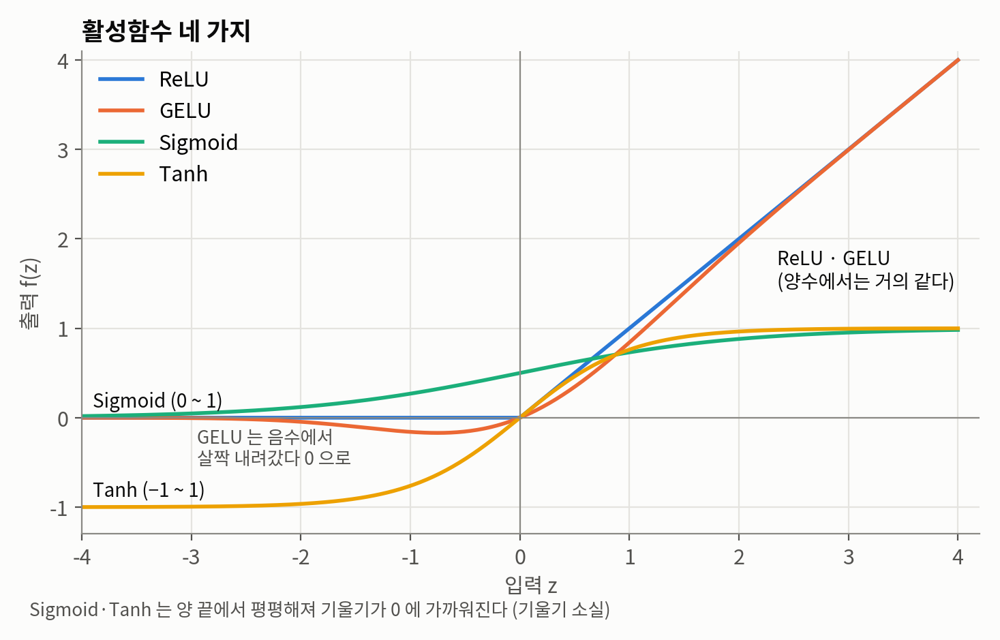

**Softmax 숫자 예시:** z = [2.0, 1.0, 0.1]

```
e^2.0 = 7.389, e^1.0 = 2.718, e^0.1 = 1.105, 합 = 11.212
softmax = [0.659, 0.242, 0.099]
```

가장 큰 값이 가장 큰 확률을 받지만, 나머지도 0 이 아니다.

### 1.4 MLP (Multi-Layer Perceptron)

선형층 → 활성함수 → 선형층 → 활성함수 … 를 쌓은 가장 기본적인 신경망이다.

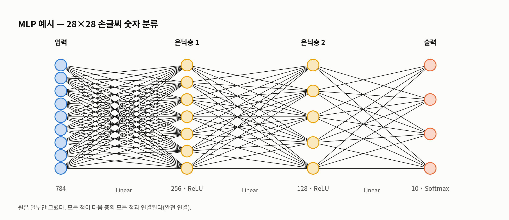

- 파라미터 수: 784·256+256 + 256·128+128 + 128·10+10 = 235,146 개
- **한계:** 이미지를 한 줄로 펴는 순간 "어떤 픽셀이 어떤 픽셀 옆에 있었는지"라는 공간 정보를 버린다. 그래서 이미지에는 CNN(8장)이나 ViT(11장)를 쓴다.
- 그러나 MLP 는 사라지지 않았다. 트랜스포머의 각 층 안에도 MLP(FFN)가 들어 있고(10.6절), 모델의 마지막 "머리(head)"도 대부분 MLP 다.

### 1.5 보편 근사 정리 (Universal Approximation)

> 은닉층이 하나만 있어도, 뉴런 수가 충분히 많으면 MLP 는 (적당한 조건의) 어떤 연속함수든 원하는 정확도로 근사할 수 있다.

- 의미: MLP 는 **표현력** 이 충분하다.
- 하지만 이 정리는 "그런 가중치가 **존재한다**"는 것만 말한다. 그 가중치를 학습으로 **찾을 수 있는지**, 필요한 뉴런이 몇 개인지, 처음 보는 입력에도 **일반화** 되는지는 말하지 않는다.
- 실무에서 깊은 신경망(층이 많음)이 넓은 신경망(뉴런이 많음)보다 잘 되는 이유는 이 정리가 아니라 경험적 관찰과 구조 설계(CNN, 트랜스포머)에서 나온다.

**우리 연구에서는:** SmolVLA 의 트랜스포머 각 층 안에 MLP 가 들어 있고(언어부 intermediate 2560), 상태 벡터 `[v, ω, δ]` 3개를 960차원 토큰으로 바꾸는 것도 선형층이다. 초기 정책 stage_a 도 ResNet18 특징 + 목표 정보를 MLP 로 합쳐 `cmd_vel` 을 냈다.

---

## 2. 손실함수 — 무엇을 줄일 것인가

학습이란 "모델 출력이 정답과 얼마나 다른지"를 숫자 하나(손실, loss)로 재고, 그 숫자를 줄이도록 파라미터를 바꾸는 과정이다.
어떤 손실을 쓰는지가 모델이 **무엇을 배우는지** 를 정한다.

### 2.1 회귀용 손실 — 연속값을 맞출 때

예측 `ŷ`, 정답 `y`, 차이 `e = ŷ − y`

| 손실 | 식 | 특징 |
|---|---|---|
| **MSE** (L2) | `mean(e²)` | 큰 오차를 제곱으로 크게 벌한다. 이상치(outlier)에 민감. 예측이 조건부 **평균** 쪽으로 간다 |
| **MAE** (L1) | `mean(|e|)` | 이상치에 덜 민감. 예측이 조건부 **중앙값** 쪽으로 간다. 0 근처에서 기울기가 불연속 |
| **SmoothL1 / Huber** | `|e| < β` 이면 `0.5·e²/β`, 아니면 `|e| − 0.5·β` | 작은 오차는 MSE 처럼 부드럽게, 큰 오차는 MAE 처럼 덜 민감하게 |

**숫자 예시:** 정답 [1.0, 2.0, 3.0], 예측 [1.1, 2.0, 5.0] (마지막이 크게 틀림)

```
오차 e = [0.1, 0.0, 2.0]
MSE = (0.01 + 0 + 4.0) / 3 = 1.337
MAE = (0.1 + 0 + 2.0) / 3 = 0.700
```

MSE 에서는 하나 크게 틀린 값이 손실 대부분을 차지한다.

**"평균으로 가는" 문제 — 행동 학습에서 특히 중요:**
같은 장면에서 시연자가 어떤 때는 왼쪽으로, 어떤 때는 오른쪽으로 피했다고 하자.
MSE 로 학습하면 모델은 두 답의 **평균인 직진** 을 내놓는다. 둘 다 아닌, 장애물에 그대로 박는 행동이다.
이것을 **다봉(multimodal) 분포 문제** 라고 하며, diffusion·flow matching 같은 생성형 행동 출력이 등장한 핵심 이유다([03 생성모델](03_생성모델_Diffusion_FlowMatching.md), [04 로봇 학습](04_로봇학습_모방학습과_강화학습.md) 참고).

### 2.2 분류용 손실 — 범주를 맞출 때

**교차 엔트로피 (Cross-Entropy, CE):**

```
CE = −Σ_c y_c · log(p_c)
y: 정답의 one-hot 벡터, p: 모델이 낸 softmax 확률
→ 정답 클래스 k 하나만 1 이면  CE = −log(p_k)
```

**숫자 예시:** 정답이 클래스 0

| 모델 확률 p_0 | CE = −log(p_0) |
|---|---|
| 0.9 | 0.105 |
| 0.5 | 0.693 |
| 0.1 | 2.303 |
| 0.01 | 4.605 |

정답 확률이 낮을수록 손실이 급격히 커진다.

**이진 분류:** BCE (Binary Cross-Entropy) = `−[y·log p + (1−y)·log(1−p)]`

### 2.3 왜 회귀와 분류의 손실이 다른가

| | 회귀 | 분류 |
|---|---|---|
| 출력 | 실수 (조향각, 속도, 이동량) | 범주별 확률 |
| 자연스러운 가정 | 오차가 정규분포 → MSE 가 최대우도 | 범주형 분포 → CE 가 최대우도 |
| 분류에 MSE 를 쓰면 | softmax 와 결합 시 기울기가 작아져 학습이 느리다 | |
| 회귀에 CE 를 쓰면 | 연속값을 구간으로 잘라야 한다 (이산화) | |

"손실 = 데이터가 어떤 확률분포에서 나왔다고 가정할 때의 음의 로그우도"라는 관점으로 보면 둘은 같은 원리에서 나온다.

**우리 연구에서는:**
- stage_a 는 `cmd_vel` 을 MSE 회귀로 학습했다.
- SmolVLA 의 행동은 **flow matching 손실**(속도장 회귀, MSE 형태)로 학습한다.
- 해설(narration)을 같이 내는 reasoning 모델은 `flow_matching + λ·CE` 를 함께 최적화한다(행동 손실 + 언어 다음 토큰 CE).
- 회피 연구의 장애물 분류기(카메라 → 장애물 유무)는 BCE + `pos_weight`(불균형 보정)로 학습했다.

---

## 3. 경사하강과 역전파 — 어떻게 줄일 것인가

### 3.1 경사하강 (Gradient Descent)

손실 L 을 파라미터 θ 로 미분한 값(기울기, gradient) `∂L/∂θ` 는 "θ 를 조금 늘리면 L 이 얼마나 늘어나는가"다.
L 을 줄이려면 기울기의 **반대 방향** 으로 조금 움직인다.

```
θ ← θ − η · ∂L/∂θ
η: 학습률 (learning rate)
```

**1차원 숫자 예시:** L(θ) = (θ − 3)², 시작 θ = 0, η = 0.1

```
∂L/∂θ = 2(θ − 3)
스텝 1: 기울기 = 2(0−3) = −6     → θ = 0 − 0.1·(−6) = 0.6
스텝 2: 기울기 = 2(0.6−3) = −4.8 → θ = 0.6 + 0.48 = 1.08
스텝 3: 기울기 = −3.84           → θ = 1.464
...  θ 가 3 에 점점 가까워진다
```

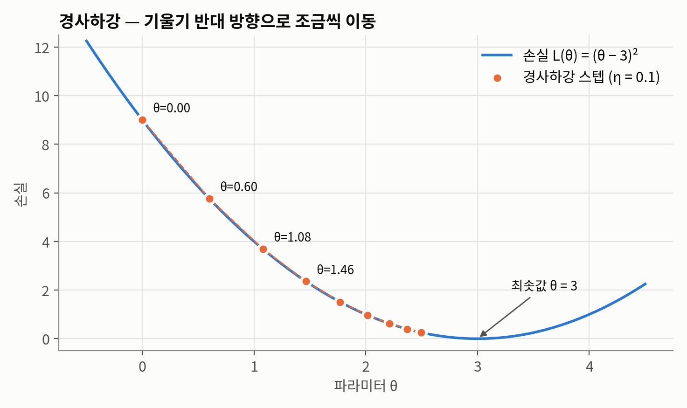

- 학습률이 너무 크면 (예: η = 1.1) 최솟값을 지나쳐 발산한다.
- 너무 작으면 (예: η = 0.001) 수렴이 매우 느리다.

### 3.2 역전파 (Backpropagation) — 연쇄법칙

신경망은 함수를 여러 번 합성한 것이다. 출력에서 손실을 구한 뒤, 연쇄법칙으로 기울기를 **뒤에서 앞으로** 전달하면 모든 파라미터의 기울기를 한 번에 구할 수 있다.

```
연쇄법칙: y = f(g(x)) 이면  dy/dx = f'(g(x)) · g'(x)
```

**작은 수치 예시 — 뉴런 하나:**

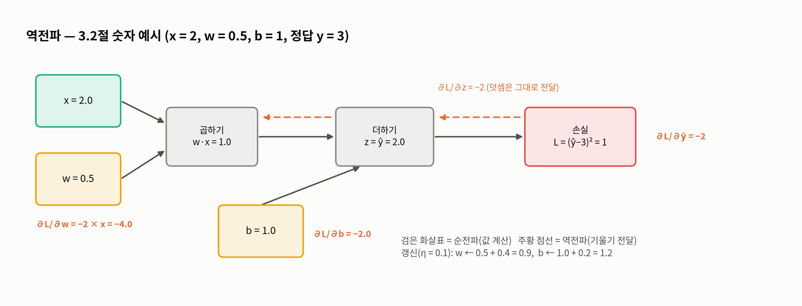

```
입력 x = 2.0, 가중치 w = 0.5, 편향 b = 1.0, 정답 y = 3.0
순전파:
  z = w·x + b = 0.5·2 + 1 = 2.0
  ŷ = z            (활성함수 없음, 단순화)
  L = (ŷ − y)² = (2 − 3)² = 1.0

역전파:
  ∂L/∂ŷ = 2(ŷ − y) = 2(2 − 3) = −2
  ∂ŷ/∂z = 1
  ∂z/∂w = x = 2.0,  ∂z/∂b = 1
  ∂L/∂w = (−2)·1·2.0 = −4.0
  ∂L/∂b = (−2)·1·1   = −2.0

갱신 (η = 0.1):
  w ← 0.5 − 0.1·(−4.0) = 0.9
  b ← 1.0 − 0.1·(−2.0) = 1.2
확인: 새 ŷ = 0.9·2 + 1.2 = 3.0  → 정답과 같아졌다 (이 예시는 우연히 한 번에 맞음)
```

**두 층 예시 (ReLU 포함):**

```
x = 1.0
층1: h = ReLU(w1·x) , w1 = 2.0  → h = ReLU(2.0) = 2.0
층2: ŷ = w2·h        , w2 = 0.5  → ŷ = 1.0
정답 y = 2.0, L = (ŷ − y)² = 1.0

∂L/∂ŷ  = 2(1 − 2) = −2
∂L/∂w2 = ∂L/∂ŷ · h = −2 · 2.0 = −4.0
∂L/∂h  = ∂L/∂ŷ · w2 = −2 · 0.5 = −1.0
∂h/∂(w1·x) = 1   (ReLU 입력이 양수이므로)
∂L/∂w1 = ∂L/∂h · 1 · x = −1.0 · 1 · 1.0 = −1.0
```

- 앞쪽 층의 기울기는 뒤쪽 층들의 기울기를 **곱해서** 얻는다.
- 곱해지는 값들이 계속 1보다 작으면 → 기울기가 0 에 가까워진다 (**기울기 소실**, vanishing gradient)
- 계속 1보다 크면 → 기울기가 폭발한다 (**기울기 폭발**, exploding gradient)
- 깊은 신경망을 학습 가능하게 만든 핵심 도구들(ReLU, 잔차연결, 정규화층, 좋은 초기화)은 대부분 이 문제를 줄이기 위한 것이다(7장).

### 3.3 자동 미분

실제로는 손으로 미분하지 않는다. PyTorch 가 순전파 때 계산 그래프를 기록해 두고 `loss.backward()` 한 줄로 모든 기울기를 계산한다.

```python
pred = model(x)
loss = ((pred - y) ** 2).mean()
optimizer.zero_grad()   # 이전 스텝의 기울기 지우기 (안 지우면 누적됨)
loss.backward()         # 역전파: 모든 파라미터의 .grad 채움
optimizer.step()        # 파라미터 갱신
```

**우리 연구에서는:** `lerobot-train` 과 `train_reasoning.py` 안에서 매 스텝 이 4줄이 돈다. 학습 로그의 `loss` 와 `grad_norm`(기울기 크기)이 이 과정의 기록이다.

---

## 4. 옵티마이저와 학습률 스케줄

### 4.1 SGD 와 미니배치

- **배치 경사하강:** 데이터 전체로 기울기를 계산 → 정확하지만 한 번에 너무 비싸다.
- **확률적 경사하강 (SGD):** 데이터 일부(미니배치)로 기울기를 추정해 자주 갱신한다. 기울기에 잡음이 있지만, 그 잡음이 오히려 나쁜 지점에서 빠져나오는 데 도움이 된다고 알려져 있다.

### 4.2 모멘텀 (Momentum)

기울기를 매번 새로 쓰지 않고, 이전 이동 방향을 일정 비율 유지한다.

```
v ← β·v + g          (β 보통 0.9)
θ ← θ − η·v
```

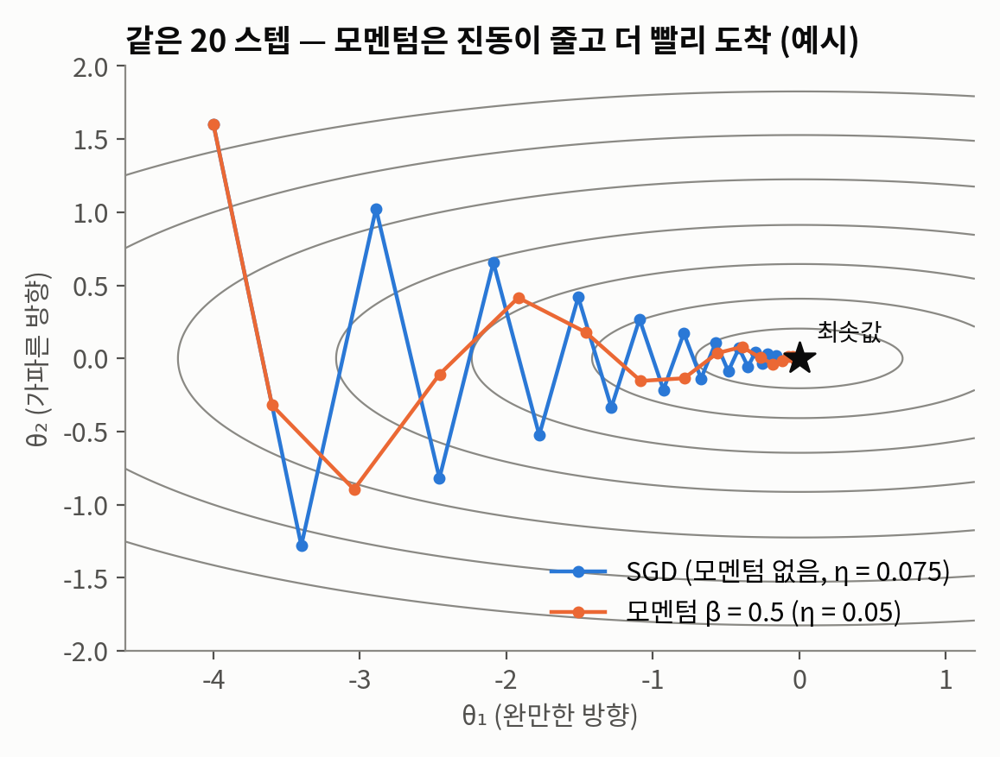

- 같은 방향으로 계속 기울어진 골짜기에서는 속도가 붙어 빨리 내려간다.
- 방향이 계속 바뀌는 진동은 서로 상쇄돼 줄어든다.

### 4.3 Adam

파라미터마다 기울기의 크기에 맞춰 보폭을 따로 조절한다.

```
m ← β1·m + (1−β1)·g          1차 모멘트 (평균 방향), β1 = 0.9
v ← β2·v + (1−β2)·g²         2차 모멘트 (크기),       β2 = 0.999
m̂ = m / (1 − β1^t),  v̂ = v / (1 − β2^t)   초기 편향 보정
θ ← θ − η · m̂ / (√v̂ + ε)
```

- 기울기가 늘 큰 파라미터는 보폭이 작아지고, 늘 작은 파라미터는 보폭이 커진다.
- 학습률을 덜 섬세하게 골라도 잘 동작해서 사실상 표준이 됐다.
- **메모리 비용:** 파라미터마다 m, v 두 개를 더 저장한다 → 파라미터의 2배 메모리가 추가로 필요하다(12장).

### 4.4 AdamW — 가중치 감쇠를 제대로

가중치 감쇠(weight decay)는 가중치를 매 스텝 조금씩 0 쪽으로 줄여 과적합을 막는 기법이다(6.2절).
원래 Adam 에 L2 정규화를 손실에 더하면, Adam 의 보폭 조절과 섞여 의도대로 동작하지 않는다.
**AdamW** 는 감쇠를 기울기와 분리해 파라미터에 직접 적용한다.

```
θ ← θ − η · ( m̂ / (√v̂ + ε)  +  λ·θ )
```

트랜스포머 학습은 거의 다 AdamW 를 쓴다.

### 4.5 학습률 스케줄 — warmup + cosine

학습률을 처음부터 끝까지 고정하지 않는다.

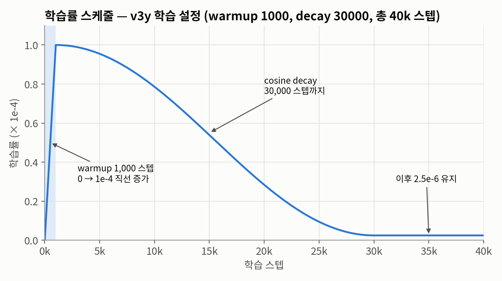

| 단계 | 하는 일 | 이유 |
|---|---|---|
| **Warmup** | 처음 수백~수천 스텝 동안 0 근처에서 목표 학습률까지 선형 증가 | 학습 초반에는 Adam 의 v 추정이 불안정하고, 사전학습 가중치를 큰 보폭으로 망가뜨릴 수 있다 |
| **Cosine decay** | 이후 코사인 곡선을 따라 서서히 감소 | 후반에 작은 보폭으로 정밀하게 수렴 |

**우리 연구에서는:** v3y 체크포인트 설정에 `scheduler_warmup_steps: 1000`, `scheduler_decay_steps: 30000` 이 들어 있다. 즉 1,000 스텝 warmup 후 30,000 스텝에 걸쳐 감소하는 스케줄이다(값은 `models/server/navvla_smolvla_v3y/.../config.json` 에서 확인).

---

## 5. 배치·에폭·스텝

| 용어 | 뜻 |
|---|---|
| **샘플** | 학습 데이터 한 개 (예: 카메라 프레임 1장 + 문장 + 상태 + 정답 행동) |
| **배치 (batch)** | 한 번의 기울기 계산에 쓰는 샘플 묶음. 크기 = batch size |
| **스텝 (step, iteration)** | 배치 하나로 순전파 → 역전파 → 갱신 1회 |
| **에폭 (epoch)** | 학습 데이터 전체를 한 번 다 본 것 |

```
에폭당 스텝 수 = 데이터 수 / 배치 크기
총 본 샘플 수 = 스텝 수 × 배치 크기
```

**숫자 예시:** 프레임 93,700개, 배치 8, 60,000 스텝

```
에폭당 스텝 = 93,700 / 8 ≈ 11,713
총 에폭 ≈ 60,000 / 11,713 ≈ 5.1 에폭
```

**배치 크기의 영향:**

| 큰 배치 | 작은 배치 |
|---|---|
| 기울기 추정이 정확 | 기울기 잡음이 큼 |
| GPU 효율이 좋음 | GPU 를 덜 채움 |
| 메모리를 많이 씀 | 메모리를 적게 씀 |
| 보통 학습률을 같이 키워야 함 | |

**우리 연구에서는:** 가이드 2.1절 기준 v5~v7 학습은 배치 8, 60,000 스텝이다. v6 코퍼스는 406 에피소드, 약 93.7K 프레임이다. 가이드 6.3절에 "8.6시간, 60K 스텝, 에폭 셈법"이 자세히 있다. 최근 goto 기준선 실험은 10k 스텝 · bs16 으로 돌렸다.

---

## 6. 과적합과 정규화 기법

### 6.1 과적합 (Overfitting)

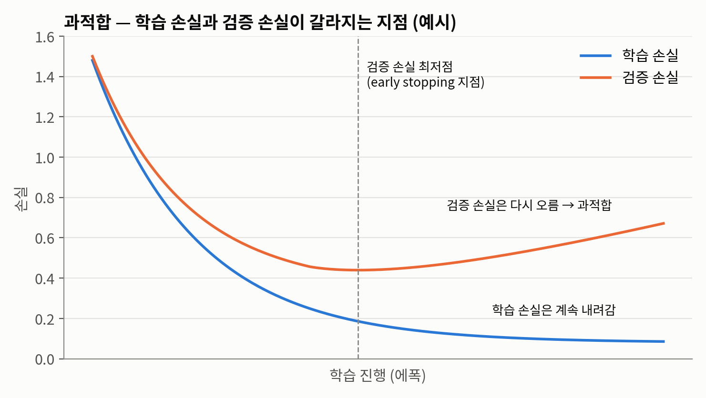

- 모델이 학습 데이터의 **일반 규칙** 이 아니라 **개별 샘플의 특이점** 까지 외우는 현상이다.
- 증상: 학습 손실은 계속 내려가는데 검증(처음 보는 데이터) 손실은 오른다.
- 원인: 데이터에 비해 모델이 너무 크거나, 너무 오래 학습했거나, 데이터가 다양하지 않다.

**행동 학습에서의 특별한 형태 — 지름길 학습(shortcut learning):**
모델이 진짜 원인(장애물) 대신 우연히 함께 나타난 단서(트랙 위의 자리, 배경)를 외우는 것이다.
학습 데이터 안에서는 둘이 항상 같이 나오니 손실로는 구별이 안 된다.
검증 데이터를 학습 데이터와 같은 분포에서 뽑으면 이 문제를 놓친다 → **조건을 바꾼 평가(홀드아웃 위치, 빈 차선 대조군)** 가 필요하다.

### 6.2 정규화 기법 (Regularization)

| 기법 | 방법 | 효과 |
|---|---|---|
| **Weight decay** | 가중치를 매 스텝 조금씩 0 쪽으로 | 큰 가중치를 억제 → 단순한 함수 선호 |
| **Dropout** | 학습 중 무작위로 뉴런 일부(예: 10%)의 출력을 0 으로 | 특정 뉴런에 의존하지 않게 함. **추론 때는 끈다** (`model.eval()`) |
| **Data augmentation** | 입력을 조금씩 바꿔 데이터를 늘림 (자르기, 밝기, 색, 좌우 반전 등) | 불필요한 변화에 둔감해짐 |
| **Early stopping** | 검증 성능이 가장 좋을 때의 체크포인트를 쓴다 | 과적합 시점 이전에서 멈춤 |
| **Label smoothing** | 분류 정답을 [0,0,1,0] 대신 [0.03,0.03,0.91,0.03] 처럼 | 과신 억제 |
| **더 많은·다양한 데이터** | 근본적인 해결 | |

**데이터 증강의 함정 — 행동과 맞지 않는 변환:**
주행 이미지를 좌우 반전하면 정답 조향의 부호도 같이 바꿔야 한다. 이미지만 뒤집고 행동을 그대로 두면 잘못된 정답을 가르치게 된다.

**우리 연구에서는:**
- 회피 연구에서 장애물 자리가 고정된 시연을 학습한 r44 가 빈 차선에서도 같은 자리에서 꺾었다. 출발 거리를 10~63 m 로 바꿔도 같은 자리에서 꺾어서, "자리 습관"이라는 지름길 학습으로 결론 내렸다([shortcut-learning 문서](../experiments/avoidance/20261002_1414_shortcut-learning.md)).
- 그래서 평가에 **빈 차선(empty) 대조 조건** 과 **무작위 위치** 를 넣는다(`tools/eval/stat_eval.sh`).

---

## 7. 초기화, 정규화층, 잔차연결

### 7.1 가중치 초기화

모든 가중치를 0 으로 시작하면 모든 뉴런이 같은 기울기를 받아 영원히 같은 값이 된다(대칭 문제). 그래서 작은 무작위 값으로 시작한다.
층을 지날 때 신호의 분산이 유지되도록 크기를 맞추는 방식이 표준이다.

| 방식 | 분산 | 맞는 활성함수 |
|---|---|---|
| Xavier (Glorot) | `2 / (d_in + d_out)` | tanh, sigmoid |
| He (Kaiming) | `2 / d_in` | ReLU |

실무에서는 대부분 **사전학습 가중치** 에서 시작하므로 초기화를 직접 고를 일이 적다. 새로 붙이는 머리(head)나 행동 출력층만 무작위 초기화된다.

### 7.2 정규화층 (Normalization Layer)

층 사이에서 값의 분포(평균, 분산)를 일정하게 맞춰 학습을 안정시킨다.
(6장의 "정규화(regularization)"와는 다른 개념이다. 영어로도 다르다.)

```
x̂ = (x − 평균) / √(분산 + ε)
y = γ·x̂ + β       (γ, β 는 학습 파라미터)
```

**평균과 분산을 어느 방향으로 계산하느냐** 가 핵심 차이다.

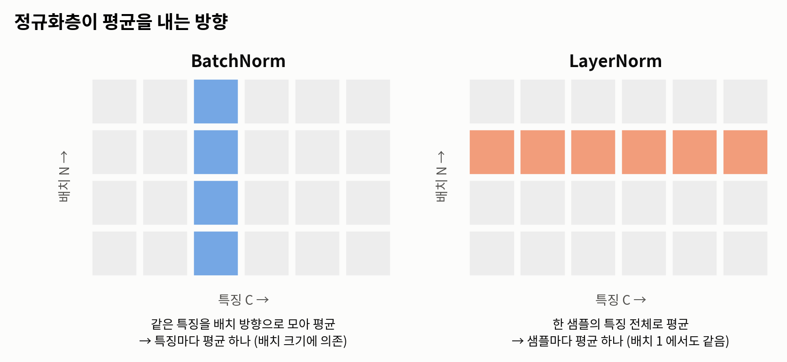

| | BatchNorm | LayerNorm |
|---|---|---|
| 통계 계산 방향 | 배치 방향 | 특징 방향 (샘플 하나 안에서) |
| 배치 크기 의존 | 있음. 배치가 작으면 통계가 불안정 | 없음 |
| 학습/추론 차이 | 있음. 추론 때는 학습 중 모아 둔 이동 평균 사용 | 없음 |
| 길이가 다른 시퀀스 | 다루기 어려움 | 자연스러움 |
| 주 사용처 | CNN (ResNet) | 트랜스포머 |

**왜 트랜스포머는 LayerNorm 인가:**
1. 문장 길이가 샘플마다 다르고, 토큰 위치마다 의미가 달라 배치 방향 통계가 의미 없다.
2. 언어모델 생성은 배치 1, 토큰 하나씩 진행돼 배치 통계를 쓸 수 없다.
3. 학습과 추론이 같은 계산이라 버그가 적다.

**RMSNorm:** LayerNorm 에서 평균 빼기를 생략하고 크기(RMS)로만 나눈다. 계산이 더 싸고 성능이 비슷해서 Llama 계열이 쓴다.

```
RMSNorm(x) = x / √(mean(x²) + ε) · γ
```

**Pre-LN vs Post-LN:** 정규화를 어텐션 **앞** 에 두느냐(Pre-LN) **뒤** 에 두느냐(Post-LN). 최근 모델은 대부분 Pre-LN 이다. 깊게 쌓아도 학습이 안정적이기 때문이다.

### 7.3 잔차연결 (Residual Connection)

층의 출력에 입력을 그대로 더한다.

```
y = x + F(x)
```

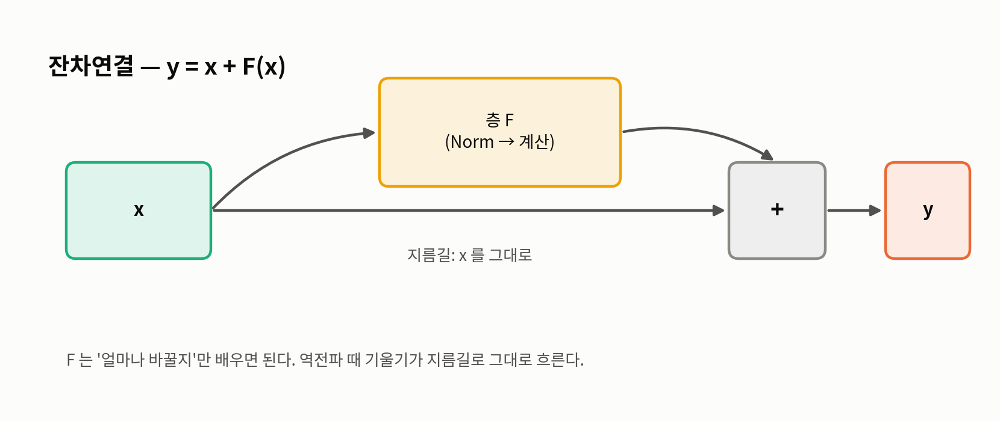

- 층 F 는 "입력을 얼마나 **바꿀지**"만 배우면 된다. 바꿀 필요가 없으면 F(x) ≈ 0 이면 된다.
- 역전파 때 기울기가 `+x` 경로로 그대로 흘러가 깊은 층까지 잘 전달된다 → 기울기 소실 완화.
- ResNet(2015)이 이 아이디어로 100층 이상의 학습을 가능하게 했다. 트랜스포머의 모든 층에도 들어 있다.

**우리 연구에서는:** SmolVLA 언어부(Llama 계열)는 RMSNorm + 잔차연결 + Pre-LN 구조다. stage_a 에 쓴 ResNet18 은 BatchNorm + 잔차연결 구조다. ResNet 을 배치 1 로 추론할 때 `model.eval()` 을 빠뜨리면 BatchNorm 이 그 한 장의 통계로 정규화해 출력이 망가지는 전형적인 실수가 있다.

---

## 8. CNN — 이미지를 위한 구조

### 8.1 합성곱 (Convolution)

작은 필터(커널, 예: 3×3)를 이미지 위로 밀면서, 겹친 부분의 값을 곱해 더한다.

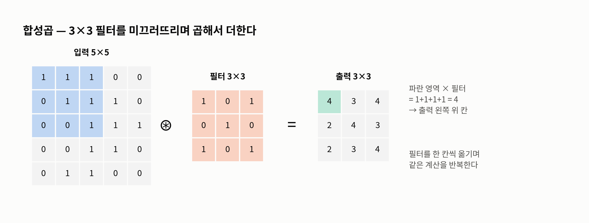

왼쪽 위 출력 값 계산:
```
1·1 + 1·0 + 1·1
+ 0·0 + 1·1 + 1·0
+ 0·1 + 0·0 + 1·1  = 1+1+1+1 = 4
```

- **같은 필터를 모든 위치에 재사용** 한다 (가중치 공유). 3×3 필터는 이미지 크기와 상관없이 파라미터가 9개(+편향)다.
- 필터는 학습으로 정해진다. 초기 층 필터는 보통 가장자리·색 경계 같은 단순 패턴을 잡게 된다.

**하이퍼파라미터:**

| 이름 | 뜻 | 출력 크기 영향 |
|---|---|---|
| kernel size | 필터 크기 (3×3, 5×5, 7×7) | |
| stride | 한 번에 몇 칸 이동 | 2 면 출력이 절반 |
| padding | 가장자리에 0 을 덧대기 | 크기 유지 |

```
출력 크기 = (입력 − 커널 + 2·패딩) / 스트라이드 + 1
예: 입력 224, 커널 7, 패딩 3, 스트라이드 2 → (224 − 7 + 6)/2 + 1 = 112
```

### 8.2 채널

- 컬러 이미지는 R, G, B 3채널이다. 필터 하나는 **모든 입력 채널** 을 한꺼번에 본다 (3×3×3 = 27개 가중치).
- 필터를 여러 개 쓰면 출력 채널이 여러 개가 된다. 64개 필터 → 64채널 특징 맵.
- 파라미터 수 = `k × k × C_in × C_out + C_out`
- 예: 3×3, 입력 64채널, 출력 128채널 → 3·3·64·128 + 128 = 73,856

### 8.3 풀링 (Pooling)

특징 맵을 줄여 계산량을 줄이고, 작은 위치 변화에 둔감하게 만든다.

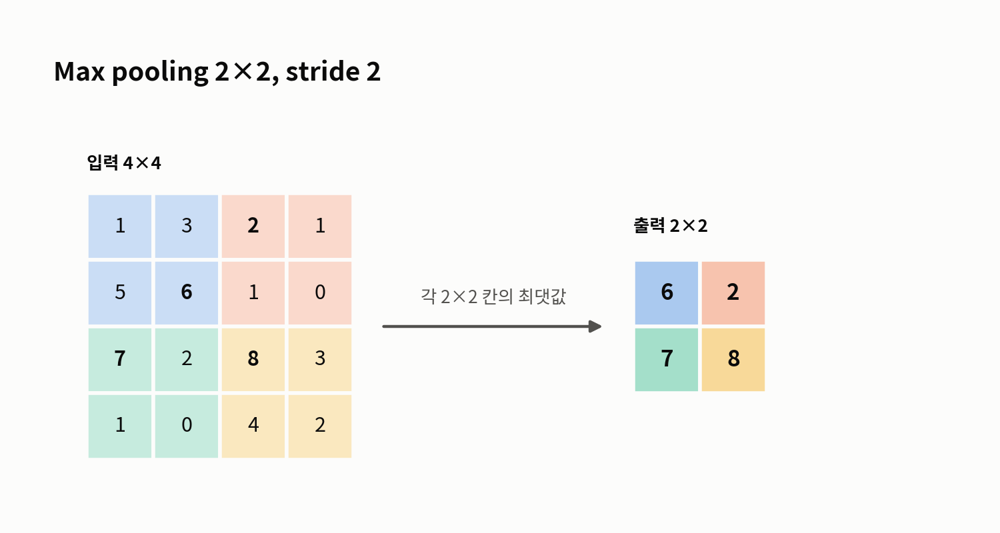

- **Global Average Pooling:** 특징 맵 전체를 채널별 평균 하나로 → [C, H, W] 가 [C] 벡터가 된다. ResNet 이 마지막에 이것으로 이미지 전체를 벡터 하나로 요약한다.

### 8.4 수용 영역 (Receptive Field)

출력 한 칸이 원래 이미지의 얼마만 한 영역을 "보고" 있는가.

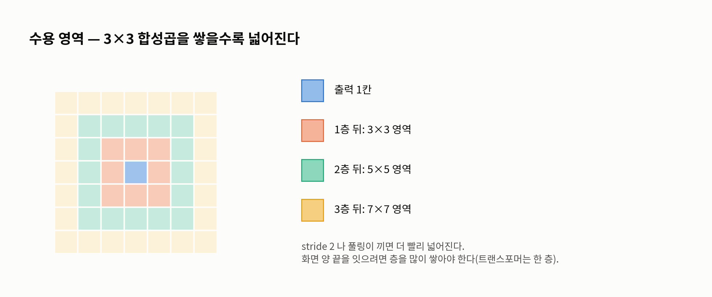

- 깊은 층일수록 넓은 영역을 보고, 더 추상적인 특징(차선 전체, 차 모양)을 표현한다.
- **CNN 의 한계:** 화면 왼쪽 끝과 오른쪽 끝을 연결하려면 층을 많이 쌓아야 한다. 트랜스포머는 한 층에서 바로 연결된다(10장).

### 8.5 왜 CNN 이 이미지에 맞는가 — 귀납 편향

| 이미지의 성질 | CNN 의 설계 |
|---|---|
| 가까운 픽셀끼리 관련이 깊다 (국소성) | 작은 필터로 국소 영역만 본다 |
| 같은 패턴이 어디에 나와도 같은 의미 (이동 불변성) | 같은 필터를 모든 위치에 공유한다 |
| 작은 패턴이 모여 큰 패턴을 이룬다 (계층성) | 층을 쌓을수록 수용 영역이 넓어진다 |

이런 "구조에 미리 넣어 둔 가정"을 **귀납 편향(inductive bias)** 이라 한다.
귀납 편향이 강하면 **데이터가 적어도** 잘 배운다. 대신 가정이 틀린 경우에는 제약이 된다.
ViT 는 귀납 편향이 약해서 데이터가 많을 때 CNN 을 이긴다(11장).

### 8.6 ResNet

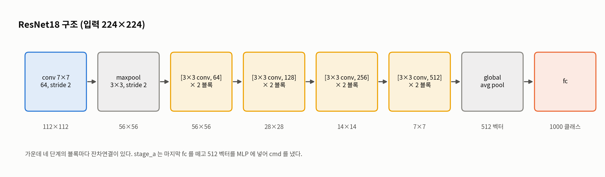

- 각 블록은 `y = x + F(x)` 잔차 구조다 (F = conv-BN-ReLU-conv-BN).
- 18은 가중치가 있는 층 수다. 파라미터 약 11.7M.
- **전이학습:** ImageNet 으로 사전학습한 ResNet 에서 마지막 fc 를 떼고, 512 벡터를 새 과제의 입력 특징으로 쓴다. 적은 데이터로도 잘 된다.

### 8.7 객체 검출 — YOLO

- **분류:** 이미지 전체 → 클래스 하나
- **검출:** 이미지 → 여러 물체 각각의 (상자 위치, 클래스, 신뢰도)
- **YOLO (You Only Look Once):** CNN 백본으로 특징을 뽑고, 격자 위치마다 상자와 클래스를 한 번에 예측한다. 한 번의 순전파로 끝나 실시간 처리가 가능하다.
- 후처리: 겹치는 상자 중 신뢰도 높은 것만 남기는 NMS(Non-Maximum Suppression)

**우리 연구에서는:**
- **stage_a** (2026-07 초기 정책): ImageNet 사전학습 ResNet18 로 128×128 카메라 이미지 특징을 뽑고, 목표 존·차선 모드·상대 좌표·상태를 합쳐 MLP 로 `cmd_vel` 한 스텝을 MSE 회귀했다. 좌표가 입력에 있어 주행은 정밀했지만 언어는 모델 밖(Qwen 파서)에 있었고, 전역 좌표가 없는 실차엔 옮길 수 없었다([비교 문서](../experiments/reports/vla_training_comparison.md)).
- **장애물 분류기** (회피 초기): ResNet18 이진 분류, 라이다를 자동 정답으로 써서 학습했다.
- **YOLO 스택:** yolov8 기반 차선 인지 → 경로계획 → 모션계획으로 이어지는 기존 주행 스택이다. v3y 부터 VLA 의 **선생(시연자)** 이 이 스택이다. 즉 VLA 는 YOLO 스택이 운전하는 모습을 보고 따라 배운 학생이다.

---

## 9. RNN·LSTM — 순서 데이터의 옛 표준

### 9.1 RNN

시퀀스를 한 원소씩 읽으면서 은닉 상태(hidden state)를 갱신한다.

```
h_t = tanh(W_h·h_(t−1) + W_x·x_t + b)
```

- 같은 가중치를 매 시점 재사용한다.
- 문제: 긴 시퀀스에서 앞쪽 정보의 기울기가 W_h 를 수십 번 곱하며 소실·폭발한다 → 먼 과거를 잘 기억 못 한다.

### 9.2 LSTM / GRU

"무엇을 기억하고 무엇을 잊을지" 정하는 **게이트** 를 넣어 장기 기억 문제를 줄였다.

```
LSTM: 망각 게이트 f, 입력 게이트 i, 출력 게이트 o, 셀 상태 c
c_t = f ⊙ c_(t−1) + i ⊙ (새 후보)
→ 셀 상태가 덧셈으로 이어져 기울기가 오래 살아남는다 (잔차연결과 비슷한 원리)
```

### 9.3 왜 트랜스포머로 넘어갔나

| | RNN/LSTM | Transformer |
|---|---|---|
| 처리 방식 | 순서대로 하나씩 (병렬 불가) | 모든 토큰 동시 처리 (학습 병렬화) |
| 먼 거리 연결 | 시점 수만큼 거쳐야 함 | 한 층에서 바로 연결 |
| GPU 활용 | 낮음 | 높음 |
| 대규모 확장 | 어려움 | 데이터·모델을 키울수록 계속 좋아짐 |
| 약점 | | 시퀀스 길이 n 에 대해 어텐션 계산이 n² |

**우리 연구에서는:** RNN 은 쓰지 않는다. 과거 정보는 상태 벡터(직전 이동량에서 나온 v, ω, δ)로 한 스텝만 넣고, 미래는 행동 청크 30스텝을 한 번에 예측해 다룬다.

---

## 10. Transformer

"Attention Is All You Need"(2017)에서 나온 구조로, 지금의 LLM·VLM·VLA 가 모두 이 위에 있다.

### 10.1 전체 흐름

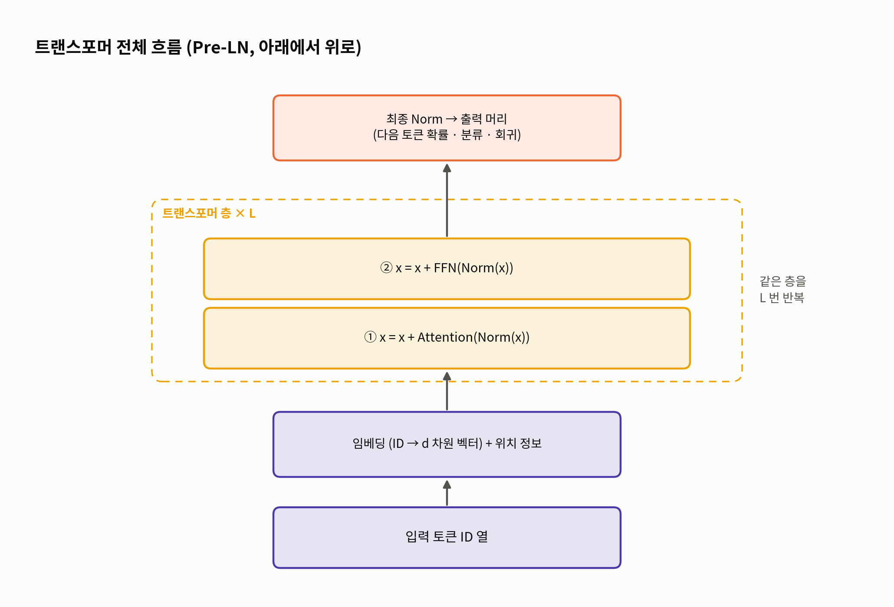

### 10.2 임베딩

- 토큰 ID(정수)를 d 차원 벡터로 바꾸는 표(lookup table)다. 크기 = 어휘 수 × d.
- 예: 어휘 49,280, d = 960 → 49,280 × 960 ≈ 47.3M 파라미터
- 학습을 거치면 비슷한 의미의 토큰 벡터가 서로 가까워진다.

### 10.3 위치 인코딩

어텐션 자체는 토큰 순서를 모른다 ("개가 사람을 물었다"와 "사람이 개를 물었다"를 구별 못 함). 그래서 위치 정보를 넣는다.

| 방식 | 방법 | 사용 |
|---|---|---|
| 사인·코사인 (고정) | 위치마다 다른 주파수의 sin/cos 값을 임베딩에 더함 | 원조 Transformer |
| 학습형 절대 위치 | 위치마다 학습 벡터를 더함 | BERT, GPT-2, ViT |
| **RoPE** (회전 위치 인코딩) | Q 와 K 벡터를 위치에 비례한 각도만큼 **회전** 시킴 | Llama, Qwen, SmolLM2 |

**RoPE 의 핵심:**
- 벡터를 2개씩 짝지어 2차원 평면의 점으로 보고, 위치 m 에 비례한 각도 `m·θ` 만큼 회전한다.
- 위치 m 의 쿼리와 위치 n 의 키를 내적하면, 결과가 두 위치의 **차이 (m − n)** 에만 의존하게 된다.
- 즉 "몇 칸 떨어져 있는가"(상대 위치)가 자연스럽게 어텐션 점수에 들어간다.
- `rope_theta` 는 회전 주파수의 기준값이다. 클수록 긴 문맥에 유리하다고 알려져 있다.

### 10.4 Self-Attention

각 토큰 벡터 x 에서 세 벡터를 만든다.

```
Q = x·W_Q   (쿼리: 내가 찾는 것)
K = x·W_K   (키: 내가 가진 것의 색인)
V = x·W_V   (값: 실제로 전달할 내용)

Attention(Q, K, V) = softmax( Q·Kᵀ / √d_k ) · V
```

**단계별 의미:**
1. `Q·Kᵀ`: 모든 토큰 쌍의 유사도 점수 (n × n 행렬)
2. `/ √d_k`: 차원이 크면 내적 값이 커져 softmax 가 한쪽으로 쏠리고 기울기가 사라진다. 그래서 크기를 줄인다.
3. `softmax`: 각 행(각 토큰)마다 "누구에게 얼마나 주목할지" 확률로
4. `· V`: 그 비중대로 다른 토큰들의 값을 섞는다

**작은 숫자 예시 — 토큰 3개, d_k = 2:**

```
Q = [[1, 0],      K = [[1, 0],      V = [[1, 0],
     [0, 1],           [0, 1],           [0, 2],
     [1, 1]]           [1, 1]]           [3, 3]]

1) Q·Kᵀ =
   토큰1: [1·1+0·0, 1·0+0·1, 1·1+0·1] = [1, 0, 1]
   토큰2: [0, 1, 1]
   토큰3: [1, 1, 2]

2) / √2 (≈1.414):
   토큰1: [0.707, 0,     0.707]
   토큰2: [0,     0.707, 0.707]
   토큰3: [0.707, 0.707, 1.414]

3) softmax (토큰1 행):
   e^0.707 = 2.028, e^0 = 1.000
   합 = 2.028 + 1.000 + 2.028 = 5.056
   → [0.401, 0.198, 0.401]

   토큰3 행: e^0.707=2.028, e^1.414=4.113, 합 = 8.169
   → [0.248, 0.248, 0.503]

4) 출력 = 가중치 · V
   토큰1: 0.401·[1,0] + 0.198·[0,2] + 0.401·[3,3]
        = [0.401 + 1.203, 0.396 + 1.203] = [1.604, 1.599]
   토큰3: 0.248·[1,0] + 0.248·[0,2] + 0.503·[3,3]
        = [0.248 + 1.510, 0.497 + 1.510] ≈ [1.759, 2.007]
```

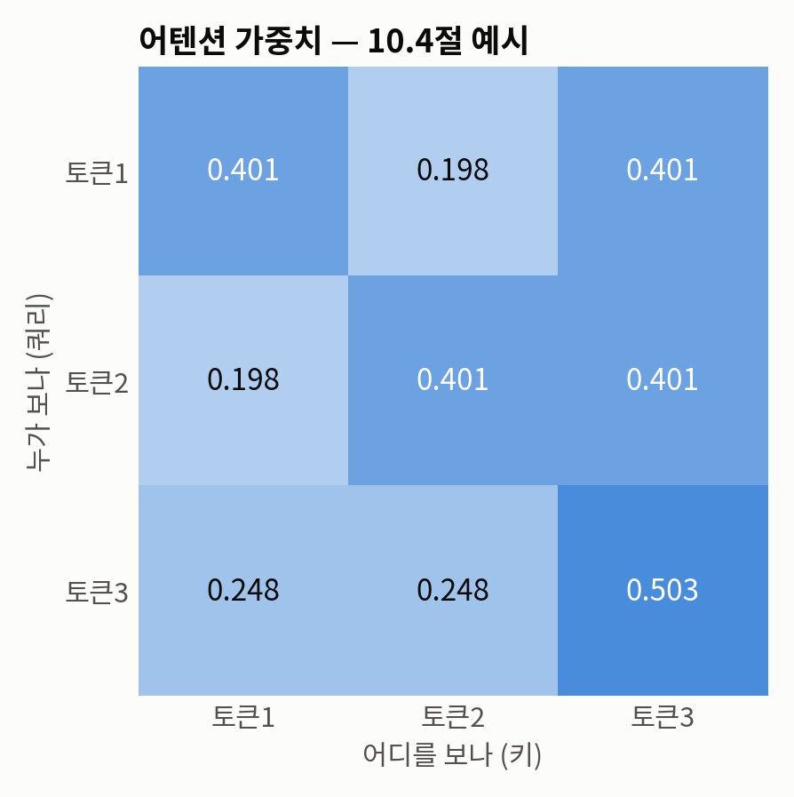

토큰1 은 자기 자신과 토큰3 에 비슷하게 주목했고, 토큰3 은 자기 자신에 가장 많이 주목했다.
이 "누구에게 주목할지"가 W_Q, W_K 학습으로 정해진다.

### 10.5 Multi-Head Attention

- 어텐션을 한 번만 하지 않고 h 개의 "헤드"로 나눠 병렬로 한다. 각 헤드는 d/h 차원을 쓴다.
- 헤드마다 다른 관계(문법 관계, 위치 관계, 의미 관계 등)에 주목하도록 학습될 수 있다.
- 헤드 출력을 이어 붙이고 선형층(W_O)으로 섞는다.

```
d = 960, h = 15 → 헤드당 64 차원
```

**GQA (Grouped-Query Attention):** 쿼리 헤드는 많이 두고, 키·값 헤드는 적게 두어 여러 쿼리 헤드가 공유한다. 추론 때 저장할 K, V(KV 캐시)가 줄어 메모리가 절약된다.

```
쿼리 헤드 15개, KV 헤드 5개 → 쿼리 3개가 KV 하나를 공유
```

### 10.6 FFN (Feed-Forward Network)

어텐션 다음에 토큰마다 **독립적으로** 적용되는 MLP 다.

```
기본형:  FFN(x) = W2 · GELU(W1·x)          (d → 4d → d)
SwiGLU:  FFN(x) = W2 · ( SiLU(W1·x) ⊙ (W3·x) )   (Llama 계열)
```

- 어텐션이 "토큰 사이에서 정보를 섞는" 역할이라면, FFN 은 "각 토큰 안에서 정보를 가공하는" 역할이다.
- 트랜스포머 파라미터의 약 2/3 가 FFN 에 있다.

### 10.7 Causal Mask

언어모델은 "다음 토큰"을 예측하므로, 학습 때 뒤쪽 토큰을 보면 정답을 미리 보는 셈이다.
그래서 어텐션 점수 행렬의 위쪽 삼각형을 −∞ 로 가려 softmax 후 0 이 되게 한다.

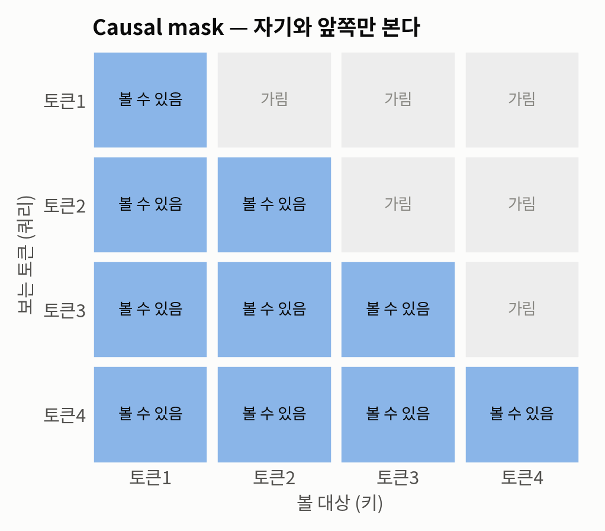

### 10.8 Encoder vs Decoder

| 구조 | 마스크 | 대표 모델 | 잘하는 일 |
|---|---|---|---|
| Encoder-only | 없음 (양방향) | BERT, ViT, SigLIP 비전 인코더 | 입력 이해·분류·특징 추출 |
| Decoder-only | Causal | GPT, Llama, Qwen, SmolLM2 | 생성 |
| Encoder-Decoder | 인코더 양방향 + 디코더 causal + cross-attention | 원조 Transformer, T5 | 번역, 요약 |

**Cross-attention:** 쿼리는 한쪽 시퀀스(예: 디코더)에서, 키·값은 다른 시퀀스(예: 인코더 출력)에서 가져온다. "한 스트림이 다른 스트림을 읽는" 연산이다.

**우리 연구에서는:**
- SmolVLA 언어부는 Llama 계열 decoder: hidden 960, 원래 32층 중 앞 16층만 사용, 쿼리 헤드 15 / KV 헤드 5 (GQA), head_dim 64, FFN 중간 크기 2560, 어휘 49,280, RoPE.
- **Action expert** 는 같은 구조를 폭 0.75 (hidden 720, FFN 2048)로 줄인 16층 트랜스포머다. 짝수 층은 VLM 토큰과 행동 토큰을 한 시퀀스로 합쳐 self-attention, 홀수 층은 행동 토큰이 VLM 쪽을 읽는 cross-attention 을 번갈아 쓴다(가이드 4.4절).
- 해설 머리(reasoning)는 언어부의 `lm_head`(약 47M, 어휘 크기 출력)를 다시 살려 다음 토큰 CE 로 학습한 것이다.

---

## 11. ViT — 이미지를 토큰으로

### 11.1 방법

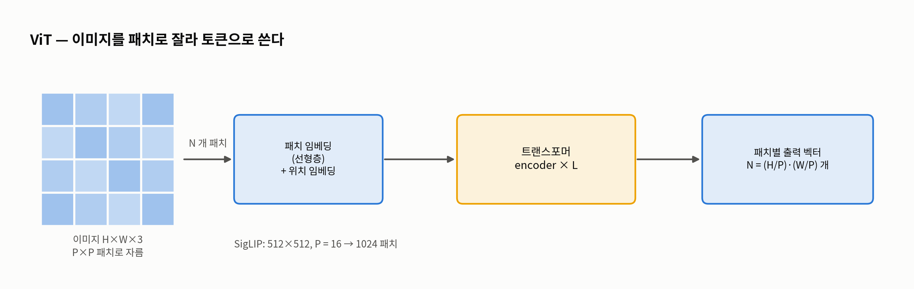

**숫자 예시:** 224×224 이미지, 16×16 패치 → 14×14 = 196 패치 토큰. 패치 하나 = 16·16·3 = 768 개 숫자.

### 11.2 CNN 과 비교

| | CNN | ViT |
|---|---|---|
| 귀납 편향 | 강함 (국소성, 이동 불변) | 약함 (위치 임베딩만) |
| 적은 데이터 | 유리 | 불리 |
| 많은 데이터 | 성능 포화 | 계속 좋아짐 |
| 먼 영역 연결 | 층을 많이 쌓아야 | 첫 층부터 가능 |
| 언어모델과 결합 | 별도 변환 필요 | 같은 "토큰" 형식이라 자연스럽다 |

마지막 줄이 VLM 이 대부분 ViT 를 쓰는 이유다. 이미지 토큰과 텍스트 토큰을 한 줄에 세울 수 있다.

**우리 연구에서는:** SmolVLM2 의 비전 인코더는 SigLIP 계열 ViT 다 (hidden 768, 12 헤드, 패치 16, 입력 512, 약 86.4M 파라미터). 512×512 이미지 → 32×32 = 1,024 패치 → pixel shuffle(배율 4)로 4×4 묶음을 접어 **64 토큰** (960차원)이 된다. 우리 카메라 프레임은 640×480 이고 체크포인트 설정 `resize_imgs_with_padding: [512, 512]` 로 패딩해 넣는다.

---

## 12. 연산량·메모리 감각

### 12.1 트랜스포머 층 하나의 파라미터 수 (d = 960 예시)

SmolLM2 형태 (d = 960, 쿼리 헤드 15, KV 헤드 5, head_dim 64, FFN 중간 2560, SwiGLU, 편향 없음 가정):

```
어텐션
  W_Q: 960 × 960          = 921,600
  W_K: 960 × (5·64=320)   = 307,200
  W_V: 960 × 320          = 307,200
  W_O: 960 × 960          = 921,600
  소계                     ≈ 2.46M

FFN (SwiGLU, 행렬 3개)
  W1: 960 × 2560          = 2,457,600
  W3: 960 × 2560          = 2,457,600
  W2: 2560 × 960          = 2,457,600
  소계                     ≈ 7.37M

RMSNorm 2개: 960 × 2      = 1,920 (무시 가능)

층 하나 합계               ≈ 9.83M
16층                       ≈ 157M
```

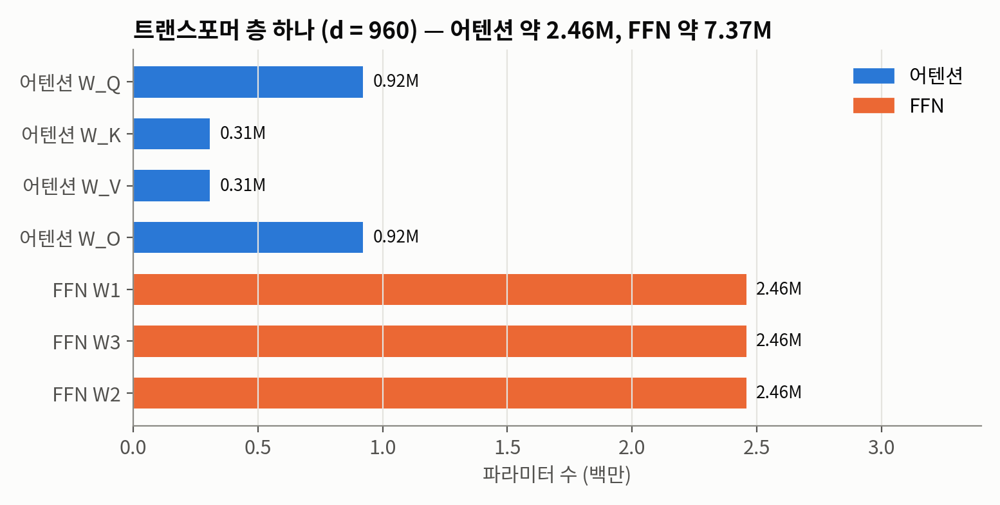

가이드 4.3절이 "32층 중 뒤 16층을 버려 약 157M 파라미터가 삭제됐다"고 적은 값과 맞는다.

### 12.2 메모리 계산

| 항목 | 바이트/파라미터 | 450M 모델 |
|---|---|---|
| 가중치 FP32 | 4 | 1.8 GB |
| 가중치 BF16 | 2 | 0.9 GB |
| 기울기 (학습 시) | 2~4 | 0.9~1.8 GB |
| Adam m, v (FP32) | 8 | 3.6 GB |
| FP32 마스터 가중치 (mixed precision) | 4 | 1.8 GB |
| 활성값 (역전파용 저장) | 배치·시퀀스 길이에 비례 | 수 GB |

- **추론** 은 대략 가중치 + 활성값 일부 + KV 캐시.
- **학습** 은 대략 가중치의 4~8배 이상 + 활성값. 그래서 같은 GPU 로도 추론은 되는데 학습은 안 되는 경우가 많다.

### 12.3 연산량 (FLOPs)

- 행렬 곱 (m × k)·(k × n) ≈ `2·m·k·n` FLOPs
- 트랜스포머 순전파 ≈ `2 × 파라미터 수 × 토큰 수` FLOPs (어텐션의 n² 항 제외한 근사)
- 학습(순전파 + 역전파) ≈ 순전파의 약 3배 → `6 × 파라미터 수 × 토큰 수`

### 12.4 계산이 병목인가, 메모리가 병목인가

- **배치가 크면:** 행렬 곱이 커서 GPU 연산 능력이 병목 (compute-bound)
- **배치 1 추론:** 가중치를 메모리에서 읽는 시간이 병목 (memory-bound). 가중치를 작게(양자화) 하면 빨라지는 이유다.

**우리 연구에서는:** 서빙은 배치 1, 10 Hz 제어 루프다. 가이드 4.2절 기준 eager 추론 108 ms 였고 `--compile` 로 줄였다. 랩서버 4070 Ti 에서 약 106 ms, 노트북 대비 2.5배 빠르다는 측정이 `smolvla_demo.sh` 주석에 있다. 양자화 실험 계획은 [model_compression 계획](../experiments/model_compression/smolvla_ptq_실험계획.md).

---

## 13. 학습 실무

### 13.1 Mixed Precision (BF16)

| 형식 | 비트 (부호/지수/가수) | 표현 범위 | 정밀도 |
|---|---|---|---|
| FP32 | 1 / 8 / 23 | 넓음 | 높음 |
| FP16 | 1 / 5 / 10 | 좁음 (약 6.5만이 최대) | 중간 |
| BF16 | 1 / 8 / 7 | FP32 와 같음 | 낮음 |

- FP16 은 범위가 좁아 기울기가 너무 작거나 크면 0 이나 무한대가 된다 → loss scaling 이 필요하다.
- BF16 은 지수 비트가 FP32 와 같아 범위 문제가 거의 없다. 정밀도는 낮지만 신경망 학습엔 대부분 충분하다. Ampere(RTX 30) 이후 GPU 가 지원한다.
- 보통 순전파·역전파 계산은 BF16, 가중치 갱신용 마스터 가중치와 옵티마이저 상태는 FP32 로 둔다.

```python
with torch.autocast("cuda", dtype=torch.bfloat16):
    loss = model(batch)
loss.backward()
```

### 13.2 Gradient Accumulation

메모리가 부족해 배치 32 를 못 올릴 때, 배치 8 로 4번 순전파·역전파하면서 기울기를 더한 뒤 한 번 갱신한다.

```python
for i, batch in enumerate(loader):
    loss = model(batch) / 4
    loss.backward()            # 기울기가 누적됨
    if (i + 1) % 4 == 0:
        optimizer.step()
        optimizer.zero_grad()
```

효과적 배치 = 8 × 4 = 32. 단 BatchNorm 통계는 여전히 배치 8 기준이다.

### 13.3 Gradient Clipping

기울기 크기(norm)가 기준값을 넘으면 비율을 유지한 채 잘라낸다. 기울기 폭발로 학습이 한 번에 망가지는 것을 막는다.

```python
torch.nn.utils.clip_grad_norm_(model.parameters(), max_norm=1.0)
```

### 13.4 Gradient Checkpointing

순전파 때 활성값을 다 저장하지 않고 일부만 저장한 뒤, 역전파 때 필요하면 다시 계산한다. 메모리를 줄이는 대신 계산이 약 30% 늘어난다.

### 13.5 체크포인트

저장해야 하는 것:

| 항목 | 이유 |
|---|---|
| 모델 가중치 | 추론에 필요 |
| 옵티마이저 상태 (m, v) | 이어서 학습할 때 필요 |
| 스케줄러 상태, 스텝 수 | 학습률이 이어지도록 |
| 설정 (config) | 같은 구조로 다시 만들기 위해 |
| **정규화 통계 (입력·출력 평균/표준편차)** | 학습 때와 같은 스케일로 입력을 넣고 출력을 되돌리기 위해 |
| 난수 상태 | 정확한 재현 |

**우리 연구에서는:** lerobot 체크포인트 폴더에 `model.safetensors`, `config.json`, `policy_preprocessor*` / `policy_postprocessor*` (정규화 통계)가 함께 있다. 10-05 에 postprocessor 통계가 베이스 모델 것으로 복사되는 버그가 있었다. 그 결과 모든 문장에서 경로가 왼쪽으로 0.6~0.9 m 쏠렸다. 지금은 새 체크포인트마다 pre/post 통계가 일치하는지부터 확인한다.

### 13.6 재현성

- 난수 시드 고정: `torch.manual_seed`, `numpy`, `random`
- 같은 시드여도 GPU 연산 순서 때문에 결과가 미세하게 다를 수 있다 (`torch.use_deterministic_algorithms`)
- 결론은 **여러 시드** 로 확인한다. 한 번의 결과는 우연일 수 있다.

---

## 14. 흔한 실수 목록

| 실수 | 증상 | 확인 방법 |
|---|---|---|
| `optimizer.zero_grad()` 누락 | 기울기가 누적돼 학습이 이상함 | 학습 루프 코드 확인 |
| 추론 때 `model.eval()` 누락 | Dropout 이 켜져 있고 BatchNorm 이 배치 통계를 씀 → 결과가 매번 다름 | 같은 입력 두 번 넣어 비교 |
| 추론 때 `torch.no_grad()` / `inference_mode()` 누락 | 메모리 낭비 | GPU 메모리 확인 |
| 학습·추론 전처리 불일치 | 오프라인 손실은 낮은데 실제 성능이 나쁨 | 입력 해상도·정규화·색 순서(RGB/BGR)·카메라 설정 대조 |
| 정규화 통계 불일치 | 출력이 한쪽으로 치우침 | 체크포인트의 통계 파일 비교 |
| 데이터 누수 (검증 데이터가 학습에 섞임) | 검증 성능이 비현실적으로 좋음 | 분할 기준 확인 (프레임이 아니라 에피소드 단위로 나눠야) |
| 학습률 너무 큼 | 손실이 NaN 또는 발산 | warmup, 작은 학습률로 재시도 |
| 손실은 내려가는데 성능 그대로 | 엉뚱한 것을 배움 (지름길) | 대조군·반사실 평가 |
| 한 번 결과로 결론 | 우연을 효과로 착각 | 시드 여러 개, 신뢰구간 |
| 측정 도구 자체의 오류 | 잘못된 결론 | 도구를 알려진 정답으로 먼저 검증 |

**우리 연구에서는:** 이 목록의 거의 모든 항목을 실제로 겪었다.
- **전처리 불일치:** 카메라 불일치 사건 (가이드 8.4절)
- **정규화 통계 불일치:** postprocessor 통계 버그 (10-05)
- **측정 도구 자체의 오류:** CMI 측정이 축 이름 불일치로 한 번도 실행되지 않았던 사건, 가이드 9.9절 "자를 의심하라"
- **대조군 없는 결론:** 문장 없이 학습한 기준선(b0)을 돌려 보니 언어 프로브 23/42 로, 문장 학습 모델 b1 의 22/42 와 같았다. 대조군 없이는 이 결과를 해석할 수 없었다.

---

## 15. 용어집

| 용어 | 뜻 |
|---|---|
| 파라미터 | 학습으로 정해지는 값 (가중치, 편향) |
| 하이퍼파라미터 | 사람이 정하는 학습 설정 (학습률, 배치 크기, 층 수) |
| 순전파 / 역전파 | 입력→출력 계산 / 출력→입력 방향 기울기 계산 |
| 기울기 (gradient) | 손실을 파라미터로 미분한 값 |
| 학습률 | 한 번에 파라미터를 움직이는 보폭 |
| 로짓 (logit) | softmax 전의 점수 |
| 임베딩 | 이산 기호(토큰)를 벡터로 바꾼 것 |
| 특징 (feature) | 신경망 중간에서 나온 표현 벡터 |
| 백본 (backbone) | 사전학습된 몸통 네트워크 |
| 헤드 (head) | 백본 뒤에 붙는 과제용 출력부. 어텐션의 "헤드"와 다른 뜻 |
| 사전학습 / 파인튜닝 | 큰 범용 데이터로 먼저 학습 / 목적 데이터로 추가 학습 |
| 동결 (freeze) | 일부 파라미터를 학습에서 제외 |
| 귀납 편향 | 구조에 미리 넣어 둔 가정 |
| 수용 영역 | 출력 한 칸이 보는 입력 영역 |
| 잔차연결 | `y = x + F(x)` |
| 일반화 | 처음 보는 데이터에서도 잘 되는 것 |
| 과적합 | 학습 데이터만 잘 되는 것 |
| 지름길 학습 | 진짜 원인 대신 우연히 함께 나온 단서를 배우는 것 |

---

## 16. 추천 자료

| 자료 | 내용 | 추천 순서 |
|---|---|---|
| **3Blue1Brown "Neural Networks"** (YouTube) | 신경망·역전파·트랜스포머를 그림으로. 가장 먼저 | 1 |
| **Karpathy "Neural Networks: Zero to Hero"** (YouTube) | micrograd(역전파 직접 구현)부터 GPT 직접 구현까지. 손으로 따라 치면 가장 많이 남는다 | 2 |
| **d2l.ai (Dive into Deep Learning)** | 무료 교재, 코드와 함께. 한국어판 있음 | 3 (참고서로) |
| **Stanford CS231n** | CNN·시각 인식 강의. 노트가 특히 좋다 | 4 |
| **"Attention Is All You Need"** (Vaswani et al., 2017) | 트랜스포머 원 논문 | 5 |
| **"Deep Residual Learning"** (He et al., 2015) | ResNet | 5 |
| **"An Image is Worth 16x16 Words"** (Dosovitskiy et al., 2020) | ViT | 6 |
| **"RoFormer"** (Su et al., 2021) | RoPE | 선택 |
| **The Illustrated Transformer** (Jay Alammar 블로그) | 트랜스포머 그림 설명 | 5와 함께 |

**다음 문서:** [02 LLM 과 VLM](02_LLM과_VLM.md)
