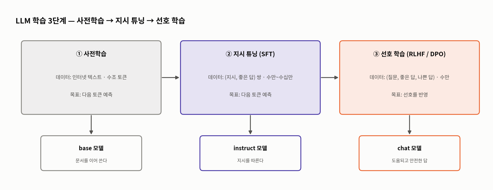
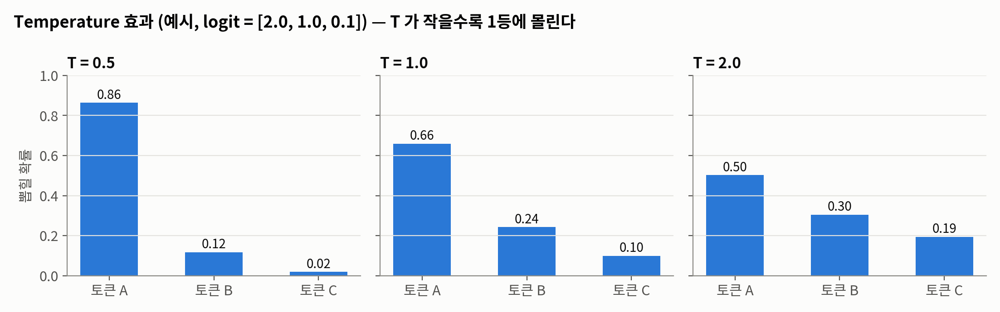
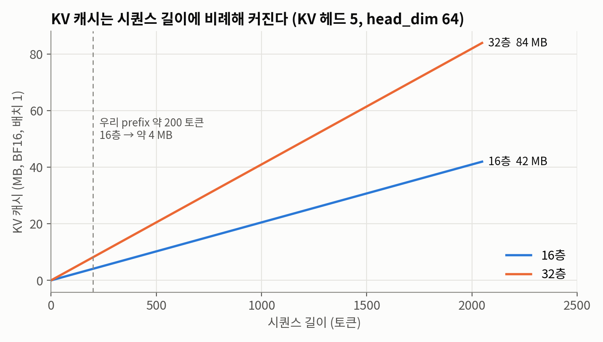
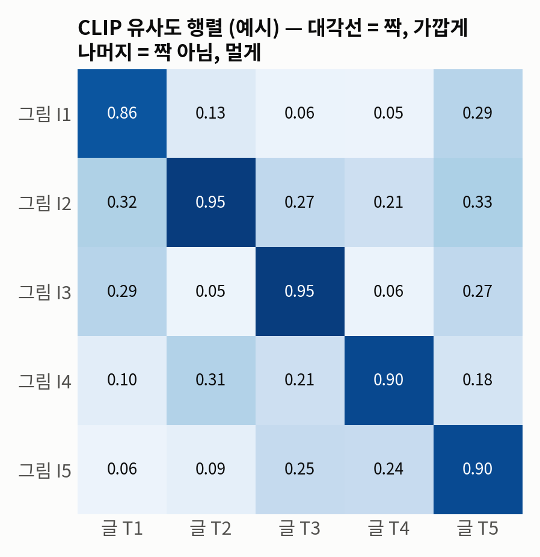
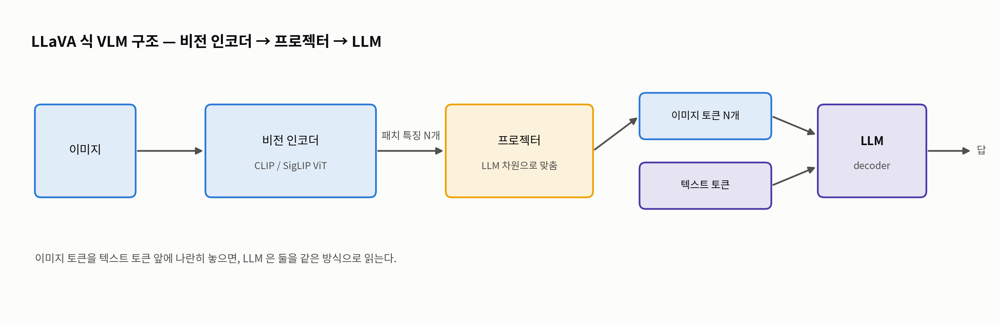
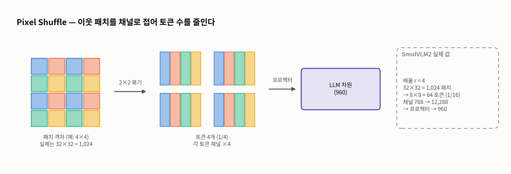
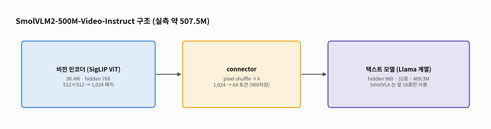

# LLM 과 VLM — 언어모델에서 시각-언어 모델까지

> 작성: 2026-10-07. study 폴더 목차: [README.md](README.md)

VLA 는 VLM 위에 행동 출력을 붙인 모델이고, VLM 은 LLM 에 눈(비전 인코더)을 붙인 모델이다.
그래서 VLA 를 이해하려면 LLM 과 VLM 이 어떻게 만들어지고 무엇을 잘하고 못하는지 알아야 한다.
이 문서는 [01 딥러닝 기초](01_딥러닝_기초_MLP_CNN_Transformer.md)의 트랜스포머를 안다고 가정한다.
각 절 끝의 **우리 연구에서는** 은 이 프로젝트의 실제 모델·실험과 연결한 것이다.

---

## 목차

**Part A. LLM**
1. [언어모델이란 — 다음 토큰 예측](#1-언어모델이란--다음-토큰-예측)
2. [토큰화](#2-토큰화)
3. [학습 단계: 사전학습 → SFT → 선호학습](#3-학습-단계-사전학습--sft--선호학습)
4. [스케일링 법칙](#4-스케일링-법칙)
5. [창발 능력과 In-Context Learning](#5-창발-능력과-in-context-learning)
6. [디코딩 — 확률에서 문장으로](#6-디코딩--확률에서-문장으로)
7. [KV 캐시와 컨텍스트 길이](#7-kv-캐시와-컨텍스트-길이)
8. [파인튜닝 방법: Full, LoRA, QLoRA, 동결](#8-파인튜닝-방법-full-lora-qlora-동결)
9. [할루시네이션](#9-할루시네이션)
10. [Chain-of-Thought 와 추론 모델](#10-chain-of-thought-와-추론-모델)

**Part B. VLM**
11. [CLIP — 그림과 글을 같은 공간에](#11-clip--그림과-글을-같은-공간에)
12. [SigLIP — 시그모이드 손실](#12-siglip--시그모이드-손실)
13. [LLaVA 식 구조: 비전 인코더 → 프로젝터 → LLM](#13-llava-식-구조-비전-인코더--프로젝터--llm)
14. [이미지 토큰 수와 Pixel Shuffle](#14-이미지-토큰-수와-pixel-shuffle)
15. [SmolVLM2 구조](#15-smolvlm2-구조)
16. [Qwen2.5-VL](#16-qwen25-vl)
17. [VLM 의 평가와 한계](#17-vlm-의-평가와-한계)
18. [VLM 에서 VLA 로](#18-vlm-에서-vla-로)
19. [용어집](#19-용어집)
20. [추천 자료](#20-추천-자료)

---

# Part A. LLM

## 1. 언어모델이란 — 다음 토큰 예측

### 1.1 정의

언어모델(Language Model, LM)은 앞의 토큰들이 주어졌을 때 **다음 토큰의 확률분포** 를 내는 모델이다.

```
P(다음 토큰 | 앞의 토큰들)

예: "나는 오늘 학교에" →  갔다: 0.62,  가서: 0.11,  늦게: 0.05, ...
```

문장 전체의 확률은 이 조건부 확률을 곱한 것이다.

```
P(t1, t2, ..., tn) = P(t1) · P(t2 | t1) · P(t3 | t1, t2) · ... · P(tn | t1..t(n-1))
```

### 1.2 학습 목표

인터넷 텍스트를 그대로 정답으로 쓴다. 문장의 각 위치에서 "실제로 다음에 온 토큰"의 확률을 높이도록 교차 엔트로피(CE)를 줄인다.

```
문장:   [The] [car] [turns] [left]
입력:   [The] [car] [turns]
정답:   [car] [turns] [left]       ← 한 칸 밀린 것
손실 = 각 위치 CE 의 평균
```

- 정답 라벨을 사람이 달 필요가 없다 → **자기지도학습(self-supervised learning)** 이라 부른다.
- causal mask(01 문서 10.7절) 덕분에 문장 하나로 모든 위치의 예측을 **동시에** 학습한다.

### 1.3 왜 이 단순한 목표가 강력한가

다음 토큰을 잘 맞히려면 결국 많은 것을 알아야 한다.

| 다음 토큰 예측 문제 | 필요한 능력 |
|---|---|
| "The cars ___" → are / is | 문법 (수 일치) |
| "프랑스의 수도는 ___" | 사실 지식 |
| "3 + 5 = ___" | 계산 |
| "그는 우산을 챙겼다. 왜냐하면 ___" | 인과 추론, 상식 |
| 코드의 다음 줄 | 프로그래밍 |

이 모든 것을 손실 하나로 동시에 배우게 된다. 이것이 대규모 사전학습의 핵심 아이디어다.

### 1.4 LLM 의 구조

현대 LLM 은 거의 모두 **decoder-only 트랜스포머** 다.

```
토큰 ID → 임베딩 → [트랜스포머 층 × L] → 최종 Norm → lm_head (d → 어휘 크기) → softmax
```

- `lm_head` 는 d 차원 벡터를 어휘 크기의 점수(logit)로 바꾸는 선형층이다.
- 많은 모델이 `lm_head` 가중치를 입력 임베딩 표와 **공유(tied embedding)** 한다.

**우리 연구에서는:** SmolVLA 의 언어부는 SmolLM2-360M 계열 decoder 다(hidden 960, 어휘 49,280). VLA 안에서는 글을 생성하지 않고 문장을 읽어 만든 내부 표현만 행동 예측에 쓴다. 그래서 원래 SmolVLA 에서 `lm_head` 는 쓰이지 않는다. reasoning 모델(SANT-VLA)은 이 잠들어 있던 `lm_head`(약 47M)를 다시 살려 행동과 함께 해설을 내게 했다([reasoning 보고서](../experiments/reports/reasoning_project_report.md)).

---

## 2. 토큰화

### 2.1 왜 필요한가

신경망은 숫자만 다룬다. 문장을 숫자열로 바꿔야 한다. 단위를 무엇으로 할지가 문제다.

| 단위 | 장점 | 단점 |
|---|---|---|
| 글자 (character) | 어휘가 작다, 모르는 단어가 없다 | 시퀀스가 매우 길어진다 |
| 단어 (word) | 의미 단위라 짧다 | 어휘가 폭발, 처음 보는 단어(OOV) 처리 불가 |
| **서브워드 (subword)** | 둘의 절충. 자주 나오는 단어는 통째로, 드문 단어는 조각으로 | 지금의 표준 |

### 2.2 BPE (Byte-Pair Encoding)

1. 글자(또는 바이트) 단위로 시작한다.
2. 데이터에서 가장 자주 붙어 나오는 **쌍** 을 찾아 하나의 새 토큰으로 합친다.
3. 원하는 어휘 크기가 될 때까지 반복한다.

**예시:** 말뭉치 = "low low low lower lowest"

```
시작:  l o w   l o w   l o w   l o w e r   l o w e s t
1회:   가장 흔한 쌍 (l, o) → "lo"
       lo w  lo w  lo w  lo w e r  lo w e s t
2회:   (lo, w) → "low"
       low  low  low  low e r  low e s t
3회:   (low, e) → "lowe"  ...
```

결과적으로 "low" 는 토큰 하나, "lowest" 는 "low" + "est" 같은 조각으로 나뉜다.

- **바이트 수준 BPE** (GPT-2 이후): 바이트(256개)에서 시작해 어떤 문자든 표현 가능 → 모르는 글자가 없다.
- 다른 방식: WordPiece(BERT), Unigram/SentencePiece(T5, 많은 다국어 모델)

### 2.3 한국어의 토큰 효율

- 어휘집이 주로 영어 데이터로 만들어지면, 한국어는 자주 안 나와서 잘게 쪼개진다.
- 한글 한 글자는 UTF-8 로 3바이트라, 바이트 수준 BPE 에서 합쳐지지 않으면 한 글자가 토큰 2~3개가 될 수 있다.
- 결과: 같은 의미의 문장이 영어보다 **토큰이 몇 배 많아질 수 있다** → 컨텍스트를 빨리 채우고, 계산이 늘고, 학습 데이터에서도 상대적으로 덜 학습된다.
- 직접 확인: `tokenizer("오른쪽 차선으로 가")` 와 `tokenizer("Go to the right lane")` 의 길이를 비교해 보면 된다.

**우리 연구에서는:** SmolVLM2 토크나이저 어휘는 49,280 이고, SmolVLA 는 문장을 **최대 48 토큰** 까지만 받는다. 넘치면 **조용히 잘린다**(가이드 2.3절). 학습 문장은 영어 정본 문장을 쓰고, 한국어나 자유 문장은 파서가 정본 문장으로 바꾼다. 한국어를 그대로 넣으면 토큰이 많아 잘릴 위험이 더 크고, 학습 때 본 적 없는 표현이 된다.

---

## 3. 학습 단계: 사전학습 → SFT → 선호학습



### 3.1 사전학습 (Pre-training)

- 목표: 1.2절의 다음 토큰 예측
- 결과: 지식과 언어 능력은 있지만, 질문하면 답 대신 "비슷한 질문 목록"을 이어 쓰기도 한다.
- 비용 대부분이 여기에 든다.

### 3.2 SFT (Supervised Fine-Tuning, 지시 튜닝)

- (지시, 모범 답) 쌍으로 같은 다음 토큰 예측을 한다. 보통 **답 부분에만** 손실을 건다.
- 결과: 질문하면 답하는 형식을 배운다.
- **채팅 템플릿:** 대화를 특수 토큰으로 구분해 넣는다. 모델마다 형식이 달라서 학습 때와 다른 템플릿으로 추론하면 성능이 크게 떨어진다.

```
<|im_start|>user
이 사진에 무엇이 있니?<|im_end|>
<|im_start|>assistant
도로와 차선이 보입니다.<|im_end|>
```

### 3.3 RLHF (Reinforcement Learning from Human Feedback)

1. 같은 질문에 대한 여러 답을 사람이 순위 매긴다.
2. 그 순위를 예측하는 **보상 모델(reward model)** 을 학습한다.
3. LLM 이 보상 모델 점수를 높이도록 강화학습(주로 PPO)으로 조정한다. 원래 모델에서 너무 멀어지지 않게 KL 벌점을 건다.

### 3.4 DPO (Direct Preference Optimization)

- 보상 모델과 강화학습 없이, (좋은 답, 나쁜 답) 쌍으로 직접 학습한다.
- "좋은 답의 확률은 올리고 나쁜 답의 확률은 내리되, 기준 모델 대비 변화량으로" 하는 손실 하나로 끝난다.
- 구현이 단순하고 안정적이라 널리 쓰인다.

### 3.5 이 단계들이 로봇·주행과 만나는 지점

| LLM 단계 | VLA 에서의 대응 |
|---|---|
| 사전학습 | VLM 사전학습 (웹 이미지·텍스트) |
| 로봇 데이터 사전학습 | 여러 로봇 시연으로 학습한 공통 정책 (smolvla_base, π0 base) |
| SFT | 목적 과제 시연으로 파인튜닝 = **행동 복제** |
| RLHF / RL | 실패에서 배우는 강화학습 단계 (Alpamayo-R1 의 추론-행동 일치 RL 등) |

**우리 연구에서는:** 모델은 3단 사다리를 탄다. 웹 규모 사전학습(SmolVLM2) → 로봇 행동 사전학습(`lerobot/smolvla_base`) → 이 트랙 시연 파인튜닝(v2~v7 코퍼스와 이후 r 시리즈). RL 단계는 아직 없다. 자유 문장 파서와 goto 실험의 Qwen 경유는 SFT·선호 학습까지 끝난 instruct 모델(qwen3:4b, Qwen2.5-VL-3B)을 그대로 쓴다.

---

## 4. 스케일링 법칙

### 4.1 관찰

모델 크기 N, 데이터 양 D, 계산량 C 를 늘리면 손실이 **거듭제곱 법칙** 으로 꾸준히 줄어든다.

```
L(N) ≈ (N_c / N)^α       로그-로그 그래프에서 직선
```

- Kaplan et al. (2020, OpenAI): 크기를 키우는 것이 가장 효과적이라고 봤다.
- **Chinchilla** (Hoffmann et al., 2022, DeepMind): 정해진 계산량에서 최적은 모델 크기와 데이터 양을 **비슷한 비율로** 함께 키우는 것이라고 수정했다. 흔히 "파라미터 1개당 약 20 토큰"이 최적 근처라는 경험칙으로 인용된다(원 논문 확인 권장).
- 이후 모델들은 추론 비용을 줄이려고 Chinchilla 최적보다 **작은 모델을 훨씬 많은 데이터로** 학습하는 경향이 있다. SmolLM 계열도 작은 크기에 많은 토큰을 쓴 사례다.

### 4.2 의미와 한계

| 의미 | 한계 |
|---|---|
| 큰 투자 결과를 작은 실험으로 미리 예측 가능 | 손실이 줄어도 특정 능력이 언제 생길지는 예측이 어렵다 |
| "데이터와 계산을 늘리면 좋아진다"는 확신이 대규모 투자의 근거 | 고품질 텍스트 데이터는 한정돼 있다 |
| 로봇 분야도 같은 법칙이 성립하는지 연구 중 | 로봇 시연 데이터는 텍스트보다 훨씬 비싸다 → 데이터 부족이 로봇 학습의 핵심 병목 |

**우리 연구에서는:** 약 450M 크기, 단일 트랙 시연 수백 에피소드 규모다. 스케일링 법칙의 반대편 끝에 있다. 그래서 "데이터를 어떻게 구성하느냐"(가중 샘플링, 반사실 짝 시연, 지름길을 막는 배치)가 결과를 크게 좌우했다. 가이드 6.7절의 40K/80K/120K 비교, 10.6절의 "데이터 한계효용" 기록도 같은 맥락이다.

---

## 5. 창발 능력과 In-Context Learning

### 5.1 창발 능력 (Emergent Abilities)

- 작은 모델에서는 거의 0 이던 능력이 어느 크기를 넘으면 갑자기 나타나는 것처럼 보이는 현상이다 (다자리 덧셈, 다단계 추론 등).
- **반론:** 정확도처럼 "맞으면 1, 틀리면 0"인 지표를 쓰면 갑자기 생기는 것처럼 보이지만, 연속적인 지표로 재면 꾸준히 늘고 있었다는 연구도 있다 (Schaeffer et al., 2023). 측정 방법이 해석을 바꾼다.

### 5.2 In-Context Learning (ICL)

가중치를 바꾸지 않고, 프롬프트 안의 예시만 보고 새 과제를 하는 능력이다. GPT-3 논문 "Language Models are Few-Shot Learners"(2020)가 크게 알렸다.

```
영어 → 한국어
cat → 고양이
dog → 개
car → ?          → 모델: 자동차
```

| 방식 | 프롬프트 |
|---|---|
| Zero-shot | 지시만 |
| One-shot | 예시 1개 + 지시 |
| Few-shot | 예시 여러 개 + 지시 |

**VLA 와의 관계:** RT-2 가 보고한 "로봇 데이터에 없던 기호·관계를 따르는" 능력은 VLM 사전학습 지식이 행동으로 넘어온 사례로 해석된다. 이것이 VLA 의 가장 큰 기대 지점이다([05 VLA 문서](05_VLA란_무엇인가.md)).

**우리 연구에서는:** 이번 goto 실습의 ③④ 단계가 바로 이것을 시험한다. 학습하지 않은 물체 이름, "멸종한 생물" → 공룡 같은 지식 연결이 행동까지 넘어오는가다. 백본 시험(G0)에서 Qwen2.5-VL-3B 는 "extinct animal" → dinosaur 를 4/4 맞혔다. 하지만 SmolVLA 는 학습한 물체 이름조차 화면 위치에 붙이지 못했다(반사실 21/42 ≈ 우연). 문장 없이 학습한 기준선 b0 과도 구별되지 않았다(23/42 vs 22/42).

---

## 6. 디코딩 — 확률에서 문장으로

모델은 다음 토큰의 확률만 낸다. 그중 무엇을 고를지는 **디코딩 방법** 이 정한다.

### 6.1 방법들

| 방법 | 규칙 | 특징 |
|---|---|---|
| **Greedy** | 항상 가장 확률 높은 토큰 | 결정적(같은 입력 → 같은 출력). 반복에 빠지기 쉬움 |
| **Beam search** | 상위 k 개 후보 문장을 동시에 유지 | 번역에 유리. 열린 생성에선 밋밋함 |
| **Temperature 샘플링** | logit 을 T 로 나눈 뒤 확률대로 뽑음 | T<1 이면 확신 강화, T>1 이면 다양 |
| **Top-k** | 상위 k 개 토큰 중에서만 뽑음 | |
| **Top-p (nucleus)** | 누적 확률이 p 가 될 때까지의 토큰 중에서 뽑음 | 확신할 땐 후보가 적고, 애매할 땐 많음 |
| **Repetition penalty** | 이미 나온 토큰의 점수를 깎음 | 반복 억제. 필요한 반복까지 막을 수 있음 |

**Temperature 숫자 예시:** logit = [2.0, 1.0, 0.1]

| T | softmax(logit / T) |
|---|---|
| 0.5 | [0.864, 0.117, 0.019] |
| 1.0 | [0.659, 0.242, 0.099] |
| 2.0 | [0.502, 0.304, 0.194] |



### 6.2 언제 무엇을 쓰나

| 용도 | 권장 |
|---|---|
| 사실을 정확히 말해야 할 때 (분류, 추출, 상태 서술) | greedy 또는 낮은 T |
| 창작·다양한 표현 | T 0.7~1.0 + top-p 0.9 |
| 평가 재현성이 필요할 때 | greedy (또는 시드 고정) |

**우리 연구에서는:** reasoning 해설은 **greedy 고정** 이다. 보고서에 따르면 repetition penalty 를 걸었더니 사실성 지표가 **전 항목 악화** 됐다. 해설은 "Cruise in the outer lane…"처럼 같은 틀이 반복되는 것이 정상인데, 반복을 벌하면 사실과 다른 단어로 바꾸게 되기 때문이다. 또 프레임별 다자리 속도 숫자를 말하게 했더니 500M 헤드가 숫자 모드 붕괴("110" 남발, "speed 10" 고정)에 빠졌다. 그래서 속도는 티어(70/110/150)만 인용하게 바꿨다(r1~r4).

---

## 7. KV 캐시와 컨텍스트 길이

### 7.1 KV 캐시

생성은 토큰을 하나씩 만든다. 매 토큰마다 앞의 모든 토큰의 K, V 를 다시 계산하면 낭비다.

```
캐시 없음:  n 번째 토큰 생성 때 1..n 전부 다시 계산 → 총 O(n²) 층 계산
캐시 있음:  이전 토큰들의 K, V 를 저장해 두고 새 토큰 것만 계산해 이어 붙임
```

**KV 캐시 메모리:**

```
2 (K와 V) × 층 수 × KV 헤드 수 × head_dim × 시퀀스 길이 × 바이트
```

예: 16층, KV 헤드 5, head_dim 64, 시퀀스 200, BF16(2바이트)

```
2 × 16 × 5 × 64 × 200 × 2 = 4,096,000 바이트 ≈ 4 MB
```

이 정도면 작다. 하지만 큰 모델·긴 문맥·큰 배치에서는 KV 캐시가 가중치보다 커지기도 한다. GQA(01 문서 10.5절)가 KV 헤드 수를 줄이는 이유다.



### 7.2 컨텍스트 길이

- 모델이 한 번에 볼 수 있는 최대 토큰 수다.
- 어텐션 계산은 길이 n 에 대해 n² 로 늘어난다.
- 학습 때보다 긴 길이를 넣으면 위치 인코딩이 처음 보는 범위가 돼 성능이 떨어진다. RoPE 스케일링 등으로 늘리는 기법이 있다.

**우리 연구에서는:**
- **행동 쪽 KV 캐시:** SmolVLA 는 관측(이미지 64 + 문장 ≤48 + 상태 1 토큰)을 prefix 로 한 번 계산해 KV 를 캐시한다. 그 뒤 flow matching 10스텝 동안 action expert 가 이 캐시를 재사용한다. 관측을 10번 다시 계산하지 않는 구조다.
- **해설 쪽:** reasoning 해설은 자기회귀 생성이라 60 토큰에 1~2초가 걸려 10 Hz 예산을 넘는다. 그래서 서버는 해설을 별도 스레드에서 몇 요청에 한 번만 갱신한다(`vla_policy_server.py` 의 reasoning side channel).

---

## 8. 파인튜닝 방법: Full, LoRA, QLoRA, 동결

### 8.1 Full fine-tuning

- 모든 파라미터를 학습한다.
- 성능이 가장 좋을 수 있지만 메모리가 가장 많이 든다 (가중치 + 기울기 + Adam 상태, 01 문서 12.2절).
- 작은 데이터로 하면 사전학습 지식을 잊을 수 있다 (**파국적 망각**, catastrophic forgetting).

### 8.2 동결 (Freeze)

- 일부(예: 비전 인코더)는 고정하고 나머지만 학습한다.
- 메모리·계산이 줄고, 고정한 부분의 사전학습 지식이 보존된다.
- 대신 고정한 부분이 새 도메인에 적응하지 못한다.

### 8.3 LoRA (Low-Rank Adaptation)

원래 가중치 W 는 고정하고, 작은 행렬 두 개의 곱으로 **변화량** 만 학습한다.

```
W' = W + ΔW = W + B·A
W: d × d (고정)
A: r × d,  B: d × r   (학습, r 은 작게: 4~64)
```

**숫자 예시:** d = 960, r = 16

```
원래 학습량: 960 × 960 = 921,600
LoRA:       16 × 960 + 960 × 16 = 30,720   (약 3.3%)
```

- B 를 0 으로 초기화해 처음엔 원래 모델과 똑같이 시작한다.
- 학습 후 `W + B·A` 를 합쳐 버리면 추론 비용이 늘지 않는다.
- 과제마다 작은 LoRA 파일만 따로 저장할 수 있다.

### 8.4 QLoRA

- 원래 가중치 W 를 **4비트로 양자화** 해서 메모리를 줄이고, 그 위에 LoRA 를 학습한다.
- 큰 모델을 단일 GPU 에서 파인튜닝할 수 있게 했다.
- 양자화 개념은 [양자화·프루닝 정리](model_compression/양자화_프루닝_개념정리.md) 참고.

### 8.5 비교

| 방법 | 학습 파라미터 | 메모리 | 성능 | 망각 위험 |
|---|---|---|---|---|
| Full | 100% | 가장 큼 | 가장 높을 수 있음 | 큼 |
| 일부 동결 | 일부 | 중간 | 과제에 따라 | 고정한 부분은 없음 |
| LoRA | ~1~5% | 작음 | Full 에 근접하는 경우 많음 | 작음 |
| QLoRA | ~1~5% | 가장 작음 | LoRA 보다 약간 낮을 수 있음 | 작음 |

**우리 연구에서는:** SmolVLA 파인튜닝은 **Full** 에 가깝다. `freeze_vision_encoder: false`, `train_expert_only: false` 로 비전 인코더까지 학습한다(약 403M 학습). 시뮬 화면이 사전학습 이미지와 달라 "눈"도 맞춰야 하기 때문이다. 이 선택은 시뮬 화면 적응에는 유리하다. 대신 사전학습 지식(처음 보는 물체 이름을 아는 능력)을 덜 보존할 수 있다. goto 실습의 "학습 안 한 물체 이름" 실험을 해석할 때 고려할 변수다. 초기 연구 방향(06-23)에서는 큰 VLM 을 LoRA/4비트로 쓰는 안도 검토했었다.

---

## 9. 할루시네이션

### 9.1 정의와 원인

모델이 사실이 아니거나 입력에 없는 내용을 **그럴듯하게** 생성하는 현상이다.

| 원인 | 설명 |
|---|---|
| 학습 목표 | "그럴듯한 다음 토큰"을 배우지 "사실인 토큰"을 배우지 않는다 |
| 지식 경계 | 모르는 것을 모른다고 말하도록 학습되지 않았다 |
| 디코딩 | 샘플링이 낮은 확률의 틀린 토큰을 고를 수 있다 |
| VLM 특유 | 이미지보다 언어 사전 지식이 우세 → "도로 사진"이면 실제로 없어도 "차"를 말함 |

### 9.2 줄이는 방법

- 근거 문서를 함께 주기 (RAG)
- 모르면 모른다고 답하도록 학습
- 출력 검증 (규칙·다른 모델로 확인)
- **라벨 품질 관리:** 학습 데이터 자체에 사실과 다른 문장이 없게

### 9.3 행동 모델에서의 대응물

언어모델의 할루시네이션처럼, 행동 모델도 "그럴듯하지만 상황에 근거하지 않은" 행동을 낸다.
**말과 행동의 불일치** 는 그 결합 형태다. 해설은 장애물을 맞게 말하는데 조향은 반응하지 않는 경우다.

**우리 연구에서는:**
- reasoning 라벨은 시뮬레이터의 특권 정보(실제 포즈, 장애물 좌표, 차선 기하)로 **규칙 기반 사실 문장** 을 먼저 만들었다. LLM 패러프레이즈는 사실 보존 검증을 통과한 것만 채택했다. 학습 데이터에서 할루시네이션 원천을 막은 설계다.
- 평가는 heldout 자유 생성을 사실 채점(모순 감지)한다.
- 장애물이 없는 클리어 셋에서 장애물을 잘못 언급하는지(오언급)를 따로 셌다.
- r8~r11 에서 해설은 정지·관찰·통과를 말했지만 행동은 정지를 배우지 못한 **언어-행동 비대칭** 이 최종 발견이었다.

---

## 10. Chain-of-Thought 와 추론 모델

### 10.1 Chain-of-Thought (CoT)

답을 바로 내지 않고 **중간 추론 과정을 글로 쓰게** 하면 다단계 문제의 정확도가 오른다.

```
질문: 사과 5개에서 2개 먹고 3개 더 샀다. 몇 개?
CoT:  처음 5개. 2개 먹어 3개. 3개 사서 6개. 답: 6
```

- 프롬프트에 "단계별로 생각하라"를 넣거나, 풀이가 있는 예시를 보여 준다.
- 효과는 주로 **큰 모델** 에서 크다.

### 10.2 추론 모델 (Reasoning Models)

- OpenAI o1, DeepSeek-R1, Qwen3 의 thinking 모드 등은 답하기 전에 긴 추론(생각 토큰)을 생성하도록 강화학습으로 훈련됐다.
- 정답을 확인할 수 있는 문제(수학, 코드)에서 보상을 줘 학습한다.
- 비용: 생각 토큰만큼 지연과 계산이 늘어난다.

### 10.3 주행·로봇의 추론

| 사례 | 방식 |
|---|---|
| DriveVLM | 장면 설명 → 분석 → 계획의 단계적 추론 |
| Alpamayo-R1 (NVIDIA) | 인과 추론(Chain of Causation)을 거쳐 궤적. RL 로 추론과 행동의 일치를 높임 |
| ECoT 계열 (로봇) | 하위 과제·물체 위치를 먼저 말하고 행동 |

- **장점:** 설명 가능성, 드문 상황 대응
- **단점:** 지연 (10 Hz 제어엔 너무 느림 → 느린 추론과 빠른 행동을 나누는 이중 구조)
- **핵심 문제:** 추론이 그럴듯해도 행동이 그것을 따르는지 보장이 없다.

**우리 연구에서는:**
- 자유 문장 파서(qwen3:4b)는 think 모드를 쓰지 않는다. 메모리 `reasoning-label-pipeline` 에 qwen3 think 관련 함정이 기록돼 있다.
- SANT-VLA 의 해설은 CoT 처럼 행동 **전** 에 생각하는 것이 아니다. 행동과 **같은 prefix 를 공유** 해 나란히 내는 서술이다.
- 해설을 행동 조건으로 쓰는 시도(`--situation-from-reasoning`, r40+)는 해설에서 상황 문구를 뽑아 행동 쪽에 다시 넣는 방식이다.

---

# Part B. VLM

## 11. CLIP — 그림과 글을 같은 공간에

### 11.1 아이디어

인터넷의 (이미지, 설명 글) 쌍 약 4억 개로, 이미지 인코더와 텍스트 인코더를 함께 학습했다(OpenAI, 2021).
목표는 **짝인 이미지와 글의 벡터는 가깝게, 짝이 아닌 것은 멀게** 하는 것이다. 이것을 **대조학습(contrastive learning)** 이라 한다.



```
유사도 S[i][j] = I_i · T_j / τ   (이미지·텍스트 벡터는 정규화)
손실 = 행 방향 softmax CE (이미지 → 글 맞히기)
     + 열 방향 softmax CE (글 → 이미지 맞히기)
```

### 11.2 결과

- **Zero-shot 분류:** "a photo of a {dog}", "a photo of a {cat}" 같은 문장 벡터를 만들고, 이미지 벡터와 가장 가까운 문장을 고르면 학습 없이 분류가 된다.
- 이미지와 언어가 **공유 임베딩 공간** 에 놓인다. 이후 VLM 의 비전 인코더로 많이 쓰인다.

### 11.3 한계

- 이미지 전체와 문장 전체를 비교하므로 **세부 위치·개수·공간 관계** 에 약하다 ("왼쪽에 있는 컵" vs "오른쪽에 있는 컵").
- softmax 가 배치 전체를 정규화해야 해서 큰 배치가 필요하고, 분산 학습 때 통신 비용이 크다.

---

## 12. SigLIP — 시그모이드 손실

### 12.1 차이

SigLIP(Google, 2023)은 CLIP 의 softmax 대조 손실을 **쌍별 시그모이드(이진 분류) 손실** 로 바꿨다.

```
CLIP:   각 이미지마다 "N 개 글 중 짝은 무엇인가" (N 지선다, softmax)
SigLIP: 모든 (이미지, 글) 쌍마다 "짝인가 아닌가" (이진, sigmoid)

손실 = −Σ_i Σ_j log σ( z_ij · (t · I_i·T_j + b) )
z_ij = +1 (짝), −1 (짝 아님)
t, b: 학습되는 온도와 편향
```

### 12.2 장점

| | CLIP (softmax) | SigLIP (sigmoid) |
|---|---|---|
| 정규화 | 배치 전체에 걸쳐 | 쌍마다 독립 |
| 큰 배치 필요 | 강함 | 약함 |
| 작은 배치 성능 | 낮음 | 상대적으로 좋음 |
| 분산 구현 | 전체 유사도 행렬 필요 | 단순 |

같은 계산량에서 더 좋거나 비슷한 성능을 보였고, 많은 공개 VLM(PaliGemma, SmolVLM, Idefics 계열 등)이 SigLIP 비전 인코더를 쓴다.

**우리 연구에서는:** SmolVLM2 의 비전 인코더가 SigLIP 계열 ViT 다(hidden 768, 12 헤드, 패치 16, 입력 512, shape-optimized 변형, 약 86.4M). 우리 학습에서 이 인코더도 함께 파인튜닝된다.

---

## 13. LLaVA 식 구조: 비전 인코더 → 프로젝터 → LLM

### 13.1 구조

LLaVA(2023)가 단순하고 효과적인 VLM 구조를 대중화했다. 지금 대부분의 공개 VLM 이 이 형태다.



- 비전 인코더 출력 차원(예: 768)과 LLM 임베딩 차원(예: 960)이 다르니 **프로젝터** 가 맞춰 준다.
- 이미지 토큰은 LLM 입장에서 "특별한 단어"처럼 텍스트 앞(또는 사이)에 놓인다.

### 13.2 학습 단계 (LLaVA 기준)

| 단계 | 학습하는 것 | 데이터 |
|---|---|---|
| 1. 정렬 (pre-alignment) | 프로젝터만 (인코더·LLM 고정) | 이미지-캡션 쌍 |
| 2. 시각 지시 튜닝 | 프로젝터 + LLM (인코더는 보통 고정) | 이미지 질의응답, 대화 |

### 13.3 다른 결합 방식

| 방식 | 예 | 특징 |
|---|---|---|
| 토큰 이어 붙이기 (early fusion of tokens) | LLaVA, SmolVLM, Qwen-VL | 단순, 이미지 토큰이 많으면 비쌈 |
| Cross-attention 삽입 | Flamingo, Llama 3.2 Vision | LLM 층 사이에 이미지를 읽는 층 추가 |
| Q-Former 압축 | BLIP-2 | 학습 쿼리 몇십 개로 이미지를 요약 |

**우리 연구에서는:** SmolVLA 는 토큰 이어 붙이기 방식이다. `[이미지 64] [문장 ≤48] [상태 1]` 이 하나의 prefix 시퀀스가 되고, 어텐션이 출신을 가리지 않고 서로 참조한다(가이드 2.7절). 문장 단어가 화면의 해당 영역에 연결되는 것(접지)은 이 교차 참조를 통해서만 일어날 수 있다.

---

## 14. 이미지 토큰 수와 Pixel Shuffle

### 14.1 문제

ViT 출력 패치 수는 해상도의 제곱에 비례한다.

```
224×224, 패치 14 → 16×16 = 256 토큰
512×512, 패치 16 → 32×32 = 1,024 토큰
고해상도·여러 장·영상이면 수천~수만 토큰
```

LLM 에 들어가는 토큰이 많으면 어텐션 계산(n²)과 메모리가 폭증하고 지연이 커진다.

### 14.2 Pixel Shuffle (공간 → 채널 접기)

인접한 r×r 패치들의 특징을 채널 방향으로 이어 붙여 토큰 하나로 만든다.



- 정보를 버리지 않고 재배열만 한다(프로젝터가 압축을 학습).
- 그러나 토큰 하나가 넓은 영역(여기선 64×64 픽셀)을 담당하게 되어, **작은 물체나 정밀한 위치** 정보가 프로젝터에서 손실될 수 있다.

### 14.3 다른 방법

- 이미지를 여러 타일로 나눠 각각 인코딩 + 축소본 하나 (고해상도 대응)
- 토큰 병합·가지치기 (중요하지 않은 패치 제거)
- Perceiver 리샘플러, Q-Former (고정 개수 쿼리로 요약)

**우리 연구에서는:** 카메라 한 장 = **64 토큰**. 즉 8×8 격자로, 토큰 하나가 원래 512×512 입력의 64×64 픽셀 영역을 대표한다. 640×480 카메라 프레임은 512×512 로 패딩·축소되므로 실제 장면 기준으로는 더 넓다. 먼 곳의 작은 물체나 "왼쪽 물체 vs 가운데 물체" 같은 위치 구분이 이 해상도에서 얼마나 남는지는 goto 실험 해석의 변수다.

---

## 15. SmolVLM2 구조

Hugging Face 의 작은 VLM 계열이다. 우리가 쓰는 것은 `HuggingFaceTB/SmolVLM2-500M-Video-Instruct`.



| 부품 | 값 (가이드 4.1절, HF config·가중치 실측) |
|---|---|
| 비전 인코더 | SigLIP 계열 ViT, hidden 768, 12 헤드, 패치 16, 입력 512, 86.4M |
| 커넥터 | pixel shuffle 배율 4 → 이미지당 64 토큰 |
| 텍스트 모델 | SmolLM2-360M 기반 Llama 계열, hidden 960, 32층, 헤드 15, KV 헤드 5 (GQA), head_dim 64, FFN 2560, 어휘 49,280, rope_theta 100000 |
| 전체 | 약 507.5M (텍스트+lm_head 409.3M) |

**설계 특징 (SmolVLM 논문 요지, 원 논문 확인 권장):**
- 작은 모델에서는 이미지 토큰을 공격적으로 줄이는 것(pixel shuffle)이 효율적이다.
- 작은 LLM 에 맞춰 비전 인코더도 작은 것을 쓴다.
- 영상(Video)도 프레임 여러 장으로 다룬다.

**SmolVLA 에서의 변형:**
- 텍스트 모델 32층 중 **앞 16층만** 쓴다(약 157M 삭제). 생성이 아니라 이해 표현만 필요하기 때문이다.
- 그 옆에 **action expert**(폭 0.75, 16층, 약 100M)를 붙인다.
- 상태 벡터도 선형층으로 960차원 토큰 하나로 만들어 시퀀스 끝에 붙인다.

**우리 연구에서는:** 이 백본이 "작아서" 10 Hz 제어에 들어오고(가이드 4.2절), 노트북급 GPU 에 올라간다. 대신 사전학습 지식과 공간 이해가 큰 VLM 보다 약하다. 17장의 G0 결과가 이 대가를 보여 준다.

---

## 16. Qwen2.5-VL

Alibaba 의 VLM 계열이다. 3B / 7B / 72B 크기가 공개됐다. 특징(원 논문·모델 카드 확인 권장):

| 특징 | 내용 |
|---|---|
| 동적 해상도 | 이미지를 고정 크기로 줄이지 않고 원래 해상도에 맞는 토큰 수로 인코딩 |
| 위치 인코딩 | 이미지의 2차원 위치(와 영상의 시간)를 반영하는 RoPE 변형 (M-RoPE 계열) |
| 그라운딩 | 물체의 **상자 좌표·점 좌표를 텍스트로 출력** 하도록 학습됨 → "빨간 꼬깔 위치" 같은 질의에 좌표로 답 |
| 문서·영상 | OCR, 차트, 긴 영상 이해 |
| 에이전트 | 화면 조작 같은 행동 계획 |

**그라운딩이 중요한 이유:** VLA 에서 "말로 지정한 물체로 가기"는 결국 "이름 → 화면 위치 → 행동"이다.
위치를 직접 출력하도록 학습된 VLM 은 첫 화살표가 이미 되어 있다.

**우리 연구에서는:**
- goto 실습의 **④ 계층형** 이 Qwen2.5-VL-3B 를 앞에 둔다. Qwen 이 문장을 SmolVLA 가 아는 표현으로 바꾸거나 대상을 고르고, SmolVLA 가 주행한다.
- 로컬 Ollama 로 VL 모델을 시뮬과 동시에 올리면 메모리가 부족했다. 그래서 랩서버 transformers 로 돌린다(`qwen_vl.py`).
- 폐루프 결과는 r50·r52·Qwen 경유 모두 30회 중 28~30회가 같은 물체로 갔다. 대상 선택보다 **배치(어느 물체가 어디 있는지)** 가 결과를 결정했다.

---

## 17. VLM 의 평가와 한계

### 17.1 대표 벤치마크

| 벤치마크 | 보는 것 |
|---|---|
| VQAv2, GQA | 일반 시각 질의응답 |
| TextVQA, DocVQA, ChartQA | 글자·문서·차트 읽기 |
| MMMU | 대학 수준 다분야 |
| POPE | 물체 할루시네이션 (있는지 없는지) |
| RefCOCO | 지칭 표현 그라운딩 ("왼쪽의 빨간 컵" → 상자) |
| 공간 추론 계열 (예: What'sUp, SpatialBench 등) | 왼쪽/오른쪽, 앞/뒤, 거리 |

### 17.2 잘 알려진 한계

| 한계 | 설명 |
|---|---|
| **공간·위치 관계** | 대조학습은 "무엇이 있는가"를 잘 배우지만 "어디에 있는가"는 약하다. 왼쪽/오른쪽 혼동이 흔하다 |
| **세는 것** | 물체 개수 |
| **작은 물체·세부** | 이미지 토큰 압축(14장)의 대가 |
| **할루시네이션** | 언어 사전 지식이 이미지를 이김 |
| **시점·3D** | 거리·깊이·자기 위치 추정 |
| **작은 모델일수록 심함** | 지식과 추론이 크기에 강하게 의존 |

### 17.3 주행·로봇 관점에서 특히 중요한 것

- 주행에 필요한 것은 "무엇"보다 **"어디에, 얼마나 멀리, 어느 쪽으로"** 다.
- 그런데 VLM 사전학습은 이 부분에 상대적으로 약하다.
- 그래서 VLA 연구는 공간 정보(깊이, 좌표, 궤적)를 추가 학습하거나, 큰 VLM 을 계획에만 쓰고 작은 정책이 실행하는 계층형을 많이 쓴다.

**우리 연구에서는 (백본 시험 G0, 2026-10-03):**

| 질문 | SmolVLM2-500M | Qwen2.5-VL-3B |
|---|---|---|
| 지식 연결: "extinct animal" 은 무엇? | (기록 없음) | dinosaur, **4/4** |
| 화면 속 물체 **위치** 질문 | **≈ 우연** | |

- SmolVLA 의 백본(SmolVLM2-500M)은 질문으로 물었을 때부터 위치를 구별하지 못했다.
- 그렇다면 파인튜닝한 SmolVLA 가 "이름 → 화면 위치 → 행동"을 못 한 결과(반사실 21/42)가 백본 한계에서 시작됐을 가능성이 있다.
- 다만 b0 대조 실험(문장 없이 학습 23/42 vs 문장 학습 22/42)은 "언어 조건이 행동에 기여하지 않았다"는 것까지만 보여 준다. 원인이 백본인지, 학습 방식인지, 데이터 대조량(교사가 굽은 접근의 횡 이동을 약 55% 과소)인지는 아직 분리되지 않았다.
- 데이터 쪽 CMI(g1 0.743 b, gv2b 0.965 b, 둘 다 GATE PASS)는 "시연 데이터에는 문장을 읽어야 풀리는 정보가 있다"를 보여 준다. 그래서 병목은 데이터보다 학습·구조 쪽으로 좁혀졌다.

---

## 18. VLM 에서 VLA 로

VLM 은 글을 출력한다. VLA 는 **행동** 을 출력해야 한다. 붙이는 방법은 크게 세 가지다.

| 방식 | 예 | 요지 |
|---|---|---|
| 행동을 토큰으로 | RT-2, OpenVLA | 연속 행동을 구간으로 나눠 어휘에 추가, 다음 토큰 예측 그대로 |
| 회귀 머리 | 여러 초기 작업 | VLM 출력 특징 → MLP → 행동 |
| 생성형 행동 전문가 | π0, SmolVLA | VLM prefix 를 조건으로 diffusion / flow matching 으로 행동 청크 생성 |

자세한 내용은 [03 생성모델 (Diffusion·Flow Matching)](03_생성모델_Diffusion_FlowMatching.md), [04 로봇 학습](04_로봇학습_모방학습과_강화학습.md), [05 VLA 란 무엇인가](05_VLA란_무엇인가.md)에서 다룬다.

**우리 연구에서는:** SmolVLA 는 세 번째 방식이다. VLM 이 만든 prefix(이미지·문장·상태)를 KV 캐시로 두고, action expert 가 노이즈에서 시작해 flow matching 10스텝으로 30×`[dx, dy, dyaw]` 청크를 만든다. 언어가 행동에 영향을 주는 **유일한 통로** 는 action expert 가 prefix 의 문장 토큰에 주는 어텐션이다. 그래서 "문장을 바꿨는데 행동이 안 바뀐다"는 결과는 이 통로를 따라 진단한다.

---

## 19. 용어집

| 용어 | 뜻 |
|---|---|
| 토큰 | 모델이 다루는 텍스트 조각 단위 |
| 어휘 (vocabulary) | 토큰 목록과 번호 |
| BPE | 자주 붙어 나오는 쌍을 합쳐 어휘를 만드는 토큰화 |
| base / instruct / chat 모델 | 사전학습만 / 지시 튜닝 / 선호 학습까지 |
| SFT | 모범 답으로 하는 지도 파인튜닝 |
| RLHF / DPO | 사람 선호로 조정 (강화학습 / 직접 최적화) |
| 스케일링 법칙 | 크기·데이터·계산과 손실의 거듭제곱 관계 |
| ICL | 가중치 변경 없이 프롬프트 예시로 과제 수행 |
| greedy / temperature / top-p | 디코딩 방법 |
| KV 캐시 | 생성 중 이전 토큰의 K, V 저장 |
| LoRA | 저랭크 행렬로 변화량만 학습 |
| 파국적 망각 | 파인튜닝으로 사전학습 능력을 잃음 |
| 할루시네이션 | 근거 없는 그럴듯한 출력 |
| CoT | 중간 추론을 글로 쓰게 하기 |
| 대조학습 | 짝은 가깝게, 아닌 것은 멀게 |
| 프로젝터 / 커넥터 | 비전 특징을 LLM 차원으로 바꾸는 층 |
| pixel shuffle | 인접 패치를 채널로 접어 토큰 수 줄이기 |
| 그라운딩 (grounding) | 말을 지각 대상(화면 위치 등)에 연결하는 것 |
| prefix | VLA 에서 관측(이미지·문장·상태) 토큰 열 |

---

## 20. 추천 자료

| 자료 | 내용 | 추천 순서 |
|---|---|---|
| **Karpathy "Let's build GPT: from scratch, in code, spelled out"** (YouTube) | 작은 GPT 를 직접 구현. 토큰화 영상("Let's build the GPT Tokenizer")도 함께 | 1 |
| **"Language Models are Few-Shot Learners"** (Brown et al., 2020, GPT-3) | ICL, 규모의 효과 | 2 |
| **"Training Compute-Optimal Large Language Models"** (Hoffmann et al., 2022, Chinchilla) | 스케일링 법칙 | 3 |
| **"Training language models to follow instructions with human feedback"** (Ouyang et al., 2022, InstructGPT) | SFT + RLHF | 3 |
| **"Direct Preference Optimization"** (Rafailov et al., 2023) | DPO | 선택 |
| **"LoRA"** (Hu et al., 2021), **"QLoRA"** (Dettmers et al., 2023) | 효율적 파인튜닝 | 4 |
| **"Chain-of-Thought Prompting"** (Wei et al., 2022) | CoT | 선택 |
| **"Learning Transferable Visual Models From Natural Language Supervision"** (Radford et al., 2021, CLIP) | 대조학습 VLM 기초 | 5 |
| **"Sigmoid Loss for Language Image Pre-Training"** (Zhai et al., 2023, SigLIP) | 우리 비전 인코더 계열 | 5 |
| **"Visual Instruction Tuning"** (Liu et al., 2023, LLaVA) | VLM 표준 구조 | 6 |
| **SmolVLM 논문** (Marafioti et al., 2025, "SmolVLM: Redefining small and efficient multimodal models") | 우리 백본 | 6 |
| **Qwen2.5-VL Technical Report** (2025) | 그라운딩·동적 해상도 | 선택 |
| **Hugging Face NLP Course / LLM Course** | 토크나이저·파인튜닝 실습 | 실습용 |

**이전 문서:** [01 딥러닝 기초](01_딥러닝_기초_MLP_CNN_Transformer.md) · **다음 문서:** [03 생성모델 (Diffusion·Flow Matching)](03_생성모델_Diffusion_FlowMatching.md)
