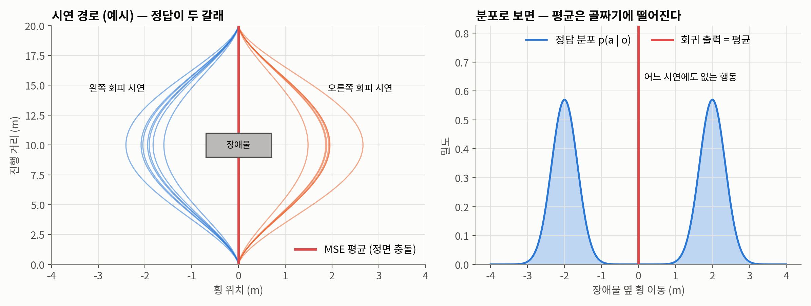
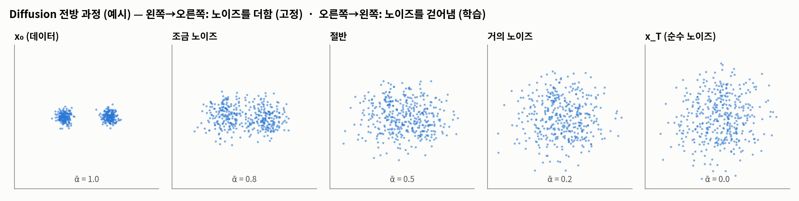
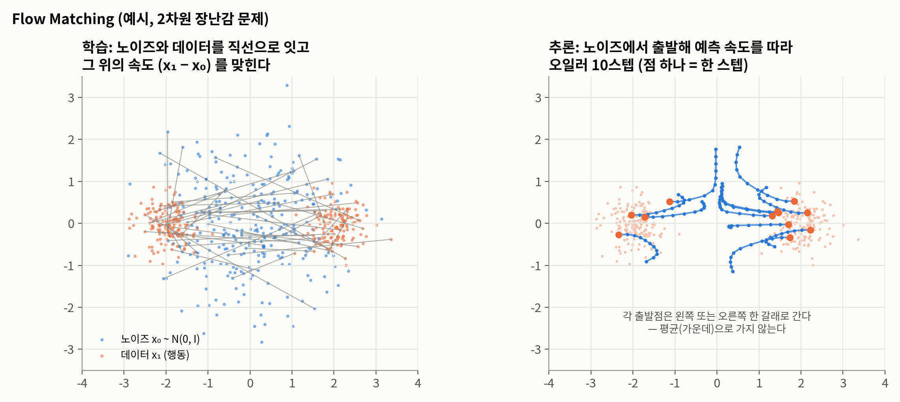
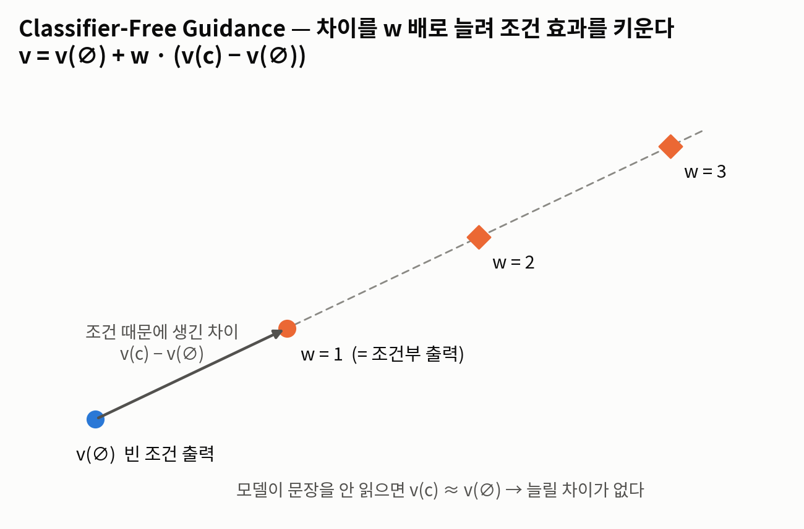

# 생성모델 — Diffusion 과 Flow Matching, 그리고 행동 생성

> 작성: 2026-10-07. study 폴더 목차: [README.md](README.md)

이 문서는 "왜 로봇·주행 정책이 행동을 **생성모델**로 만들어 내는가"를 바닥부터 정리한다.
SmolVLA 의 행동 출력부(action expert)는 flow matching 이라는 생성 기법으로 행동 청크를 만든다.
이 구조를 이해하려면 확률분포, 회귀의 한계, diffusion, flow matching, guidance 를 순서대로 알아야 한다.

프로젝트에서 같은 내용을 코드 위치와 함께 설명한 곳:
[VLA 완전 정복 가이드 3.5~3.8, 4.6절](../guides/vla_complete_guide_ko.md).
이 문서는 그 절들의 **이론 배경**을 더 자세히 다룬다.

---

## 목차

1. 왜 행동에 생성모델이 필요한가 — 회귀(MSE)의 한계
2. 확률분포 기초 — 생성모델을 읽기 위한 최소한의 수학
3. 생성모델의 큰 갈래 — VAE, GAN, 자기회귀, Diffusion, Flow
4. Diffusion (DDPM) — 노이즈를 더하고 걷어내기
5. Score matching — "확률이 높아지는 방향"을 배운다는 관점
6. Flow Matching / Rectified Flow — 직선으로 이어 속도를 배운다
7. 조건부 생성 — 이미지·문장·상태를 조건으로
8. Classifier-Free Guidance — 조건 효과를 키우는 방법
9. 행동을 만드는 두 방식: 이산 토큰 vs 연속 생성
10. 행동 청크와 생성모델
11. 평가할 때의 주의: 노이즈 고정과 노이즈 바닥
12. 우리 연구와 연결 요약
13. 용어집
14. 추천 자료

---

## 1. 왜 행동에 생성모델이 필요한가 — 회귀(MSE)의 한계

### 1.1 가장 단순한 방법: 회귀

정책(policy)은 관측 o 를 받아 행동 a 를 내는 함수다. 가장 단순한 학습법은 시연 데이터
{(o_i, a_i)} 에 대해 신경망 f_θ 가 정답 행동과 가깝도록 **평균제곱오차(MSE)** 를 줄이는 것이다.

```
L(θ) = (1/N) Σ_i || f_θ(o_i) − a_i ||²
```

이 방법은 싸고 안정적이다. 추론도 신경망 호출 한 번이면 끝난다.
초기 자율주행 E2E 연구(예: 카메라 → 조향각 회귀)와 우리 프로젝트의 stage_a(ResNet → 명령 회귀)가 이 방식이다.

### 1.2 MSE 의 최적해는 "조건부 평균"이다

같은 관측 o 에서 정답 행동이 여러 가지일 수 있다. 이때 MSE 를 최소로 만드는 출력은 무엇일까?

관측 o 가 고정되어 있을 때, 출력 값 c 에 대한 기대 손실은

```
E[ ||c − a||² | o ] = ||c||² − 2 c·E[a|o] + E[||a||² | o]
```

이를 c 로 미분해 0 으로 두면

```
c* = E[a | o]        (조건부 평균)
```

즉 **회귀는 "그 상황에서 나온 정답들의 평균"을 내도록 학습된다.** 정답이 하나면 문제가 없다.
정답이 여러 개(분포의 봉우리가 여러 개, **다봉 multimodal**)면 평균은 어느 정답도 아닐 수 있다.

### 1.3 예시: 장애물 회피

차선 정면에 장애물이 있다. 시연 데이터에는 왼쪽으로 피한 기록과 오른쪽으로 피한 기록이 반반 있다.
횡 이동(왼쪽 +) 을 행동이라고 하면:

| 시연 | 횡 이동 |
|---|---|
| 왼쪽 회피 | +2.0 m |
| 오른쪽 회피 | −2.0 m |

MSE 회귀의 최적 출력 = (+2.0 + −2.0)/2 = **0 m**. 즉 **장애물 정면으로 직진**한다.
두 시연 모두 안전했지만, 그 평균은 충돌이다.



교차로의 좌회전/우회전, 링 출구에서 남기/빠지기, 주차 4칸 중 어디에 서기 등도 같은 구조다
([가이드 3.5~3.6절](../guides/vla_complete_guide_ko.md)).

### 1.4 해결 방향: 분포를 배우고 거기서 하나를 뽑는다

평균 하나를 맞히는 대신, **조건부 분포 p(a | o) 자체**를 배우고, 추론할 때 그 분포에서 **샘플 하나**를 뽑으면
왼쪽 봉우리나 오른쪽 봉우리 중 하나가 나온다. 둘 다 정답이다.
이것이 "생성모델(generative model)"로 행동을 만든다는 뜻이다.

| 방식 | 배우는 것 | 다봉 상황의 출력 |
|---|---|---|
| 회귀 (MSE) | 조건부 평균 E[a\|o] | 봉우리 사이 (틀림) |
| 생성모델 | 조건부 분포 p(a\|o) | 봉우리 중 하나 (맞음) |

### 1.5 언어 조건이 다봉성을 줄이기도 한다

"왼쪽으로 피해라" 라는 문장이 주어지면 p(a | o, 문장) 은 거의 한 봉우리가 된다.
그래서 언어 조건 정책에서는 다봉성이 일부 사라진다. 그래도 생성모델이 쓰이는 이유:

1. 문장이 지정하지 않는 자유도가 남는다(예: 정확히 어디서 꺾기 시작할지).
2. 문장이 없는 상황, 혹은 모델이 문장을 충분히 따르지 못하는 상황에서 평균으로 뭉개지는 실패를 막는다.
3. 생성모델은 행동 **청크(여러 스텝 묶음)** 처럼 고차원 출력의 상관 구조(앞 스텝과 뒷 스텝의 관계)를 잘 표현한다.

---

## 2. 확률분포 기초 — 생성모델을 읽기 위한 최소한의 수학

### 2.1 확률변수와 분포

- **확률변수 X**: 값이 무작위로 정해지는 양. 예: 시연 행동 a.
- **확률밀도함수 p(x)**: 연속값에서 "그 근처 값이 나올 가능성"의 밀도. 전체 적분이 1.
- **조건부 분포 p(a | o)**: 관측 o 가 주어졌을 때 행동 a 의 분포.

### 2.2 정규분포(가우시안)

```
N(x; μ, σ²) = (1 / √(2πσ²)) · exp( −(x−μ)² / (2σ²) )
```

다차원이면 평균 벡터 μ 와 공분산 행렬 Σ 를 쓴다. 생성모델에서 "노이즈"라고 하면 보통
**표준정규분포 N(0, I)** (평균 0, 각 차원 분산 1, 차원끼리 독립)에서 뽑은 값이다.
SmolVLA 의 행동 노이즈 ε 도 이 분포에서 뽑는다.

### 2.3 최대우도 추정과 MSE 의 관계

데이터를 가장 잘 설명하는 파라미터를 찾는 원리가 **최대우도(maximum likelihood)**:

```
θ* = argmax_θ Σ_i log p_θ(a_i | o_i)
```

만약 모델이 "평균은 f_θ(o), 분산은 고정 σ² 인 정규분포"라고 가정하면

```
−log p_θ(a | o) = ||a − f_θ(o)||² / (2σ²) + 상수
```

즉 **MSE 회귀 = 단봉 정규분포를 가정한 최대우도**다. 1장의 한계는 이 "단봉 가정"에서 나온다.

### 2.4 다봉 분포를 표현하는 방법들

| 방법 | 아이디어 | 한계 |
|---|---|---|
| 가우시안 혼합(GMM / MDN) | 정규분포 K 개의 가중합을 출력 | K 를 정해야 함, 고차원에서 학습 불안정 |
| 이산화 + 분류 | 값을 구간(bin)으로 나누고 확률을 출력 | 정밀도가 bin 크기에 묶임, 차원이 많으면 조합 폭발 |
| 에너지 모델(EBM) | 좋은 행동에 낮은 에너지 | 샘플링이 어려움 |
| **Diffusion / Flow** | 노이즈를 데이터로 바꾸는 변환을 학습 | 추론에 여러 번의 신경망 호출 |

로봇 행동 생성의 최근 주류는 마지막 줄이다(Diffusion Policy 2023, π0 2024, SmolVLA 2025).

### 2.5 KL 발산 (자주 나오는 용어)

두 분포 p, q 가 얼마나 다른지 재는 양:

```
KL(p || q) = ∫ p(x) log( p(x) / q(x) ) dx    (≥ 0, 같으면 0)
```

VAE, 정보 병목, 지식 증류 등에서 계속 나온다.

---

## 3. 생성모델의 큰 갈래

생성모델의 목표: 데이터 분포 p_data(x) 를 흉내 내는 분포 p_θ(x) 를 만들고, 거기서 새 샘플을 뽑는 것.

| 갈래 | 대표 | 핵심 아이디어 | 샘플링 비용 | 행동 생성에서 |
|---|---|---|---|---|
| VAE | Kingma & Welling 2013 | 잠재변수 z 로 압축·복원 | 1회 | ACT 가 학습 보조에 사용 |
| GAN | Goodfellow 2014 | 생성기와 판별기의 경쟁 | 1회 | 학습 불안정으로 잘 안 씀 |
| 자기회귀 | GPT 계열 | 앞 토큰 보고 다음 토큰 예측 | 토큰 수만큼 | RT-2, OpenVLA (행동 토큰) |
| Diffusion | DDPM 2020 | 노이즈 추가의 역과정을 학습 | 수십~수백 회 (가속 시 수 회~수십 회) | Diffusion Policy |
| Flow matching | Lipman 2022, Liu 2022 | 노이즈→데이터 속도장을 학습 | 수 회~수십 회 | π0, SmolVLA |

### 3.1 VAE (Variational Autoencoder) — 짧게

- **인코더** q_φ(z | x): 데이터 x 를 잠재변수 z 의 분포로 압축
- **디코더** p_θ(x | z): z 에서 x 를 복원
- **사전분포** p(z) = N(0, I)

학습 목표(ELBO, 증거 하한):

```
log p_θ(x) ≥ E_{z~q_φ(z|x)}[ log p_θ(x|z) ] − KL( q_φ(z|x) || p(z) )
              └──── 복원 잘하기 ────┘      └── z 분포를 N(0,I) 에 가깝게 ──┘
```

샘플링: z ~ N(0, I) 를 뽑아 디코더에 넣는다.
행동 분야에서는 **ACT**(ALOHA, 2023)가 CVAE(조건부 VAE)를 써서 시연자의 "스타일" 차이를 z 로 흡수했다.
추론 때는 z 를 0(평균)으로 고정해 사실상 결정론적으로 쓴다.

### 3.2 GAN (Generative Adversarial Network) — 짧게

- **생성기 G**: 노이즈 z 를 가짜 데이터 G(z) 로
- **판별기 D**: 진짜/가짜를 구분

```
min_G max_D  E_x[log D(x)] + E_z[log(1 − D(G(z)))]
```

샘플 품질이 좋고 빠르지만, 학습이 불안정하고 **모드 붕괴**(분포의 일부 봉우리만 생성)가 잦다.
다봉 행동 표현이 목적인 로봇 학습에서는 이 약점이 치명적이라 주류가 되지 못했다.

### 3.3 자기회귀 (Autoregressive)

결합분포를 조건부의 곱으로 분해한다.

```
p(x_1, ..., x_n) = Π_k p(x_k | x_1, ..., x_{k−1})
```

LLM 이 이 방식이다. 행동을 이산 토큰으로 바꾸면 LLM 과 똑같이 "다음 행동 토큰 예측"으로 학습할 수 있다(9장).

---

## 4. Diffusion (DDPM) — 노이즈를 더하고 걷어내기

### 4.1 큰 그림

1. **전방 과정(forward)**: 데이터 x_0 에 노이즈를 조금씩 T 번 더해 완전한 노이즈 x_T 로 만든다. 학습 없음, 고정된 규칙.
2. **역방향 과정(reverse)**: 노이즈 x_T 에서 시작해 노이즈를 조금씩 걷어내 데이터 x_0 로 돌아간다. **이 과정을 신경망이 배운다.**



### 4.2 전방 과정 수식

각 단계에서 아주 작은 분산 β_t 의 노이즈를 더한다.

```
q(x_t | x_{t−1}) = N( x_t ; √(1−β_t) · x_{t−1},  β_t · I )
```

정규분포끼리의 합은 정규분포이므로, 중간 단계를 거치지 않고 x_0 에서 x_t 로 바로 갈 수 있다.
α_t = 1 − β_t, ᾱ_t = Π_{s≤t} α_s 라 두면

```
x_t = √ᾱ_t · x_0 + √(1−ᾱ_t) · ε,     ε ~ N(0, I)
```

- t 가 작으면 ᾱ_t ≈ 1 → x_t 는 거의 데이터
- t 가 크면 ᾱ_t ≈ 0 → x_t 는 거의 노이즈
- β_t 를 정하는 규칙을 **노이즈 스케줄**이라 한다(선형, 코사인 등).

### 4.3 학습: 노이즈를 맞힌다

DDPM(Ho et al., 2020)의 핵심 발견: 복잡한 확률 식을 정리하면 학습 목표가 아주 단순해진다.
**"x_t 를 보고, 섞인 노이즈 ε 를 맞혀라."**

```
L_simple(θ) = E_{x_0, t, ε} [ || ε − ε_θ(x_t, t) ||² ]
```

학습 한 스텝:

```
1. 데이터에서 x_0 하나를 뽑는다
2. t 를 {1, ..., T} 에서 무작위로 뽑는다
3. ε ~ N(0, I) 를 뽑는다
4. x_t = √ᾱ_t x_0 + √(1−ᾱ_t) ε 를 만든다
5. 신경망 출력 ε_θ(x_t, t) 와 ε 의 MSE 로 경사하강
```

겉모습은 회귀(MSE)지만, 맞히는 대상이 "행동"이 아니라 "섞인 노이즈"다. 이것이 1장의 평균 문제를 피하는 이유다:
각 x_t 지점에서 노이즈 방향은 (거의) 하나로 정해지므로 평균으로 뭉개질 일이 적고,
여러 단계를 거치면서 샘플이 한 봉우리로 굴러 들어간다.

### 4.4 샘플링: 반복해서 걷어낸다

```
x_T ~ N(0, I)
for t = T, ..., 1:
    z ~ N(0, I)  (t > 1 일 때만, t = 1 이면 z = 0)
    x_{t−1} = (1/√α_t) · ( x_t − (β_t / √(1−ᾱ_t)) · ε_θ(x_t, t) ) + σ_t · z
return x_0
```

매 단계 신경망을 한 번 부른다. 원래 DDPM 은 T = 1000 이었다.

### 4.5 스텝 수와 속도 — 실시간 제어의 문제

| 방법 | 아이디어 | 스텝 수 |
|---|---|---|
| DDPM | 확률적 역과정, 학습한 T 그대로 | 많음 (원 논문 1000) |
| DDIM (Song et al. 2020) | 결정론적 샘플러, 스텝 건너뛰기 | 수십 회로 줄여도 품질 유지 |
| 고차 ODE 솔버 (DPM-Solver 등) | 역과정을 미분방정식으로 보고 정밀 적분 | 더 적게 |
| 증류(consistency 등) | 여러 스텝을 1~2 스텝으로 압축 | 1~수 회 |

로봇 제어는 초당 수~수십 번 행동을 내야 하므로 스텝 수가 곧 지연시간이다.
Diffusion Policy(Chi et al., 2023)는 학습 100 스텝, 추론은 DDIM 으로 줄여 실시간에 맞췄다.

### 4.6 신경망 구조

ε_θ(x_t, t, 조건) 은 입력과 출력 모양이 같은 네트워크면 된다.
- 이미지 생성: U-Net, Transformer(DiT)
- 행동 생성: 1D 시간축 U-Net(Diffusion Policy), Transformer(π0·SmolVLA 의 action expert)
- 시간 t 는 스칼라이므로 **사인·코사인 위치 인코딩**으로 벡터화해 넣는다(SmolVLA 도 동일, [가이드 4.6절](../guides/vla_complete_guide_ko.md)).

---

## 5. Score matching — "확률이 높아지는 방향"을 배운다는 관점

### 5.1 score 의 정의

분포 p(x) 의 **score** 는 로그밀도의 기울기다.

```
s(x) = ∇_x log p(x)
```

뜻: "지금 위치 x 에서 어느 방향으로 움직이면 데이터가 있을 법한 곳(밀도 높은 곳)으로 가는가".
score 를 알면 **랑주뱅 동역학(Langevin dynamics)** 으로 샘플을 만들 수 있다.

```
x ← x + (η/2) · s(x) + √η · z,    z ~ N(0, I)
```

밀도가 높은 쪽으로 조금 이동 + 약간의 무작위 흔들림을 반복하면 분포 p 에서 뽑은 샘플이 된다.

### 5.2 노이즈 예측 = score 예측

정규 노이즈를 더한 분포에서는 score 와 노이즈가 직접 연결된다.

```
∇_{x_t} log q(x_t | x_0) = − ε / √(1−ᾱ_t)
```

즉 **DDPM 의 노이즈 예측 ε_θ 는 (부호와 크기를 뺀) score 예측과 같다.**
Song et al. 의 Score SDE(2021)는 이 관점으로 DDPM 과 score 기반 모델을 하나의 확률미분방정식(SDE) 틀로 통합했고,
같은 분포를 만드는 **결정론적 ODE(probability flow ODE)** 가 있음을 보였다. 이 ODE 관점이 6장의 flow matching 으로 이어진다.

### 5.3 직관 정리

| 관점 | 신경망이 맞히는 것 | 샘플링 |
|---|---|---|
| DDPM | 섞인 노이즈 ε | 확률적 역과정 반복 |
| Score | 밀도 증가 방향 ∇log p | 랑주뱅 / SDE 적분 |
| Probability flow ODE | 결정론적 속도 | ODE 적분 |
| Flow matching | 노이즈→데이터 속도 v | ODE 적분 (오일러 등) |

네 관점은 수학적으로 깊게 연결되어 있다. 차이는 "경로를 어떻게 정의하느냐"와 "무엇을 출력하게 하느냐"다.

---

## 6. Flow Matching / Rectified Flow — 직선으로 이어 속도를 배운다

### 6.1 아이디어

노이즈 분포의 점 하나와 데이터 점 하나를 **직선**으로 잇는다. 그 직선 위를 일정한 속도로 이동하는 흐름(flow)을 생각하면,
각 위치·시각에서의 **속도 벡터**가 정해진다. 신경망에게 이 속도를 맞히게 한다.
샘플링은 노이즈에서 출발해 배운 속도를 따라 시간 적분하는 것이다.

- Flow Matching (Lipman et al., 2022): 조건부 경로로 속도장을 학습하는 일반 틀
- Rectified Flow (Liu et al., 2022): 직선 경로를 강조, 경로를 "곧게 펴서" 적은 스텝으로 샘플링

### 6.2 수식 (일반적인 표기)

t ∈ [0, 1], x_0 ~ N(0, I) (노이즈), x_1 ~ p_data (데이터) 라 하면

```
x_t = (1 − t) · x_0 + t · x_1            (직선 위의 점)
dx_t/dt = x_1 − x_0                      (타깃 속도, t 와 무관한 상수)

L(θ) = E_{t, x_0, x_1} [ || v_θ(x_t, t) − (x_1 − x_0) ||² ]
```



샘플링: x_0 ~ N(0, I) 에서 시작해 ODE dx/dt = v_θ(x, t) 를 t = 0 → 1 로 적분.

### 6.3 SmolVLA(π0 계열)의 표기 — 시간 방향이 반대

SmolVLA 코드는 시간 방향을 반대로 쓴다. **t = 1 이 순수 노이즈, t = 0 이 정답 행동**이다
([가이드 3.7·4.6절](../guides/vla_complete_guide_ko.md), `modeling_smolvla.py`).

```
x_t = t · ε + (1 − t) · a          a: 정답 행동 청크, ε ~ N(0, I)
u_t = ε − a                        타깃 속도 ("행동 → 노이즈" 방향)
L   = || v_θ(x_t, t, 조건) − u_t ||²
```

추론(SmolVLA, num_steps = 10):

```
x ← ε ~ N(0, I)                    # t = 1.0
dt = −1/10
for step in 0..9:
    t = 1.0 + step·dt              # 1.0, 0.9, ..., 0.1
    x ← x + dt · v_θ(x, t, 조건)    # 음의 dt → 노이즈에서 행동 쪽으로 이동
return x                           # ≈ 행동 청크
```

이것이 **오일러 적분(Euler method)**: "현재 속도 × 작은 시간"을 더하는 가장 단순한 수치 적분이다.
그 밖의 세부:
- 학습 시 t 는 균일분포가 아니라 Beta(1.5, 1.0) 에서 뽑아 [0.001, 1.0] 로 옮긴다 — 노이즈 쪽(t≈1) 구간을 더 자주 연습.
- 무거운 VLM 부분(prefix: 이미지·문장·상태)은 한 번만 계산해 **KV 캐시**로 저장하고, 10 번 반복하는 것은 가벼운 action expert 뿐이다.

### 6.4 왜 diffusion 보다 단순하고 빠른가

| 항목 | DDPM | Flow matching (직선) |
|---|---|---|
| 경로 | 노이즈 스케줄에 따른 곡선 | 직선 |
| 학습 목표 | 노이즈 ε (스케줄 계수와 얽힘) | 속도 (x_1 − x_0), 조건부로는 t 와 무관한 상수 |
| 스케줄 설계 | β_t 선택이 성능에 영향 | 사실상 불필요 (t 분포 정도만) |
| 샘플링 | 확률적, 많은 스텝 | 결정론적 ODE, 적은 스텝 |
| 오일러 적분 오차 | 경로가 굽어 큰 스텝에서 오차 큼 | 경로가 곧을수록 큰 스텝도 정확 |

주의: "개별 쌍의 경로는 직선"이지만, 신경망이 배우는 **전체 속도장(여러 쌍의 평균)** 은 완전히 직선이 아니다.
서로 다른 (노이즈, 데이터) 쌍의 직선이 교차하는 곳에서 속도가 평균나기 때문이다.
그래서 1 스텝은 부족하고 수~수십 스텝이 필요하다. Rectified Flow 의 "reflow"(학습된 흐름으로 다시 쌍을 만들어 재학습)는
이 교차를 줄여 경로를 더 곧게 편다.

### 6.5 1 장의 다봉 문제를 flow 는 어떻게 푸는가

장애물 예시(정답 −2 와 +2)를 1차원으로 생각하자.
- 노이즈 ε 가 양수 쪽에서 시작하면 속도장이 +2 쪽으로, 음수 쪽에서 시작하면 −2 쪽으로 이끈다.
- 중간(ε ≈ 0)에서는 두 방향이 평균나 속도가 작지만, 조금만 벗어나면 한쪽으로 갈라진다.
- 결과: 샘플은 대부분 −2 또는 +2 근처에 떨어지고, 0 근처는 드물다.

**시작 노이즈가 어느 봉우리로 갈지를 결정한다.** 그래서 같은 입력이라도 노이즈가 다르면 다른 행동이 나올 수 있다(11장).

### 6.6 오일러 스텝 수와 품질·속도

| 스텝 수 | 신경망 호출 | 품질 경향 |
|---|---|---|
| 1 | 1 회 | 평균에 가까운 흐릿한 결과가 나오기 쉬움 |
| 5 | 5 회 | 중간 |
| 10 (SmolVLA 기본) | 10 회 | 기본 설정 |
| 그 이상 | 더 많음 | 개선 폭이 줄어듦 |

스텝 수를 줄이는 것은 양자화와 별개의 지연시간 단축 수단이다
([SmolVLA PTQ 실험계획](../experiments/model_compression/smolvla_ptq_실험계획.md) 의 steps5 대조군).

---

## 7. 조건부 생성 — 이미지·문장·상태를 조건으로

### 7.1 무조건 vs 조건부

- 무조건 생성: p(x). "아무 그림이나 그려라."
- 조건부 생성: p(x | c). "고양이 그림을 그려라." c 가 조건.

정책은 본질적으로 조건부 생성이다. **행동 a 를 관측·지시 c 에 조건부로 생성**한다.

```
c = (카메라 이미지, 지시 문장, 차량 상태)
p_θ(a | c)  ←  v_θ(x_t, t, c) 를 학습해서 간접적으로 표현
```

### 7.2 조건을 넣는 방법

| 방법 | 설명 | 예 |
|---|---|---|
| 입력에 이어 붙이기 | 조건 벡터를 x_t 와 concat | 단순 MLP 정책 |
| FiLM | 조건으로 각 층의 scale/shift 를 조절 | Diffusion Policy(CNN 버전) |
| Cross-attention | 생성 토큰이 조건 토큰에 어텐션 | Stable Diffusion, Diffusion Policy(Transformer 버전) |
| 공유 시퀀스 어텐션 | 조건 토큰(prefix)과 행동 토큰(suffix)을 한 시퀀스로 두고 어텐션 마스크로 제어 | π0, SmolVLA |

SmolVLA 는 마지막 방식이다. 이미지 토큰, 문장 토큰, 상태 토큰이 prefix 가 되고, 노이즈가 섞인 행동 청크와 시간 t 가 suffix 가 된다.
action expert 의 각 층은 prefix 의 KV 에 어텐션해서 조건 정보를 읽는다([가이드 4.5절](../guides/vla_complete_guide_ko.md)).

### 7.3 "조건이 실제로 쓰이는가"는 별도 문제

조건을 입력에 넣었다고 모델이 그것을 쓴다는 보장은 없다.
- 이미지만으로 행동이 거의 결정되면 모델은 문장을 무시해도 손실이 낮다.
- 이것이 우리 goto 실습에서 확인한 현상이다: 문장을 준 모델 b1 과 문장을 상수 `Drive.` 로 덮은 모델 b0 이
  언어 프로브에서 22/42 vs 23/42 로 구별되지 않았다([20261007_1010](../experiments/goto_object/20261007_1010_vision-action-baseline.md)).
  데이터에는 언어 정보가 있었다(CMI 0.743 b). 즉 **데이터가 아니라 학습·구조 쪽이 병목**이다.

조건의 효과를 측정하는 방법은 [04_로봇학습](04_로봇학습_모방학습과_강화학습.md)의 평가 방법론 절을 본다.

---

## 8. Classifier-Free Guidance (CFG) — 조건 효과를 키우는 방법

### 8.1 배경: classifier guidance

Dhariwal & Nichol(2021)은 별도의 분류기 p(c | x_t) 의 기울기를 score 에 더해 조건 쪽으로 샘플을 밀었다.

```
∇ log p(x_t | c) = ∇ log p(x_t) + ∇ log p(c | x_t)
```

단점: 노이즈 섞인 입력에서 동작하는 분류기를 따로 학습해야 한다.

### 8.2 CFG: 분류기 없이

Ho & Salimans(2021/2022)의 아이디어: **하나의 모델이 조건부·무조건 둘 다 하게 학습**하고, 추론 때 둘의 차이를 키운다.

학습:
```
확률 p_drop (예: 10~20%) 으로 조건 c 를 "빈 조건 ∅"으로 바꿔서 학습
→ 같은 신경망이 v_θ(x, t, c) 와 v_θ(x, t, ∅) 를 모두 배운다
```

추론:
```
v_guided = v_θ(x, t, ∅) + w · ( v_θ(x, t, c) − v_θ(x, t, ∅) )
```



- w = 1: 보통의 조건부 생성
- w > 1: "조건이 만드는 차이"를 w 배로 키움 → 조건을 더 강하게 따름 (대가: 다양성 감소, 너무 크면 품질 붕괴)
- w = 0: 무조건 생성

이미지 생성에서 "프롬프트를 더 강하게 따르게" 하는 표준 기법이다(Stable Diffusion 의 guidance scale).

### 8.3 핵심 전제: 빈 조건을 학습 때 봤어야 한다

추론 때 쓰는 v_θ(·, ∅) 는 모델이 학습 중 실제로 배운 "조건 없는 출력"이어야 한다.
학습 때 ∅ 를 한 번도 안 보여 줬다면 그 출력은 의미가 없고, 차이 (cond − null) 도 의미가 없다.

### 8.4 우리 연구에서는

goto 실습(말로 지정한 물체로 가기)에서 CFG 와 같은 형태를 시험했다.

- 서버: `server/code/vla_policy_server.py` 의 `--guide`(w), `--guide-null`(빈 조건 문장, 기본 `"Go to the object."`), `--guide-match`(적용할 문장 패턴).
  `infer()` 는 같은 seed 로 조건 문장과 null 문장을 각각 추론한 뒤 `null + guide · (cond − null)` 을 돌려준다.
  차선 문장이면 null 을 `"Follow the lane to the object."` 로 바꾼다.
- 학습 쪽: `server/code/course/add_null_goto.py` 가 방향 문장 에피소드의 일부(기본 25%)를 **방향이 빠진 문장**
  ("Go to the object." / "Follow the lane to the object.")으로 복사해 학습 데이터에 넣는다.
  스크립트 주석이 밝히듯 "null 이 진짜 '방향 없음' 조건이 되려면 정책이 그것을 봤어야 한다" — 8.3 의 전제를 데이터로 맞춘 것이다.
  CFG 의 "조건 드롭아웃"을 문장 바꾸기로 구현한 셈이다.
- 결과([20261005_0028](../experiments/goto_object/20261005_0028_goto-r52-closed-loop-left-bias.md) 3절):
  - 오프라인(r52 30k): w = 1, 3, 6 에서 횡 차이가 0.17 → 0.50 → 0.96 m 로 커졌지만, **지시한 쪽으로 간 비율은 34/42 로 그대로**였다.
    즉 guidance 는 이미 있는 차이를 키울 뿐, 방향을 새로 만들지 않는다.
  - 폐루프(배치 E): w = 1, 3 모두 짝 두 문장 모두 맞음 0/20 — 거의 매번 왼쪽 물체로 갔다(이후 원인은 postprocessor 통계 복사 버그로 확인).
- 교훈: **CFG 는 모델이 약하게라도 조건을 따를 때 그 효과를 키우는 도구**다. 조건을 무시하는 모델에는 해결책이 아니다.
  그리고 "같은 노이즈"로 두 출력을 구해야 차이가 조건 효과만 반영한다(11장).

### 8.5 CFG 변형들 (참고)

| 변형 | 내용 |
|---|---|
| Negative prompt | ∅ 대신 "원하지 않는 조건"을 넣어 그 반대로 밀기 |
| 다중 조건 guidance | 이미지·문장 각각에 다른 w |
| 스텝별 w 스케줄 | 초반/후반 스텝에 다른 w |

---

## 9. 행동을 만드는 두 방식: 이산 토큰 vs 연속 생성

### 9.1 이산 토큰화 (RT-2, OpenVLA)

- 행동의 각 차원을 정해진 범위에서 **256 개 구간(bin)** 으로 나누고, 각 구간을 언어모델 어휘의 토큰 하나로 대응시킨다.
- 행동 = 토큰 몇 개. LLM 처럼 "다음 토큰 예측"(교차엔트로피)으로 학습하고, 자기회귀로 생성한다.
- 장점: VLM 을 구조 변경 없이 그대로 쓸 수 있다. 분류이므로 다봉 분포를 표현할 수 있다(토큰 확률이 여러 bin 에 나뉨).
- 단점:
  - 정밀도가 bin 크기에 묶인다.
  - 차원 × 스텝 수만큼 토큰을 하나씩 생성해야 해서 고주파 제어·긴 청크에서 느리다.
  - 인접 bin 이 "가깝다"는 정보가 손실 함수에 없다(분류는 bin 100 과 bin 101 을 bin 100 과 bin 200 처럼 똑같이 틀렸다고 본다).

### 9.2 FAST 토큰화 (Physical Intelligence, 2025)

- 행동 청크(시간 × 차원)에 **이산 코사인 변환(DCT)** 을 적용해 주파수 성분으로 바꾸고, 양자화한 뒤 BPE 로 압축해 토큰으로 만든다.
- 매끄러운 궤적은 저주파 성분 몇 개로 표현되므로 토큰 수가 크게 줄어든다.
- 자기회귀 VLA 가 고주파·정밀 작업도 다룰 수 있게 한 방법(π0-FAST).

### 9.3 연속 생성 (Diffusion Policy, π0, SmolVLA)

- 행동을 연속 실수 벡터로 두고 diffusion / flow 로 생성.
- 청크 전체를 병렬로(스텝 수만큼 반복) 만든다.

### 9.4 비교표

| 항목 | 이산 토큰 (bin) | FAST 토큰 | 연속 생성 (flow/diffusion) |
|---|---|---|---|
| 대표 | RT-2, OpenVLA | π0-FAST | Diffusion Policy, π0, SmolVLA |
| 학습 손실 | 교차엔트로피 | 교차엔트로피 | MSE (노이즈/속도) |
| 다봉 표현 | 가능 | 가능 | 가능 |
| 정밀도 | bin 크기에 제한 | 양자화 수준에 제한 | 연속 |
| 생성 비용 | 토큰 수만큼 순차 | 압축된 토큰 수만큼 순차 | 적분 스텝 수만큼 (병렬 청크) |
| VLM 재사용 | 그대로 (어휘 일부 재할당) | 그대로 | 별도 행동 헤드/전문가 필요 |
| 언어 능력 보존 | 행동 토큰 학습이 언어 능력을 해칠 수 있음 | 같음 | 행동 전문가를 분리하면 보존에 유리 |

### 9.5 우리 연구에서는

- SmolVLA 는 **연속 생성(flow matching) + 분리된 action expert** 구조다.
- 우리 SANT-VLA 는 여기에 **언어 헤드(lm_head)를 함께 학습**해 행동과 해설을 동시에 낸다
  (flow_matching + λ·CE co-training, [reasoning 보고서](../experiments/reports/reasoning_project_report.md)).
  행동 쪽은 연속 생성, 해설 쪽은 자기회귀 토큰 생성이 한 모델 안에 공존한다.
- 보고서의 "언어-액션 비대칭"(언어 헤드는 정지·관찰을 말하는데 flow 행동 전문가는 희소한 정지 행동을 끝내 배우지 못함)은
  두 출력 방식이 같은 데이터에서 다르게 배운다는 관찰이다.

---

## 10. 행동 청크와 생성모델

### 10.1 청크란

한 번의 추론으로 여러 스텝의 행동을 묶어 낸다. 우리 설정: 30 스텝 × [dx, dy, dyaw], 10 Hz → 3 초.

### 10.2 생성모델과 청크의 궁합

- 청크는 고차원 출력(30 × 3 = 90 차원, 패딩 포함 30 × 32)이다. 스텝끼리 강하게 상관되어 있다(매끄러운 궤적).
- 회귀로 청크를 내면 봉우리 평균 문제가 **청크 전체**에서 생긴다(왼쪽 궤적과 오른쪽 궤적의 평균 = 직진 궤적).
- 생성모델은 "궤적 하나 전체"를 하나의 샘플로 뽑으므로, 한 봉우리의 일관된 궤적이 나온다.
- 한 번 정한 봉우리를 청크 길이만큼 유지하므로 **스텝마다 마음이 바뀌는 흔들림**도 줄어든다.

### 10.3 실행과 재계획

| 설계 변수 | 의미 | 우리 값 |
|---|---|---|
| chunk_size | 한 번에 예측하는 스텝 수 | 30 |
| n_action_steps | 그중 실행 큐에 넣는 수 | 30 |
| refill_at | 큐가 이 비율 밑으로 떨어지면 재추론 | 0.3 (청크의 70% 소비 후, 약 2.1 초) |
| splice overlap | 새 청크와 옛 큐를 섞는 스텝 수 | 5 (선형 크로스페이드) |

refill_at 실측(4 주차칸 시험): 0.93 은 모든 런이 한 지점으로 붕괴, 0.7 은 가운데 칸만 정답, 0.3 은 8/8 정답
([가이드 3.8·8.6절](../guides/vla_complete_guide_ko.md)). 회전 결정이 청크 뒤쪽에 실리기 때문에, 너무 자주 재계획하면 앞부분만 실행된다.

### 10.4 다른 연결 방식

- **Temporal ensembling** (ACT): 매 스텝 추론하고, 같은 시각에 대한 여러 청크의 예측을 가중평균. 매끄럽지만 매 스텝 추론 비용.
  다봉 상황에서 평균을 내면 1 장의 문제가 다시 생길 수 있어 생성모델과는 조합에 주의가 필요하다.
- **Receding horizon**: 앞 k 스텝만 실행하고 재계획(Diffusion Policy).
- **Real-time chunking 계열**: 다음 청크를 이전 청크와 이어지도록 생성 단계에서 맞추는 방법이 최근 제안되고 있다.

---

## 11. 평가할 때의 주의: 노이즈 고정과 노이즈 바닥

### 11.1 같은 입력, 다른 출력

생성모델 정책은 시작 노이즈 ε 에 따라 출력이 달라진다. 그래서
- "문장을 바꿨더니 궤적이 달라졌다" 가 **문장 효과인지, 노이즈 차이인지** 구분해야 한다.

### 11.2 seed 고정

우리 서버는 요청마다 seed 를 받아 `infer1()` 에서 `torch.manual_seed(seed)` 로 고정한다
(`server/code/vla_policy_server.py:216`). 같은 seed 면 같은 노이즈 → 입력만 다른 두 추론의 차이는 입력 효과다.
CFG 의 cond/null 두 추론도 같은 seed 를 쓴다.

### 11.3 노이즈 바닥 (noise floor)

**같은 입력**에서 seed 만 바꿨을 때의 출력 차이 = 모델이 원래 갖는 흔들림.
어떤 효과(문장 변경, 양자화, 체크포인트 변경)를 주장하려면 그 효과가 노이즈 바닥보다 확실히 커야 한다.

| 비교 | 바닥 역할 |
|---|---|
| 문장 A vs 문장 B 의 궤적 차이 | 같은 문장, 다른 seed 의 차이 |
| 양자화 모델 vs 원본 | 원본끼리 seed 만 바꾼 차이 ([PTQ 계획 4.2절](../experiments/model_compression/smolvla_ptq_실험계획.md)) |
| 문장 준 모델의 프로브 점수 | 문장을 상수로 덮은 모델의 점수 (b0 23/42) |

폐루프에서는 청크 이음새 점프 같은 실행 요인도 바닥을 키운다 — splice 를 도입한 이유 중 하나가 "같은 문장 반복 주행의 노이즈 바닥(D_same)" 을 줄이는 것이었다([가이드 8.6절](../guides/vla_complete_guide_ko.md)).

### 11.4 체크리스트

1. seed 를 고정했는가? (비교하는 두 조건이 같은 노이즈를 쓰는가)
2. 노이즈 바닥을 같은 조건에서 쟀는가?
3. 효과 / 바닥 비율로 보고했는가?
4. 오프라인 차이가 폐루프에서도 유지되는가? (오프라인 34/42 가 폐루프 0/20 이 된 사례가 있다)

---

## 12. 우리 연구와 연결 요약

| 개념 | 우리 연구에서 |
|---|---|
| 다봉 분포 | 링 출구, 주차 4칸, 차선 선택, 회피 방향 |
| Flow matching | SmolVLA action expert, x_t = t·ε + (1−t)·a, 10 스텝 오일러 |
| 조건부 생성 | 조건 = 카메라 1장 + 문장 + state 3값(v, ω, δ) |
| 조건 무시 | goto 기준선: 문장 모델 ≈ 상수 문장 모델 |
| CFG | `--guide`, `add_null_goto.py` 로 null 문장 학습 — 차이는 키우나 방향은 못 만듦 |
| 청크 | 30 스텝, refill 0.3, splice 5 |
| 노이즈 고정 | `torch.manual_seed(seed)`, 노이즈 바닥 대비 효과 |
| 행동+언어 공존 | SANT-VLA: flow 행동 + CE 해설 co-training |

---

## 13. 용어집

| 용어 | 뜻 |
|---|---|
| 생성모델 | 데이터 분포를 배워 새 샘플을 만드는 모델 |
| 다봉 분포 (multimodal) | 봉우리가 여러 개인 분포. 입력 종류가 여러 개라는 뜻의 멀티모달과 다름 |
| 조건부 평균 | 주어진 조건에서 정답들의 평균. MSE 회귀의 최적해 |
| 최대우도 | 데이터가 나올 확률을 최대로 하는 파라미터 추정 |
| ELBO | VAE 의 학습 목표, 로그우도의 하한 |
| 모드 붕괴 | 생성모델이 분포의 일부 봉우리만 만드는 현상 |
| 전방/역방향 과정 | diffusion 에서 노이즈 추가 / 제거 과정 |
| 노이즈 스케줄 | 단계별 노이즈 양 β_t 의 규칙 |
| score | 로그밀도의 기울기 ∇log p(x) |
| ODE / SDE | 상미분방정식 / 확률미분방정식 |
| 속도장 (velocity field) | 각 위치·시각에서 이동 방향과 크기 |
| 오일러 적분 | x ← x + dt·v 를 반복하는 수치 적분 |
| CFG | 조건부·무조건 출력의 차이를 w 배 키우는 추론 기법 |
| null 조건 | CFG 의 "조건 없음" 입력. 학습 때 봤어야 의미가 있음 |
| 행동 토큰화 | 연속 행동을 이산 토큰으로 바꾸는 것 (bin, FAST) |
| DCT | 이산 코사인 변환. 신호를 주파수 성분으로 분해 |
| 행동 청크 | 한 번에 예측하는 여러 스텝의 행동 묶음 |
| 노이즈 바닥 | 같은 입력에서 seed 만 바꿨을 때의 출력 차이 |

---

## 14. 추천 자료

읽는 순서대로.

1. **Lilian Weng, "What are Diffusion Models?"** (블로그, 2021, 이후 갱신) — diffusion 수식을 가장 친절하게 정리한 글. 시작점으로 추천.
2. **Ho, Jain, Abbeel, "Denoising Diffusion Probabilistic Models" (DDPM), NeurIPS 2020** — 노이즈 예측 손실의 원 논문.
3. **Song et al., "Score-Based Generative Modeling through Stochastic Differential Equations", ICLR 2021** — score·SDE·probability flow ODE 통합 관점.
4. **Song, Meng, Ermon, "Denoising Diffusion Implicit Models" (DDIM), ICLR 2021** — 빠른 샘플링.
5. **Lipman et al., "Flow Matching for Generative Modeling", ICLR 2023 (arXiv 2022)** — flow matching 원 논문.
6. **Liu, Gong, Liu, "Flow Straight and Fast: ... Rectified Flow", ICLR 2023 (arXiv 2022)** — 직선 경로와 reflow.
7. **Ho & Salimans, "Classifier-Free Diffusion Guidance" (2022)** — CFG.
8. **Chi et al., "Diffusion Policy: Visuomotor Policy Learning via Action Diffusion", RSS 2023** — diffusion 을 로봇 행동에 적용, 다봉성 논의.
9. **Zhao et al., "Learning Fine-Grained Bimanual Manipulation with Low-Cost Hardware" (ACT/ALOHA), RSS 2023** — 행동 청크, CVAE, temporal ensembling.
10. **Black et al., "π0: A Vision-Language-Action Flow Model for General Robot Control" (2024)** — VLM + flow matching 행동 전문가. SmolVLA 의 직계 조상.
11. **Pertsch et al., "FAST: Efficient Action Tokenization for Vision-Language-Action Models" (2025)** — DCT 기반 행동 토큰화.
12. **Shukor et al., "SmolVLA" (Hugging Face, 2025)** — 우리 기반 모델.
13. 프로젝트 내부: [VLA 완전 정복 가이드 3·4장](../guides/vla_complete_guide_ko.md) — 코드 위치까지 연결된 설명.

연습 과제(직접 해보면 이해가 빨라진다):
- 1차원 두 봉우리 데이터(−2, +2)에 MSE 회귀와 flow matching 을 각각 학습시켜 출력 히스토그램을 비교해 보기.
- 같은 flow 모델로 오일러 스텝 수 1, 2, 5, 10 의 샘플 분포를 비교해 보기.
- 조건 드롭아웃 비율 0% 와 20% 로 학습한 모델에 CFG w = 3 을 적용해 차이를 보기.
