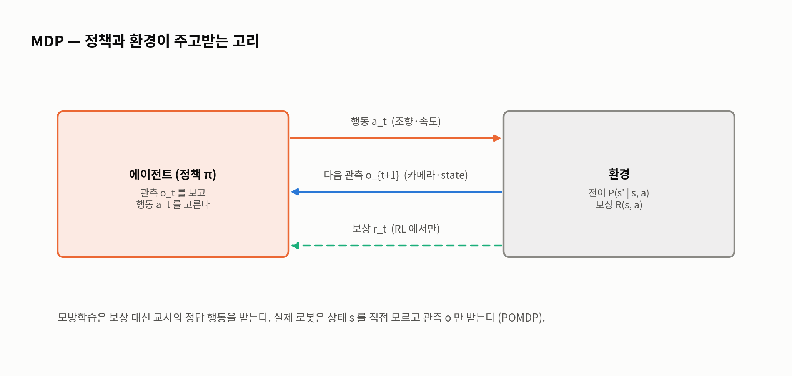
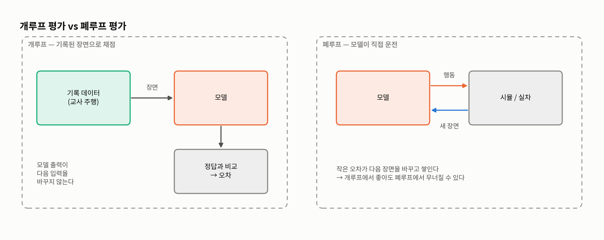
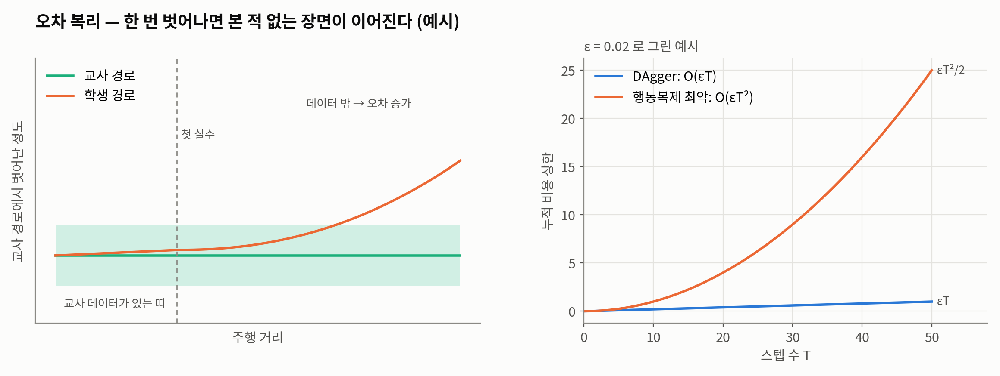
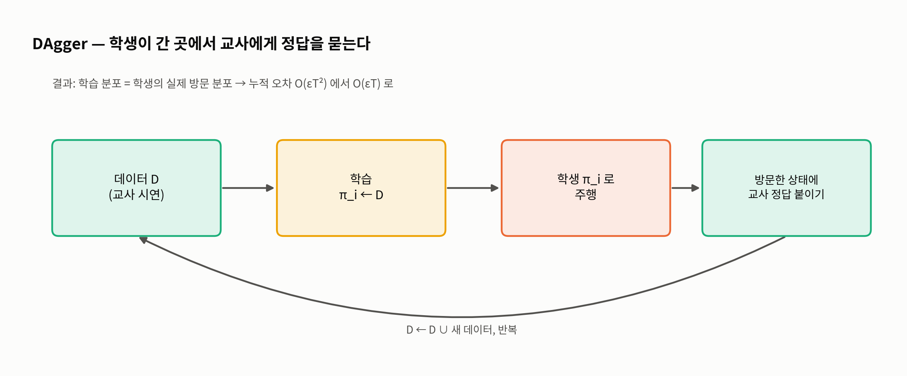
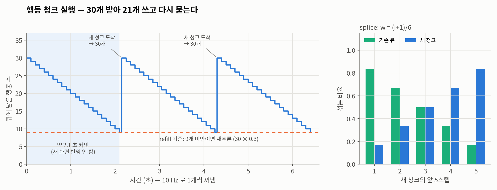
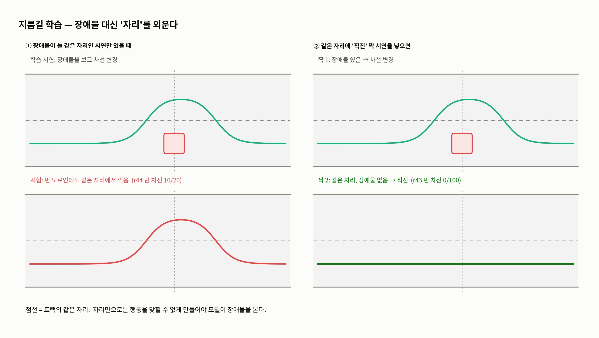
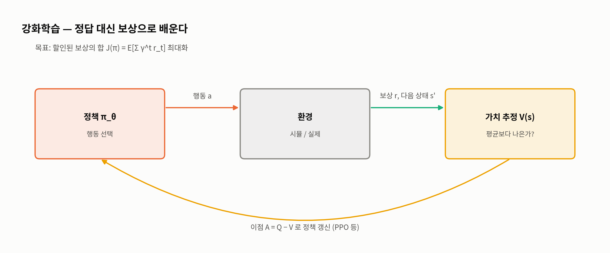
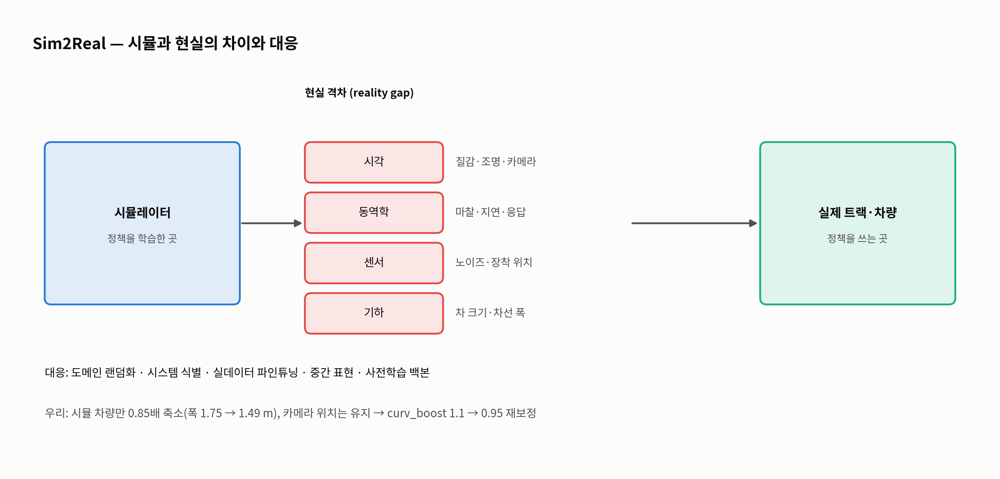

# 로봇 학습 — 모방학습과 강화학습

> 작성: 2026-10-07. study 폴더 목차: [README.md](README.md)

이 문서는 "로봇(차량)이 데이터로 행동을 배우는 방법"의 이론을 정리한다.
VLA 는 결국 **시연을 따라 배우는 정책(모방학습)** 이고, 최근에는 강화학습으로 추가 학습하는 흐름이 생겼다.
각 절 끝의 **"우리 연구에서는"** 에 프로젝트에서 실제로 겪은 일을 연결했다.

프로젝트에서 같은 주제를 실측 수치와 함께 다룬 곳:
[VLA 완전 정복 가이드 7장(학습 방법론), 9장(평가)](../guides/vla_complete_guide_ko.md),
[지름길 학습 정리](../experiments/avoidance/20261002_1414_shortcut-learning.md).

---

## 목차

1. 기본 틀: MDP, 정책, 관측·상태·행동
2. 개루프 vs 폐루프
3. 행동복제 (Behavior Cloning)
4. 공변량 이동과 오차 복리 — 왜 T² 인가
5. DAgger 와 HG-DAgger
6. 교사(teacher): 사람, 오라클, 특권 정보
7. 행동 표현: 속도 명령 vs 궤적 vs SE(2) 델타
8. 행동 청크와 실행 방식
9. 지름길 학습과 인과 혼동
10. 데이터 설계: 다양성, 짝 시연, 희소 행동
11. Co-training — 다른 데이터를 섞어 배우기
12. 강화학습 기초
13. 오프라인 RL 과 VLA 의 RL 파인튜닝
14. Sim2Real
15. 평가 방법론
16. 데이터셋과 도구
17. 용어집
18. 추천 자료

---

## 1. 기본 틀: MDP, 정책, 관측·상태·행동

### 1.1 마르코프 결정 과정 (MDP)

순차적 의사결정을 수학으로 쓰는 표준 틀. 다섯 요소로 정의한다.

| 기호 | 이름 | 주행 예 |
|---|---|---|
| S | 상태 공간 | 차의 위치·방향·속도, 주변 물체 |
| A | 행동 공간 | 조향·속도, 또는 다음 궤적 |
| P(s' \| s, a) | 전이 확률 | 이 행동을 하면 다음 상태가 어떻게 되나 (물리) |
| R(s, a) | 보상 | 차선 유지 +, 충돌 − |
| γ | 할인율 (0~1) | 먼 미래 보상을 얼마나 덜 쳐줄지 |

**마르코프 성질**: 다음 상태는 현재 상태와 행동에만 의존하고 그 이전 기록에는 의존하지 않는다.



### 1.2 부분 관측 (POMDP)

실제 로봇은 상태 s 를 직접 모른다. 카메라 이미지 같은 **관측 o** 만 받는다. 이 경우를 POMDP 라 한다.
- 카메라 한 장에는 속도가 안 보인다 → 속도는 별도 입력(상태 벡터)으로 주거나, 과거 프레임을 함께 준다.
- 똑같이 생긴 트랙 구간이 여러 곳이면 카메라만으로 "어디인지" 알 수 없다(자기 위치 추정 불가).

### 1.3 정책

**정책 π(a | o)** = 관측을 받아 행동(의 분포)을 내는 함수. 학습의 대상이다.
- 결정론적 정책: a = π(o)
- 확률적 정책: a ~ π(· | o)  (생성모델로 만든 정책이 여기에 해당 — [03 문서](03_생성모델_Diffusion_FlowMatching.md))

### 1.4 용어 정리 — "상태"가 두 가지 뜻으로 쓰인다

| 단어 | 강화학습 이론에서 | 로봇·VLA 실무에서 |
|---|---|---|
| state | 세계의 전체 상태 s | 로봇 자신의 고유수용감각(proprioception): 관절각, 속도 등 |
| observation | 센서로 보는 것 o | 이미지 + state 벡터 + 지시 문장 |

LeRobot 의 `observation.state` 는 실무 쪽 뜻이다.

### 1.5 우리 연구에서는

| 요소 | 우리 값 |
|---|---|
| 관측 | 전방 카메라 1장 + `observation.state` [v, ω, δ] (속도, yaw rate, 조향 추정) + 지시 문장 |
| 행동 | 30 × [dx, dy, dyaw] (ego 좌표계 0.1 초 이동량) |
| 제어 주기 | 10 Hz |
| 부분 관측의 결과 | 트랙이 시각적으로 균일해 카메라만으로는 "M2 로 가라" 같은 전역 좌표 내비가 불가능 → 2026-06 에 카메라 VLA 는 반응형 인지·주행으로, 전역 내비는 좌표 내비에 위임 |

입출력 계약 상세: [io_contract_state_action_twist.md](../guides/io_contract_state_action_twist.md).

---

## 2. 개루프 vs 폐루프

| | 개루프 (open-loop) | 폐루프 (closed-loop) |
|---|---|---|
| 정의 | 실행 중 결과를 보지 않고 계획대로 | 매 순간 결과를 관측해 다음 행동에 반영 |
| 평가에서 | 저장된 데이터의 정답과 모델 출력을 비교 | 모델이 직접 운전하고 결과를 잰다 |
| 장점 | 빠르고 재현 쉬움 | 실제 성능을 반영 |
| 함정 | 오차가 누적되는 효과를 못 봄 | 느리고 분산이 큼 |

**핵심**: 정책의 행동이 다음 관측을 바꾼다. 그래서 개루프 평가(오프라인 손실)가 좋아도 폐루프에서 무너질 수 있다(4장).



### 우리 연구에서는

- 오프라인 프로브 34/42 였던 방향 문장 모델이 폐루프 쉬운 배치에서 짝 정답 0/20 이었다
  ([20261005_0028](../experiments/goto_object/20261005_0028_goto-r52-closed-loop-left-bias.md)).
- 청크 실행 중 약 2.1 초는 관측 반영이 없는 개루프 구간이다(8장).

---

## 3. 행동복제 (Behavior Cloning, BC)

### 3.1 정의

전문가 시연 데이터 D = {(o_i, a_i)} 로 정책을 **지도학습**한다.

```
θ* = argmin_θ  E_{(o,a)~D} [ ℓ( π_θ(o), a ) ]
```

- ℓ 이 MSE 면 회귀 BC, 교차엔트로피면 분류 BC, 생성모델 손실(노이즈/속도 MSE)이면 생성 BC.
- 확률 관점으로는 시연 행동의 로그우도 최대화: max_θ E[ log π_θ(a | o) ].

### 3.2 장점

- 보상 함수를 설계할 필요가 없다.
- 시뮬레이터 없이 기록만 있으면 된다.
- 학습이 안정적이고 단순하다 (일반 지도학습과 같다).

### 3.3 근본 한계

1. **교사보다 잘할 수 없다** (교사의 실수까지 따라 함) — 6장
2. **교사가 가지 않은 상태에서 무엇을 할지 모른다** — 4장
3. **상관관계와 인과를 구분하지 못한다** — 9장
4. **다봉 시연을 회귀로 배우면 평균으로 뭉개진다** — [03 문서 1장](03_생성모델_Diffusion_FlowMatching.md)

### 3.4 우리 연구에서는

SmolVLA 학습은 손실은 flow matching 이지만 패러다임은 **순수 BC** 다
([가이드 7.1절](../guides/vla_complete_guide_ko.md)).
교사(오라클 순수추종 또는 YOLO 스택)의 (카메라, 상태, 문장) → [dx, dy, dyaw] 를 따라 배운다.

---

## 4. 공변량 이동과 오차 복리 — 왜 T² 인가

### 4.1 공변량 이동 (covariate shift)

학습 때 입력 분포 ≠ 실제 사용 때 입력 분포.
- 학습 입력 분포 = **교사가 방문한 상태들** d_π*
- 실행 입력 분포 = **학생 자신이 방문하는 상태들** d_π
- 학생이 조금이라도 다르게 움직이면 d_π 는 d_π* 에서 벗어난다.

### 4.2 오차 복리의 직관

- 매 스텝 학생이 교사와 다르게 행동할 확률을 ε 라 하자(교사 분포 위에서).
- 한 번 틀려 분포 밖으로 나가면, 그 뒤는 배운 적 없는 상태다. 최악의 경우 남은 스텝 전부에서 손해를 본다.
- t 번째 스텝의 실수 비용 ≈ (T − t). 실수 기회는 T 번.

```
기대 누적 비용 ≲ Σ_{t=1..T} ε · (T − t + 1)  ≈  ε · T² / 2   →  O(ε T²)
```

Ross & Bagnell(2010), Ross et al.(2011)이 이 상한을 보였다. 지도학습의 일반화 오차는 ε 수준인데,
순차 결정에서는 **실수의 이자가 남은 시간만큼 붙어** T² 로 커진다.



### 4.3 대응 방법 개관

| 방법 | 아이디어 |
|---|---|
| 노이즈 주입 / 시작 지터 | 시연 수집 때 일부러 흔들어 복귀 장면을 데이터에 넣기 (DART 등) |
| DAgger 계열 | 학생이 실제로 간 상태에 교사 정답을 붙이기 (5장) |
| 데이터 증강 | 이미지를 옆으로 옮기고 그에 맞게 조향 라벨을 고치기 (NVIDIA PilotNet 의 좌우 카메라) |
| 행동 청크 | 결정 횟수를 줄여 흔들림 감소 (단, 분포 이탈 자체는 못 막음) |
| 강화학습 파인튜닝 | 자기 분포에서 보상으로 교정 (12~13장) |

### 4.4 우리 연구에서는

([가이드 7.2절](../guides/vla_complete_guide_ko.md))
- 수집기는 시작 포즈에 횡 ±0.6 m, 요 ±6° 무작위 흔들림을 준다. 순수추종 교사가 절대 보여 주지 않는 **복귀 행동을 만드는 유일한 장치**였다. 단 시작 순간에만 작동한다.
- **교사의 결함도 그대로 복제**: YOLO 교사가 분기점을 놓친 이탈 시연 16 에피소드(전체의 2%)가 섞인 v4 계열은, 학습을 오래 할수록(= 더 충실히 모방할수록) 이탈이 심해졌다.

---

## 5. DAgger 와 HG-DAgger

### 5.1 DAgger (Dataset Aggregation, Ross et al. 2011)

**학습 분포를 학생의 방문 분포로 옮긴다.**

```
D ← 교사 시연
π_1 ← D 로 학습
for i = 1..N:
    π_i 로 주행하며 방문한 상태들 {s} 수집
    각 s 에 교사의 정답 행동 π*(s) 를 붙임
    D ← D ∪ {(s, π*(s))}
    π_{i+1} ← D 로 재학습
```

결과: 실행 분포와 학습 분포가 일치하므로 누적 오차가 **O(εT)** 로 내려간다.
요구조건: 교사에게 **임의의 상태에서 정답을 물을 수 있어야** 한다(사람에게는 부담이 크다).



### 5.2 변형들

| 변형 | 내용 |
|---|---|
| HG-DAgger (Kelly et al. 2019) | 사람이 지켜보다 위험할 때만 개입, **개입 구간만** 라벨로 사용 |
| SafeDAgger, EnsembleDAgger | 학생이 불확실하거나 위험할 때만 교사에게 넘김 |
| 개입 기반 학습 (intervention data) | 실차 안전운전자의 개입 기록을 학습 데이터로 |

### 5.3 우리 연구에서는 — DAgger 사이클 1 (v6 → y7d → v7)

([가이드 7.3~7.6절](../guides/vla_complete_guide_ko.md))
- 방법(실용적 변형): v6 프로브 궤적에서 교사 라인 대비 0.25~2.0 m 이탈 상태를 검출(5,405 개) → 44 개 선별 →
  **그 포즈에 교사를 다시 출발시켜 복귀 주행 전체를 수집**(y7d 42 에피소드) → 기존 406 + 42 로 재학습(v7).
- 결과: **표적은 개선, 전반은 희석.**
  - S-커브 편차 −1.88 → −1.45 m, 이탈 0/8 유지
  - 하지만 차선 중앙 유지가 전반적으로 0.1~0.2 m 후퇴 (두 런·두 차선에서 같은 방향)
- 원인 진단: 복귀 에피소드(약 10%)는 전부 "어긋난 자세에서 출발" 시연이라, 정상 주행의 비중을 옅게 만들었다.
- 교훈: **데이터 추가는 표적일 때만 유효하고, 혼합비는 민감하다.**
- 다음 수: 실차에는 순간이동 리셋이 없으므로, 사람이 개입한 순간만 라벨로 쓰는 **HG-DAgger** 가 자연스러운 대응이다.
  정책이 잘 달리는 구간에는 데이터가 생기지 않아 희석이 구조적으로 줄어든다.

---

## 6. 교사(teacher): 사람, 오라클, 특권 정보

### 6.1 교사의 종류

| 교사 | 장점 | 단점 |
|---|---|---|
| 사람 원격조작 | 자연스러운 행동, 실차에 바로 | 비용, 피로, 일관성 낮음, 다봉성 큼 |
| 규칙 기반 제어기 | 대량·일관 | 규칙이 커버하는 행동만 |
| **특권 정보(privileged) 오라클** | 시뮬의 정답 정보(정확한 위치·지도·장애물 좌표)를 써서 완벽에 가깝게 | 실차에는 없음 → 학생은 센서만으로 따라 해야 함 |
| 다른 학습 정책 | 확장성 | 그 정책의 결함을 물려받음 |

### 6.2 "특권 정보로 가르치기" (Learning by Cheating, Chen et al. 2019)

1. 시뮬의 정답 정보(조감도, 다른 차 위치)를 보는 **특권 에이전트**를 먼저 만든다.
2. 센서(카메라)만 보는 **학생**이 특권 에이전트를 모방한다.
3. 특권 에이전트는 어떤 상태에서도 정답을 낼 수 있으므로 DAgger 식 질의가 쉽다.

### 6.3 교사 품질이 학생의 상한

- BC 는 교사의 실수를 판별하지 않는다. 교사가 코너를 자르면 학생도 자른다.
- 교사의 행동이 **관측에 없는 정보**에 의존하면 학생은 그것을 재현할 수 없다(예: 카메라에 안 보이는 장애물 위치로 꺾는 오라클).
  학생 입장에서는 이유 없는 행동 → 지름길 학습의 재료가 된다.

### 6.4 우리 연구에서는

| 교사 | 사용처 | 관찰 |
|---|---|---|
| `route_oracle_node` (순수추종, 시뮬 정답 포즈 사용) | 주행·goto 시연 | 특권 정보 교사. 경로가 원호 |
| YOLO 인지 스택 | v3 이후 주행 코퍼스 | 분기점 놓침이 시연에 섞여 v4 오염 사건 |
| 사람 | (실차 계획) | HG-DAgger 후보 |

- goto 실습에서 **운동학 교사가 굽은 접근에서 횡 이동을 실제 주행보다 작게 만든다**는 관찰이 있었다(측정: 실제 0.497/0.482 m 대 교사 0.292/0.216 m, n=3).
  가르치려는 대조량 자체가 작으면 학생이 배우기 어렵다.
- "교사도 코너를 잘랐다" — 교사 중앙선 대비 편차는 측정 기준으로 부적절해, 기하 차선중심 기준(`geometric_lane_check.py`, ±0.70 m)으로 바꿨다([가이드 9.4~9.5절](../guides/vla_complete_guide_ko.md)).

---

## 7. 행동 표현: 속도 명령 vs 궤적 vs SE(2) 델타

### 7.1 선택지

| 표현 | 예 | 장점 | 단점 |
|---|---|---|---|
| 저수준 명령 | 조향각·가속, 관절 토크 | 바로 구동 | 차량·로봇마다 다름, 고주파 필요 |
| 속도 명령 | (v, ω) = Twist | 단순 | 한 순간 정보, 경로 모양을 따로 못 다룸 |
| 웨이포인트/궤적 | 미래 위치 점 N 개 | 계획을 보여 줌, 하위 제어기와 분리 | 추종 제어기 필요 |
| 상대 이동량 (델타) | 스텝별 [dx, dy, dyaw] | 차량 좌표계라 위치 불변, 속도·곡률 분리 가능 | 적분 오차 |
| 절대 목표 자세 | 로봇팔 말단의 목표 위치 | 직관적 | 좌표계 의존 |

### 7.2 좌표계

- **월드 좌표계**: 지도 기준. 위치에 따라 같은 행동의 숫자가 달라짐 → 일반화에 불리.
- **ego(차량) 좌표계**: 차 기준 앞이 +x, 왼쪽이 +y. 같은 행동이면 어디서든 같은 숫자 → 학습에 유리.
- SE(2) = 평면의 회전 + 이동. [dx, dy, dyaw] 는 SE(2) 의 상대 변환.

### 7.3 정규화

행동 각 차원의 평균·표준편차(또는 최소·최대)로 정규화해 학습하고, 추론 출력은 역정규화해서 쓴다.
이 통계가 체크포인트와 함께 저장된다(LeRobot preprocessor / postprocessor).

### 7.4 우리 연구에서는

([io_contract 문서](../guides/io_contract_state_action_twist.md))
- 행동 = 30 × [dx, dy, dyaw] (ego SE(2) 델타), state = [v, ω, δ], 구동 = Twist(v, ω).
- 셋은 같은 (v, ω) 를 과거·현재·미래 3 초의 세 시간 스케일로 본 것이다(state = action / dt).
- 출력을 델타로 두는 핵심 이유: **곡률 k = dyaw/dx 가 속도와 분리**되어, 서빙의 속도 셰이핑이 경로 모양을 망가뜨리지 않는다.
- 정규화 통계 함정: 학습 스크립트가 postprocessor(행동 복원 통계)를 베이스 모델에서 복사하는 버그로 **모든 문장의 경로가 왼쪽으로 쏠렸던** 사건이 있다.
  새 체크포인트는 pre/post 통계가 일치하는지부터 확인한다.

---

## 8. 행동 청크와 실행 방식

### 8.1 ACT (Action Chunking with Transformers, Zhao et al. 2023)

- 한 번에 k 스텝 행동을 예측.
- 효과: 결정 횟수가 줄어 오차 누적 감소, 사람 시연의 머뭇거림(정지 구간) 같은 비마르코프 행동을 처리.
- **Temporal ensembling**: 매 스텝 추론해서, 같은 시각을 가리키는 여러 청크 예측을 지수 가중평균 → 매끄러운 동작.

### 8.2 실행 전략 비교

| 전략 | 추론 빈도 | 반응성 | 매끄러움 |
|---|---|---|---|
| 매 스텝 1개 | 매 스텝 | 높음 | 낮음 (흔들림) |
| 청크 전부 실행 | k 스텝마다 | 낮음 | 이음새 점프 |
| Receding horizon | 일부 실행 후 재계획 | 중간 | 중간 |
| Temporal ensembling | 매 스텝 | 높음 | 높음, 다봉에서 평균 위험 |
| 크로스페이드 이음 | 재계획 때 | 중간 | 높음 |

### 8.3 우리 연구에서는

- chunk 30 (3 초), `refill_at` 0.3 → 남은 행동이 9개 미만일 때 재추론(약 2.1 초 커밋), 새 청크 앞 5 스텝을 선형 크로스페이드(splice).
- refill 0.93 / 0.7 / 0.3 실측에서 0.3 만 주차 4칸 8/8 — **회전 결정이 청크 뒤쪽에 실리기 때문**([가이드 3.8, 8.6절](../guides/vla_complete_guide_ko.md)).
- 대가: 커밋 구간은 개루프 → 폐루프 추적 오차가 교사의 약 2배로 수렴.
- 청크는 느린 추론(약 100 ms)과 빠른 제어(10 Hz)를 잇는 완충재 역할도 한다.



---

## 9. 지름길 학습과 인과 혼동

([지름길 학습 정리](../experiments/avoidance/20261002_1414_shortcut-learning.md) 에 논문 요약과 실험이 자세히 있다.)

### 9.1 지름길 학습 (Shortcut learning, Geirhos et al. 2020)

모델이 의도한 규칙 대신 **학습 데이터에서 정답과 우연히 같이 나타나는 더 쉬운 단서**로 문제를 푼다.
학습 데이터 안에서는 두 규칙이 같은 답을 내므로 학습 오차로 구분되지 않는다.

왜 생기나:
1. 경사하강법은 손실을 가장 빨리 줄이는 단순한 특징(배경, 위치)부터 잡는다.
2. 데이터에 단서와 정답을 떼어 놓는 반례가 없다.
3. 평가가 학습과 같은 분포에서만 이뤄진다.

### 9.2 인과 혼동 (Causal confusion, de Haan et al. 2019)

- 계기판 브레이크등이 보이면 모델이 "앞차 때문"이 아니라 "브레이크등이 켜져서" 브레이크를 밟는다고 배운다.
- **정보를 더 줬는데 더 나빠진다.** 검증 손실은 더 낮은데 실제 성능은 더 낮다.
- BC 에서 특히 심한 이유: 학습 때는 교사 궤적 위에서만 평가 → 원인을 잘못 짚어도 오차가 낮다.

### 9.3 카피캣 문제 (Wen et al. 2020)

과거 관측 히스토리를 주면 그 안에서 직전 행동을 알아내 "직전 행동 반복"을 배운다. 행동이 바뀌어야 하는 순간을 놓친다.

### 9.4 우리 연구에서는 — 회피의 "자리 습관"

| 단계 | 관찰 |
|---|---|
| 의도 | 우리 차선에 장애물이 보이면 차선 변경 |
| 증상 | 빈 차선에서도 꺾음. 회피 시연을 늘릴수록 더 꺾음 (빈 차선 인덱스 70: 5 개 0.56 m → 80 개 2.26 m) |
| 반례 투입 (r43) | 같은 출발·같은 위치의 **직진 짝 시연** 포함 → 빈 차선 차선 변경 **0/100** |
| 반례가 묽어짐 (r44) | 짝 없는 회피 109 개 추가 → 빈 차선 차선 변경 **10/20** |
| 원인 판별 (출발 거리 실험) | 출발 거리를 10~63 m 로 바꿔도 **같은 트랙 자리에서** 꺾음 → "출발 후 거리" 가 아니라 **트랙 자리(배경)** 단서 |

모델은 장애물 대신 "이 자리에서는 꺾는다"를 외웠다. 회피 시연의 장애물 자리가 고정되어 있었기 때문이다.



또 다른 사례: goto 실습의 "왼쪽 쏠림"은 지름길이 아니라 정규화 통계 버그였다(7.4) — **증상이 같아도 원인은 다를 수 있으니 버그부터 배제**한다.

### 9.5 대응 원칙

1. **반례(짝 시연)를 데이터에 넣는다**: 같은 장면에서 정답만 다른 시연.
2. **단서를 다양화**한다: 장애물 위치·출발 조건을 무작위로.
3. **입력에서 단서를 지운다**: 불필요한 입력 제거, 드롭아웃, 적대적 학습(TCA).
4. **폐루프 대조 실험**으로 확인한다: 빈 차선, 옆 차선 장애물 같은 "단서는 같고 정답은 다른" 조건.

---

## 10. 데이터 설계: 다양성, 짝 시연, 희소 행동

### 10.1 다양성

- 같은 행동을 다양한 배경·위치·조명·속도에서 보여 줘야 행동의 진짜 원인을 배운다.
- **방향 다양성**: 반시계 방향만 수집한 코퍼스로 학습한 모델은 시계 방향으로 놓으면 학습된 좌조향대로 이탈했다
  ([sim_scale_calibration_note](../experiments/reports/sim_scale_calibration_note.md)). 대응: 양방향 수집 또는 거울 증강(이미지 좌우반전 + dy·dyaw 부호 반전 + 차선 어휘 교환).

### 10.2 짝 시연 (paired / counterfactual demonstrations)

- **같은 시작 상태**에서 **지시만 다른** 시연을 묶음으로 수집 → 행동 차이가 오직 지시 때문임이 데이터에 드러난다.
- 언어 조건 정책에서 "문장을 읽어야만 풀리는 데이터"를 만드는 핵심 장치.
- 우리 코퍼스: `cf_group_id` / `cf_variant_id` 로 짝을 묶는다.

### 10.3 데이터의 언어 정보량 측정: CMI

조건부 상호정보량 I(행동 ; 지시 | 관측) — 같은 관측 버킷 안에서 지시가 교사 행동에 대해 갖는 정보량(bit).
- 0 이면 지시를 몰라도 행동을 맞힐 수 있는 데이터 → 모델이 문장을 무시해도 손실이 안 오른다.
- 셔플 대조(지시를 무작위로 섞어 같은 계산)로 추정 편향을 빼서 본다.
- 우리 g1 코퍼스 0.743 b(셔플 0.104 b), gv2b 0.965 b — 데이터는 문장을 읽어야 풀리는 데이터였다.
  **이것은 데이터의 성질이지 모델이 문장을 읽는다는 뜻이 아니다**([20261007_1010](../experiments/goto_object/20261007_1010_vision-action-baseline.md)).

### 10.4 희소 행동 — 재샘플링 vs 가중치

드문 행동(장애물 정지, 특정 언급)은 자연 빈도로는 잘 안 배워진다.

| 방법 | 내용 | 특징 |
|---|---|---|
| 손실 가중치 | 드문 샘플의 손실에 큰 가중 | 노출 횟수는 그대로 |
| 재샘플링(오버샘플링) | 드문 샘플을 더 자주 뽑음 | 모델이 실제로 더 많이 봄 |
| 재샘플링 + 역가중 | 많이 뽑고 손실은 1/w 로 보정 | 노출은 늘리되 분포 왜곡을 줄임 |

우리 실측([reasoning_versions](../experiments/reports/reasoning_versions.md), [보고서](../experiments/reports/reasoning_project_report.md)):
- r5 → r6: 장애물 프레임 10% 빈도에서 차량 언급 7% → **4배 가중 샘플링으로 100%**.
- r14: 손실 가중을 언어(CE)에만 주는 방식에서, 가시성 게이트로 부스트 대상 풀이 5926 → 2676 으로 줄자 **언어 붕괴**(가시 프레임 언급 4%).
- r15: 재샘플링 복원 + 행동 1/w 역가중(`resample-comp`) → 언급 52% 로 회복.
- 교훈: **희소 신호는 가중치만으로는 부족하고 노출(재샘플링)이 필요하다.**
- 그러나 노출을 늘려도 못 배운 경우도 있다: flow 행동 전문가는 24배 오버샘플에도 희소한 정지 행동을 획득하지 못했다(언어-액션 비대칭).

### 10.5 혼합비

5.3 의 DAgger 희석, v2c 의 정지 신호 가중으로 주차 서수 학습이 희석된 사례 — **좋은 데이터를 더 넣어도 기존 분포가 옅어지는 비용**이 있다.

---

## 11. Co-training — 다른 데이터를 섞어 배우기

### 11.1 정의

목표 과제 데이터에 **다른 과제·다른 형식의 데이터**를 섞어 함께 학습.

| 섞는 것 | 목적 | 예 |
|---|---|---|
| 인터넷 이미지-텍스트 (VQA, 캡션) | VLM 의 일반 지식 유지, 망각 방지 | RT-2 |
| 다른 로봇의 데이터 | 다양성, 전이 | Open X-Embodiment, π0 |
| 같은 데이터의 언어 라벨 (해설, 추론) | 표현 학습 보조, 설명 가능성 | EMMA 다과제, Alpamayo-R1 |
| 시뮬 + 실제 | 실제 데이터 부족 보완 | 다수 |

### 11.2 효과와 위험

- **양의 전이**: 과제를 함께 학습하면 각각보다 좋아진다(EMMA 보고).
- **음의 간섭**: 공유 파라미터가 서로 다른 목표에 끌려 한쪽 성능이 떨어진다.
- **파국적 망각(catastrophic forgetting)**: 로봇 데이터로만 파인튜닝하면 사전학습 언어·지식이 사라진다. co-training 이 이를 줄인다.

### 11.3 우리 연구에서는 — SANT-VLA

- Shared-backbone Action–Narration Training: 하나의 SmolVLA 백본에서 **행동(flow matching)** 과 **해설(CE)** 을 함께 학습.
- 손실: flow_matching + λ·CE. 잠들어 있던 lm_head 를 해동해 언어 헤드로 사용, 행동 경로는 원래대로.
- 관찰된 간섭: r16 의 잔여 차선 오차 0.10 m 를 "v9 언어 CE 의 공유-trunk 간섭"으로 해석, 대응 후보는 λ_CE 축소나 trunk 동결.
- co-training 자체는 무죄인 경우도 확인: r4(v3y 데이터 + co-training)는 v3y 와 같은 차선 중심 0.24 m.

---

## 12. 강화학습 기초

### 12.1 목표

보상의 기대 할인합을 최대화하는 정책을 찾는다.

```
J(π) = E_π [ Σ_{t=0}^{∞} γ^t r_t ]
```

모방학습과 달리 **정답 행동이 없다**. 시도하고 결과 보상으로 배운다.



### 12.2 가치함수

```
V^π(s)    = E_π[ Σ γ^t r_t | s_0 = s ]             상태 가치
Q^π(s, a) = E_π[ Σ γ^t r_t | s_0 = s, a_0 = a ]     행동 가치
A^π(s, a) = Q^π(s, a) − V^π(s)                      이점(advantage): 평균보다 얼마나 좋은가
```

**벨만 방정식**:
```
Q^π(s, a) = r(s, a) + γ E_{s'}[ V^π(s') ]
Q*(s, a)  = r(s, a) + γ E_{s'}[ max_{a'} Q*(s', a') ]
```

### 12.3 알고리즘 갈래

| 갈래 | 대표 | 아이디어 |
|---|---|---|
| 가치 기반 | Q-learning, DQN | Q* 를 배우고 argmax 로 행동 (이산 행동에 적합) |
| 정책 경사 | REINFORCE | 정책을 직접 미분해 보상 큰 쪽으로 |
| 액터-크리틱 | A2C, PPO, SAC | 정책(액터) + 가치(크리틱)를 함께 |
| 모델 기반 | Dreamer, MuZero | 환경 모델(월드 모델)을 배워 계획·상상으로 학습 |

### 12.4 정책 경사 정리

```
∇_θ J = E_π [ Σ_t ∇_θ log π_θ(a_t | s_t) · A(s_t, a_t) ]
```

직관: "평균보다 좋았던 행동의 확률은 올리고, 나빴던 행동은 내린다."

### 12.5 PPO (Proximal Policy Optimization, Schulman et al. 2017)

정책을 한 번에 너무 많이 바꾸면 학습이 무너진다. 변화를 잘라서(clip) 제한한다.

```
r_t(θ) = π_θ(a_t|s_t) / π_old(a_t|s_t)
L = E[ min( r_t A_t,  clip(r_t, 1−ε, 1+ε) A_t ) ]
```

로봇 시뮬 학습, LLM 의 RLHF 에서 가장 널리 쓰인 알고리즘.

### 12.6 RL 의 어려움 (로봇에서)

| 어려움 | 내용 |
|---|---|
| 표본 효율 | 수백만 번 시도가 필요 → 실차에서 불가, 시뮬 필수 |
| 보상 설계 | 보상을 잘못 주면 의도와 다른 행동으로 보상만 챙김 (reward hacking) |
| 안전 | 탐색 중 위험 행동 |
| 희소 보상 | 성공해야만 보상이면 학습 신호가 거의 없음 |

그래서 로봇에서는 **BC 로 시작하고 RL 로 다듬는** 조합이 흔하다.

---

## 13. 오프라인 RL 과 VLA 의 RL 파인튜닝

### 13.1 오프라인 RL

환경과 상호작용 없이 **고정된 데이터셋**(보상이 붙은)만으로 RL.
- 문제: 데이터에 없는 행동의 Q 값을 과대평가(분포 밖 행동).
- 대표: CQL(보수적 Q-learning), IQL, TD3+BC (BC 항을 섞어 데이터 근처에 머물게).
- BC 와의 차이: 나쁜 시연은 덜, 좋은 시연은 더 따라 하도록 **보상으로 가중**할 수 있다.

### 13.2 VLA 에 RL 을 붙이는 최근 흐름

| 방식 | 내용 |
|---|---|
| 시뮬 온라인 RL 파인튜닝 | BC 로 학습한 VLA 를 시뮬에서 PPO 등으로 추가 학습 → 분포 밖 상태 교정, 성공률 향상 보고 |
| 잔차 정책 (residual RL) | VLA 출력은 고정하고 작은 보정 정책만 RL 로 학습 |
| 보상 모델 / 선호 학습 | 사람이 고른 좋은 궤적으로 보상 모델 → 정렬 (LLM 의 RLHF 와 같은 구조) |
| 추론-행동 일치 RL | 모델의 설명(추론)과 실제 행동이 맞을 때 보상 — NVIDIA Alpamayo-R1 이 이 방향을 보고 |
| 월드 모델 안에서 RL | 학습된 월드 모델 속에서 상상 주행으로 RL (Dreamer 계열) |

flow / diffusion 정책은 로그확률 계산이 까다로워 정책 경사를 바로 적용하기 어렵다. 이를 풀기 위한 방법(노이즈 공간에서 RL, 잔차 정책 등)이 연구되고 있다.

### 13.3 우리 연구에서는

- 지금까지는 순수 BC + DAgger 변형만 사용. RL 은 쓰지 않았다.
- 시뮬이 있고 성공 판정(차선 접촉, 충돌, 목표 도달)이 자동화되어 있어, **보상 설계 재료는 갖춰져 있다**. 언어 지시 준수(짝 문장 둘 다 맞기)를 보상으로 주는 실험은 BC 로 못 푼 언어 접지 문제의 후보가 될 수 있다(미시험, 아이디어 단계).

---

## 14. Sim2Real

### 14.1 현실 격차 (reality gap)

시뮬에서 배운 정책이 실제에서 실패하는 원인:
- **시각 차이**: 질감, 조명, 카메라 특성
- **동역학 차이**: 마찰, 질량, 지연, 액추에이터 응답
- **센서 차이**: 노이즈, 해상도, 장착 위치
- **기하 차이**: 차량 크기, 차선 폭



### 14.2 대응 방법

| 방법 | 내용 |
|---|---|
| 도메인 랜덤화 | 시뮬 파라미터(질감·조명·마찰·지연)를 무작위로 바꿔 학습 → 실제를 "또 하나의 변형"으로 |
| 시스템 식별 (system identification) | 실제 시스템을 측정해 시뮬 파라미터를 맞춤 |
| 도메인 적응 | 시뮬·실제 이미지를 같은 표현으로 (스타일 변환, 특징 정렬) |
| 실데이터 파인튜닝 | 소량의 실제 시연으로 추가 학습 |
| 중간 표현 사용 | 원본 이미지 대신 분할 마스크·차선 등 추상 표현 입력 |
| 사전학습 VLM 백본 | 다양한 실사 이미지로 사전학습된 시각 표현은 시각 격차에 상대적으로 강하다는 기대 |

### 14.3 우리 연구에서는

([sim_scale_calibration_note](../experiments/reports/sim_scale_calibration_note.md))
- **시스템 식별에 해당하는 작업**: 실트랙·유아용 차량 대비 시뮬 차량이 커서, 차량만 0.85배 축소(폭 1.75 → 1.49 m).
  카메라·라이다 위치는 그대로 두어 정책 시야가 학습 때와 같게 유지 → 재학습 없이 적용, 양 차선 무접촉.
- **스케일을 바꾸면 서빙 게인 재보정 필수**: 축소 차에서 curv_boost 1.1 이 과조향 → 0.95 로 재보정. 보닛이 작아진 시각 변화로 조향 특성이 달라진 것으로 추정.
- 실차 쪽은 고정 인프라 Hesai 라이다로 외부 위치추정을 준비 중이고, 실차 DAgger 는 HG-DAgger 로 계획.

---

## 15. 평가 방법론

### 15.1 무엇을 재나

| 지표 | 예 |
|---|---|
| 성공률 | 목표 도달, 충돌 없음, 지시 준수 |
| 연속 품질 | 차선 중심 편차(중앙값·p95·최대), 기준 초과 비율 |
| 안전 | 충돌·이탈·개입 횟수 |
| 효율 | 완주 시간, 평균 속도 |
| 지연·자원 | 추론 ms, GPU 메모리 |

### 15.2 성공률의 신뢰구간 — Wilson 구간

성공 k / n 의 비율 p̂ = k/n. 표본이 작으면 단순 정규근사(p̂ ± 1.96√(p̂(1−p̂)/n))는 0 이나 1 근처에서 틀린다.
**Wilson 점수 구간**:

```
center = ( p̂ + z²/(2n) ) / ( 1 + z²/n )
half   = z · √( p̂(1−p̂)/n + z²/(4n²) ) / ( 1 + z²/n )
구간   = [center − half, center + half]      (95% 면 z = 1.96)
```

우리 `tools/eval/stat_analyze.py` 의 `wilson()` 이 이 식이다. 예: 0/20 이어도 상한은 0 이 아니다(약 16%).
**n 이 작은 결과로 "0%" 라고 단정하지 않는다.**

### 15.3 대조군과 노이즈 하한

효과를 주장하려면 "효과가 없을 때 얼마가 나오는가"를 같은 조건에서 재야 한다.

| 주장 | 필요한 대조 |
|---|---|
| "모델이 문장을 따른다" | 문장을 상수로 덮은 모델 (b0) — 우리 결과: 23/42 vs 22/42 로 구별 안 됨 |
| "장애물에 반응한다" | 같은 위치 빈 차선, 옆 차선 장애물 |
| "개선됐다" | 같은 날 같은 스택의 기준 모델, 여러 런 |
| "문장마다 궤적이 다르다" | 같은 문장·다른 seed 의 차이 (노이즈 바닥) |

### 15.4 반사실(counterfactual) A/B

같은 장면·같은 seed 에서 **지시만 바꿔** 두 번 실행하고 결과 차이를 본다.
- 행동 차이 D_diff 를 같은 지시 반복의 차이 D_same(노이즈 바닥)과 비교.
- 오프라인(같은 프레임에 두 문장)과 폐루프(같은 시작 자세에서 두 번 주행) 두 수준이 있다.
- 우리 사례: 차선 문장 전환 +2.51 m, v8g 목표 채널 D 26.8 m vs 바닥 0.5 m — 채널이 정책에 도달함을 보임(단, 목표 도달은 실패).

### 15.5 짝 지은 비교 (paired)

같은 위치에서 조건만 바꿔 비교하면 위치 간 분산이 상쇄된다. 우리 `stat_eval.sh` 는 무작위 위치 N 곳 × {ours, adj, empty} 조건을 같은 위치에서 돌리고,
위치별로 (ours − empty) 차이를 본다.

### 15.6 재현의 규율

- 런 간 분산(우리 차선 편차 ±0.1~0.2 m)보다 작은 차이는 약한 증거.
- 두 런·두 차선에서 방향이 일관되면 실재로 본다.
- 측정 도구 자체를 의심한다 — 도구가 틀렸던 사건 목록이 [가이드 9.9절](../guides/vla_complete_guide_ko.md) 에 있다.

---

## 16. 데이터셋과 도구

| 이름 | 무엇 | 비고 |
|---|---|---|
| **LeRobot** (Hugging Face) | 로봇 학습 라이브러리: 데이터셋 형식, 정책(ACT, Diffusion, π0, SmolVLA), 학습·평가 | 우리 학습·서빙의 기반 |
| LeRobotDataset 형식 | 프레임별 관측·행동 + 영상, 메타데이터, 정규화 통계 | 우리 `to_lerobot.py` 가 변환 |
| **Open X-Embodiment** (2023) | 여러 기관·여러 로봇의 시연을 모은 대규모 데이터 | RT-X, OpenVLA 학습 |
| **DROID** (2024) | 다양한 장소에서 수집한 실제 로봇팔 조작 데이터 | 일반화 연구 |
| BridgeData | 저가 로봇팔 조작 데이터 | OpenVLA 등 |
| nuScenes, Waymo Open | 실도로 주행 데이터 | 인지·예측 |
| CARLA | 오픈소스 주행 시뮬 | LMDrive, SimLingo 의 폐루프 평가 |
| Gazebo (gz sim) | 로봇 시뮬 | 우리 트랙 시뮬 |

---

## 17. 용어집

| 용어 | 뜻 |
|---|---|
| MDP / POMDP | (부분관측) 마르코프 결정 과정 |
| 정책 | 관측 → 행동 함수 |
| 행동복제 (BC) | 시연을 지도학습으로 따라 배우기 |
| 공변량 이동 | 학습·실행 입력 분포가 다른 현상 |
| 오차 복리 | 작은 실수가 분포 이탈로 커지는 현상, O(εT²) |
| DAgger | 학생이 방문한 상태에 교사 정답을 붙여 데이터 누적 |
| HG-DAgger | 사람이 개입한 구간만 라벨로 쓰는 DAgger |
| 특권 정보 교사 | 시뮬 정답 정보를 쓰는 교사 |
| 행동 청크 | 여러 스텝 행동 묶음 |
| temporal ensembling | 같은 시각에 대한 여러 청크 예측의 가중평균 |
| 지름길 학습 | 의도와 다른 쉬운 단서로 정답 맞히기 |
| 인과 혼동 | 결과를 원인으로 착각한 모방 |
| 짝 시연 | 같은 시작 상태, 다른 지시의 시연 묶음 |
| CMI | 조건부 상호정보량, 데이터의 언어 의존도 |
| co-training | 다른 과제·데이터를 함께 학습 |
| 파국적 망각 | 새 과제 학습으로 기존 능력이 사라짐 |
| 보상 / 가치 / 이점 | RL 의 학습 신호 / 기대 누적 보상 / 평균 대비 좋음 |
| PPO | 정책 변화를 잘라 안정화한 정책경사 |
| 오프라인 RL | 고정 데이터만으로 RL |
| 도메인 랜덤화 | 시뮬 파라미터를 무작위화해 실제 격차 줄이기 |
| 시스템 식별 | 실제 시스템을 측정해 모델 파라미터 맞추기 |
| Wilson 구간 | 작은 표본 비율의 신뢰구간 |
| 노이즈 바닥 / 노이즈 하한 | 효과가 없을 때 나오는 값의 크기 |
| 반사실 A/B | 지시만 바꾼 두 실행의 비교 |

---

## 18. 추천 자료

### 교과서·강의
1. **Sutton & Barto, *Reinforcement Learning: An Introduction* (2판, 2018)** — RL 기초. 무료 공개. 1~6장, 13장(정책경사) 우선.
2. **OpenAI Spinning Up** — 정책경사·PPO·SAC 를 코드와 함께. RL 실습 입문.
3. **Sergey Levine, UC Berkeley CS 285 (Deep RL)** 강의 — 모방학습(2강)부터 오프라인 RL·모델 기반 RL 까지. 강의 영상·슬라이드 공개.
4. **LeRobot 문서·튜토리얼** — 데이터셋 형식, ACT·Diffusion·SmolVLA 학습 예제. 우리 코드와 직결.

### 논문 (모방학습)
5. **Ross, Gordon, Bagnell, "A Reduction of Imitation Learning and Structured Prediction to No-Regret Online Learning" (DAgger), AISTATS 2011**
6. **Kelly et al., "HG-DAgger: Interactive Imitation Learning with Human Experts", ICRA 2019**
7. **de Haan, Jayaraman, Levine, "Causal Confusion in Imitation Learning", NeurIPS 2019**
8. **Wen et al., "Fighting Copycat Agents in Behavioral Cloning from Observation Histories", NeurIPS 2020**
9. **Geirhos et al., "Shortcut Learning in Deep Neural Networks", Nature Machine Intelligence 2020**
10. **Chen et al., "Learning by Cheating", CoRL 2019** — 특권 정보 교사.
11. **Zhao et al., ACT/ALOHA, RSS 2023** — 행동 청크.
12. **Chi et al., "Diffusion Policy", RSS 2023**
13. **Bojarski et al., "End to End Learning for Self-Driving Cars" (NVIDIA PilotNet), 2016** — 카메라→조향 BC 의 고전, 좌우 카메라 증강.

### 논문 (RL·sim2real·데이터)
14. **Schulman et al., "Proximal Policy Optimization Algorithms", 2017**
15. **Tobin et al., "Domain Randomization for Transferring Deep Neural Networks from Simulation to the Real World", IROS 2017**
16. **Kumar et al., "Conservative Q-Learning for Offline RL", NeurIPS 2020** / **Kostrikov et al., "IQL", ICLR 2022**
17. **Open X-Embodiment Collaboration, 2023** / **Khazatsky et al., "DROID", 2024**

### 프로젝트 내부
18. [VLA 완전 정복 가이드 7·9·10장](../guides/vla_complete_guide_ko.md) — 우리 DAgger, 평가 규율, 연혁의 교훈.
19. [지름길 학습 정리](../experiments/avoidance/20261002_1414_shortcut-learning.md) — 인과 혼동·카피캣 논문 요약과 회피 실험.
20. [Reasoning 프로젝트 보고서](../experiments/reports/reasoning_project_report.md) — co-training, 희소 신호, 언어-액션 비대칭.
