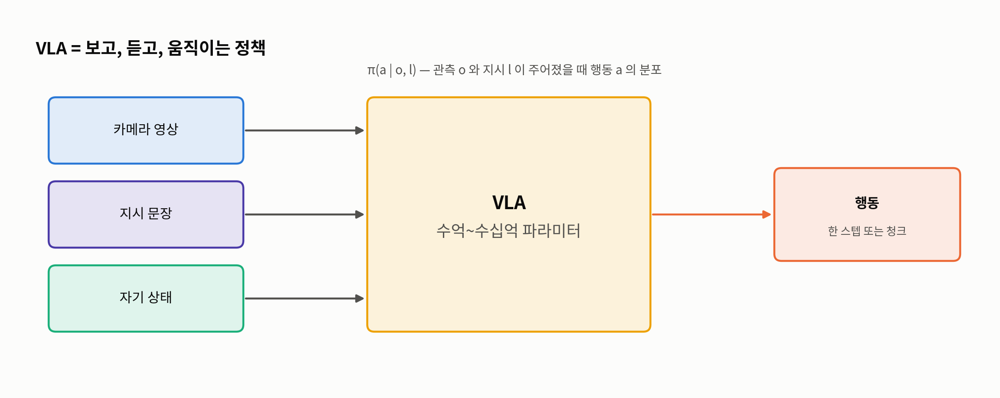
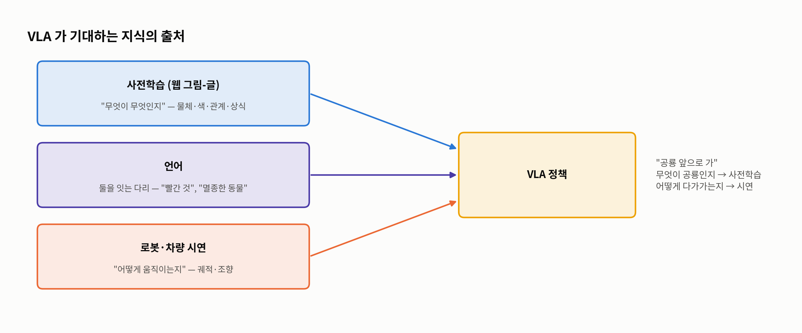
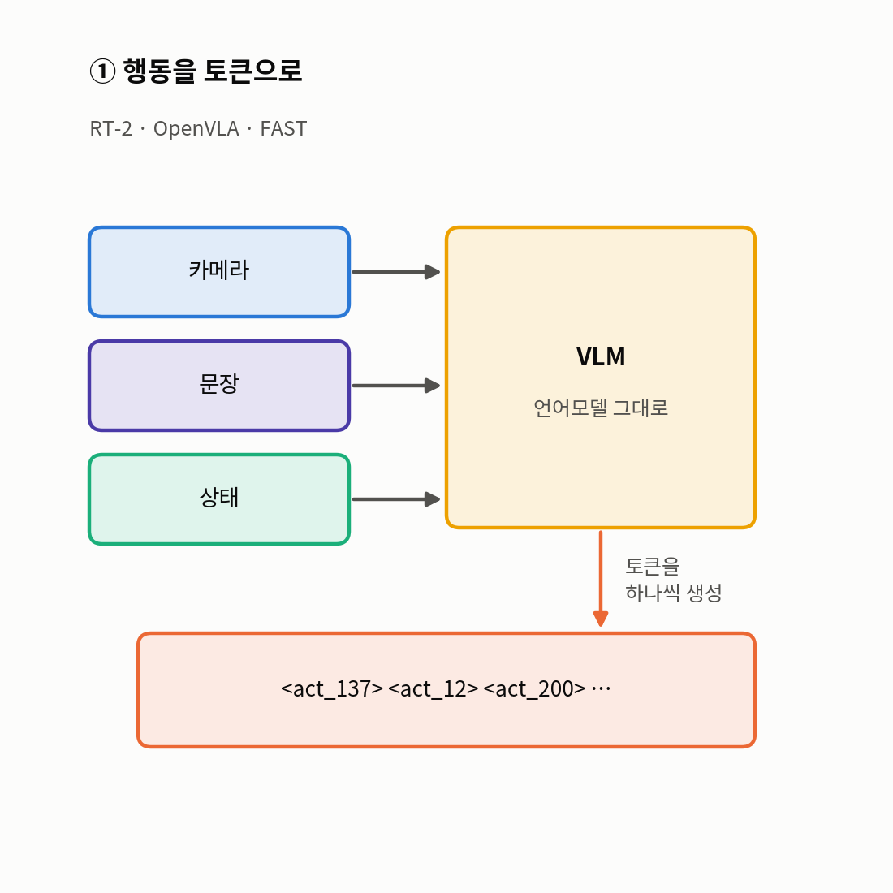
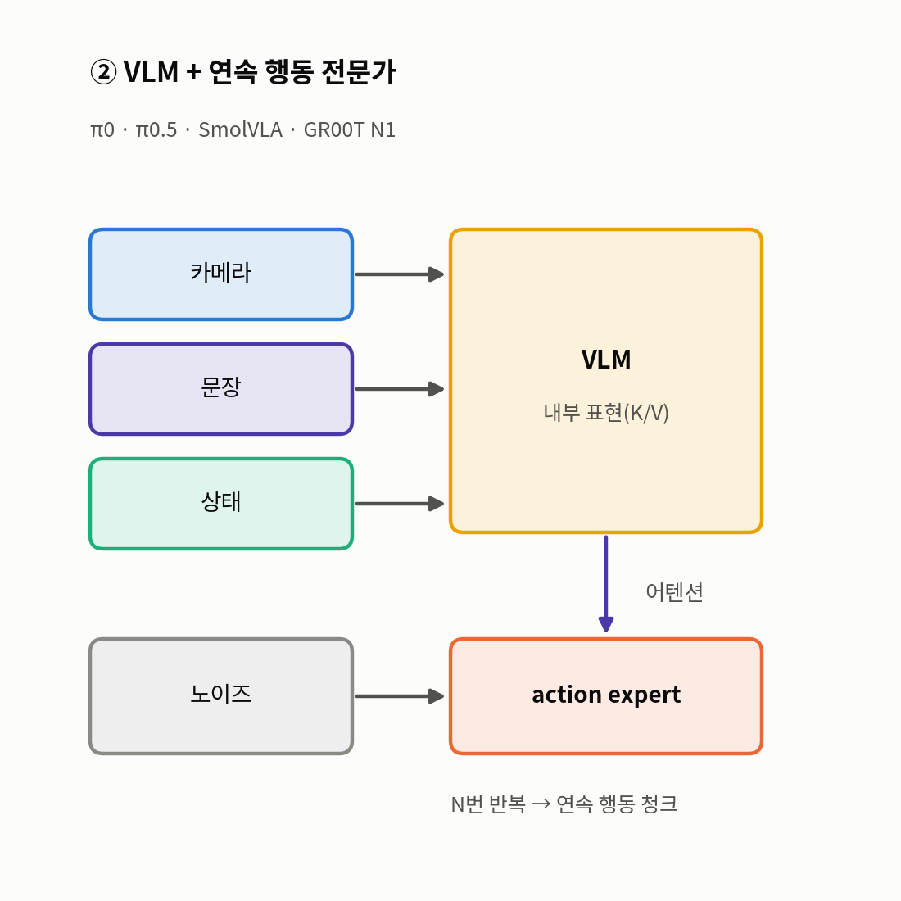
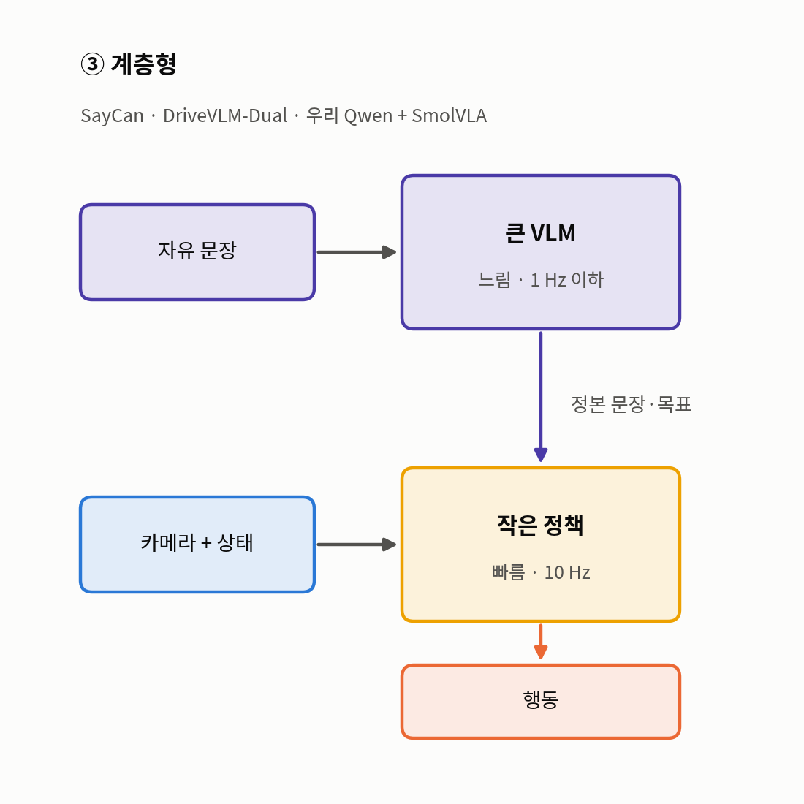
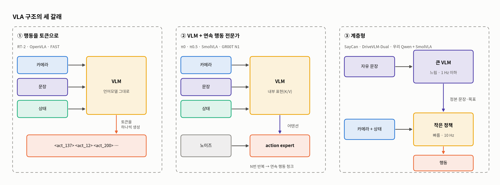
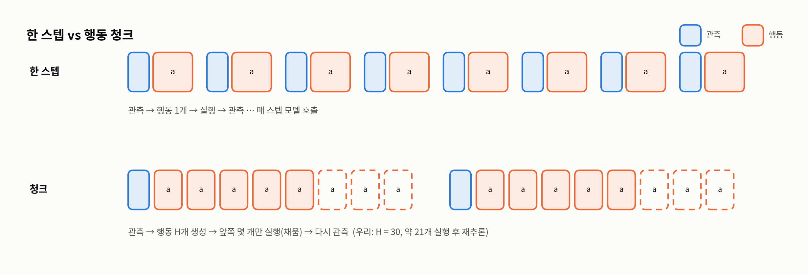
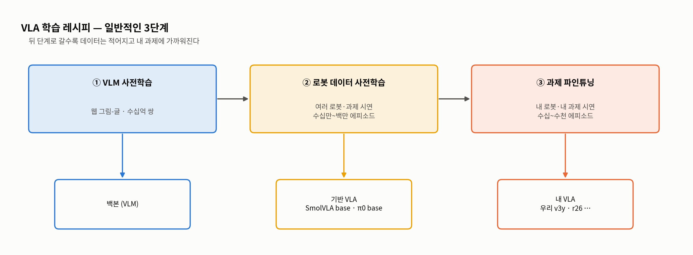

# VLA (Vision-Language-Action) 란 무엇인가

> 작성: 2026-10-07. study 폴더 목차: [README.md](README.md)
>
> 이 문서는 개념 공부용이다. 논문별 수치와 연표는 강좌 자료
> [VLA_최근연구동향과_장점.md](../course/VLA_최근연구동향과_장점.md) 에 정리돼 있으니 여기서는 반복하지 않고 링크한다.
> 우리 프로젝트(SmolVLA 주행) 쪽 세부 구현은 [VLA 완전 정복 가이드](../guides/vla_complete_guide_ko.md) 3·4장을 본다.
> 연도·수치 중 원 논문에서 다시 확인하지 않은 것은 "(확인 필요)" 로 표시했다.

---

## 목차

1. 한 줄 정의와 세 글자의 의미
2. 정책(policy)이라는 관점: π(a | o, l)
3. VLM 과 VLA 는 무엇이 다른가
4. 왜 VLA 인가 — 연구자들이 기대하는 것
5. 구조 계보 ① 행동을 토큰으로 (RT-1, RT-2, OpenVLA, FAST)
6. 구조 계보 ② VLM + 연속 행동 전문가 (π0, π0.5, SmolVLA, GR00T N1)
7. 구조 계보 ③ 계층형 (고수준 VLM + 저수준 정책)
8. 세 방식 비교표
9. 행동을 어떻게 표현하나 — 한 스텝 vs 청크, 이산 vs 연속
10. 학습 레시피 — 사전학습, 파인튜닝, 동결, co-training, 데이터 양
11. 추론 지연과 실시간 제어
12. 평가 — 무엇을 재야 하나
13. 한계
14. 언어 접지(language grounding)가 실제로 어려운 이유
15. 최근 경향
16. 우리 연구와의 연결
17. 용어집
18. 추천 자료

---

## 1. 한 줄 정의와 세 글자의 의미

**VLA = 카메라 영상(Vision)과 지시 문장(Language)을 입력으로 받아, 로봇이나 차량이 실행할 행동(Action)을 직접 출력하는 신경망.**
보통 인터넷 규모의 그림·글로 사전학습된 VLM(Vision-Language Model)을 출발점으로 삼고, 여기에 행동 출력을 붙여
로봇·차량 시연 데이터로 추가 학습한다.

| 글자 | 의미 | 실제 입력·출력의 예 |
|---|---|---|
| **V**ision | 지금 보이는 장면 | 전방 카메라 1장(우리), 손목 카메라 + 외부 카메라 여러 장(로봇팔) |
| **L**anguage | 무엇을 할지 알려 주는 지시 | "바깥 차선으로 보통 속도로 달려", "빨간 컵을 접시에 올려" |
| **A**ction | 몸이 실제로 할 움직임 | 조향·속도, 관절 각도, 그리퍼 열고 닫기, 이동량 [dx, dy, dyaw] |

입력에는 보통 하나가 더 붙는다. **로봇·차량의 자기 상태(proprioception, state)** 다. 관절 각도, 속도, 조향각 같은 값이다.
우리 SmolVLA 주행 모델은 state 로 `[v, ω, δ]` (속도, 각속도, 조향) 3개 값을 넣는다
([io_contract](../guides/io_contract_state_action_twist.md)).

정리하면 VLA 는 다음 함수다.



---

## 2. 정책(policy)이라는 관점: π(a | o, l)

로봇 학습과 강화학습에서는 "상황을 보고 행동을 고르는 함수"를 **정책(policy)** 이라 부르고 π 로 쓴다.

```
π(a | o)        : 관측 o 가 주어졌을 때 행동 a 의 분포     ← 보통의 시각 정책
π(a | o, l)     : 관측 o 와 지시 l 이 주어졌을 때 행동 a 의 분포  ← 언어 조건 정책 = VLA
```

- **o (observation, 관측):** 카메라 이미지 + 자기 상태.
- **l (language, 지시):** 문장.
- **a (action, 행동):** 연속값(조향 0.13 rad 같은 실수)일 수도 있고, 몇 개 칸으로 나눈 이산값일 수도 있다.
- **"분포"인 이유:** 같은 상황에서도 정답 행동이 하나가 아닐 수 있다. 장애물을 왼쪽으로 피해도 되고 오른쪽으로 피해도 된다.
  이렇게 정답이 여러 개인 경우를 **다봉(multimodal) 분포** 라 한다. 평균을 내면 장애물 정면으로 가 버리므로,
  행동을 "값 하나"가 아니라 "분포에서 뽑기"로 다루는 설계(토큰화, diffusion, flow matching)가 중요해졌다. 9장에서 다시 다룬다.

**왜 언어 조건이 필요한가.** 같은 화면에서 다른 행동이 정답인 경우가 많기 때문이다.
교차로 화면 하나로는 좌회전인지 직진인지 알 수 없다. 지시 l 이 그 모호함을 없앤다.
수식으로 쓰면, 좋은 VLA 는 π(a | o, l₁) 과 π(a | o, l₂) 가 **실제로 달라야** 한다.
이게 13장·14장의 "언어 무시 문제"와 직접 연결된다.

**학습 방법.** 대부분의 VLA 는 **모방학습(행동 복제, Behavior Cloning)** 으로 학습한다.
사람이나 교사 프로그램(우리는 오라클·YOLO 교사)이 보여 준 (o, l, a) 묶음을 모아 두고,
모델이 같은 (o, l) 에서 같은 a 를 내도록 손실을 줄인다. 자세한 함정(분포 이동, DAgger)은
[04 로봇학습 문서](04_로봇학습_모방학습과_강화학습.md) 와 가이드 7장을 본다.

---

## 3. VLM 과 VLA 는 무엇이 다른가

| | VLM (Vision-Language Model) | VLA (Vision-Language-Action) |
|---|---|---|
| 입력 | 이미지 + 문장 | 이미지 + 문장 + (대개) 자기 상태 |
| 출력 | **문장** (답변, 설명, 캡션) | **행동** (조향, 관절, 그리퍼). 일부는 문장도 함께 |
| 학습 데이터 | 웹의 그림-글 쌍, 질의응답 | 그 위에 **로봇·차량 시연** (상대적으로 아주 적음) |
| 틀렸을 때 | 틀린 문장 하나 | 물리적 결과. 다음 입력이 바뀌어 **오차가 쌓인다** (폐루프) |
| 시간 제약 | 몇 초 걸려도 됨 | 10 Hz~50 Hz 제어 주기 안에 행동이 나와야 함 |
| 평가 | 정답 문장과 비교 (오프라인) | **실제로 돌려 봐야** 안다 (폐루프) |
| 대표 예 | GPT-4V 류, Qwen2.5-VL, SmolVLM2, PaliGemma | RT-2, OpenVLA, π0, SmolVLA, GR00T N1 |

핵심 차이는 두 가지다.

1. **출력이 물리 세계로 나간다.** VLM 의 답이 틀리면 거기서 끝나지만, VLA 의 행동이 조금 틀리면 차가 조금 옆으로 가고,
   다음 카메라 영상은 학습 때 본 적 없는 각도가 된다. 이 "자기 행동이 자기 입력을 바꾸는" 구조 때문에
   오프라인 정확도가 높아도 실제 주행은 무너질 수 있다.
2. **데이터 비대칭.** VLM 은 수십억 장 규모의 그림-글로 학습하지만, 로봇 시연은 가장 큰 공개 묶음(Open X-Embodiment)도
   약 100만 에피소드 수준이다(확인 필요). 우리 프로젝트는 수백~수천 에피소드다.
   그래서 "적은 행동 데이터로 큰 사전학습 지식을 얼마나 끌어 쓰느냐"가 VLA 연구의 중심 문제다.

**VLM 이 VLA 안에서 하는 일.** VLA 의 앞부분(비전 인코더 + 언어모델)은 대개 VLM 을 그대로 가져온 것이다.
이 부분을 **백본(backbone)** 또는 **트렁크(trunk)** 라 부른다. 우리 SmolVLA 의 백본은 SmolVLM2-500M 이다.
VLM 이 장면과 문장을 이해한 내부 표현을 만들고, 그 뒤에 붙은 행동 출력부(행동 토큰 헤드나 action expert)가 그 표현을 행동으로 바꾼다.

---

## 4. 왜 VLA 인가 — 연구자들이 기대하는 것

자세한 근거 논문 표는 [VLA_최근연구동향과_장점.md 3장](../course/VLA_최근연구동향과_장점.md) 에 있다. 여기서는 개념 수준으로 정리한다.

### 4.1 사전학습 지식 전이

로봇 데이터에 "공룡 장난감"이 한 번도 없어도, VLM 은 웹에서 공룡 그림을 수없이 봤다.
"공룡 앞으로 가" 라는 지시에서 **무엇이 공룡인지** 는 사전학습이, **어떻게 다가가는지** 는 로봇 시연이 맡는다.
RT-2 가 보고한 "로봇 데이터에 없던 기호·사람·관계 지시를 따른다"는 결과가 이 기대의 출발점이다.



**주의:** 의미(무엇을, 어디로)는 넓어지지만, **움직임 자체는 시연 범위를 잘 넘지 못한다.** RT-2 논문도 이 한계를 적었다.
우리 프로젝트에서도 시계방향 시연이 0개이면 역방향 주행은 안 된다.

### 4.2 언어로 과제 지정

과제마다 모델이나 규칙 코드를 따로 만들지 않고, **하나의 모델이 문장에 따라 다른 행동** 을 한다.
"1차선으로", "천천히", "물체 앞에 서" 를 각각 별도 기능으로 짜는 대신 문장 하나로 바꾼다.
데이터만 늘리면 기능이 늘어나는 구조라 확장 비용이 낮다는 기대가 있다.

### 4.3 일반화

새 물체, 새 장소, 새 표현의 지시에서도 동작할 것이라는 기대다. 일반화는 축을 나눠서 말해야 정확하다(12장).
π0.5 의 "처음 가는 집에서 정리" 같은 결과가 이 방향의 대표 사례다.

### 4.4 설명 가능성 (부가)

일부 VLA 는 행동과 함께 판단 근거를 문장으로 낸다(LINGO-2, Alpamayo-R1, 우리 SANT-VLA 의 해설 헤드).
다만 **말한 이유와 실제로 행동을 만든 이유가 같다는 보장은 없다.** 13장에서 다룬다.

---

## 5. 구조 계보 ① 행동을 토큰으로

### 5.1 아이디어

언어모델은 "다음 토큰 맞히기"를 아주 잘한다. 그렇다면 **행동도 토큰으로 바꿔서 문장처럼 생성** 하면
언어모델 구조와 학습법을 거의 그대로 쓸 수 있다.



연속 행동 값(예: −1~1)을 구간 256개로 나눠 정수 0~255 로 바꾸고, 그 정수를 어휘의 특수 토큰(예: `<act_137>`)으로 쓴다.
언어모델은 이미지·문장 토큰 뒤에 이 행동 토큰을 행동 차원 수만큼 차례로 생성한다.

학습은 언어모델과 똑같이 **교차 엔트로피(cross-entropy)** 로 정답 토큰의 확률을 높인다.

### 5.2 대표 모델

| 모델 | 요점 |
|---|---|
| **RT-1** (Google, 2022) | 이미지(EfficientNet) + 문장 임베딩(FiLM 결합) → 트랜스포머 → 행동 차원마다 256 구간 분류. 대규모 실제 로봇 시연(약 13만 에피소드, 확인 필요)으로 학습. "로봇 트랜스포머"의 시작 |
| **RT-2** (Google DeepMind, 2023) | 큰 VLM(PaLI-X, PaLM-E)을 **웹 데이터와 로봇 데이터로 함께(co-fine-tuning)** 학습. 행동을 문자열 토큰으로 출력. 웹 지식이 로봇 행동으로 넘어오는 "창발" 사례 보고. 공개 안 됨 |
| **OpenVLA** (Stanford 외, 2024) | 7B 공개 VLA. Llama 2 언어모델 + SigLIP·DINOv2 비전 인코더. 행동 7차원 각각을 **256 구간** 으로 나누고, Llama 어휘 중 거의 안 쓰는 토큰 256개를 행동 토큰으로 재사용. Open X-Embodiment 약 97만 에피소드로 학습(확인 필요). LoRA 파인튜닝 레시피 공개 |
| **FAST** (Physical Intelligence, 2025) | 구간 나누기를 시간축으로 확장할 때 토큰 수가 너무 많아지는 문제를 해결. 행동 시퀀스를 **이산 코사인 변환(DCT)** 으로 주파수 성분으로 바꾸고, 바이트 쌍 인코딩(BPE)으로 압축해서 토큰 수를 크게 줄인다. 고주파(빠른) 동작도 토큰 방식으로 학습 가능하게 함 |

### 5.3 장점과 단점

| 장점 | 단점 |
|---|---|
| 언어모델 구조·학습 코드를 그대로 쓴다 | 연속값을 256 칸으로 깎아서 **정밀도 손실** |
| 분포 표현이 자연스럽다 (softmax 로 다봉 표현 가능) | 행동 차원 × 스텝 수만큼 토큰을 **하나씩 생성** → 느리다 |
| 웹 데이터와 같은 손실로 함께 학습(co-training) 쉬움 | 시간적으로 매끄러운 궤적을 만들기 어렵다 (FAST 가 일부 해결) |
| 큰 모델의 지식이 그대로 이어진다 | 7B 이상이면 단일 GPU 실시간이 어렵다 |

---

## 6. 구조 계보 ② VLM + 연속 행동 전문가

### 6.1 아이디어

행동은 문장과 성질이 다르다. 연속적이고, 시간적으로 매끄러워야 하고, 빠르게 나와야 한다.
그래서 **이해는 VLM 에게, 행동 생성은 별도의 작은 네트워크(action expert)에게** 맡긴다.
행동 전문가는 VLM 의 내부 표현을 어텐션으로 참조하면서, **diffusion 이나 flow matching** 으로 연속 행동 덩어리(청크)를 만든다.



### 6.2 diffusion / flow matching 을 왜 쓰나

- 정답이 여러 개인(다봉) 행동 분포를 표현할 수 있다. 단순 회귀(MSE)는 두 정답의 **평균** 을 내서 둘 다 아닌 행동을 만든다.
- 연속값을 그대로 다룬다. 구간 나누기 손실이 없다.
- 청크 전체를 한 번에 만든다. 시간적으로 매끄럽다.

flow matching 의 직관(자세한 수식은 [03 생성모델 문서](03_생성모델_Diffusion_FlowMatching.md) 와 가이드 3.7·4.6절):

```
학습:  정답 행동 a¹ 과 노이즈 a⁰ 사이 직선 위의 점 aᵗ = (1-t)·a⁰ + t·a¹ 을 만들고,
       모델이 그 지점에서의 "속도" v = a¹ - a⁰ 를 맞히도록 학습 (MSE).
추론:  노이즈 a⁰ 에서 시작해 모델이 알려 주는 속도를 따라 N 번(우리 10번) 조금씩 이동 → 행동 a¹.
```

### 6.3 대표 모델

| 모델 | 요점 |
|---|---|
| **π0** (Physical Intelligence, 2024) | PaliGemma(약 3B) VLM + flow matching action expert(약 300M). 여러 로봇 형태(팔 1개, 팔 2개, 이동 로봇)의 대규모 자체 데이터로 사전학습 후 과제 파인튜닝. 빨래 개기 같은 긴 손재주 과제 시연. 이후 코드·가중치 공개(openpi) |
| **π0.5** (2025) | π0 에 이질적인 데이터(여러 로봇, 웹 데이터, 고수준 하위 과제 예측, 말로 된 지시)를 함께 학습(co-training). 하나의 모델이 먼저 "다음 하위 과제"를 문장으로 고르고, 그다음 행동을 낸다. 처음 보는 집에서 정리 과제 수행 보고 |
| **SmolVLA** (Hugging Face, 2025) | 약 450M 소형 VLA. 백본 SmolVLM2-500M 의 언어모델 층을 절반(32→16)만 쓰고, 행동 전문가(폭 0.75배)가 flow matching 으로 청크 생성. 커뮤니티가 LeRobot 형식으로 올린 공개 데이터로 사전학습. 소비자 GPU 에서 학습·추론 가능. **우리 연구의 기반 모델** |
| **GR00T N1** (NVIDIA, 2025) | 휴머노이드용 공개 기반 모델. **System 2**(VLM, 느리게 장면·지시 이해)와 **System 1**(diffusion 트랜스포머 행동 생성, 빠르게)로 나눈 이중 구조. 실제 로봇 데이터 + 사람 영상 + 시뮬·생성 데이터를 섞은 "데이터 피라미드"로 학습 |

**System 1 / System 2 라는 말.** 심리학(카너먼)의 빠른 직관 vs 느린 숙고에서 빌린 이름이다.
VLA 맥락에서는 "느린 VLM 이 가끔 생각하고, 빠른 정책이 자주 움직인다"는 주기 분리를 뜻한다.
DriveVLM-Dual(주행), GR00T N1, Figure 의 Helix 등 여러 시스템이 비슷한 분리를 쓴다.

### 6.4 SmolVLA 를 조금 더 자세히

| 항목 | 값 (v3y 체크포인트 `config.json` 기준) |
|---|---|
| 백본 | `HuggingFaceTB/SmolVLM2-500M-Video-Instruct` |
| 사용하는 VLM 층 수 | 16 (`num_vlm_layers`) |
| action expert 폭 | VLM 의 0.75배 (`expert_width_multiplier`) |
| 이미지 크기 | 512×512 로 패딩·리사이즈 |
| 청크 길이 | 30 (`chunk_size`, `n_action_steps`) |
| flow matching 스텝 | 10 (`num_steps`) |
| 행동 | 3 차원 `[dx, dy, dyaw]` (ego 좌표계 이동량) |
| 저장 크기 | `model.safetensors` 약 907 MB (BF16) |

action expert 는 VLM 층과 **번갈아 가며** 어텐션을 한다(`self_attn_every_n_layers: 2`):
어떤 층에서는 VLM 의 이미지·문장 토큰을 참조(cross-attention 성격)하고, 어떤 층에서는 행동 토큰끼리만 참조한다.
**언어가 행동에 영향을 주는 유일한 경로는 이 어텐션이다.** 14장의 "언어 무시" 문제가 생기는 지점이기도 하다.

### 6.5 장점과 단점

| 장점 | 단점 |
|---|---|
| 연속·매끄러운 행동, 정밀 | 행동 생성부가 새로 초기화되므로 **사전학습 지식이 행동에 바로 이어진다는 보장이 약하다** |
| 청크 단위로 빠르다 (토큰을 하나씩 안 뽑음) | flow/diffusion 은 여러 번 반복 계산 (우리 10회) |
| 다봉 분포 표현 | 행동 전문가가 언어 신호를 무시하고 이미지만 보고도 손실을 줄일 수 있다 |
| 작은 모델(SmolVLA)이면 단일 GPU 실시간 | 웹 데이터와 같은 손실로 함께 학습하기가 토큰 방식보다 번거롭다 |

---

## 7. 구조 계보 ③ 계층형 (고수준 VLM + 저수준 정책)

### 7.1 아이디어

큰 VLM 은 똑똑하지만 느리고, 작은 정책은 빠르지만 아는 게 적다. 둘을 **위아래로 나눠** 연결한다.



위층은 **문장 → 문장(또는 목표)** 변환만 한다. 아래층은 자기가 학습한 좁은 문장 집합만 알아들으면 된다.

### 7.2 예

| 예 | 위층 | 아래층 |
|---|---|---|
| SayCan (2022) | 언어모델이 할 수 있는 기술 목록 중 다음 기술 선택 | 기술별 학습 정책 |
| π0.5 | 같은 모델 안에서 하위 과제를 문장으로 먼저 예측 | 같은 모델의 행동 전문가 |
| Hi Robot (PI, 2025, 확인 필요) | 사람 말·피드백을 받아 하위 지시 생성 | π0 계열 정책 |
| DriveVLM-Dual | VLM 이 느리게 상황 해석·계획 | 기존 주행 모듈이 빠르게 실행 |
| **우리 강좌 실습 ④** | Qwen2.5-VL-3B 가 "extinct animal" 을 "dinosaur" 로 바꿈 (서버 transformers, 4/4 정답) | SmolVLA 가 학습한 이름 문장으로 주행 |

### 7.3 장점과 단점

| 장점 | 단점 |
|---|---|
| 큰 모델의 상식을 행동 학습 없이 쓴다 | 두 모델 사이 **인터페이스(문장·목표)에서 정보가 줄어든다** — 모듈러 파이프라인의 문제가 다시 생김 |
| 위·아래를 따로 교체·검증 가능 | 아래층이 위층의 출력을 실제로 따르는지는 별개 문제 (우리 결과: 정본 이름 문장 자체를 아래층이 구별 못 하면 위층이 맞아도 소용없다) |
| 아래층은 작아도 된다 → 실시간 | 지연이 두 번 생긴다. 위층 호출 중 상황이 바뀔 수 있다 |
| 위층 출력이 사람이 읽을 수 있는 문장 → 디버깅 쉬움 | 시스템이 복잡해진다 |

---

## 8. 세 방식 비교표



| | ① 행동 토큰 | ② VLM + 연속 행동 전문가 | ③ 계층형 |
|---|---|---|---|
| 대표 | RT-2, OpenVLA, (FAST 토큰화) | π0, π0.5, SmolVLA, GR00T N1 | SayCan, DriveVLM-Dual, 우리 Qwen+SmolVLA |
| 행동 표현 | 이산 토큰 | 연속 청크 (flow/diffusion) | 아래층에 따라 다름 |
| 학습 손실 | 교차 엔트로피 | flow/diffusion 회귀 (+ 선택적 CE) | 층마다 따로 |
| 정밀도 | 구간 폭만큼 손실 | 높음 | 아래층 성능에 좌우 |
| 속도 | 느림 (토큰 순차 생성) | 빠름 (청크 한 번 + 반복 N회) | 아래층은 빠름, 위층은 느림 |
| 사전학습 지식 활용 | 가장 직접적 (같은 출력 공간) | 간접 (어텐션 경유) | 위층에서 직접, 행동엔 간접 |
| 웹 데이터 co-training | 쉬움 | 가능하나 손실이 둘 | 위층만 하면 됨 |
| 엔드투엔드 여부 | 예 | 예 | 아니오 (부분적) |
| 소형 GPU 실시간 | 어려움 (7B) | 가능 (SmolVLA 450M) | 위층을 서버에 두면 가능 |

경계가 흐려지는 중이다. π0.5 는 ①의 토큰 학습(FAST)과 ②의 flow 전문가를 함께 쓰고,
③의 하위 과제 예측도 같은 모델 안에서 한다. "어느 방식이냐"보다 **어떤 부품을 어떻게 섞었느냐** 로 보는 편이 정확하다.

---

## 9. 행동을 어떻게 표현하나

### 9.1 무엇을 행동으로 볼 것인가

| 선택지 | 예 | 특징 |
|---|---|---|
| 저수준 명령 | 바퀴 속도, 관절 토크, `cmd_vel` | 몸에 바로 들어감. 몸이 바뀌면 다시 학습 |
| 위치 목표 | 관절 목표 각도, 엔드이펙터 위치 | 로봇팔 VLA 의 흔한 선택 |
| 궤적/이동량 | 앞으로 몇 m, 옆으로 몇 m, 몇 도 회전 | 주행 VLA 의 흔한 선택. **우리는 30 × [dx, dy, dyaw]** |
| 고수준 명령 | "좌회전", "차선 변경" | 계층형의 위층 출력 |

우리가 `cmd_vel` 이 아니라 이동량을 쓰는 이유는 [io_contract](../guides/io_contract_state_action_twist.md) 와 가이드 5.7절에 있다
(요약: 차량 동역학·제어 주기와 분리되고, 경로 기하를 직접 학습한다).

### 9.2 한 스텝 vs 청크 (action chunking)



청크의 장점:
- **모델 호출 횟수가 줄어든다.** 우리 모델은 한 번 추론에 약 100 ms 이상인데 제어는 10 Hz 다. 청크가 없으면 추론이 주기를 못 따라간다.
- **시간적 일관성.** 한 번에 만든 30 스텝은 서로 이어져 있어 떨림이 적다.
- **사람 시연의 머뭇거림 흡수.** ACT(Action Chunking with Transformers) 논문이 이 효과를 보고했다.

단점: 청크 중간에 상황이 바뀌어도 바로 반영 못 한다. 그래서 **앞쪽 일부만 실행하고 다시 추론** 하거나,
새 청크와 남은 청크를 이어 붙인다(우리 브리지의 refill/splice, 가이드 8.6절).

### 9.3 이산 vs 연속

| | 이산 (토큰) | 연속 (회귀 / diffusion / flow) |
|---|---|---|
| 다봉 표현 | 자연스러움 | 단순 회귀는 불가, diffusion/flow 는 가능 |
| 정밀도 | 구간 폭 한계 | 높음 |
| 언어모델과 통합 | 쉬움 | 별도 헤드 필요 |

---

## 10. 학습 레시피

### 10.1 일반적인 3단계



| 데이터 | 설명 |
|---|---|
| **Open X-Embodiment (OXE)** | 2023년 여러 연구기관이 모은 공개 로봇 데이터 묶음. 수십 종 로봇, 백만 개 규모 에피소드(확인 필요). OpenVLA, Octo 등의 사전학습 데이터 |
| **LeRobot 커뮤니티 데이터** | Hugging Face Hub 에 사용자가 올린 저가 로봇팔(SO-100 등) 시연. SmolVLA 사전학습에 사용 |
| **자체 대규모 데이터** | π0 계열, GR00T 등 회사 자체 수집. 공개 범위 제한적 |
| **시뮬·생성 데이터** | GR00T 의 데이터 피라미드처럼 시뮬과 영상 생성으로 늘린 데이터 |
| **사람 영상** | 행동 라벨은 없지만 "무엇이 일어나는지"를 배움. 월드 모델·잠재 행동 학습과 연결 ([06 문서](06_자율주행_패러다임_인지판단제어에서_월드액션모델까지.md)) |

### 10.2 무엇을 얼려(freeze) 두고 무엇을 학습하나

| 선택 | 의미 | 장단점 |
|---|---|---|
| 전체 학습 | 백본까지 모두 업데이트 | 성능 상한 높음. 사전학습 지식을 **잊을 위험(catastrophic forgetting)**, 메모리 큼 |
| 비전 인코더 동결 | 눈은 그대로, 나머지 학습 | 시각 표현 보존, 시뮬 화면이 웹 사진과 다르면 적응이 부족할 수 있음 |
| 행동 전문가만 학습 | 백본 전체 동결 | 빠르고 안전. 백본이 과제에 필요한 특징을 이미 갖고 있어야 함 |
| LoRA | 큰 행렬 옆에 작은 저랭크 행렬만 학습 | 메모리 절약 (OpenVLA 권장 레시피) |

우리 v3y 설정은 `freeze_vision_encoder: false`, `train_expert_only: false` — 전체 학습이다.

### 10.3 co-training

**행동 데이터만으로 파인튜닝하면 백본의 언어·상식 능력이 깎일 수 있다.** 그래서 행동 손실과 함께
다른 과제(웹 질의응답, 캡션, 해설 생성)의 손실을 섞어 학습한다. RT-2, π0.5 가 쓰는 방식이다.

```
L = L_action (flow matching 또는 행동 토큰 CE)  +  λ · L_language (문장 생성 CE)
```

우리 SANT-VLA(Shared-backbone Action–Narration Training)도 이 형태다. SmolVLA 의 쓰지 않던 언어 헤드를 깨워서
**주행 행동과 상황 해설을 같은 백본으로 함께 학습** 한다
([reasoning_project_report](../experiments/reports/reasoning_project_report.md)).
관찰된 현상: 언어 헤드는 희소한 상황(정지·관찰)을 말로 결속했지만, 행동 전문가는 같은 데이터에서 그 행동을 배우지 못했다.
**공유 백본이라도 두 출력이 같은 것을 배운다는 보장은 없다.**

### 10.4 데이터 양에 대한 감각

- 큰 VLA 사전학습: 수십만~백만 에피소드.
- 과제 파인튜닝: 단순 집기-놓기는 수십~수백 에피소드로도 되는 사례가 많다.
- **희소한 행동**(긴 주행 중 몇 초뿐인 정지, 회피)은 자연 빈도로는 거의 안 배워진다. 재샘플링·가중이 필요하다.
  우리 r5→r6 에서 장애물 프레임 4배 가중으로 언어 언급이 7 % → 100 % 가 됐다.
- **다양성 > 양.** 같은 자리·같은 장면 시연을 늘리면 모델이 자리를 외운다(우리 r44 "자리 습관",
  [shortcut-learning](../experiments/avoidance/20261002_1414_shortcut-learning.md)).

---

## 11. 추론 지연과 실시간 제어

### 11.1 왜 중요한가

주행은 10 Hz(0.1 초마다 명령)가 흔하다. 시속 10 km 면 0.1 초에 약 28 cm 이동한다.
모델이 판단하는 동안에도 차는 움직인다. 지연이 크면 **이미 지나간 장면에 대한 행동** 을 실행하게 된다.

### 11.2 우리 수치

| 항목 | 값 |
|---|---|
| 제어 주기 | 10 Hz |
| 청크 | 30 스텝 = 3 초 분량 |
| 랩서버 4070 Ti 추론 | 약 106 ms / 청크 (`smolvla_demo.sh` 2026-08-28 결정 주석) |
| ssh 터널 왕복 | 약 114 ms |
| 노트북 RTX 4060 로컬 | 서버 대비 약 2.5배 느림 |

### 11.3 지연을 다루는 방법

| 방법 | 설명 |
|---|---|
| 청크 | 3 초 분량을 미리 받아 두고 큐에서 꺼내 씀. 추론 시간을 큐가 버텨 준다 |
| 비동기 추론 | 큐가 일정 비율 남았을 때(우리 refill_at 0.3) 다음 추론을 미리 요청 |
| 이어 붙이기(splice) | 새 청크를 현재 시점에 맞춰 잘라 붙임 (지연만큼 앞부분 버림) |
| 이중 주기(System 1/2) | 큰 모델은 느리게, 작은 정책은 빠르게 |
| 경량화 | 양자화·프루닝·층 절단 ([model_compression](model_compression/양자화_프루닝_개념정리.md)) |
| flow 스텝 줄이기 | 10 → 5 등 (품질과 교환) |
| 안전층 분리 | 지연과 무관하게 즉시 반응하는 규칙(라이다 근접 정지, 워치독) |

---

## 12. 평가 — 무엇을 재야 하나

### 12.1 오프라인 vs 폐루프

| | 오프라인 | 폐루프 |
|---|---|---|
| 방법 | 저장된 (o, l, a) 에 대해 모델 출력과 정답 비교 | 모델이 직접 운전/조작하고 결과를 잼 |
| 장점 | 빠르고 재현 쉬움 | 실제 성능 |
| 함정 | **오프라인 오차가 작아도 폐루프는 실패할 수 있다** (오차 누적, 분포 이동) | 느리고, 환경 변동 때문에 분산이 큼 |

VLA 평가는 **폐루프가 필수** 다. 오프라인 지표는 걸러내기용이다.

### 12.2 일반화 축

| 축 | 질문 | 우리 예 |
|---|---|---|
| 새 물체 | 학습에 없던 물체를 다루나 | 강좌 실습 ③ 학습 안 한 물체 이름 |
| 새 장면 | 새 배경·조명·배치 | 실차 트랙 이식 |
| 새 지시 표현 | 같은 뜻 다른 말 | A3 실패: 처음 보는 표현에 실패 → 파서가 정본 문장으로 변환 |
| 새 의미 조합 | "멸종한 동물" → 공룡 | 실습 ④ (계층형) |
| 새 동작 | 시연에 없는 움직임 | 역방향 주행 불가 |
| 새 몸(embodiment) | 다른 로봇·차량 | Thor 실차 |

### 12.3 반드시 함께 둘 대조군

- **노이즈 하한:** 같은 조건을 seed 만 바꿔 돌렸을 때의 차이.
- **언어 제거 기준선(vision-action baseline):** 문장을 상수로 바꿔 학습한 모델. "언어가 행동을 바꾼다"는 주장은
  이 기준선보다 나아야 성립한다. 우리 10-07 결과가 이 기준선의 중요성을 보여 준다(13장).
- **반사실(counterfactual) 쌍:** 같은 관측에 지시만 바꿔서 행동이 달라지는지 (가이드 9.2절).

---

## 13. 한계

| 한계 | 설명 | 우리 관찰 |
|---|---|---|
| 새 동작을 못 만든다 | 의미는 넓어져도 움직임은 시연 범위 안 | 시계방향 시연 0 → 역방향 주행 불가 |
| **언어 무시** | 행동 전문가가 이미지만 보고도 손실을 줄일 수 있으면 문장을 안 쓴다 | **2026-10-07: 같은 데이터에서 문장을 상수 `Drive.` 로 덮은 b0 와 물체 이름 문장 b1 이 언어 프로브 23/42 vs 22/42 — 구별 안 됨** ([기록](../experiments/goto_object/20261007_1010_vision-action-baseline.md)). 데이터에는 언어 정보가 있었다(CMI 0.743 bit) → 병목은 데이터가 아니라 학습·구조 |
| 지름길 학습 | 우연히 같이 나온 단서(자리, 배경)로 행동 | r44 자리 습관, 왼쪽 쏠림 |
| 희소 행동 | 드문 행동은 안 배워짐 | r8~r11 정지 행동 미획득 |
| 말과 행동 불일치 | 해설은 맞는데 행동은 다름 | 회피 실험에서 서술은 물체를 맞히고 조향은 무반응 |
| 안전 보장 없음 | 신경망 출력은 검증이 어렵다 | 라이다 근접 정지·워치독을 별도로 둠 |
| 지연 | 큰 모델일수록 느림 | 노트북 로컬 서빙을 랩서버로 넘김 |
| 데이터 비용 | 시연 수집이 비쌈 | 수집 1회 수 시간~11 시간 |

---

## 14. 언어 접지(language grounding)가 실제로 어려운 이유

**언어 접지** = 문장 속 단어를 실제 관측(이미지의 어느 부분)과 행동에 연결하는 것.
"공룡 앞으로 가" 에서 "공룡"이 화면의 어느 물체인지 찾고, 그 위치로 행동을 바꿔야 한다.

### 14.1 학습 신호가 약하다

- 행동 손실은 "정답 행동과의 차이"뿐이다. **이미지만 보고도 정답 행동을 대부분 맞힐 수 있으면**
  모델은 문장을 볼 이유가 없다. 예: 차선 유지는 문장과 무관하게 대부분의 프레임에서 같은 행동이다.
- 문장이 행동을 바꾸는 프레임(갈림길, 물체 선택 순간)은 전체 중 일부다. 평균 손실에서 차지하는 비중이 작다.
- 이를 정량화한 것이 우리 **CMI(조건부 상호정보량)** 측정이다: 같은 관측 버킷 안에서 지시가 행동에 대해 몇 bit 의 정보를 주는가.
  CMI 가 높아도 모델이 그 정보를 쓰는지는 별개다(10-07 결과).

### 14.2 구조적 경로가 좁다

- SmolVLA 에서 문장은 VLM prefix 의 토큰으로 들어가고, 행동 전문가는 어텐션으로만 그것을 본다.
  행동 전문가가 이미지 토큰에 주로 어텐션하도록 굳어지면 문장 토큰은 거의 반영되지 않는다.
- 사전학습 VLM 이 "물체 이름 ↔ 화면 위치"를 잘 연결하지 못하면(우리: SmolVLM2-500M 위치 질문 ≈ 우연),
  행동 전문가가 끌어 쓸 표현 자체가 없다.

### 14.3 데이터 구성이 상관을 만든다

- 특정 지시가 항상 특정 배치와 함께 나오면, 모델은 문장 대신 배치를 본다(지름길).
- 반사실 쌍 시연(같은 장면, 다른 지시, 다른 행동)이 이 상관을 끊는 데이터 설계다.

### 14.4 평가가 어렵다

- 폐루프 결과는 배치·초기 위치가 크게 좌우한다. 우리 실험에서 r50·r52·Qwen 경유가 30회 중 28~30회 같은 물체로 갔다 —
  문장이 아니라 배치가 결정한 결과였다.
- 그래서 **언어 제거 기준선 + 반사실 쌍 + 노이즈 하한** 을 함께 봐야 한다.

### 14.5 연구 쪽에서 시도하는 방법 (개념)

| 방법 | 아이디어 |
|---|---|
| co-training (웹 + 로봇) | 언어 이해 능력을 유지하며 행동 학습 |
| 반사실 데이터 증강 | 같은 장면에 여러 지시·행동 쌍을 붙임 (SimLingo 의 Action Dreaming) |
| classifier-free guidance | 조건 출력과 무조건 출력의 차이를 키워 조건 효과를 증폭. 우리 서버의 `--guide` 옵션이 이 형태 (`null + w·(cond − null)`) |
| 중간 표현 출력 | 물체 위치·하위 과제를 먼저 말하게 한 뒤 행동 (CoT, π0.5) |
| 구조 변경 | 언어를 FiLM 등으로 행동 경로에 직접 주입 |

---

## 15. 최근 경향

| 경향 | 내용 | 예 |
|---|---|---|
| 추론 결합 (CoT-VLA) | 행동 전에 중간 단계를 생성: 문장 추론, 하위 과제, 목표 이미지, 물체 위치 | CoT-VLA(미래 목표 이미지 생성 후 행동, 확인 필요), Alpamayo-R1(인과 추론 후 궤적), π0.5(하위 과제) |
| RL 파인튜닝 | 모방학습 후 강화학습으로 성공률·추론-행동 일치를 높임 | Alpamayo-R1 의 RL 후처리, 여러 VLA+RL 연구 |
| 월드 모델 결합 | 미래 장면 예측을 학습 신호나 계획에 사용, 비디오로 사전학습 | GR-1/GR-2, GR00T 의 생성 데이터. [06 문서](06_자율주행_패러다임_인지판단제어에서_월드액션모델까지.md) 참고 |
| 이중 주기 | 느린 VLM + 빠른 정책 | GR00T N1, Helix, DriveVLM-Dual |
| 소형·효율화 | 엣지 장치 실시간 | SmolVLA, 양자화, 층 절단 |
| 데이터 확장 | 시뮬·생성·사람 영상 활용 | GR00T 데이터 피라미드 |
| 행동 토큰화 개선 | 토큰 방식의 속도·정밀도 문제 해결 | FAST |

---

## 16. 우리 연구와의 연결

| 이 문서의 개념 | 우리 프로젝트에서 |
|---|---|
| π(a \| o, l) | SmolVLA: 전방 카메라 + state 3값 + 문장 → 30 × [dx, dy, dyaw] |
| VLM + 연속 행동 전문가 | SmolVLA (flow matching 10 스텝) |
| co-training | SANT-VLA: 행동 + 해설 헤드 공동 학습 |
| 계층형 | 강좌 실습 ④ Qwen2.5-VL-3B → SmolVLA |
| 청크와 비동기 | 브리지의 큐·refill·splice, 10 Hz |
| 일반화 평가 | 반사실 프로브, 폐루프 트라이얼, 기하 차선 검사 |
| 언어 접지 문제 | 물체 이름 접지 실패, 언어 제거 기준선과 구별 안 됨 (10-07) |
| 지름길 | 자리 습관(r44), 배치가 결정하는 폐루프 결과 |

**과장하지 않을 것:** 우리가 확인한 것은 "정본 문장으로 차선·속도·모드 같은 전역 행동 전환" 수준이다.
물체 이름 같은 세밀한 언어 접지, 처음 보는 표현, 사전학습 지식의 행동 전이는 아직 확인하지 못했다.

---

## 17. 용어집

| 용어 | 뜻 |
|---|---|
| 정책 (policy) | 관측(+지시)을 행동으로 바꾸는 함수 π |
| 백본 / 트렁크 | VLA 앞단의 사전학습 VLM 부분 |
| action expert | 행동만 만드는 별도 네트워크 (π0, SmolVLA) |
| 행동 토큰 | 연속 행동을 구간으로 나눠 만든 어휘 토큰 |
| 액션 청크 | 한 번에 출력하는 여러 스텝 행동 묶음 |
| flow matching | 노이즈에서 데이터로 가는 속도장을 학습하는 생성 방법 |
| diffusion | 노이즈를 단계적으로 제거해 데이터를 만드는 생성 방법 |
| co-training | 여러 과제 손실을 섞어 함께 학습 |
| embodiment | 로봇·차량의 몸 형태 (관절 수, 바퀴 구조) |
| proprioception | 자기 상태 (관절 각도, 속도) |
| 폐루프 평가 | 모델이 직접 행동하며 결과를 재는 평가 |
| 언어 접지 | 문장을 관측·행동에 연결하는 것 |
| 반사실 (counterfactual) | 다른 조건은 같고 하나(지시)만 바꾼 비교 |
| CMI | 조건부 상호정보량. 같은 관측에서 지시가 행동에 대해 주는 정보량 |
| 지름길 학습 (shortcut) | 의도한 단서 대신 우연히 같이 나온 단서로 푸는 것 |
| System 1 / System 2 | 빠른 정책 / 느린 숙고 모델의 주기 분리 |
| LoRA | 저랭크 행렬만 학습하는 경량 파인튜닝 |
| OXE | Open X-Embodiment 공개 로봇 데이터 묶음 |

---

## 18. 추천 자료

읽는 순서대로.

1. **RT-2** — Brohan et al., "RT-2: Vision-Language-Action Models Transfer Web Knowledge to Robotic Control", 2023. https://arxiv.org/abs/2307.15818
   "VLA" 라는 이름과 co-fine-tuning 의 출발점. 한계 절도 꼭 읽기.
2. **RT-1** — https://arxiv.org/abs/2212.06817 (행동 토큰화와 대규모 실로봇 데이터)
3. **Open X-Embodiment** — https://arxiv.org/abs/2310.08864
4. **OpenVLA** — Kim et al., 2024. https://arxiv.org/abs/2406.09246 (공개 코드로 직접 돌려 보기 좋음)
5. **ACT / Diffusion Policy** — 청크와 diffusion 행동 생성의 기초. https://arxiv.org/abs/2304.13705 , https://arxiv.org/abs/2303.04137
6. **π0** — Black et al., 2024. https://arxiv.org/abs/2410.24164 (flow matching action expert 구조, SmolVLA 의 직접 선배)
7. **FAST** — https://arxiv.org/abs/2501.09747
8. **π0.5** — https://arxiv.org/abs/2504.16054
9. **SmolVLA** — Shukor et al., 2025. https://arxiv.org/abs/2506.01844 (우리 모델. 구조 절은 꼭 정독)
10. **GR00T N1** — NVIDIA, 2025. https://arxiv.org/abs/2503.14734
11. 서베이: 로봇 VLA 서베이(예: "Vision-Language-Action Models: Concepts, Progress, Applications and Challenges", 2025, 확인 필요),
    주행 VLA 서베이 https://arxiv.org/pdf/2512.16760 (강좌 문서에 인용된 것)
12. 실습: LeRobot 문서와 SmolVLA 학습 예제 — https://github.com/huggingface/lerobot

관련 문서: [06 자율주행 패러다임](06_자율주행_패러다임_인지판단제어에서_월드액션모델까지.md) ·
[VLA 최근 연구 동향](../course/VLA_최근연구동향과_장점.md) · [VLA 완전 정복 가이드](../guides/vla_complete_guide_ko.md)
