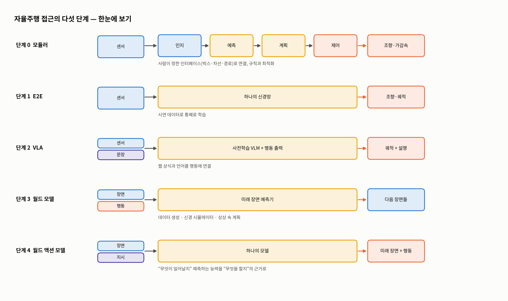
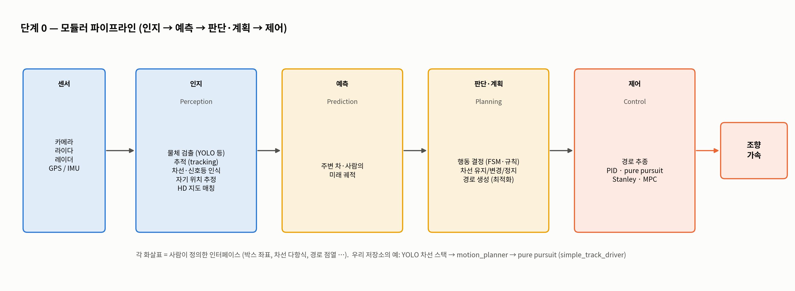
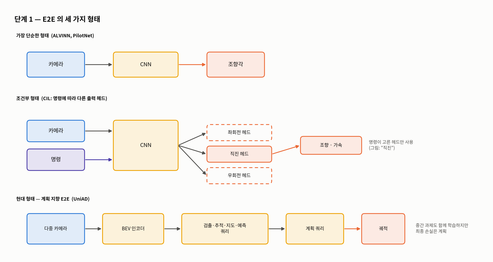
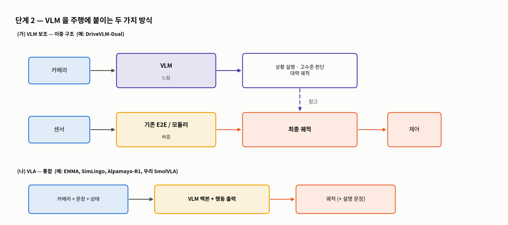
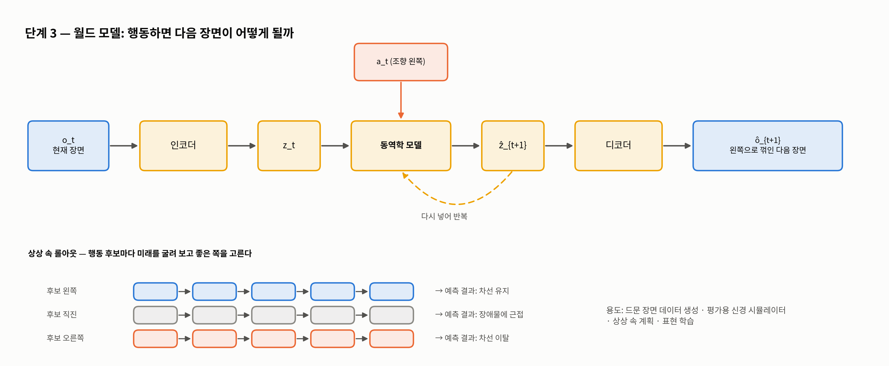
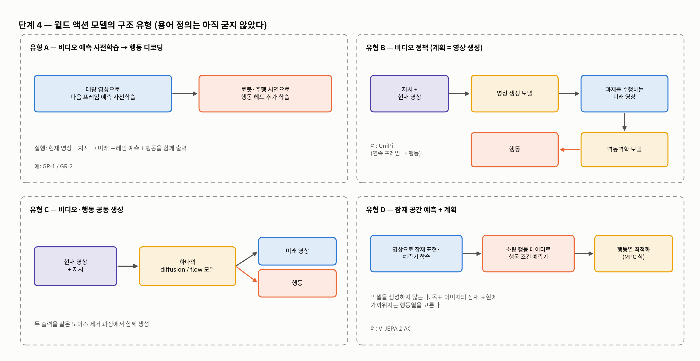
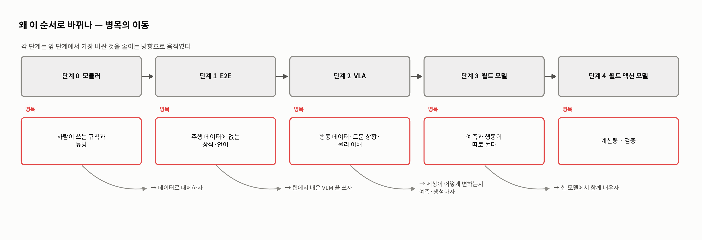
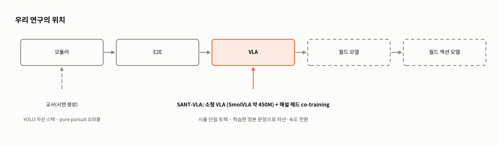

# 자율주행 패러다임 — 인지·판단·제어에서 월드 액션 모델까지

> 작성: 2026-10-07. study 폴더 목차: [README.md](README.md)
>
> 질문: **"기존 인지-판단-제어 구조에서 왜 E2E → VLA → 월드 모델 → 월드 액션 모델 순서로 최근 경향이 바뀌고 있나?"**
> 각 단계를 같은 틀로 정리한다: **구조 → 대표 시스템 → 무엇을 해결했나 → 무엇이 남았나 → 그래서 다음 단계.**
> 연도·수치 중 원문에서 다시 확인하지 않은 것은 "(확인 필요)" 로 표시했다. 회사 제품(Tesla 등)은 공개 발언 수준으로만 적는다.
> VLA 자체의 개념은 [05 VLA란 무엇인가](05_VLA란_무엇인가.md), 논문별 수치는 [VLA_최근연구동향과_장점](../course/VLA_최근연구동향과_장점.md) 를 본다.

---

## 목차

0. 한눈에 보는 흐름
1. 단계 0 — 모듈러 파이프라인: 인지 → 예측 → 판단·계획 → 제어
2. 단계 1 — 엔드투엔드(E2E) 모방학습
3. 단계 2 — VLM 보조 주행과 VLA 주행
4. 단계 3 — 월드 모델
5. 단계 4 — 월드 액션 모델
6. 전체 비교표
7. 왜 이 순서로 바뀌나 — 병목의 이동
8. 산업 현실 — 양산은 하이브리드
9. 우리 연구는 이 지도에서 어디에 있나
10. 용어집
11. 추천 자료

---

## 0. 한눈에 보는 흐름



중요한 점: **뒤 단계가 앞 단계를 완전히 대체하지 않는다.** 실제 차량은 대부분 여러 단계를 섞어 쓴다(8장).
"경향이 바뀐다"는 말은 **연구 관심과 투자가 어디로 이동하는가** 의 의미다.

---

## 1. 단계 0 — 모듈러 파이프라인

### 1.1 구조



### 1.2 각 모듈이 하는 일

| 모듈 | 하는 일 | 대표 방법 |
|---|---|---|
| 검출 | 이미지·점군에서 차, 사람, 표지판의 위치와 종류 | YOLO, Faster R-CNN, PointPillars |
| 추적 | 프레임 사이에서 같은 물체를 이어 붙임, 속도 추정 | 칼만 필터, SORT/DeepSORT |
| 차선 인식 | 차선 경계를 곡선으로 | 세그멘테이션 + 다항식 피팅 |
| 위치 추정 | 내 차가 지도 어디에 있나 | GNSS + IMU + 라이다 지도 매칭, SLAM |
| 예측 | 다른 차·사람이 몇 초 뒤 어디 있을까 | 물리 모델, 학습 기반 궤적 예측 |
| 행동 결정 | 따라가기/추월/정지 중 무엇을 | 유한 상태 기계(FSM), 규칙, 비용 함수 |
| 경로 계획 | 충돌 없고 편안한 궤적 | 샘플링(lattice), 최적화(QP), A*·하이브리드 A* |
| 제어 | 궤적을 실제 조향·가속으로 | PID(속도), pure pursuit·Stanley(조향), MPC(통합) |

**제어기 세 가지만 조금 자세히:**

- **Pure pursuit:** 경로 위 앞쪽 일정 거리(lookahead)의 점을 하나 골라, 그 점을 지나는 원호의 곡률로 조향한다.
  곡률 κ = 2·y / L² (y: 목표점의 횡방향 거리, L: lookahead 거리). 단순하고 튼튼하다.
- **Stanley:** 앞바퀴 기준 횡방향 오차와 방향 오차를 합쳐 조향한다. δ = ψ_e + arctan(k·e / v). DARPA 챌린지 우승차(Stanley)에서 유래.
- **MPC(모델 예측 제어):** 차량 모델로 몇 초 앞까지 예측하면서, 비용(경로 오차·편안함·제약 위반)이 최소가 되는 입력열을 매 주기 최적화하고 첫 입력만 실행한다.

### 1.3 우리 저장소에 있는 모듈러 스택

| 역할 | 우리 저장소 | 비고 |
|---|---|---|
| 인지 (차선·물체) | `src/camera_perception_pkg/.../yolov8_node.py`, `lane_info_extractor_node.py`, `traffic_light_detector_node.py` | YOLO 기반 차선·물체 인식 |
| 인지 (라이다) | `src/lidar_perception_pkg/.../lidar_obstacle_detector_node.py` | 근접 장애물 판정 |
| 위치 추정 | `src/track_localizer_pkg/` | 고정 Hesai 라이다로 외부 위치 추정(실트랙) |
| 계획 | `src/decision_making_pkg/.../path_planner_node.py` | 차선에서 목표 경로 |
| 제어 | `src/decision_making_pkg/.../motion_planner_node.py` | 조향을 7단계 명령으로 양자화(cubic), 코너 감속, 차선 변경 이득 등 손 튜닝 파라미터 다수 |
| 오라클 제어 | `src/simulation_pkg/.../simple_track_driver_node.py`, `route_oracle_node` | 시뮬 정답 경로를 pure pursuit 로 추종 → VLA 시연 교사 |

이 스택이 **우리 VLA 의 교사** 이기도 하다. 모방학습 데이터는 YOLO 스택이나 오라클이 운전한 기록이다.
[VLA_vs_YOLO 주행 차별점](../course/VLA_vs_YOLO주행_차별점.md) 에 두 방식의 비교가 있다.

### 1.4 무엇을 해결했나 (장점)

| 장점 | 설명 |
|---|---|
| 해석 가능 | 어느 모듈이 틀렸는지 알 수 있다 ("검출이 사람을 놓쳤다") |
| 검증 가능 | 모듈별 시험·안전 규격(ISO 26262 등) 적용이 쉽다 |
| 교체 가능 | 검출기만 새 모델로 바꿀 수 있다 |
| 데이터 효율 | 모듈별 라벨(박스, 차선)로 학습, 계획·제어는 데이터 없이 설계 |
| 보장 | 규칙으로 "빨간불이면 반드시 정지" 를 강제할 수 있다 |

DARPA Urban Challenge(2007) 이후 Waymo 등 초기 로보택시까지, 오랫동안 업계 표준이었다.

### 1.5 무엇이 남았나 (한계)

| 한계 | 설명 | 우리 경험 |
|---|---|---|
| **인터페이스 정보 손실** | 인지가 "박스와 차선"만 넘기면, 박스로 표현 안 되는 정보(공사장 수신호, 도로 위 비닐, 상대 운전자의 눈짓)는 계획 단계에서 사라진다 | YOLO 가 못 잡은 물체는 계획이 모른다 |
| **오차 누적** | 앞 모듈의 작은 오차가 뒤 모듈에서 커진다. 각 모듈은 자기 지표(검출 mAP)로만 최적화되어 **최종 주행 품질** 에 맞춰지지 않는다 | 차선 인식 흔들림 → 조향 떨림 |
| **긴 꼬리(long-tail) 규칙 폭발** | 드문 상황마다 규칙을 추가해야 한다. 규칙끼리 충돌하고 유지가 어렵다 | — |
| **사람 손 튜닝** | 파라미터가 수백~수천 개. 환경이 바뀌면 다시 튜닝 | `motion_planner_node.py` 의 코너 감속·lookahead·EMA 등. 속도 티어마다 언더스티어 보정 |
| **HD 지도 의존** | 정밀 지도가 없는 곳에서 약하다 | — |

### 1.6 그래서 다음 단계로

"모듈마다 사람이 인터페이스와 규칙을 정하는 것" 자체가 병목이 됐다.
**→ 센서에서 행동까지를 하나의 신경망으로 연결하고, 최종 목표(운전 잘하기)로 통째로 학습하자.**

---

## 2. 단계 1 — 엔드투엔드(E2E) 모방학습

### 2.1 구조



### 2.2 대표 시스템

| 시스템 | 시기 | 요점 |
|---|---|---|
| **ALVINN** | 1989 (CMU) | 작은 신경망이 카메라 영상에서 조향 방향을 직접 출력. E2E 주행의 최초 사례로 자주 인용 |
| **NVIDIA PilotNet** ("End to End Learning for Self-Driving Cars") | 2016 | CNN 이 전방 카메라에서 조향각 회귀. 사람 주행 영상으로 학습, 실제 도로 주행. 좌우 카메라로 "벗어난 위치에서 복귀" 데이터를 만들어 분포 이동 완화 |
| **조건부 모방학습 (CIL)** | 2018 (Codevilla 외) | 같은 장면에서 "다음 교차로 좌회전/직진/우회전" 명령에 따라 다른 행동. **명령 조건 정책의 원형** — 언어 조건 VLA 의 선조 |
| **TransFuser** | 2021~2022 | 카메라와 라이다를 트랜스포머로 융합해 궤적 출력. CARLA 벤치마크 강자 |
| **UniAD** ("Planning-oriented Autonomous Driving") | CVPR 2023 최우수 논문 | 검출·추적·지도·움직임 예측·점유 예측·계획을 하나의 네트워크에서 쿼리로 연결. **모든 중간 과제가 계획을 위해 존재** 한다는 설계 |
| 그 밖에 | — | VAD(벡터화 E2E), ST-P3 등 계획 지향 E2E 계열 다수 |
| **Tesla FSD v12** (공개 발언 수준) | 2023~2024 | 회사가 "규칙 코드 상당 부분을 신경망으로 대체한 엔드투엔드" 라고 발표. 구조·데이터의 상세는 공개되지 않아 학술적으로 검증할 수 없다 |

### 2.3 무엇을 해결했나

| 해결 | 설명 |
|---|---|
| 규칙 대신 데이터 | 새 상황은 규칙 대신 **데이터를 더 넣어서** 고친다. 확장 방식이 바뀌었다 |
| 정보 손실 감소 | 박스·차선으로 요약하지 않고 이미지 특징을 그대로 계획에 씀 |
| 최종 목표 최적화 | 모든 부분이 주행 품질 손실로 함께 학습 |
| 튜닝 감소 | 손으로 맞추던 파라미터 대부분이 학습된 가중치로 바뀜 |

### 2.4 무엇이 남았나

| 한계 | 설명 |
|---|---|
| **블랙박스** | 왜 그렇게 운전했는지 알기 어렵다. 안전 검증·사고 분석이 힘들다 |
| **분포 이동과 오차 누적** | 시연에서 벗어난 상태를 본 적이 없어 복구를 못 한다. DAgger, 교란 주입, 좌우 카메라 증강으로 완화 ([04 문서](04_로봇학습_모방학습과_강화학습.md)) |
| **인과 혼동 (causal confusion)** | 진짜 원인 대신 상관된 단서를 배움. 예: 브레이크등이 켜진 장면에서 정지 → "브레이크등 = 정지" 로 학습. 우리 r44 "자리 습관" 도 같은 종류 |
| **긴 꼬리 데이터 부족** | 드문 상황은 데이터에도 드물다. 규칙 폭발이 **데이터 수집 폭발** 로 바뀌었을 뿐이다 |
| **상식 없음** | "공사 중 수신호를 따른다", "공이 굴러오면 아이가 따라올 수 있다" 같은 세상 지식이 주행 데이터만으로는 잘 안 생긴다 |
| **말로 지시 불가** | CIL 의 명령은 몇 개 고정된 기호다. "주차장 입구 쪽 빈자리에 세워" 같은 자유 지시는 못 받는다 |
| **평가 어려움** | 오프라인 지표(궤적 오차)와 실제 주행 품질이 잘 맞지 않는다. 폐루프 시뮬 평가 필요 (nuScenes 개방 루프 평가의 한계 논쟁) |

### 2.5 그래서 다음 단계로

부족한 것은 **세상에 대한 상식, 말을 알아듣는 능력, 판단을 설명하는 능력** 이었다.
이것들은 주행 데이터가 아니라 **인터넷 규모 그림·글에서 학습된 VLM** 이 이미 갖고 있다.
**→ VLM 을 주행에 끌어들이자.**

---

## 3. 단계 2 — VLM 보조 주행과 VLA 주행

### 3.1 두 가지 결합 방식



### 3.2 대표 시스템

수치는 [VLA_최근연구동향과_장점 2장](../course/VLA_최근연구동향과_장점.md) 에 있다. 여기서는 각 시스템이 무엇을 보여 줬는지만 정리한다.

| 시스템 | 방식 | 보여 준 것 |
|---|---|---|
| **DriveVLM / DriveVLM-Dual** (칭화대·Li Auto, 2024) | (가) | VLM 이 장면 설명 → 분석 → 계획을 단계적으로. Dual 은 기존 모듈과 결합해 VLM 의 느림을 보완하며 실차 탑재 |
| **LMDrive** (CVPR 2024) | (나) | 언어 지시를 받는 **폐루프** E2E 주행 (CARLA). 언어 조건 주행 벤치마크 제시 |
| **Wayve LINGO-1/2** (2023~2024) | (나) | 주행하며 판단을 말로 설명. LINGO-2 는 공공도로에서 시험한 폐루프 언어-행동 모델 |
| **Waymo EMMA** (2024) | (나) | 멀티모달 대형 모델로 궤적·검출·도로 그래프를 모두 텍스트로 출력. 여러 과제를 함께 학습하면 서로 도움 |
| **SimLingo** (CVPR 2025) | (나) | 카메라만으로 CARLA 상위권 + 질의응답 + 지시 따르기. 같은 장면에 여러 지시·궤적을 붙여 말과 행동 일치 평가 |
| **NVIDIA Alpamayo-R1** (2025) | (나) | 인과 추론 문장을 거쳐 궤적 출력. 강화학습으로 추론과 행동의 일치를 높임. 공개 모델 |

### 3.3 무엇을 해결했나

| 해결 | 설명 |
|---|---|
| 상식·긴 꼬리 | 드문 상황을 의미 수준에서 해석 (공사, 특이 물체) |
| 언어 지시 | 자유 문장으로 목적지·행동 지정 |
| 설명 | 판단 이유를 문장으로 → 디버깅, 승객 신뢰, 규제 대응 |
| 다과제 시너지 | 인지·예측·계획·질의응답을 한 모델로 |
| 사전학습 이득 | 적은 주행 데이터로도 넓은 의미 이해 |

### 3.4 무엇이 남았나

| 한계 | 설명 |
|---|---|
| **느림** | 수십억 파라미터 VLM 은 차량 컴퓨터에서 수백 ms. 그래서 이중 구조가 나왔다 |
| **접지 문제** | 말한 이유와 실제 행동이 어긋날 수 있다. 언어 지시를 행동이 무시할 수 있다 (우리 10-07 결과: 문장 유무를 구별 못 함, [05 문서 13장](05_VLA란_무엇인가.md)) |
| **안전 보장 없음** | 환각(hallucination)이 행동으로 이어질 수 있다. 규칙 안전층이 여전히 필요 |
| **물리 이해 부족** | VLM 은 정지 사진과 글로 학습해 **움직임·인과·물리** 를 잘 모른다. "이렇게 하면 다음에 어떻게 될까" 를 예측하는 능력이 약하다 |
| **행동 데이터 병목 그대로** | 상식은 웹에서 오지만, 행동은 여전히 비싼 주행 시연에서만 온다. 드문 위험 상황 시연은 여전히 부족 |
| **평가 비용** | 폐루프 평가에 실제 도로나 정교한 시뮬이 필요 |

### 3.5 그래서 다음 단계로

남은 핵심 두 가지:
1. **드문 상황의 데이터와 평가 환경이 부족하다.**
2. **모델이 "행동의 결과로 세상이 어떻게 변하는지" 를 모른다.**

둘 다 "**세상이 어떻게 변하는지를 예측·생성하는 모델**" 이 있으면 풀린다.
**→ 월드 모델.**

---

## 4. 단계 3 — 월드 모델

### 4.1 정의

**월드 모델 = 현재 상태와 행동이 주어지면, 다음 상태(또는 관측)를 예측하는 모델.**

```
p( o_{t+1} | o_{≤t}, a_t )       관측 공간에서 예측 (다음 카메라 영상을 생성)
p( z_{t+1} | z_t,   a_t )        잠재 공간에서 예측 (압축된 상태 벡터로)
```

- o: 관측(이미지), z: 잠재 상태(인코더가 압축한 벡터), a: 행동.
- 행동 조건이 없는 비디오 예측 모델 p(o_{t+1} | o_{≤t}) 도 넓게 월드 모델이라 부르는 경우가 있다. 엄밀히는 **행동 조건** 이 있어야 계획에 쓸 수 있다.



### 4.2 계보

| 작업 | 요점 |
|---|---|
| **World Models** (Ha & Schmidhuber, 2018) | VAE 로 이미지 압축 + RNN 으로 다음 잠재 상태 예측 + 작은 제어기. **꿈(상상) 속에서 정책을 학습** 하고 실제 환경에 옮김. 이름의 출발점 |
| **Dreamer 계열** (DreamerV1~V3, Hafner 외, 2019~2023) | 잠재 동역학 모델 위에서 강화학습. V3 는 하나의 설정으로 여러 도메인(마인크래프트 다이아몬드 포함) 해결 보고 |
| **MuZero** (DeepMind, 2019) | 보상·가치 예측에 필요한 만큼만 학습하는 잠재 모델로 계획 (바둑·아타리) |
| **GAIA-1 / GAIA-2** (Wayve, 2023 / 2025) | 주행 영상 생성 월드 모델. 행동·문장·장면 조건으로 미래 주행 영상 생성. GAIA-2 는 다중 카메라, 드문 장면 합성 |
| **NVIDIA Cosmos** (2025) | 물리 AI 용 "월드 파운데이션 모델" 플랫폼. 대규모 영상으로 학습한 영상 예측·생성 모델과 데이터 처리 도구 공개 |
| **Genie 계열** (DeepMind, 2024~2025) | 영상에서 **행동 라벨 없이 잠재 행동을 추론** 해 상호작용 가능한 환경을 생성. 이후 버전에서 실시간 상호작용 세계 생성 (세부 수치 확인 필요) |
| 그 밖에 주행 | DriveDreamer, Vista, OccWorld(점유 격자 예측) 등 (확인 필요) |

### 4.3 용도 네 가지

| 용도 | 설명 | 주행 예 |
|---|---|---|
| **① 데이터 생성** | 드물거나 위험한 장면을 합성해 학습 데이터로 | 갑자기 끼어드는 차, 폭설, 역주행 차량 영상 생성 |
| **② 신경 시뮬레이터 (평가)** | 정책이 낸 행동에 따라 다음 장면을 생성 → **폐루프 평가** 를 실제 도로 없이 | 정책 버전 비교, 회귀 시험 |
| **③ 계획 (상상 속 롤아웃)** | 후보 행동마다 미래를 예측해 보고 가장 좋은 것을 선택 (MPC 와 같은 생각을 학습 모델로) | "지금 차선 변경하면 3 초 뒤 뒤차와의 거리는?" |
| **④ 표현 학습** | 미래를 예측하도록 학습하면 물리·인과를 담은 좋은 특징이 생김 → 정책의 백본으로 | 비디오 예측 사전학습 후 주행 정책 파인튜닝 |

### 4.4 무엇을 해결했나

- **데이터 병목 완화:** 드문 장면을 만들어 낼 수 있다.
- **평가 병목 완화:** 학습된 시뮬레이터로 폐루프 시험.
- **물리·인과 학습 신호:** "다음에 무엇이 일어날지" 를 맞히는 과제는 행동 라벨 없이 영상만으로 학습할 수 있다.
  영상은 행동 시연보다 훨씬 많다 → **라벨 없는 대규모 데이터로 확장** 가능.

### 4.5 무엇이 남았나

| 한계 | 설명 |
|---|---|
| **물리 일관성** | 생성 영상에서 차가 사라지거나 합쳐지거나 물리 법칙을 어김. 긴 롤아웃일수록 심해짐 |
| **행동 조건 정확도** | "조향 5도" 를 넣었을 때 정말 5도만큼 꺾인 영상이 나오는가. 행동에 둔감한 월드 모델은 계획·평가에 못 쓴다 |
| **계산량** | 고해상도 다중 카메라 영상 생성은 매우 무겁다. 실시간 계획에 쓰기 어렵다 |
| **평가 신뢰도** | 신경 시뮬레이터 자체가 틀리면 평가가 틀린다. "자를 의심하라" 의 문제 |
| **정책과 분리** | 월드 모델은 미래를 예측할 뿐, 행동은 별도 정책이 정한다. 둘을 따로 학습하면 지식이 잘 공유되지 않는다 |

### 4.6 그래서 다음 단계로

"미래를 상상하는 능력" 과 "행동을 고르는 능력" 을 **따로 두지 말고 한 모델에** 넣으면,
- 영상으로 배운 물리·인과 지식이 행동에 직접 이어지고,
- 행동 라벨이 적어도 영상 예측으로 대부분을 학습할 수 있다.
**→ 월드 액션 모델.**

---

## 5. 단계 4 — 월드 액션 모델 (World Action Model)

### 5.1 먼저: 용어가 아직 굳지 않았다

"World Action Model" 은 2025년 무렵부터 여러 회사·연구에서 쓰이기 시작한 표현이지만,
**표준 정의가 합의되지 않았다.** 비슷한 것을 "video-action model", "unified world model",
"world model-based policy", "video policy" 등으로 부르기도 한다. 이 문서는 아래의 **공통 아이디어** 로 묶어 정리한다.
특정 회사 제품이 이 이름을 어떤 의미로 쓰는지는 각 발표를 직접 확인해야 한다(확인 필요).

> **공통 아이디어:** 하나의 모델이 **미래 장면(또는 그 잠재 표현)을 예측하는 능력** 과 **행동을 생성하는 능력** 을 함께 갖는다.
> 미래를 예측하도록 학습한 표현이 행동의 근거가 되고, 행동 라벨이 없는 대량의 영상으로 사전학습을 확장한다.

### 5.2 구조 유형



### 5.3 대표 작업 (유형별)

| 작업 | 유형 | 요점 |
|---|---|---|
| **UniPi** ("Learning Universal Policies via Text-Guided Video Generation", 2023) | B | 문장 조건 영상 생성으로 과제 수행 영상을 만들고, 역동역학 모델로 행동을 추출. "**정책 = 영상 생성**" 이라는 관점 |
| **GR-1 / GR-2** (ByteDance, 2023~2024) | A | 대량 영상으로 미래 프레임 예측 사전학습 후 로봇 시연으로 행동 함께 학습. 영상 사전학습이 로봇 조작 일반화에 도움된다는 보고 |
| **비디오·행동 공동 diffusion** (여러 연구, 2024~2025, 확인 필요) | C | 미래 영상과 행동을 하나의 생성 모델로 함께 예측. 영상 예측 손실이 행동 학습을 돕는 보조 신호가 됨 |
| **V-JEPA 2 / V-JEPA 2-AC** (Meta, 2025) | D | 픽셀을 생성하지 않고 **잠재 공간에서** 미래를 예측하도록 대량 영상으로 학습(JEPA). 소량 로봇 데이터로 행동 조건 예측기(AC)를 붙여, 목표 이미지에 맞는 행동을 계획으로 찾음 |
| **GR00T 계열의 영상·잠재 행동 활용** (NVIDIA) | A/D 성격 | 사람 영상에서 잠재 행동을 뽑아 학습 데이터로 활용 (세부 확인 필요) |
| 주행 쪽 | — | 월드 모델(GAIA 류)과 주행 정책을 하나로 묶으려는 연구·발표가 늘고 있음. 특정 이름·수치는 확인 필요 |

### 5.4 왜 기대하나

| 기대 | 설명 |
|---|---|
| **데이터 확장** | 행동 라벨이 붙은 시연은 비싸고 적지만, 영상은 거의 무한하다(유튜브, 블랙박스, 사람 작업 영상). 대부분의 학습을 영상으로 한다 |
| **물리·인과 이해** | "공을 밀면 굴러간다", "앞차가 감속하면 거리가 줄어든다" 를 예측 과제로 배운다. VLM 이 약했던 부분 |
| **행동의 근거** | 행동이 "예측한 미래" 와 연결되어 있다. 예측 영상을 보면 모델이 무엇을 기대하고 행동했는지 볼 수 있다 (설명 가능성의 다른 형태) |
| **평가·계획 일체화** | 같은 모델이 후보 행동의 결과를 상상해 고를 수 있다 |
| **몸 독립성** | 영상 예측은 로봇·차량 형태와 무관하게 학습 가능 → 몸이 바뀌어도 행동 헤드만 다시 |

### 5.5 남은 과제

| 과제 | 설명 |
|---|---|
| 계산량 | 영상 예측은 VLA 보다 훨씬 무겁다. 실시간 제어와 양립이 어렵다 → 잠재 공간 예측(유형 D)·이중 주기가 대안 |
| 예측 오류의 전파 | 상상한 미래가 틀리면 행동도 틀린다 |
| 언어 조건과의 결합 | 월드 모델 쪽은 언어 접지가 VLA 보다 덜 연구됨 |
| 검증·안전 | 블랙박스 문제는 그대로. 오히려 더 크다 |
| 정의의 혼란 | 이름만 같고 내용이 다른 시스템이 많다. 논문을 읽을 때 **무엇을 예측하고 무엇을 출력하는지** 를 반드시 확인 |

---

## 6. 전체 비교표

| | 모듈러 | E2E 모방학습 | VLA | 월드 모델 | 월드 액션 모델 |
|---|---|---|---|---|---|
| **입력** | 센서 → 모듈별 | 센서 (+ 고정 명령) | 센서 + 자유 문장 + 상태 | 관측 + 행동 | 관측 + 지시 (+ 행동) |
| **출력** | 모듈별 중간 결과 → 제어 | 조향·궤적 | 궤적 (+ 설명) | 미래 관측 | 미래 예측 + 행동 |
| **학습 신호** | 모듈별 라벨 + 손 설계 | 시연 행동 | 웹 그림-글 + 시연 행동 | 영상 (행동 라벨 있으면 더 좋음) | 대량 영상 + 소량 시연 |
| **주 데이터** | 박스·차선 라벨, HD 지도 | 주행 로그 | 웹 + 주행 로그 | 주행·일반 영상 | 영상 + 주행 로그 |
| **해석성** | 높음 | 낮음 | 중간 (문장 설명, 단 일치 보장 없음) | 중간 (생성 영상으로 확인) | 중간 (예측 미래로 확인) |
| **지연** | 낮음 | 낮음 | 높음 (큰 VLM) | 매우 높음 (영상 생성) | 높음 |
| **안전 검증** | 가장 쉬움 | 어려움 | 어려움 | (정책 아님) 평가 도구로 기여 | 어려움 |
| **긴 꼬리 대응** | 규칙 추가 | 데이터 추가 | 상식으로 일반화 | 드문 데이터 생성 | 예측 기반 일반화 |
| **말로 지시** | 불가 (기능별 구현) | 고정 기호만 | 가능 | 일부 (문장 조건 생성) | 가능 (모델에 따라) |
| **병목** | 규칙·튜닝 | 데이터·인과 혼동 | 행동 데이터·접지·지연 | 물리 일관성·계산 | 계산·검증 |

---

## 7. 왜 이 순서로 바뀌나 — 병목의 이동

각 단계는 **앞 단계에서 가장 비싼 것** 을 줄이는 방향으로 움직였다.



같은 이야기를 "**무엇으로 확장하는가**" 로 다시 쓰면:

| 단계 | 성능을 올리는 수단 |
|---|---|
| 모듈러 | 엔지니어 시간 (규칙, 튜닝) |
| E2E | 주행 시연 데이터 양 |
| VLA | 웹 사전학습 + 주행 시연 |
| 월드 모델 / 월드 액션 모델 | **행동 라벨 없는 영상** (가장 많은 데이터) + 계산 |

딥러닝 전반의 흐름("사람이 설계한 지식보다 데이터와 계산으로 확장되는 방법이 결국 이긴다")과 같은 방향이다.
다만 **안전 검증 가능성은 반대 방향으로 줄어든다.** 그래서 산업은 하이브리드를 택한다(8장).

---

## 8. 산업 현실 — 양산은 하이브리드

| 현실 | 설명 |
|---|---|
| 학습 정책 + 규칙 안전층 | 학습된 E2E/VLA 정책이 주로 운전하고, 규칙 기반 안전 감시(충돌 임박 시 긴급 제동, 신호 위반 방지)가 위에서 거부권을 가진다 |
| 이중 주기 | 큰 모델은 느리게 상황 해석, 작은 모델은 빠르게 제어 (DriveVLM-Dual 류) |
| 월드 모델은 주로 오프라인 | 데이터 생성·평가에 먼저 쓰이고, 차 안의 실시간 계획에는 아직 제한적 |
| 중간 표현 유지 | 완전 E2E 라도 검출·지도 같은 중간 출력을 함께 내서 감시·검증에 씀 (UniAD 식) |
| 규제·인증 | 설명·검증 요구 때문에 순수 블랙박스는 어렵다 |

**우리 프로젝트도 같은 구조를 쓴다.** VLA 가 주행하고, 라이다 근접 정지·워치독·브리지의 속도 셰이핑이 별도 계층으로 있다.
"순수 E2E 가 아니라 계층 보조" 라는 점은 [가이드 1.5절](../guides/vla_complete_guide_ko.md) 과
[코드 vs VLA 책임](../guides/code_vs_vla_responsibilities.md) 에 정리돼 있다.

---

## 9. 우리 연구는 이 지도에서 어디에 있나



| 항목 | 우리 |
|---|---|
| 단계 | 단계 2 (VLA), 소형. 교사로 단계 0 스택을 사용 |
| 입력 | 전방 카메라 1장 + 상태 3값 + 정본 문장. 좌표·오도메트리 입력 없음 |
| 출력 | 30 × [dx, dy, dyaw] 청크 + (SANT-VLA) 상황 해설 문장 |
| 환경 | 단일 트랙 Gazebo 시뮬. 실차(Thor, 실트랙)는 이식 준비 중 |
| 확인한 것 | 정본 문장에 따른 차선·속도 전환, 시연 추가로 행동 축 추가, 상황 서술 |
| 확인 못 한 것 | 처음 보는 표현, 물체 이름 접지(10-07 언어 제거 기준선과 구별 안 됨), 사전학습 지식의 행동 전이 |
| 월드 모델 관련 | 하지 않음. 시뮬레이터(Gazebo)가 손으로 만든 월드 모델 역할을 한다고 볼 수는 있다 |

**과장하지 말 것:** 우리는 대형 주행 VLA 와 규모·환경·지시 범위가 크게 다르다.
"VLA 의 장점을 소형 모델·단일 트랙에서 어디까지 재현할 수 있나, 어디서 무너지나" 를 측정하는 위치다.

---

## 10. 용어집

| 용어 | 뜻 |
|---|---|
| 모듈러 파이프라인 | 인지·예측·계획·제어를 따로 만들어 연결한 구조 |
| E2E (end-to-end) | 센서 입력에서 행동까지 하나의 학습 모델 |
| BEV (Bird's-Eye View) | 위에서 내려다본 평면 표현. 여러 카메라를 한 평면으로 합침 |
| 계획 지향 (planning-oriented) | 모든 중간 과제를 최종 계획 품질을 위해 설계 |
| 인과 혼동 | 원인 대신 상관된 단서를 학습하는 것 |
| 긴 꼬리 (long-tail) | 드물지만 종류가 매우 많은 상황들 |
| 개방 루프 / 폐루프 평가 | 기록된 데이터로 비교 / 모델이 직접 운전하며 평가 |
| 월드 모델 | 현재 상태·행동 → 다음 상태 예측 모델 |
| 잠재 공간 | 인코더가 압축한 벡터 공간 |
| 롤아웃 | 모델로 여러 스텝 앞까지 순서대로 예측·실행 |
| 역동역학 모델 (inverse dynamics) | 연속된 두 관측에서 그 사이의 행동을 추정 |
| 신경 시뮬레이터 | 학습된 모델로 만든 시뮬레이터 |
| JEPA | 픽셀이 아니라 잠재 표현을 예측하는 학습 방식 (Joint-Embedding Predictive Architecture) |
| MPC | 모델로 미래를 예측하며 매 주기 최적 입력을 다시 푸는 제어 |
| pure pursuit | 앞쪽 목표점을 지나는 원호 곡률로 조향하는 경로 추종 |
| Stanley | 횡오차와 방향 오차를 합쳐 조향하는 경로 추종 |

---

## 11. 추천 자료

**모듈러·제어**
- Thrun et al., "Stanley: The Robot that Won the DARPA Grand Challenge", 2006 — 모듈러 구조와 Stanley 제어기의 원전
- Paden et al., "A Survey of Motion Planning and Control Techniques for Self-driving Urban Vehicles", 2016 — 계획·제어 서베이
- Coulter, "Implementation of the Pure Pursuit Path Tracking Algorithm", 1992

**E2E**
- Pomerleau, "ALVINN", 1989
- Bojarski et al., "End to End Learning for Self-Driving Cars", 2016 — https://arxiv.org/abs/1604.07316
- Codevilla et al., "End-to-end Driving via Conditional Imitation Learning", 2018 — https://arxiv.org/abs/1710.02410
- de Haan et al., "Causal Confusion in Imitation Learning", 2019 — https://arxiv.org/abs/1905.11979
- Hu et al., "Planning-oriented Autonomous Driving" (UniAD), CVPR 2023 — https://arxiv.org/abs/2212.10156
- Chen et al., "End-to-end Autonomous Driving: Challenges and Frontiers" (서베이), 2023 — https://arxiv.org/abs/2306.16927

**VLM / VLA 주행** — 링크는 [VLA_최근연구동향과_장점 출처](../course/VLA_최근연구동향과_장점.md) 참고 (DriveVLM, LMDrive, LINGO-2, EMMA, SimLingo, Alpamayo-R1, 주행 VLA 서베이)

**월드 모델**
- Ha & Schmidhuber, "World Models", 2018 — https://arxiv.org/abs/1803.10122 (인터랙티브 페이지 worldmodels.github.io 추천)
- Hafner et al., "Mastering Diverse Domains through World Models" (DreamerV3), 2023 — https://arxiv.org/abs/2301.04104
- Hu et al., "GAIA-1", 2023 — https://arxiv.org/abs/2309.17080 · GAIA-2 — https://arxiv.org/abs/2503.20523
- NVIDIA, "Cosmos World Foundation Model Platform for Physical AI", 2025 — https://arxiv.org/abs/2501.03575
- Bruce et al., "Genie: Generative Interactive Environments", 2024 — https://arxiv.org/abs/2402.15391

**월드 액션 모델 계열**
- Du et al., "Learning Universal Policies via Text-Guided Video Generation" (UniPi), 2023 — https://arxiv.org/abs/2302.00111
- Wu et al., "Unleashing Large-Scale Video Generative Pre-training for Visual Robot Manipulation" (GR-1), 2023 — https://arxiv.org/abs/2312.13139
- Cheang et al., "GR-2", 2024 — https://arxiv.org/abs/2410.06158
- Assran et al., "V-JEPA 2", 2025 — https://arxiv.org/abs/2506.09985

관련 문서: [05 VLA란 무엇인가](05_VLA란_무엇인가.md) · [VLA_vs_YOLO 주행 차별점](../course/VLA_vs_YOLO주행_차별점.md) ·
[VLA 완전 정복 가이드](../guides/vla_complete_guide_ko.md)
