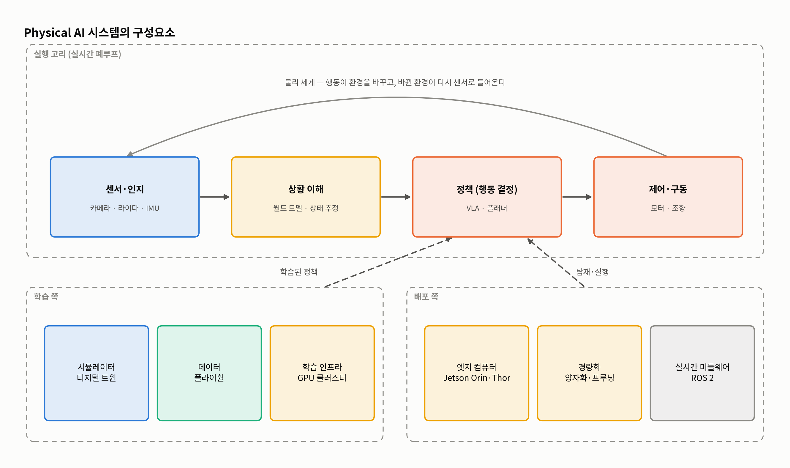
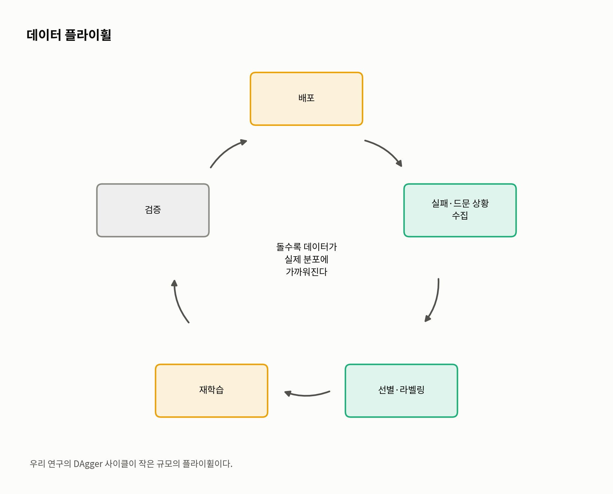
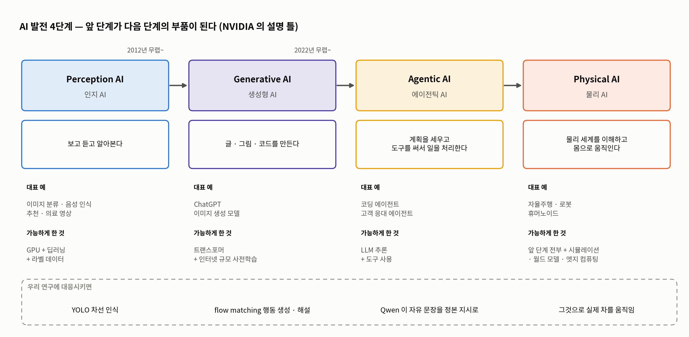
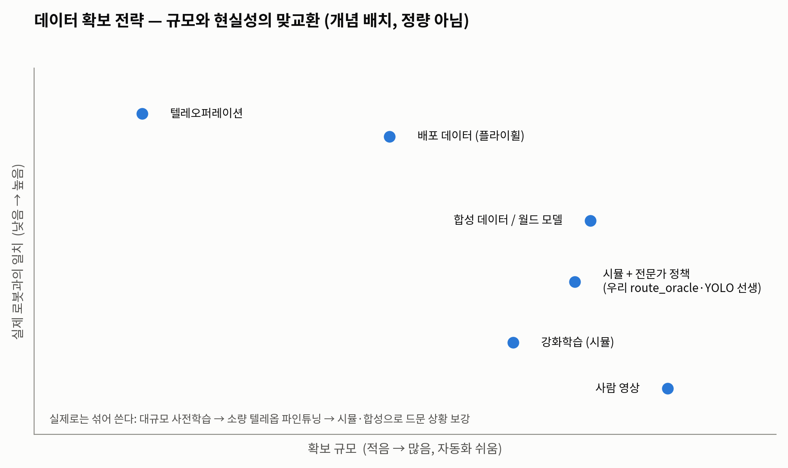

# Physical AI — 무엇이고 왜 지금 주목받는가

> 작성: 2026-10-07. study 폴더 목차: [README.md](README.md)
>
> 이 문서는 개념 정리용이다. 회사·제품 이야기는 공개 발표로 확인된 사실만 적었고, 금액·출시일처럼
> 확인이 어려운 숫자는 일부러 뺐다. 면접이나 발표에 숫자를 쓸 때는 원문을 다시 확인할 것.

---

## 목차

1. 한 줄 정의
2. 디지털 AI 와 무엇이 다른가
3. Physical AI 시스템의 구성요소
4. 기존 로봇 공학과의 관계
5. 왜 지금 주목받는가 (AI 발전 4단계 + 6가지 이유)
6. 핵심 난제 7가지
7. 데이터 확보 전략 비교
8. 산업 지형
9. 직무 관점 — 로봇 학습 모델 엔지니어에게 기대되는 역량
10. 우리 연구와의 연결 (과장 없이)
11. 용어집
12. 추천 자료

---

## 1. 한 줄 정의

**Physical AI** 는 **물리 세계에서 센서로 상황을 감지하고, 판단하고, 몸(액추에이터)을 움직여 행동하는 AI** 를 말한다.

- 대상: 로봇 팔, 이동 로봇, 휴머노이드, 자율주행차, 드론, 공장 자동화 설비, 물류 로봇 등
- 입력: 카메라, 라이다, 레이더, IMU, 관절 엔코더, 힘·토크 센서, 그리고 사람의 지시(말·글)
- 출력: 모터 명령(관절 각도·토크, 조향·가속), 궤적, 그리퍼 열기/닫기 같은 **물리적 행동**

"Physical AI" 라는 말 자체는 2024~2025 년 무렵 NVIDIA 등 업계 발표에서 널리 쓰이기 시작한 표현이다.
학계에서는 비슷한 범위를 **Embodied AI**(몸을 가진 AI), **Robot Learning**(로봇 학습) 이라고 부르는 경우가 많다.
세 용어는 거의 같은 영역을 가리키지만 강조점이 다르다.

| 용어 | 주로 쓰는 곳 | 강조점 |
|---|---|---|
| Physical AI | 업계(NVIDIA 등), 언론, 채용 공고 | 생성형 AI 다음 단계로서 "물리 세계로 나온 AI" |
| Embodied AI | 학계(컴퓨터 비전·AI) | 몸을 통해 환경과 상호작용하며 배우는 지능 |
| Robot Learning | 학계(로봇 공학) | 데이터로 로봇의 행동을 학습하는 방법론 |

---

## 2. 디지털 AI 와 무엇이 다른가

ChatGPT 같은 생성형 AI 는 텍스트·이미지를 만들어 화면에 보여 준다. 틀려도 사람이 다시 물으면 된다.
Physical AI 는 출력이 곧 **물리적 움직임** 이라서 조건이 완전히 다르다.

| 항목 | 디지털 AI (LLM, 이미지 생성) | Physical AI (로봇, 자율주행) |
|---|---|---|
| 출력 | 텍스트, 이미지, 코드 | 모터 명령, 궤적 |
| 실수의 결과 | 다시 생성하면 됨 | 충돌, 파손, 부상 — 되돌릴 수 없음 |
| 시간 제약 | 몇 초 걸려도 괜찮음 | 10~100 Hz 이상으로 계속 응답해야 함 (주행 10 Hz 면 한 번에 100 ms 이내) |
| 물리 법칙 | 무시해도 됨 | 관성, 마찰, 접촉, 차량 동역학을 지켜야 함 |
| 데이터 양 | 인터넷 전체 (수조 토큰) | 로봇이 직접 움직인 기록 — 수집 비용이 매우 큼 |
| 데이터 형태 | 텍스트·이미지 한 장 | 시간 순서가 있는 센서 + 행동 시퀀스 |
| 평가 | 정답 비교, 사람 선호 | 실제로 돌려봐야 앎 (폐루프 평가) |
| 피드백 구조 | 개방 루프: 출력하고 끝 | **폐루프**: 내 행동이 다음 입력을 바꿈 |
| 하드웨어 | 데이터센터 GPU | 로봇에 실린 작은 컴퓨터 (전력·발열 제한) |
| 몸의 다양성 | 없음 | 로봇마다 관절 수·센서 위치·크기가 다름 |

### 2.1 가장 중요한 차이: 폐루프

LLM 은 질문 하나에 답 하나를 내면 끝이다. 로봇·자동차는 **행동 → 세상이 바뀜 → 새 관측 → 다음 행동** 이 계속 이어진다.

- 한 스텝의 작은 오차가 다음 관측을 바꾼다.
- 바뀐 관측은 학습 때 못 본 상황일 수 있다.
- 그래서 오차가 시간에 따라 **쌓인다** (compounding error).

이 때문에 "오프라인에서 정답과 비교한 점수(open-loop 지표)" 와 "실제로 돌렸을 때의 성능(closed-loop 지표)" 이 자주 어긋난다.
우리 연구에서도 같은 현상을 여러 번 봤다 (예: 오프라인 언어 프로브는 통과해도 폐루프에서는 배치가 결과를 결정함 — [실험 기록](../experiments/log/)).

### 2.2 데이터 희소성

- LLM: 인터넷 텍스트가 이미 있다. 사람이 따로 만들 필요가 거의 없다.
- 로봇: "이 장면에서 이렇게 움직였다" 는 기록이 인터넷에 거의 없다. 사람이 원격 조종(텔레오퍼레이션)으로 하나씩 만들어야 한다.
- 결과적으로 로봇 데이터는 언어 데이터보다 **여러 자릿수 작다**. 이 격차를 메우는 방법(시뮬, 사람 영상, 월드 모델)이 지금 연구의 큰 줄기다 (7장).

### 2.3 안전과 검증

- 소프트웨어 버그가 사람을 다치게 할 수 있다.
- 신경망은 "왜 그렇게 했는지" 를 증명하기 어렵다.
- 그래서 실제 시스템은 거의 항상 **학습된 정책 + 규칙 기반 안전층** 을 함께 둔다.
  (예: 우리 강좌 차량도 라이다 근접 정지를 따로 둔다. 업계 자율주행도 규칙 기반 안전 검사를 병행한다.)

---

## 3. Physical AI 시스템의 구성요소

### 3.1 센서와 인지

| 센서 | 장점 | 단점 |
|---|---|---|
| 카메라 | 싸고 정보량이 많음, 사람이 보는 것과 같음, 사전학습 모델 활용 쉬움 | 거리 직접 측정 불가, 조명·날씨에 약함 |
| 라이다 | 정확한 3차원 거리 | 비쌈, 색·글자 정보 없음 |
| 레이더 | 속도 직접 측정, 날씨에 강함 | 해상도 낮음 |
| IMU·엔코더 | 자기 움직임 측정 | 시간이 지나면 누적 오차(드리프트) |
| 힘·토크·촉각 | 물체를 잡고 누를 때 필수 | 비싸고, 학습 데이터가 적음 |

전통적으로는 인지 모듈이 "차량 3대, 보행자 1명, 차선 2개" 같은 **사람이 정한 중간 표현** 을 만든다.
최근 흐름은 이 중간 표현을 줄이고 센서 → 행동을 한 번에 배우는 쪽이다 (자세한 내용은 [06 자율주행 패러다임](06_자율주행_패러다임_인지판단제어에서_월드액션모델까지.md)).

### 3.2 월드 모델

**월드 모델** = "지금 상태에서 이렇게 행동하면 다음에 세상이 어떻게 될까" 를 예측하는 모델.

- 쓰임 1: **계획** — 머릿속에서 여러 행동을 시뮬레이션해 보고 좋은 것을 고른다.
- 쓰임 2: **데이터 생성** — 드물거나 위험한 장면(사고 직전 등)을 만들어 학습·평가에 쓴다.
- 쓰임 3: **평가** — 실제 차를 몰지 않고 정책을 시험한다.
- 예: Wayve GAIA-1/GAIA-2(주행 영상 생성), NVIDIA Cosmos(월드 파운데이션 모델 플랫폼), DreamerV3(강화학습용 잠재 월드 모델).

### 3.3 정책 (Policy)

**정책** = 관측을 받아 행동을 내는 함수. Physical AI 의 "두뇌" 에 해당한다.

| 정책 종류 | 설명 | 예 |
|---|---|---|
| 규칙 기반 | 사람이 if-else, 제어 법칙을 직접 작성 | PID, pure pursuit, MPC |
| 작은 학습 정책 | 과제 하나에 특화된 신경망 | ACT, Diffusion Policy, PilotNet |
| **VLA** | 사전학습된 VLM 에 행동 출력을 붙인 범용 정책 | RT-2, OpenVLA, π0, SmolVLA, GR00T N1 |
| 계층형 | 큰 모델이 계획, 작은 모델이 실행 | 큰 VLM(느림) + 빠른 저수준 정책 |

VLA 에 대한 자세한 설명은 [05 VLA](05_VLA란_무엇인가.md).

### 3.4 시뮬레이터와 디지털 트윈

- **시뮬레이터**: 물리 엔진 + 렌더러로 가상 세계를 만든다. 예: Gazebo(우리가 쓰는 것), NVIDIA Isaac Sim / Isaac Lab, MuJoCo, CARLA(자율주행), PyBullet.
- **디지털 트윈**: 실제 공장·도로·트랙을 가상으로 정밀하게 복제한 것. 실물과 맞춰 둔 시뮬레이터라고 보면 된다.
- 쓰임: 데이터 수집(위험 없이, 24시간, 병렬로), 강화학습, 정책 평가, 엣지 케이스 재현.
- 한계: **sim2real gap** — 시뮬의 물리·그림이 현실과 달라서 시뮬에서 잘 되던 정책이 실물에서 실패한다 (6.3 절).

### 3.5 데이터 플라이휠

- 자율주행 업계가 오래 써 온 구조다. 차가 많을수록 드문 상황 데이터가 빨리 쌓인다.
- 로봇에서는 아직 배포 대수가 적어 플라이휠이 막 돌기 시작하는 단계다.
- 우리 연구의 DAgger 사이클(학생 모델이 간 곳에 선생을 데려가 정답을 다시 받는 것)이 작은 규모의 플라이휠이다.

### 3.6 엣지 컴퓨팅

로봇·차량에는 데이터센터 GPU 를 실을 수 없다. 전력·발열·크기 제한 안에서 모델을 돌려야 한다.

| 플랫폼 | 위치 | 비고 |
|---|---|---|
| NVIDIA Jetson AGX Orin | 로봇·자율주행 연구용 엣지 컴퓨터로 널리 쓰임 | Ampere 세대 GPU |
| NVIDIA Jetson AGX Thor | 2025 년 출시된 차세대 로봇용 엣지 컴퓨터 | Blackwell 세대 GPU, 휴머노이드·VLA 같은 큰 모델 실행을 겨냥 |
| NVIDIA DRIVE (Orin, Thor) | 자동차용 플랫폼 | 양산 차량 탑재용 |
| 그 밖에 | Qualcomm, 자체 칩 등 | 회사마다 다름 |

엣지에서 모델을 돌리려면 **경량화**(양자화·프루닝·증류)와 **추론 최적화**(TensorRT 등)가 필요하다 → [model_compression](model_compression/양자화_프루닝_개념정리.md).
우리 저장소에도 Thor 에서 SmolVLA 를 돌리는 문서가 있다 → [Thor SmolVLA 데모](../guides/thor_smolvla_demo.md).

---

## 4. 기존 로봇 공학과의 관계

Physical AI 는 로봇 공학을 대체하는 것이 아니라 **위에 올라가는 것** 이다.

| 층 | 전통 로봇 공학 | Physical AI 에서 바뀐 점 |
|---|---|---|
| 기구·하드웨어 | 기구 설계, 액추에이터 | 그대로 필요 (휴머노이드 붐으로 오히려 중요해짐) |
| 저수준 제어 | PID, 임피던스 제어, 동역학 | 대부분 그대로 유지. 학습 정책이 목표값을 주고 저수준 제어기가 따라감 |
| 상태 추정 | 칼만 필터, SLAM | 일부는 학습으로 대체, 많은 시스템에서 여전히 사용 |
| 계획 | 경로 계획(A*, RRT), MPC | 학습 정책·VLA 가 일부를 대신하거나 보조 |
| 과제 정의 | 과제마다 프로그램을 새로 작성 | **언어 지시** 로 과제를 지정, 데이터로 새 능력 추가 |
| 인지 | 손으로 만든 특징 → 딥러닝 검출기 | 사전학습된 대형 비전·언어 모델 사용 |

우리 시스템도 같은 구조다. VLA 가 30 스텝 궤적(dx, dy, dyaw)을 내면, 브리지와 저수준 제어가 그것을 조향·속도 명령으로 바꾼다
([io_contract](../guides/io_contract_state_action_twist.md), [코드 vs VLA 책임 분담](../guides/code_vs_vla_responsibilities.md)).

---

## 5. 왜 지금 주목받는가

### 5.0 Physical AI 는 갑자기 나온 게 아니다 — AI 발전 4단계

NVIDIA 의 젠슨 황 CEO 는 CES 2025 기조연설(2025년 1월)에서 AI 가 네 단계로 발전해 왔다는 그림을 보여 줬다.
업계에서 Physical AI 를 설명할 때 가장 자주 인용되는 틀이다.

| 단계 | 무엇을 하나 | 대표 예 | 가능하게 한 것 |
|---|---|---|---|
| **Perception AI** (2012년 무렵~) | 보고 듣고 **알아본다** — 분류, 검출, 인식 | 이미지 분류(AlexNet), 음성 인식, 추천 시스템, 의료 영상 판독 | GPU + 딥러닝 + 대규모 라벨 데이터(ImageNet 등) |
| **Generative AI** (2022년 무렵~) | 글·그림·코드를 **만들어 낸다** | ChatGPT, 이미지 생성 모델 | 트랜스포머 + 인터넷 규모 사전학습 + 지시 튜닝 |
| **Agentic AI** | 목표를 받으면 **스스로 계획을 세우고 도구를 써서 일을 처리한다** | 코딩 에이전트, 고객 응대 에이전트 | LLM 의 추론 능력 + 도구 호출 + 긴 작업 기억 |
| **Physical AI** | 물리 세계를 이해하고 **몸으로 움직인다** | 자율주행, 산업용·범용 로봇, 휴머노이드 | 앞 단계 전부 + 시뮬레이션·합성 데이터 + 월드 모델 + 엣지 컴퓨팅 |

#### 단계마다 무엇이 새로 붙었나

| 넘어가는 지점 | 새로 생긴 능력 | 그 전에는 왜 안 됐나 |
|---|---|---|
| 인지 → 생성 | **입력을 이해하는 것**에서 **새 출력을 만드는 것**으로 | 분류 모델은 정해진 라벨 중 하나만 고른다. 자유로운 문장·그림을 만들려면 큰 사전학습 생성 모델이 필요했다 |
| 생성 → 에이전틱 | **한 번 답하기**에서 **여러 단계를 계획하고 실행하기**로 | 생성 모델은 질문 하나에 답 하나다. 목표를 쪼개고, 도구 결과를 보고 다음 행동을 고르는 추론 능력이 LLM 에 생기면서 가능해졌다 |
| 에이전틱 → 물리 | **디지털 도구를 쓰는 것**에서 **실제 몸을 움직이는 것**으로 | 물리 세계는 실시간이고, 실수하면 되돌릴 수 없고, 학습 데이터가 적다. 시뮬레이션·월드 모델·로봇 시연 데이터·엣지 GPU 가 따라오면서 시도할 수 있게 됐다 |

#### 핵심: 앞 단계가 다음 단계의 부품이 된다

Physical AI 시스템 안에는 앞 세 단계의 기술이 모두 들어 있다.

| 앞 단계 | Physical AI 안에서 하는 일 | 우리 연구에서 |
|---|---|---|
| Perception | 카메라·라이다로 주변을 알아본다 | YOLO 차선 인식(교사 스택), VLA 의 비전 인코더(SigLIP) |
| Generative | 행동을 생성 모델로 만든다, 상황을 말로 설명한다 | SmolVLA 의 flow matching 행동 생성, 해설(narration) 헤드 |
| Agentic | 사람의 지시를 실행 가능한 계획으로 바꾼다 | 큰 VLM(Qwen2.5-VL)이 자유 문장을 정본 지시로 바꾸는 계층형 구조 |
| Physical | 그 모든 것으로 실제 차·로봇을 움직인다 | 시뮬레이터 차량 주행, 실차 이식 준비 |

그래서 "Physical AI 를 한다" 는 말은 새로운 한 가지 기술이 아니라, **인지·생성·계획 기술을 물리 세계의 실시간 폐루프에 묶는 일**이라는 뜻에 가깝다.
2장에서 본 폐루프·데이터 희소성·안전 문제가 바로 이 마지막 단계에서 새로 생기는 어려움이다.

#### 읽을 때 주의할 점

- 이것은 학계의 공식 분류가 아니라 **업계(NVIDIA)가 만든 설명 틀**이다. GPU·로봇 플랫폼을 파는 회사의 사업 방향과 맞물려 있으므로 홍보 성격을 감안해야 한다.
- 네 단계가 차례로 끝나고 넘어간 것이 아니다. **지금도 네 분야가 동시에 발전**하고 있다. 로봇 연구 자체는 생성형 AI 보다 훨씬 오래됐다.
- 연도는 대략적인 시기다. 2012년은 AlexNet 이 ImageNet 대회에서 딥러닝의 가능성을 보인 해, 2022년은 ChatGPT 가 공개된 해로 흔히 기준을 잡는다. 연설의 정확한 표현을 인용하려면 NVIDIA 공식 영상·블로그를 확인할 것.
- 면접에서 쓸 한 문장: **"업계에서는 인지 → 생성 → 에이전틱 → 물리 AI 로 설명하는데, 실제로는 앞 단계 기술이 부품으로 합쳐지는 구조이고, Physical AI 에서 새로 생기는 어려움은 폐루프·데이터·안전입니다."**

### 5.1 파운데이션 모델이 언어·이미지에서 성공했다 → 다음 개척지는 물리 세계

- 2020 년대 초반, 큰 모델을 많은 데이터로 사전학습하면 다양한 과제를 잘한다는 것(**스케일링**)이 언어(GPT 계열)와 이미지(CLIP, 확산 모델)에서 확인됐다.
- 이 사전학습 모델은 "컵", "빨간색", "왼쪽", "멸종한 동물" 같은 **세상에 대한 일반 지식** 을 갖고 있다.
- 자연스러운 질문: 이 지식을 로봇 행동에 연결하면 로봇도 범용으로 만들 수 있지 않을까?
- 텍스트·이미지 시장은 이미 경쟁이 치열하고, 물리 세계는 아직 시장이 열리는 중이라 업계가 "다음 큰 기회" 로 본다.

### 5.2 로봇 파운데이션 모델이 실제로 나오기 시작했다

| 시기 | 모델 | 의미 |
|---|---|---|
| 2022 | RT-1 (Google) | 대규모 실제 로봇 데이터로 학습한 트랜스포머 정책 |
| 2023 | RT-2 (Google DeepMind) | VLM 을 웹 데이터 + 로봇 데이터로 함께 학습. 로봇 데이터에 없던 개념을 따르는 사례 보고 |
| 2023 | Open X-Embodiment | 여러 기관의 로봇 데이터를 모은 공개 데이터셋. 여러 로봇에 걸친 학습의 출발점 |
| 2024 | Octo, OpenVLA | 공개 범용 로봇 정책 |
| 2024 | π0 (Physical Intelligence) | VLM + flow matching 행동 전문가. 여러 로봇·과제에 걸친 범용 정책 |
| 2025 | π0.5 | 학습 때 안 본 새 집에서 정리·청소 과제 수행 시연 |
| 2025 | NVIDIA GR00T N1 | 휴머노이드용 공개 파운데이션 모델 |
| 2025 | Gemini Robotics (Google DeepMind) | Gemini 기반 로봇 VLA |
| 2025 | SmolVLA (Hugging Face) | 약 450M 파라미터 소형 공개 VLA. **우리 연구의 기반 모델** |

"범용 로봇 두뇌" 가 데모 수준에서는 가능해 보이기 시작했다는 것이 관심이 커진 직접적인 이유다.

### 5.3 시뮬레이션과 합성 데이터가 성숙했다

- GPU 물리 시뮬레이터(Isaac Sim / Isaac Lab, MuJoCo 등)로 수천 개 환경을 병렬로 돌릴 수 있다.
- 사실적인 렌더링으로 시뮬 이미지가 실제와 가까워졌다.
- 영상 생성 기반 월드 모델(NVIDIA Cosmos, Wayve GAIA 계열 등)로 학습용 장면을 만드는 시도가 늘었다.
- 데이터 부족(2.2 절)을 일부 메울 수 있는 길이 보이기 시작했다.

### 5.4 휴머노이드 붐

- 여러 회사가 휴머노이드 로봇을 개발·시연하고 있다. 예: Tesla Optimus, Figure AI, Agility Robotics(Digit), Unitree(H1, G1 등), Boston Dynamics(Atlas), 1X 등.
- 휴머노이드는 사람이 쓰는 공간·도구를 그대로 쓸 수 있다는 점이 장점으로 제시된다.
- 다만 **실제 대규모 상용 배치는 아직 초기** 이고, 공개 시연 영상만으로 성능을 판단하기는 어렵다 (원격 조종 여부, 편집 여부 등).
- 면접·발표에서는 "개발과 시연이 활발하다" 정도로 말하고, 특정 회사의 배치 대수나 성능 수치는 원문을 확인한 경우에만 인용하는 것이 안전하다.

### 5.5 엣지 하드웨어가 따라왔다

- Jetson Thor 처럼 로봇에 실을 수 있는 컴퓨터에서 수십억 파라미터급 모델을 돌리는 것을 겨냥한 하드웨어가 나왔다.
- 양자화·추론 최적화 도구도 성숙했다.
- 예전에는 "큰 모델은 서버에서만" 이었다면, 이제 "로봇에 큰 모델을 싣는 것" 이 현실적인 목표가 됐다.

### 5.6 산업 수요

- 제조·물류 현장의 인력 부족과 고령화, 반복 작업 자동화 수요가 꾸준히 이야기된다.
- 기존 산업용 로봇은 정해진 동작을 반복하는 데 강하지만, 물건·환경이 바뀌면 다시 프로그래밍해야 한다.
- "데이터로 새 작업을 가르치고 말로 지시하는 로봇" 은 이 재프로그래밍 비용을 줄일 수 있다는 기대가 있다.
- 자율주행도 규칙을 손으로 쌓는 방식의 한계(긴 꼬리 상황) 때문에 학습 기반 E2E·VLA 로 옮겨 가는 중이다.

### 5.7 업계 메시지

- NVIDIA 는 CES·GTC 같은 행사에서 Physical AI 를 AI 의 다음 단계로 반복해서 내세우고 있고, 젠슨 황 CEO 는 범용 로봇에도 "ChatGPT 같은 순간" 이 다가온다는 취지로 발표했다.
- 이런 메시지는 투자·채용·연구 방향에 영향을 준다. 다만 **업계 발표는 홍보 성격이 있으므로** 기술적 사실(논문·벤치마크)과 구분해서 받아들여야 한다.

---

## 6. 핵심 난제

### 6.1 데이터 수집 비용

- 실제 로봇 데이터는 사람이 텔레오퍼레이션으로 한 번씩 시연해야 한다. 한 시연에 수십 초~수 분, 장비·인건비가 든다.
- 같은 과제라도 물체·조명·배치를 바꿔 가며 많이 모아야 일반화된다.
- 우리 연구에서도 "드문 행동은 시연이 적어 잘 안 배워진다" 는 문제를 반복해서 겪었다 (예: 정지 행동 미획득, 회피 시연 부족).

### 6.2 일반화

| 일반화 종류 | 질문 | 어려움 |
|---|---|---|
| 새 물체 | 처음 보는 컵도 잡나? | 사전학습 지식이 행동까지 넘어오는지가 관건 |
| 새 환경 | 처음 가는 집·도로에서도 되나? | 배경이 바뀌면 지름길 학습한 정책이 무너짐 |
| 새 지시 | 처음 듣는 표현도 따르나? | 소형 모델은 학습한 문장 형태에 묶이기 쉬움 |
| 새 동작 | 시연에 없던 움직임도 하나? | 현재 VLA 대부분이 못함 (RT-2 논문도 한계로 명시) |
| 새 로봇 | 다른 몸에도 옮겨지나? | embodiment gap (6.7 절) |

### 6.3 Sim2Real

- 시뮬의 물리(마찰, 접촉, 차량 동역학)와 그림(조명, 질감)이 실제와 다르다.
- 대표 대응:
  - **도메인 랜덤화**: 시뮬의 색·조명·마찰을 무작위로 바꿔 학습 → 현실이 그 범위 안에 들어오길 기대
  - **시스템 식별**: 실제 측정으로 시뮬 파라미터를 맞춤
  - **실제 데이터 소량 섞기**, 실제에서 파인튜닝
  - 사실적 렌더링, 디지털 트윈
- 우리 연구에서는 시뮬 차량과 실차의 크기 비율 차이를 따로 교정한 기록이 있다 ([시뮬-실차 스케일 교정 노트](../experiments/reports/sim_scale_calibration_note.md)).

### 6.4 안전과 검증

- 학습된 정책은 테스트하지 않은 입력에서 어떻게 행동할지 보장하기 어렵다.
- 대응: 규칙 기반 안전층(비상 정지, 속도 제한), 런타임 모니터링, 시뮬 기반 대량 시나리오 시험, 기능 안전 표준(자동차 ISO 26262, SOTIF ISO 21448 등)과의 연결.
- 자동차 업계에서 E2E·VLA 를 양산에 넣을 때 가장 큰 장벽이 이것이다.

### 6.5 지연 (Latency)

- 큰 모델일수록 추론이 느리다. 수십억 파라미터 VLA 는 한 번 추론에 수백 ms 가 걸릴 수 있다.
- 대응:
  - **액션 청크**: 한 번 추론으로 여러 스텝 행동을 미리 냄 (우리 SmolVLA 는 30 스텝, 10 Hz 기준 3초 분량)
  - **계층 구조**: 느린 큰 모델은 가끔, 빠른 작은 정책은 자주 (DriveVLM-Dual, 일부 휴머노이드 구조)
  - 경량화·추론 최적화
- 우리 데모는 노트북 GPU 대신 랩서버에서 추론한다 (추론 약 106 ms, 왕복 약 114 ms — [smolvla_demo.sh](../../smolvla_demo.sh) 주석). 이것을 줄이려는 것이 [PTQ 실험 계획](../experiments/model_compression/smolvla_ptq_실험계획.md) 이다.

### 6.6 평가 표준 부재

- 언어 모델은 공통 벤치마크로 점수를 비교할 수 있다.
- 로봇은 로봇·환경·과제가 연구실마다 달라 **같은 조건에서 비교하기 어렵다**.
- 실제 로봇 평가는 느리고 비싸서 시도 횟수가 적고, 통계적으로 약한 경우가 많다.
- 그래서 시뮬 벤치마크(LIBERO, SimplerEnv, CARLA, Bench2Drive 등)와 함께, **대조군·노이즈 하한·신뢰구간** 을 갖춘 평가 설계가 중요하다.
- 우리 연구에서 "문장 없이 학습한 기준선(b0)" 을 돌려서 언어 프로브의 노이즈 하한을 확인한 것이 이 문제에 대한 대응이다.

### 6.7 하드웨어 다양성 (Embodiment gap)

- 로봇마다 관절 수, 그리퍼 모양, 카메라 위치, 크기가 다르다. 행동 공간 자체가 다르다.
- 한 로봇에서 배운 정책을 다른 로봇에 그대로 쓸 수 없다.
- 대응: 여러 로봇 데이터를 함께 학습(Open X-Embodiment), 행동 공간을 공통 형태로 맞추기, 로봇별 입출력 층만 바꾸기.
- 자동차도 같다. 시뮬 차량(Prius 모델)과 실차(유아용 전동차·실험 차량)는 조향 범위·축거·속도가 다르다.

---

## 7. 데이터 확보 전략 비교

| 전략 | 방법 | 장점 | 단점 | 대표 예 |
|---|---|---|---|---|
| **텔레오퍼레이션** | 사람이 원격 조종하며 시연 기록 | 실제 물리·센서 그대로, 품질 높음 | 느리고 비쌈, 사람 피로, 규모 확장 어려움 | ALOHA, 대부분의 VLA 파인튜닝 데이터 |
| **시뮬레이션 + 스크립트/전문가 정책** | 시뮬에서 규칙·플래너가 정답 행동을 생성 | 무한·자동·안전, 특권 정보(정확한 좌표) 사용 가능 | sim2real gap, 전문가 정책의 한계가 그대로 전이 | 우리 route_oracle·YOLO 선생 수집 |
| **강화학습 (시뮬)** | 보상을 최대화하도록 시행착오 | 시연 없이도 학습, 사람보다 나은 행동 가능 | 보상 설계 어려움, 시뮬 의존 | 보행 로봇 locomotion |
| **사람 영상** | 사람이 일하는 영상에서 행동 추정 | 인터넷에 대량 존재 | 행동 라벨이 없음, 사람 몸 ≠ 로봇 몸 | 잠재 행동 학습 연구들 |
| **합성 데이터 / 월드 모델** | 생성 모델로 장면·영상 생성 | 드문 상황 생성, 다양성 | 생성 품질·물리 정확성 검증 필요 | NVIDIA Cosmos, Wayve GAIA 계열 |
| **배포 데이터 (플라이휠)** | 운영 중 수집 | 실제 분포, 대규모 | 배포 대수가 먼저 필요, 라벨링 비용 | 자율주행 회사 차량 데이터 |

실제로는 여러 전략을 **섞는다**. 대표적인 흐름: 대규모 사전학습(인터넷 + 다양한 로봇 데이터) → 목표 로봇의 소량 텔레옵 데이터로 파인튜닝 → 시뮬·합성 데이터로 드문 상황 보강.

---

## 8. 산업 지형

> 회사 목록은 예시이며 순위가 아니다. 각 회사의 세부 성과·투자 규모는 이 문서에 적지 않았다.

### 8.1 로봇 파운데이션 모델 / 범용 로봇 지능

| 구분 | 예 |
|---|---|
| 빅테크 연구 조직 | Google DeepMind (RT 계열, Gemini Robotics), NVIDIA (Isaac, GR00T, Cosmos) |
| 로봇 파운데이션 모델 스타트업 | Physical Intelligence (π0, π0.5), Skild AI 등 |
| 오픈소스 생태계 | Hugging Face LeRobot (SmolVLA 포함), OpenVLA, Octo |

### 8.2 휴머노이드·로봇 하드웨어

Tesla (Optimus), Figure AI, Agility Robotics, Unitree, Boston Dynamics, 1X, 그 밖의 중국·한국 로봇 기업들.

### 8.3 자율주행

| 구분 | 예 | 방향 |
|---|---|---|
| 로보택시 | Waymo 등 | 모듈 + 학습 혼합, 대형 모델 연구(EMMA) |
| E2E 주행 | Tesla(FSD), Wayve | 카메라 중심 E2E 학습, 언어 결합(LINGO), 월드 모델(GAIA) |
| 플랫폼 | NVIDIA (DRIVE, Alpamayo) | 하드웨어 + 공개 모델·도구 |
| 연구 | 중국 업체·대학 (DriveVLM 등) | VLM 결합 주행 |

### 8.4 자동차 업계의 로봇 진출

- **현대자동차그룹은 2021 년 Boston Dynamics 인수를 완료했다** (지배 지분 확보). 그룹 차원에서 로보틱스를 미래 사업으로 꼽고 있다.
- 자동차 회사가 로봇에 관심을 갖는 이유:
  - 자율주행과 로봇은 기술 스택(센서, 인지, 계획, 제어, 엣지 컴퓨팅, 안전)이 많이 겹친다.
  - 대규모 공장을 가진 제조사는 로봇의 첫 고객이자 시험장이 될 수 있다.
  - 차량 양산 경험(품질·원가·공급망)을 로봇 양산에 쓸 수 있다.
- 부품사(현대모비스 등)에도 로보틱스 관련 조직과 채용이 있다. 구체 조직명·직무명은 **회사 채용 페이지 원문으로 확인한 것만** 쓴다.

---

## 9. 직무 관점 — 로봇 학습 모델 엔지니어에게 기대되는 역량

"로봇 학습 모델 개발" 류의 직무에서 공통적으로 요구되는 내용을 정리했다.
(특정 공고를 그대로 옮긴 것이 아니라, 공개 VLA 파인튜닝·모방학습·ROS 2·평가 등 이 분야에서 흔히 요구되는 항목의 정리다.)

| 역량 | 구체 내용 | 우리 연구에서 해 본 것 |
|---|---|---|
| **데이터 파이프라인** | 수집 → 정제 → 동기화(타임스탬프) → 리샘플 → 학습 형식 변환 → 검증 | 시뮬 수집기, 30 Hz → 10 Hz 리샘플, LeRobot 변환, verify_corpus, CMI 측정 |
| **모방학습** | 행동복제(BC), 분포 이동, DAgger, 액션 청크, 데이터 가중·재샘플링 | BC 학습 다수, DAgger 사이클, 가중 샘플링 실험 |
| **공개 VLA 파인튜닝** | SmolVLA·OpenVLA·π0 등 체크포인트 로드, 입력·출력 공간 맞추기, 정규화 통계, 학습 하이퍼파라미터 | SmolVLA 파인튜닝, 언어 헤드 co-training(SANT-VLA) |
| **시뮬레이션** | 시뮬 환경 구성, 센서 모델, 시나리오 자동화, sim2real 고려 | Gazebo 트랙, 자동 시나리오·수집 |
| **평가 설계** | 폐루프 KPI, 대조군, 노이즈 하한, 신뢰구간, 실패 분석 | 기하 차선 오차, 반사실 A/B, Wilson 구간, 기준선(b0) 실험 |
| **ROS 2 통합** | 노드 구조, 토픽·메시지, 실시간성, 하드웨어 연결 | 정책 서버 ↔ 브리지 노드 ↔ 차량 |
| **배포·경량화** | 엣지 추론, 양자화, TensorRT, 지연 측정 | 원격/로컬 서빙 비교, PTQ 계획(미실행), Thor 데모 문서 |
| **디버깅 습관** | "모델이 못 배운다" 전에 배선·데이터·측정 도구를 의심 | 후처리 통계 불일치 버그, CMI 미실행 버그 등 발견 기록 |

**면접에서 강조할 만한 점**: 대형 모델을 처음부터 만드는 일보다, **공개 모델을 가져와 우리 로봇·데이터에 맞추고, 제대로 평가하고, 실패 원인을 좁혀 가는 능력** 이 실무에서 많이 필요하다.
이 부분은 실제 경험(실험 기록)으로 근거를 댈 수 있다.

---

## 10. 우리 연구와의 연결 (과장 없이)

| 항목 | 우리 연구 | Physical AI 큰 그림에서의 위치 |
|---|---|---|
| 모델 | SmolVLA 약 450M | 대형 VLA(수십억~수백억)보다 훨씬 작은 소형 모델 |
| 입력 | 전방 카메라 1장 + 차량 상태 3값 + 문장 | 다중 카메라·라이다를 쓰는 산업 시스템보다 단순 |
| 출력 | 30 스텝 궤적 (dx, dy, dyaw) | 액션 청크 + flow matching — π0 계열과 같은 구조 |
| 환경 | Gazebo 단일 트랙 시뮬, 실차 이식 준비 | 시뮬 중심, sim2real 은 앞으로의 과제 |
| 엣지 | Jetson Thor 데모 문서 준비 | 배포 쪽 경험의 출발점 |
| 확인한 것 | 문장에 따른 차선·속도 전환, 시연으로 행동 추가, 주행과 서술 동시 출력 | VLA 의 "언어로 과제 지정" 일부를 소형 모델에서 확인 |
| 확인 못 한 것 / 반증된 것 | 처음 보는 표현, 물체 이름으로 대상 지정(이 설정에서는 문장 유무 구별 안 됨), 드문 정지 행동 | 소형 VLA 의 언어 접지 한계를 정직하게 측정 |

**한 문장 요약**: 우리 연구는 Physical AI 의 핵심 구조(사전학습 VLM + 행동 전문가 + 시연 학습 + 폐루프 평가)를 **작은 규모로 끝까지 직접 돌려 보고, 무엇이 되고 무엇이 안 되는지를 대조군과 함께 측정한 경험** 이다.
"대형 VLA 와 같은 성능" 이나 "실차 검증 완료" 처럼 말하면 안 된다.

---

## 11. 용어집

| 용어 | 뜻 |
|---|---|
| Physical AI | 물리 세계에서 감지·판단·행동하는 AI |
| Embodied AI | 몸을 가진 AI. 학계에서 쓰는 비슷한 용어 |
| 정책 (policy) | 관측 → 행동 함수 |
| 파운데이션 모델 | 대규모 데이터로 사전학습해 여러 과제에 쓰는 큰 모델 |
| 텔레오퍼레이션 | 사람이 로봇을 원격 조종하는 것. 시연 데이터 수집 방법 |
| 폐루프 (closed-loop) | 행동이 다음 입력을 바꾸는 구조, 또는 실제로 돌려서 하는 평가 |
| 개방 루프 (open-loop) | 기록된 데이터에 대해 출력만 비교하는 평가 |
| compounding error | 폐루프에서 작은 오차가 쌓이는 현상 |
| sim2real gap | 시뮬과 현실의 차이로 인한 성능 저하 |
| 도메인 랜덤화 | 시뮬 조건을 무작위로 바꿔 현실 차이를 견디게 하는 방법 |
| 디지털 트윈 | 실제 환경을 정밀 복제한 가상 환경 |
| 데이터 플라이휠 | 배포 → 수집 → 재학습이 반복되는 구조 |
| embodiment gap | 로봇 몸이 달라서 정책이 옮겨지지 않는 문제 |
| 엣지 컴퓨팅 | 로봇·차량에 실린 컴퓨터에서 직접 추론 |
| 월드 모델 | 행동에 따른 미래 상태를 예측하는 모델 |
| 액션 청크 | 한 번에 여러 스텝 행동을 출력하는 방식 |
| 긴 꼬리 (long tail) | 드물지만 종류가 매우 많은 상황들 |

---

## 12. 추천 자료

| 자료 | 무엇을 얻나 |
|---|---|
| NVIDIA GTC / CES 기조연설 중 Physical AI·로보틱스 부분 (공식 영상) | 업계가 그리는 전체 그림 (홍보 성격 감안) |
| Physical Intelligence 블로그 (π0, π0.5 글) | VLA 구조와 일반화 시연을 비교적 쉬운 글로 |
| Hugging Face LeRobot 문서·튜토리얼 | 실제 코드로 데이터셋·정책·학습을 다뤄 봄. 우리 저장소가 쓰는 라이브러리 |
| SmolVLA 논문·블로그 (Hugging Face, 2025) | 우리 모델의 설계 배경 |
| RT-2 논문 (2023) | VLA 개념의 출발점과 한계 |
| Open X-Embodiment 논문 (2023) | 여러 로봇 데이터 통합 |
| 주행 VLA 서베이 (예: arXiv 2512.16760, [course 문서](../course/VLA_최근연구동향과_장점.md) 출처 목록 참고) | 자율주행 쪽 VLA 흐름 |
| Stanford CS 계열 로봇 학습 강의, Berkeley CS285 (Deep RL) | 정책 학습의 이론 기반 |
| [course/VLA_최근연구동향과_장점.md](../course/VLA_최근연구동향과_장점.md) | 우리가 이미 정리한 VLA 동향·장점·한계 표 |

다음 읽을 문서: [09 공부 로드맵](09_공부_로드맵.md)
