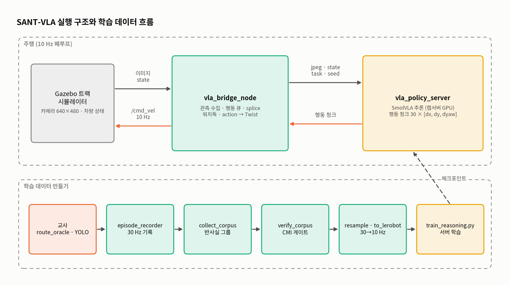
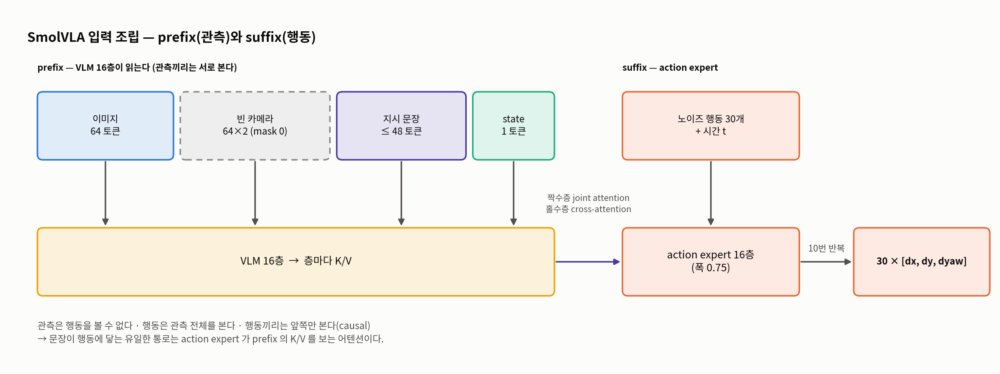

# 내 연구를 이해하기 위한 핵심 개념 — SANT-VLA

> 작성: 2026-10-07. study 폴더 목차: [README.md](README.md)
>
> 이 문서는 "내 연구에서 쓰는 개념을 하나씩, 이론 → 우리 코드 → 실제로 얻은 결과" 순서로 정리한 것이다.
> 일반 이론은 01~07 문서에 있고, 구현 세부는 [VLA 완전 정복 가이드](../guides/vla_complete_guide_ko.md)에 더 자세히 있다.
> 이 문서는 그 둘을 잇는 **지도** 역할을 한다. 수치는 모두 저장소의 실험 기록에서 가져왔고, 출처 파일을 함께 적었다.

---

## 목차

0. [한 장 요약 — 내 연구는 무엇을 묻는가](#0-한-장-요약--내-연구는-무엇을-묻는가)
1. [시스템 전체 지도](#1-시스템-전체-지도)
2. [모델: SmolVLA 를 이해하는 데 필요한 개념](#2-모델-smolvla-를-이해하는-데-필요한-개념)
3. [입력과 출력: state·action·Twist](#3-입력과-출력-stateactiontwist)
4. [실행: 행동 청크·큐·폐루프](#4-실행-행동-청크큐폐루프)
5. [데이터: 교사·코퍼스·검증](#5-데이터-교사코퍼스검증)
6. [학습: 모방학습과 그 함정](#6-학습-모방학습과-그-함정)
7. [언어: 조건화·접지·해설(Narration)](#7-언어-조건화접지해설narration)
8. [평가: 무엇을 재고 어떻게 믿는가](#8-평가-무엇을-재고-어떻게-믿는가)
9. [지금까지의 결과 — 확인 / 반증 / 미결](#9-지금까지의-결과--확인--반증--미결)
10. [자주 헷갈리는 구분](#10-자주-헷갈리는-구분)
11. [스스로 점검하는 질문](#11-스스로-점검하는-질문)
12. [다음에 읽을 곳](#12-다음에-읽을-곳)

---

## 0. 한 장 요약 — 내 연구는 무엇을 묻는가

### 0.1 연구 이름

**SANT-VLA = Shared-backbone Action–Narration Training.** 예전 이름은 NAV-VLA 다
([sant_vla_rename.md](../guides/sant_vla_rename.md)).
이름 그대로, **하나의 백본(backbone)을 공유하면서 행동(Action)과 해설(Narration)을 함께 학습**시키는 소형 VLA 연구다.

### 0.2 큰 질문

> 카메라 한 대와 차량 상태만 보는 작은 VLA(약 450M 파라미터)가,
> **사람이 한 말(지시 문장)에 따라 주행 행동을 바꾸고**,
> **자기가 왜 그렇게 움직이는지 말로 설명**할 수 있는가?
> 그리고 그것을 **어떻게 정직하게 측정**하는가?

### 0.3 세 줄로 본 현재 위치

| 구분 | 내용 | 근거 |
|---|---|---|
| **된 것** | 학습한 정본 문장으로 차선·속도를 바꾸는 것(반사실 분리 +2.51 m, 노이즈 바닥 +0.05 m), 차선 중심 유지(v3y 중앙값 0.25 m), 해설 헤드 co-training(액션 무회귀) | 가이드 9.2, [reasoning_versions 3.5절](../experiments/reports/reasoning_versions.md), [reasoning_project_report](../experiments/reports/reasoning_project_report.md) |
| **안 된 것** | 물체 이름으로 대상을 고르기(상수 문장 대조군과 구별 안 됨, 23/42 vs 22/42), 희소한 정지 행동 학습, 장애물 회피의 일반화(자리 습관) | [20261007_1010](../experiments/goto_object/20261007_1010_vision-action-baseline.md), 보고서 3장, [shortcut-learning](../experiments/avoidance/20261002_1414_shortcut-learning.md) |
| **열린 질문** | 데이터에는 언어 정보가 있는데(CMI 0.743 bit) 왜 행동 쪽이 그걸 안 쓰는가 — 학습·구조 쪽 병목 | 같은 기록 |

이 표가 연구 전체의 요약이다. 아래 장들은 이 표의 단어 하나하나를 이해하기 위한 설명이다.

---

## 1. 시스템 전체 지도

| 덩어리 | 핵심 개념 | 이 문서의 장 |
|---|---|---|
| 모델 | VLM, action expert, flow matching, prefix/suffix | 2 |
| 입출력 | state, SE(2) 델타, Twist | 3 |
| 실행 | 행동 청크, 큐, refill, splice, 워치독, 폐루프 | 4 |
| 데이터 | 교사(오라클), 반사실 그룹, CMI, 검증 게이트 | 5 |
| 학습 | 행동복제, 분포 이동, DAgger, 지름길 학습, 희소 신호 | 6 |
| 언어 | 언어 조건화, 접지, co-training, 해설, CFG | 7 |
| 평가 | 반사실 A/B, 노이즈 바닥, 대조군, 기하 차선 기준, 통계 | 8 |

---

## 2. 모델: SmolVLA 를 이해하는 데 필요한 개념

> 일반 이론: [01 딥러닝 기초](01_딥러닝_기초_MLP_CNN_Transformer.md), [02 LLM과 VLM](02_LLM과_VLM.md), [03 생성모델](03_생성모델_Diffusion_FlowMatching.md), [05 VLA](05_VLA란_무엇인가.md)
> 구현 세부: 가이드 4장

### 2.1 VLM 백본 — "눈과 언어"

**이론.** VLM(Vision-Language Model)은 이미지를 토큰으로 바꿔 문장 토큰 옆에 나란히 놓고, 하나의 트랜스포머가 둘을 함께 읽게 만든 모델이다.
인터넷 규모의 그림·글로 미리 학습돼 있어서 "무엇이 무엇인지"에 대한 지식을 갖고 있다.

**우리 모델.** SmolVLA 의 백본은 `SmolVLM2-500M-Video-Instruct` 다.

| 부품 | 하는 일 | 크기·설정 |
|---|---|---|
| SigLIP 비전 인코더 | 512×512 이미지를 패치(16×16)로 잘라 1024개 패치 특징을 만든다 | ViT 계열 |
| connector (pixel shuffle ×4) | 1024 패치를 이미지당 **64 토큰**으로 줄인다 | 960 차원 |
| 언어모델(텍스트 층) | 이미지 토큰 + 문장 토큰 + state 토큰을 함께 읽는다 | 원래 32층 → **16층만 사용** |

- 층을 절반만 쓰는 이유: 10 Hz 제어 루프 안에서 추론이 끝나야 하기 때문이다(가이드 4.2~4.3).
- 문장은 **최대 48 토큰**, 넘치면 조용히 잘린다. 그래서 지시문은 짧아야 한다(가이드 4.5).

### 2.2 Action Expert — "행동을 만드는 두 번째 네트워크"

**이론.** VLM 은 원래 글자를 출력한다. 연속적인 행동(조향·이동량)을 내려면 출력 방식을 바꿔야 한다.
방법은 두 갈래다 — 행동을 숫자 토큰으로 바꿔 글자처럼 생성(RT-2, OpenVLA)하거나,
**행동만 전문으로 만드는 작은 네트워크를 따로 붙이는 것**(π0, SmolVLA). 우리는 후자다.

**우리 모델.**
- action expert 는 VLM 과 같은 층 수(16)를 갖되 폭은 0.75배(720 차원)다.
- 짝수 층은 VLM 과 **joint self-attention**, 홀수 층은 VLM 의 K/V 를 보는 **cross-attention** (`self_attn_every_n_layers: 2`).
- 출력: 30개 행동 토큰 → `action_out_proj(720→32)` → 앞 3차원만 사용 = `[dx, dy, dyaw]`.

### 2.3 prefix / suffix — 무엇이 무엇을 보나

- 이것이 **언어 조건화의 통로**다. 문장 토큰은 prefix 에 있고, 행동 토큰이 prefix 에 어텐션해서 문장 정보를 가져간다.
- 10-07 점검: 우리 `reasoning_policy.forward` 의 액션 경로가 stock SmolVLA 와 같다는 것을 확인했다. 즉 "문장이 행동에 안 닿는" 배선 버그는 없다([20261007_1010](../experiments/goto_object/20261007_1010_vision-action-baseline.md) 2절).
- 빈 카메라 2장: smolvla_base 가 카메라 3대로 사전학습돼서 자리만 남아 있다(마스크 0).

### 2.4 Flow Matching — 노이즈에서 행동을 만드는 방법

**이론.** (자세히는 [03 문서](03_생성모델_Diffusion_FlowMatching.md))
- 노이즈 `x0 ~ N(0, I)` 와 정답 행동 `x1` 사이를 직선으로 잇는다: `x_t = (1 − t)·x0 + t·x1`
- 모델은 그 직선 위 어느 점에서든 **"어느 방향으로 얼마나 가야 하는지"(속도 `v = x1 − x0`)** 를 맞히도록 학습한다.
- 추론: 노이즈에서 시작해 예측한 속도를 따라 조금씩 이동 → 여러 번 반복하면 행동이 된다.

**왜 그냥 회귀(MSE)로 안 하나?** 같은 장면에서 정답이 여러 개일 수 있기 때문이다.
예: 장애물을 왼쪽으로 피해도, 오른쪽으로 피해도 정답이다. 회귀는 둘의 평균(정면 충돌)을 낸다.
생성모델은 둘 중 하나를 골라 낸다.

**우리 설정.** `num_steps = 10` → 한 번의 추론에서 action expert 를 10번 돌린다.
그래서 지연시간의 상당 부분이 expert 반복이고, 양자화 실험에서 이 부분을 따로 본다
([PTQ 실험계획](../experiments/model_compression/smolvla_ptq_실험계획.md)).

**seed 가 중요한 이유.** 시작 노이즈가 다르면 결과도 조금 다르다. 서버의 `infer1()` 은
요청마다 `torch.manual_seed(seed)` 로 노이즈를 고정한다(`server/code/vla_policy_server.py:216`).
같은 seed 로 비교해야 "모델 차이"와 "노이즈 차이"를 구별할 수 있다 → 8.2절 노이즈 바닥.

### 2.5 사전학습과 파인튜닝

- `smolvla_base`(커뮤니티 로봇 데이터로 사전학습된 SmolVLA)를 출발점으로, 우리 주행 데이터로 **전체 파인튜닝**한다.
  설정에서 `freeze_vision_encoder: false`, `train_expert_only: false` → 비전 인코더까지 다 학습된다.
- 의미: 사전학습 지식이 우리 데이터에 덮어써질 수 있다. "사전학습 지식으로 처음 보는 물체 다루기"가 잘 안 넘어오는 이유 후보 중 하나다(아직 원인 분리 안 됨).

### 2.6 해설 헤드 (Reasoning / Narration head)

- SmolVLA 에는 쓰이지 않던 `lm_head`(약 47M)가 있다. 이것을 깨워 **언어 출력 헤드**로 쓴다.
- 같은 prefix(이미지·문장·state)를 두 번 쓴다: 한 번은 행동(flow matching), 한 번은 해설(다음 토큰 예측, CE).
- 손실: `L = L_flow + λ · L_CE` — 이것이 SANT-VLA 의 "Shared-backbone Action–Narration Training" 이다.
- 액션 경로는 바이트 단위로 원래와 같게 유지했다. 해설을 붙여도 주행이 나빠지지 않는지(액션 무회귀)가 첫 번째 확인 항목이었다.

---

## 3. 입력과 출력: state·action·Twist

> 자세히: [io_contract_state_action_twist.md](../guides/io_contract_state_action_twist.md)

### 3.1 세 가지 표현

| 이름 | 모양 | 뜻 | 누가 씀 |
|---|---|---|---|
| **state** | `float32[3]` = `[v, ω, δ]` | 지금 속도, 회전 속도(yaw rate), 조향각 | 모델 입력 |
| **action** | `float32[3] × 30` = `[dx, dy, dyaw]` | 차량 기준 좌표계에서 다음 한 스텝 동안의 이동량(SE(2) 델타) | 모델 출력 |
| **Twist** | `linear.x, angular.z` | ROS 속도 명령 | 차량 구동 |

### 3.2 왜 이동량(델타)인가

- 속도 명령(`cmd_vel`)을 직접 배우면 시연의 속도 단계(양자화된 값)까지 그대로 배운다.
- 이동량은 "어디로 가려 했나"라는 **경로 모양**을 담는다. 경로의 굽음은 곡률 `k = ω / v = dyaw / dx` 로 나온다.
- 변환: `v = dx / dt`, `ω = dyaw / dt` (`dt = 1 / 10 Hz`).
- 학습 데이터에서 `state[k]` 는 직전 action 을 dt 로 나눈 것이다 — 즉 **state 와 action 은 같은 양의 다른 표현**이다.

### 3.3 좌표·위치 정보를 주지 않는다

- 모델 입력에 차량의 절대 좌표·오도메트리가 없다. 카메라 픽셀 + state 3 값이 전부다.
- 그래서 "트랙의 어디쯤인가"는 화면으로만 알 수 있다. 트랙이 비슷비슷하게 생겼으면 위치 판단이 어렵다
  (초기 연구에서 카메라만으로 특정 존 찾아가기가 불가능했던 이유).
- 반대로, 화면 배경이 위치를 알려 주면 모델이 **장면 대신 자리를 외우는** 지름길이 생긴다 → 6.4절.

### 3.4 정규화

- 학습 전 state·action 을 데이터 평균·표준편차로 정규화한다. 이 통계는 체크포인트의 preprocessor / postprocessor 파일에 들어 있다.
- **함정(10-05 발견):** 학습 스크립트가 행동 복원 통계(postprocessor)를 베이스 모델에서 복사하고 있었다.
  그러면 출력 행동이 엉뚱한 스케일로 복원된다 — 실제로 모든 문장에서 경로가 왼쪽으로 쏠렸다.
  교훈: **새 체크포인트는 pre/post 통계가 학습 데이터와 일치하는지부터 확인한다.**

---

## 4. 실행: 행동 청크·큐·폐루프

> 자세히: 가이드 8장

### 4.1 행동 청크 (action chunking)

- 모델은 한 번에 **30 스텝(10 Hz 기준 3초)** 분량의 행동을 낸다.
- 장점: 매 스텝 추론하지 않아도 되고(지연 여유), 행동이 매끄럽고, "앞으로의 계획"이 하나로 묶인다.
- 단점: 청크를 실행하는 동안은 새 화면을 반영하지 않는 **개루프 구간**이 생긴다.

### 4.2 큐와 refill

- 청크는 큐에 쌓이고 10 Hz 로 하나씩 꺼낸다.
- **refill_at = 0.3**: 큐가 30% (9개) 아래로 줄면 다시 추론한다 → 약 2.1초마다 재계획.
- 이 값은 실험으로 정했다: 너무 자주 재계획하면 청크의 앞부분(어느 목표든 공통인 구간)만 실행하다 버려서, 청크 뒤쪽에 있는 회전 결정이 계속 미뤄진다.

### 4.3 splice (이어 붙이기)

- 새 청크가 오면 앞 5개를 기존 큐와 가중치를 바꿔가며 섞는다(`w = (i+1)/(n+1)`). 명령이 갑자기 튀지 않게 하려는 것.

### 4.4 워치독

- 큐가 비거나 청크가 너무 오래되면 정지 명령(v=0, ω=0)을 낸다. 제어 경로에 있는 **유일한 규칙**이다.
- 평가에서 워치독이 한 번이라도 발동한 런은 "정책의 주행"이 아니므로 무효 처리한다.

### 4.5 폐루프 (closed loop)

- **개루프 평가**: 기록된 장면을 넣고 출력이 정답과 얼마나 다른지 본다. 모델의 출력이 다음 입력에 영향을 주지 않는다.
- **폐루프 평가**: 모델이 실제로 차를 몰고, 그 결과로 바뀐 화면이 다시 입력된다.
- 핵심 사실: **개루프에서 좋아도 폐루프에서 무너질 수 있다.** 작은 오차가 쌓여 학습 때 못 본 위치로 가기 때문이다(6.2절).
  실제 예: 방향 단어 모델 r52 는 오프라인 34/42 였지만 폐루프에서는 30번 중 28~30번이 같은 물체로 갔다
  — 결과를 정한 것은 문장이 아니라 물체 배치였다(goto 실습 기록 10-04~05).

---

## 5. 데이터: 교사·코퍼스·검증

> 일반 이론: [04 로봇학습](04_로봇학습_모방학습과_강화학습.md) · 자세히: 가이드 5장

### 5.1 교사(Teacher) — 시연을 누가 만드나

| 교사 | 원리 | 쓰인 곳 |
|---|---|---|
| YOLO 차선 스택 | 카메라로 차선 인식 → 경로 계획 → 제어 (기존 인지-판단-제어 방식) | 초기 주행 코퍼스(v3y 등) |
| **route_oracle** | 시뮬의 **정답 정보**(실제 위치, 트랙 기하, 장애물 좌표)로 경로를 계산 | 회피·goto 시연 |

- **특권 정보(privileged information) 교사:** 학생(VLA)은 카메라만 보지만, 교사는 시뮬의 정답 좌표를 본다.
  교사는 쉽게 완벽한 시연을 만들고, 학생은 그것을 카메라만으로 흉내 내도록 배운다.
- **교사 품질 = 학생의 상한.** 실제 사례: YOLO 교사는 교차 구간에서 코너를 0.5~0.9 m 잘랐고, 학생도 그대로 배웠다(가이드 9.4).
  goto 교사는 굽은 접근에서 횡 이동을 실제의 약 55% 로 과소평가했다 → 가르치려는 차이 자체가 작아졌다.

### 5.2 에피소드와 코퍼스

- **에피소드**: 한 번의 주행 시연(시작 → 목표). 프레임(JPEG), state, action, 지시 문장, 메타정보가 기록된다.
- **코퍼스**: 에피소드 묶음. 이름 예: v3y(차선·속도 주행), packed_goto / g1(물체로 가기), gv2b.
- 30 Hz 로 기록 → 10 Hz 로 리샘플 → LeRobot 형식으로 변환 → 서버에서 학습.

### 5.3 반사실 그룹 (counterfactual group)

- **같은 출발 상태에서 문장만 다르게** 여러 번 시연한다. 예: 같은 위치에서 "왼쪽 물체로" / "오른쪽 물체로".
- 이렇게 하면 "문장이 바뀌면 행동이 이렇게 바뀐다"를 데이터가 직접 보여 준다.
- 문장 없이도 장면만 보고 풀 수 있는 데이터는 언어를 배울 이유가 없다. 반사실 그룹은 **언어를 꼭 읽어야 풀리는** 데이터를 만드는 장치다.

### 5.4 짝 시연 (paired demonstrations)

- 회피 연구에서 배운 것: 장애물이 항상 같은 자리에 있으면 모델은 장애물이 아니라 **자리**를 외운다.
- 해결: 같은 자리에서 "장애물 있음 → 회피" 와 "장애물 없음 → 직진" 시연을 짝으로 넣는다(r43).
  그러면 자리만으로는 행동을 맞힐 수 없고, 장애물을 봐야 한다.

### 5.5 CMI — 데이터에 언어 정보가 있는가

> 자세히: 가이드 9.7

**정의.** 조건부 상호정보 `I(행동 ; 문장 | 관측)`.
"이 장면을 보고 있을 때, 문장을 추가로 들으면 행동에 대해 몇 비트를 더 알게 되나."

- 관측만으로 설명되는 부분(코너에서는 누구나 돈다)을 빼고 **언어만의 정보**를 잰다.
- 관측 조건은 실제 위치를 1 m / 15° 로 나눈 버킷으로 근사한다(정적인 트랙에선 위치가 화면을 결정하므로).
- 추정치에는 편향이 있어서 **버킷 안에서 문장 라벨을 섞은(셔플) 값을 빼서** 쓴다(디바이어스). 대조군 없는 정보량은 읽지 않는다.

**중요한 구분.** CMI 는 **데이터의 성질**이다. CMI 가 높다 = "문장을 읽어야 풀리는 데이터다". 모델이 문장을 읽는다는 뜻이 아니다.

**결과.** g1 0.743 bit, gv2b 0.965 bit (셔플 대조 0.104 / 0.195, 둘 다 GATE PASS).
→ 데이터는 문장을 요구한다. 그런데 모델은 안 읽는다(9장). **병목은 데이터가 아니라 학습·구조 쪽.**

### 5.6 검증 게이트

- `verify_corpus.py`: 스트림 누락·프레임 레이트·반사실 쌍 발산·언어 다양성을 검사해 PASS/FAIL 을 낸다.
- 반사실 그룹은 궤적 차이가 **노이즈 바닥의 5배 이상**이어야 통과한다(G-C 게이트).
- 원칙: **학습 전에 데이터를 검증하고(CMI, verify), 학습 후에 정책을 검증한다(반사실 A/B).** 두 번 확인한다.

---

## 6. 학습: 모방학습과 그 함정

> 일반 이론: [04 로봇학습](04_로봇학습_모방학습과_강화학습.md) · 자세히: 가이드 7장

### 6.1 행동복제 (Behavior Cloning, BC)

- 관측 → 교사 행동 쌍을 정답지로 놓고 지도학습한다. 우리 학습의 기본이다.
- 장점: 단순하고, 보상 설계가 필요 없다.
- 약점: 아래 6.2~6.5.

### 6.2 분포 이동과 오차 복리

- 학습 데이터는 **교사가 간 길**에서만 나온다. 학생이 조금 벗어나면 학습 때 본 적 없는 장면이 나오고, 거기서 더 크게 틀린다.
- 오차가 쌓이는 속도가 시간에 대해 선형이 아니라 더 빠르게 커진다(이론상 최악 T²).
- 그래서 "개루프 오차가 작다"는 것만으로는 부족하고 폐루프로 확인한다.

### 6.3 DAgger

- 학생이 실제로 운전해서 간 곳에서 교사에게 정답을 물어 데이터에 추가한다. 학생이 가는 분포를 데이터가 덮게 된다.
- **우리 교훈(v7):** 표적 구간은 좋아졌지만 전체 데이터가 희석돼 다른 곳이 나빠졌다. 추가 데이터의 비율이 중요하다.

### 6.4 지름길 학습 (Shortcut Learning)

**정의.** 모델이 진짜 원인이 아닌, 데이터에서 **우연히 같이 나타난 단서**로 행동하는 것.

| 실험 | 기대한 단서 | 모델이 실제로 쓴 단서 | 기록 |
|---|---|---|---|
| 회피 r44 | 장애물 | 트랙의 **자리** (장애물이 없어도 같은 자리에서 1.5~2.5 m 꺾음, 출발 거리 10~63 m 바꿔도 같음) | [shortcut-learning](../experiments/avoidance/20261002_1414_shortcut-learning.md) |
| 차선 r11 | 빈 트랙 차선 중심 | 회피 시연의 안쪽 차선 이동 습관이 빈 트랙에서도 샘 → 중앙값 0.88 m (v3y 0.25 m) | [reasoning_versions 3.5절](../experiments/reports/reasoning_versions.md) |
| goto | 물체 이름 | 물체 **배치** (어떤 문장이든 같은 물체로 감) | goto 실습 기록 |

- 이론 이름: **인과 혼동(causal confusion)**. 관측 안에 행동과 상관된 다른 신호가 있으면 모델은 더 쉬운 쪽을 쓴다.
- 대응: 짝 시연, 배치 다양화, 그리고 **대조군으로 지름길 여부를 먼저 확인**.

### 6.5 희소 신호 (sparse signal)

- 전체 데이터 중 일부에만 있는 행동·라벨은 잘 안 배워진다.
- 해설: 장애물 프레임이 10% 일 때 차량 언급 7% → **4배 가중 샘플링으로 100%**. 가장 깨끗한 성공 사례.
- 행동: 정지 행동은 24배 오버샘플까지 해도 action expert 가 끝내 배우지 못했다(보고서 3장 4번).
- 교훈: **가중치(손실에 곱하기)보다 노출(재샘플링)** 이 효과적이었다(r14 → r15). 그래도 행동 쪽은 한계가 있었다.

### 6.6 다과제 학습의 간섭

- 해설 CE 와 행동 flow 를 같은 백본으로 학습하면 서로 영향을 준다.
- r16: v9 회피 데이터의 행동 가중치를 0 으로 해도 차선 중심 0.346 m 로 r4(0.24 m)보다 나빴다 → **공유 백본에서 언어 학습이 행동에 간섭**한 잔차.
- 다음 수 후보: λ_CE 줄이기, 백본 일부 동결.

---

## 7. 언어: 조건화·접지·해설(Narration)

> 일반 이론: [02 LLM과 VLM](02_LLM과_VLM.md), [05 VLA](05_VLA란_무엇인가.md)

### 7.1 언어 조건화 (language conditioning)

- 정책 `π(a | o, l)`: 같은 관측 `o` 에서도 문장 `l` 에 따라 다른 행동 `a` 를 내야 한다.
- 우리에게 된 것: **정본 문장**(학습에 쓴 형식) — "Cruise in the outer lane, at a normal speed." 같은 차선·속도 지시.
- 안 된 것: 처음 보는 표현(A3 실패) → 그래서 자유 문장은 파서·LLM 이 정본 문장으로 바꿔 넘긴다.

### 7.2 언어 접지 (language grounding)

- 문장 속 단어가 **화면 속 무엇에 해당하는지 연결**하는 것. "공룡 앞으로" → 화면의 공룡 위치 → 그쪽으로 가는 행동.
- 조건화보다 어렵다: 차선·속도는 "전역 모드"(화면 어디에도 안 묶인 2~3가지 선택)지만, 물체 이름은 **화면 위치와 묶어야** 한다.
- 우리 관찰(미엄밀): 모드 단어(곧장 vs 차선 따라)는 따르는 경향(r52 비율 0.67), 물체 이름은 우연 수준. 단 r52 에는 상수 문장 대조군이 없어 확정은 아니다.

### 7.3 언어를 무시하는 문제

- VLA 에서 흔히 보고되는 현상: 모델이 이미지만으로 행동을 맞힐 수 있으면 문장을 무시한다.
- 우리 10-07 결과가 이를 대조군으로 확인했다:

| 모델 | 학습 문장 | 언어 프로브 | 해석 |
|---|---|---|---|
| b0 | 모든 문장을 상수 `Drive.` 로 덮음 | 23/42 | 문장을 볼 수 없으니 이 값이 **프로브의 노이즈 하한** |
| b1 | 물체 이름 문장 | 22/42 | 하한과 구별 안 됨 → 문장 정보를 안 씀 |

### 7.4 해설 (Narration) 과 co-training

- 목표: 주행하는 모델 **자신이** 근거를 말하게 한다. 외부 LLM(Qwen)이 붙이는 해설은 정책의 근거가 아니기 때문이다.
- 라벨: 시뮬의 정답 정보로 규칙 기반 사실 문장을 만들고, LLM 은 문장 다듬기에만 쓴다(사실 보존 검증 통과분만). 학습·서빙에는 LLM 이 없다.
- 결과: 해설은 정지·관찰·통과 같은 상황을 말로 맞혔지만, **행동은 정지를 배우지 못했다** → **언어-행동 비대칭**.
  "말은 맞는데 행동은 다르다"는 대형 VLA(예: Alpamayo-R1 의 추론-행동 일치 학습)에서도 다루는 문제다.

### 7.5 해설로 행동을 조건화하기 (situation-from-reasoning)

- 서버 옵션 `--situation-from-reasoning`(r40+): 해설 헤드가 읽은 상황을 정해진 짧은 문구로 바꿔 **행동용 문장 뒤에 붙인다**.
- 즉 "말한 내용"을 다시 행동의 조건으로 넣어 말과 행동을 잇는 시도다.

### 7.6 Classifier-Free Guidance (CFG)

- 같은 입력으로 두 번 추론: 실제 문장(cond)과 무의미 문장(null). 그리고 `out = null + w · (cond − null)`.
- `w > 1` 이면 "문장 때문에 생긴 차이"를 키운다. 언어 효과가 약할 때 증폭하는 도구다.
- 우리 구현: 서버 `--guide w`, `--guide-null "Go to the object."`, 학습 때 null 문장을 함께 넣는 `server/code/course/add_null_goto.py`.
- 한계: 모델이 문장을 아예 안 읽으면 `cond − null ≈ 0` 이라 키울 것이 없다.

### 7.7 계층형 (hierarchical) 대안

- 큰 VLM(Qwen2.5-VL-3B)이 자유 문장과 화면을 보고 "무엇을 해야 하는지"를 정본 문장으로 바꾸고, SmolVLA 가 운전만 한다.
- G0 확인: Qwen2.5-VL-3B 는 "extinct animal" → "dinosaur" 를 4/4 맞혔고, SmolVLM2-500M 은 위치 질문이 우연 수준.
- 강좌 실습에서 SmolVLA 단독 vs 계층형을 비교하는 이유다. 대형 VLM 의 상식과 작은 정책의 속도를 나누는 구조로, 업계의 이중 구조(DriveVLM-Dual 등)와 같은 발상이다.

---

## 8. 평가: 무엇을 재고 어떻게 믿는가

> 자세히: 가이드 9장. 이 장이 연구에서 가장 중요하다 — "자가 데이터보다 자주 틀렸다"가 프로젝트 제1 교훈이다.

### 8.1 반사실 A/B 프로브

- 같은 위치로 리셋 → 문장 A 로 주행 → 다시 같은 위치로 리셋 → 문장 B 로 주행 → 두 궤적의 차이 D 를 잰다.
- 문장이 행동을 **인과적으로** 바꿨다고 말할 수 있는 유일한 방법이다.

### 8.2 노이즈 바닥 (noise floor)

- 같은 문장을 두 번 돌려도 궤적이 조금 다르다(시뮬 비결정성, 샘플링 노이즈). 그 차이가 바닥이다.
- 규칙: **효과가 바닥의 수십 배일 때만** "문장이 바꿨다"고 말한다. 예: 차선 전환 +2.51 m vs 바닥 +0.05 m.
- 양 끝 기준도 미리 재 둔다: 명령과 무관한 스택 0.063 m(사실상 0), 정답 좌표로 모는 오라클 6.4 m(상한).

### 8.3 대조군 (control)

- "효과가 있다"를 말하려면 "효과가 없는 조건"과 비교해야 한다.
- 우리 예: 상수 문장 모델 b0(7.3절), CMI 의 셔플 대조(5.5절), 빈 차선 조건(stat_eval 의 empty).
- 대조군이 없던 시기에는 "측정 한계인지 모델 한계인지" 몰랐다. b0 을 돌리고서야 b1 이 하한에 앉아 있다는 것을 알았다.

### 8.4 차선 유지 지표

- 기하 기준: 트랙의 **기하학적 차선 중심선** 대비 횡오차(`tools/eval/geometric_lane_check.py`).
- 0.70 m 기준: 차선폭 3.16 m, 차폭 1.75 m → 중앙에서 0.70 m 넘게 벗어나면 바퀴가 선에 닿는다.
- 교사 경로 기준은 교사 자신의 코너 자르기가 섞이므로 보조로만 쓴다.

### 8.5 유효 런 조건

- 워치독 발동 0회, 언더런 1% 미만, `/cmd_vel` 에 다른 퍼블리셔(유령 노드) 없음.
- 실제 사고: 전날 남은 고아 노드가 `/cmd_vel` 에 0 을 섞어 보내 "차가 출발 안 함" — 이후 프로브에 가드를 넣었다.

### 8.6 통계

- 성공률은 **Wilson 95% 신뢰구간**으로 같이 본다(`tools/eval/stat_analyze.py`). 20회 중 4회 같은 작은 표본은 구간이 넓다.
- 같은 자리 반복은 정보가 적다 → **무작위 위치 다수 × 조건별 1회**(stat_eval: ours / adj / empty).
- 짝 비교: 같은 위치에서 "장애물 있음 − 없음" 차이를 본다(위치 효과 제거).

### 8.7 측정 도구를 의심하기

| 사건 | 무엇이 틀렸나 |
|---|---|
| 교사 기준선 | 교사가 코너를 잘라서 학생의 "이탈"이 사실은 정상이었다 |
| CMI 첫 측정 | 0.553 bit 중 0.520 이 추정 편향 |
| CMI 지평선 | 0.1초로 재면 3초 청크로 행동하는 정책에선 0 bit → 2.1초로 수정 |
| CMI 미실행 | 축 이름 불일치로 측정이 한 번도 실행되지 않았는데 메시지는 "리샘플 먼저" |
| postprocessor | 복원 통계가 베이스 것이라 모든 경로가 왼쪽으로 쏠림 |

교훈: 결과가 이상하면 모델보다 **자와 배선**을 먼저 의심한다. 이 프로젝트에서 "못 배운다"가 배선 버그였던 경우가 두 번 있었다.

---

## 9. 지금까지의 결과 — 확인 / 반증 / 미결

> 주장의 경계는 [가이드 11.2](../guides/vla_complete_guide_ko.md) 기준. 여기서 벗어나는 표현은 쓰지 않는다.

### 9.1 확인된 것

| 결과 | 수치 | 의미 |
|---|---|---|
| 정본 문장으로 차선·속도 전환 | 반사실 +2.51 m (바닥 +0.05 m) | 작은 VLA 도 학습한 지시 형식은 따른다 |
| 차선 중심 유지 | v3y 중앙값 0.25 m | 순수 주행 품질 기준 모델 |
| 해설 co-training | 액션 무회귀, 희소 언급 가중 샘플링으로 100% | 행동을 해치지 않고 말하는 헤드를 붙일 수 있다 |
| 데이터의 언어 정보 | CMI g1 0.743 / gv2b 0.965 bit | goto 데이터는 문장을 읽어야 풀린다 |

### 9.2 반증되거나 실패한 것

| 결과 | 근거 |
|---|---|
| 이 설정(g1, r26 베이스, 10k)에서 물체 이름이 행동에 기여 | b0 23/42 vs b1 22/42 — 반증 |
| 희소한 정지 행동 학습 | 24배 오버샘플, seed 8종 모두 전진 |
| 장애물 회피의 일반화 | 자리 습관(r44), 다장애물 홀드아웃 무반응 |
| cf-sidecar(합성 반사실 행동 라벨) | 22/42 우연, 버그 아님 확인 |
| 처음 보는 표현 | A3 실패 |

### 9.3 열린 질문 (다음 연구 거리)

1. 데이터가 문장을 요구하는데 **action expert 는 왜 prefix 의 문장 정보를 안 쓰는가?**
   - 다음 가장 싼 확인: 같은 프레임에서 목표만 다른 두 문장으로 해설을 생성해 보기. 해설은 지시한 이름을 말하는데 행동만 안 따르면 → 문제는 action expert 쪽으로 좁혀진다.
2. 모드 단어는 따르고 물체 이름은 못 따르는 비대칭이 진짜인가? (r52 설정의 상수 문장 대조군 필요)
3. 공유 백본의 언어-행동 간섭을 줄이는 방법(λ_CE, 동결 범위)
4. 사전학습 지식이 파인튜닝 후 얼마나 남는가(전체 파인튜닝의 영향)
5. 경량화(PTQ) 후에도 언어 반응이 유지되는가 → [PTQ 실험계획](../experiments/model_compression/smolvla_ptq_실험계획.md)

---

## 10. 자주 헷갈리는 구분

| A | B | 차이 |
|---|---|---|
| 언어 **조건화** | 언어 **접지** | 문장에 따라 행동이 바뀜 vs 단어를 화면 속 대상에 연결함. 접지가 더 어렵다 |
| 해설 정확도 | 명령 준수율 | r1 의 lane 68% / speed 69% 는 **서술 정확도**다. 지시를 따른 비율이 아니다 |
| CMI (데이터) | 반사실 프로브 (모델) | 데이터가 문장을 요구하는가 vs 모델이 문장을 쓰는가 |
| 개루프 정확도 | 폐루프 성공 | 기록 장면 위 출력 오차 vs 실제 주행 결과 |
| 노이즈 바닥 | 대조군 | 같은 조건 반복의 흔들림 vs 효과가 없도록 만든 조건 |
| 손실 가중치 | 재샘플링 | 같은 데이터에 손실을 크게 vs 해당 데이터를 더 자주 보여 줌 |
| quantizer (행동) | 양자화 (모델) | 조향·속도를 몇 단계로 나눈 것 vs 가중치 비트 수를 줄인 것 |
| 오라클 | 정책 | 정답 좌표를 쓰는 교사 vs 카메라만 보는 학생 |
| VLA 단독 | 계층형 | 한 모델이 다 함 vs 큰 VLM 이 지시를 정리하고 작은 정책이 운전 |
| 체크포인트 이름 v* | r* | 대체로 v 는 주행 코퍼스 학습(v3y 등), r 은 reasoning 학습 런(r1~). 정확한 계보는 [reasoning_versions](../experiments/reports/reasoning_versions.md) |

---

## 11. 스스로 점검하는 질문

답을 말로 설명할 수 있으면 그 개념은 이해한 것이다.

**모델**
1. 문장 정보는 어떤 경로로 action expert 까지 가는가? (prefix, 어텐션 마스크)
2. flow matching 이 회귀보다 나은 상황을 예를 들어 설명하라.
3. `num_steps` 를 10 에서 5 로 줄이면 무엇이 좋아지고 무엇이 나빠질 수 있나?
4. 같은 입력인데 출력이 매번 조금씩 다른 이유는? 비교할 때 어떻게 통제하나?

**입출력·실행**
5. state 와 action 이 "같은 양"이라는 말의 뜻은?
6. refill_at 을 0.9 로 올리면 무엇이 문제가 되나?
7. 개루프 평가만 하면 왜 위험한가?

**데이터·학습**
8. 반사실 그룹이 없으면 왜 언어를 못 배울 수 있나?
9. r44 가 장애물 대신 자리를 외웠다는 것은 어떤 실험으로 보였나?
10. 희소 행동에 가중치 대신 재샘플링을 쓰는 이유는?
11. 교사가 코너를 자르면 학생과 평가에 각각 어떤 영향이 있나?

**언어·평가**
12. CMI 가 높은데 모델이 문장을 안 쓸 수 있는가? 그 둘을 어떻게 구별해 쟀나?
13. b0 모델이 왜 필요했나? 없었다면 22/42 를 어떻게 해석했겠나?
14. CFG 는 어떤 경우에 효과가 없나?
15. "모델이 공룡을 이해한다"라고 쓰면 안 되는 이유는? 대신 무엇이라 써야 하나?

---

## 12. 다음에 읽을 곳

| 더 알고 싶은 것 | 문서 |
|---|---|
| 모델 내부 코드 줄 단위 | [가이드 4장](../guides/vla_complete_guide_ko.md) |
| 브리지·서버 실행 흐름 | 가이드 8장 |
| 평가 도구와 측정 사고 | 가이드 9장 |
| 버전 계보 | [reasoning_versions.md](../experiments/reports/reasoning_versions.md) |
| 해설 연구 전체 | [reasoning_project_report.md](../experiments/reports/reasoning_project_report.md) |
| 회피 연구 묶음 | [experiments/avoidance/README.md](../experiments/avoidance/README.md) |
| 최신 결과(대조군) | [20261007_1010](../experiments/goto_object/20261007_1010_vision-action-baseline.md) |
| 날짜별 전체 기록 | [experiments/log/README.md](../experiments/log/README.md) |
| 공부 순서 | [09 공부 로드맵](09_공부_로드맵.md) |
