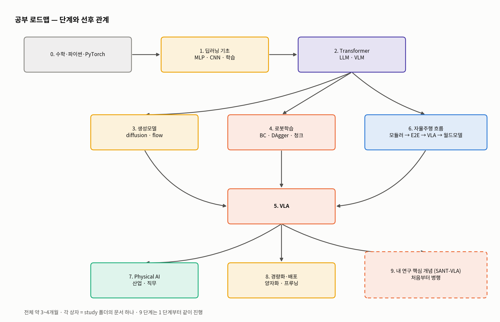

# 공부 로드맵 — 내 연구를 깊게 이해하고 면접까지 대비하기

> 작성: 2026-10-07. study 폴더 목차: [README.md](README.md)
>
> 목표: (1) 지금 하고 있는 SmolVLA 주행 연구를 이론부터 설명할 수 있고, (2) 로봇 학습 모델 직무 면접에서
> 개념·내 연구·트레이드오프 질문에 근거를 들어 답할 수 있게 되는 것.
> 시간 추정은 석사 과정과 병행한다는 가정의 대략적인 값이다.

---

## 목차

1. 전체 지도
2. 단계별 계획 (0 ~ 9 단계)
3. 필수 논문 읽기 목록
4. 논문 읽는 법
5. 수학 복습 목록
6. 면접 예상 질문과 답변 포인트
7. 주간 일정 예시
8. 진도 체크리스트

---

## 1. 전체 지도

| 단계 | 주제 | 관련 문서 | 예상 시간 |
|---|---|---|---|
| 0 | 수학·파이썬·PyTorch 기초 | (이 문서 5장) | 1~2주 (복습 위주) |
| 1 | 딥러닝 기초 | [01_딥러닝_기초_MLP_CNN_Transformer.md](01_딥러닝_기초_MLP_CNN_Transformer.md) | 1~2주 |
| 2 | Transformer · LLM · VLM | [02_LLM과_VLM.md](02_LLM과_VLM.md) | 2주 |
| 3 | 생성모델 (diffusion, flow matching) | [03_생성모델_Diffusion_FlowMatching.md](03_생성모델_Diffusion_FlowMatching.md) | 1~2주 |
| 4 | 로봇학습 (모방학습) | [04_로봇학습_모방학습과_강화학습.md](04_로봇학습_모방학습과_강화학습.md) | 1~2주 |
| 5 | VLA | [05_VLA란_무엇인가.md](05_VLA란_무엇인가.md) | 1~2주 |
| 6 | 자율주행 패러다임·월드모델 | [06_자율주행_패러다임_인지판단제어에서_월드액션모델까지.md](06_자율주행_패러다임_인지판단제어에서_월드액션모델까지.md) | 1주 |
| 7 | Physical AI 산업 | [07_Physical_AI.md](07_Physical_AI.md) | 2~3일 |
| 8 | 경량화·배포 | [model_compression/](model_compression/양자화_프루닝_개념정리.md) | 1주 (+ 실험 3일) |
| 9 | 내 연구 핵심 개념 | [08_내연구_핵심개념.md](08_내연구_핵심개념.md) | 1~2주 (계속 갱신) |

전체 약 3~4개월. 단, **9 단계(내 연구)는 처음부터 병행** 하는 것이 좋다. 이론을 배울 때마다 "우리 코드에서는 어디에 해당하나" 를 바로 찾아보면 오래 남는다.

---

## 2. 단계별 계획

각 단계는 **목표 → 읽을 것 → 손으로 해볼 것 → 확인 질문** 순서다. 확인 질문에 막힘없이 답할 수 있으면 다음 단계로 넘어간다.

---

### 0 단계: 수학 · 파이썬 · PyTorch 기초

**목표**
- 텐서 연산, 자동미분, 학습 루프를 PyTorch 로 직접 짤 수 있다.
- 딥러닝 논문의 수식(행렬곱, 기댓값, 기울기)을 읽고 코드로 옮길 수 있다.

**읽을 것**
| 자료 | 범위 |
|---|---|
| PyTorch 공식 튜토리얼 "Learn the Basics" | 텐서, Dataset/DataLoader, nn.Module, autograd, 최적화, 저장·불러오기 |
| *Dive into Deep Learning* (d2l.ai, 무료) | 2장 (Preliminaries: 선형대수·미적분·확률·자동미분) |
| 3Blue1Brown "Essence of Linear Algebra" 영상 | 행렬 = 선형 변환, 고윳값의 직관 |
| 수학 복습 목록 | 이 문서 5장 |

**손으로 해볼 것**
1. 넘파이 없이 PyTorch 텐서만으로 선형회귀를 경사하강법으로 학습 (autograd 사용 / 미사용 두 버전).
2. `torch.no_grad()`, `model.eval()`, `torch.inference_mode()` 의 차이를 실험으로 확인.
   - 우리 서버 코드가 `torch.inference_mode()` 를 쓰는 곳: `server/code/vla_policy_server.py` 의 `infer1()`.
3. GPU 메모리 측정: `torch.cuda.max_memory_allocated()` 로 배치 크기별 메모리 변화 기록.

**확인 질문**
1. 역전파는 어떤 수학 규칙(연쇄 법칙)을 어떻게 쓰는가?
2. `requires_grad=True` 인 텐서에 in-place 연산을 하면 왜 문제가 될 수 있나?
3. 배치 차원을 왜 맨 앞에 두나? `unsqueeze(0)` 은 무엇을 하나? (힌트: `infer1()` 의 이미지 텐서 처리)
4. float32, bfloat16, float16 의 차이는? (지수·가수 비트 수, 표현 범위)
5. `model.eval()` 을 빼먹으면 어떤 층의 동작이 달라지나?

---

### 1 단계: 딥러닝 기초 (MLP, CNN, 학습 원리)

**목표**
- MLP·CNN 의 구조와 학습 과정(손실, 최적화, 정규화, 과적합)을 설명할 수 있다.
- 우리 프로젝트 초기의 ResNet 기반 정책(stage_a)이 어떻게 동작했는지 설명할 수 있다.

**읽을 것**
| 자료 | 범위 |
|---|---|
| [01_딥러닝_기초_MLP_CNN_Transformer.md](01_딥러닝_기초_MLP_CNN_Transformer.md) | 전체 |
| Stanford CS231n 강의 노트 (공개) | 신경망, 역전파, CNN, 학습 팁 |
| Andrej Karpathy "Neural Networks: Zero to Hero" (YouTube) | micrograd(자동미분 직접 구현), makemore |
| *Deep Learning* (Goodfellow, Bengio, Courville) | 6장(MLP), 7장(정규화), 8장(최적화), 9장(CNN) — 필요한 장만 |
| 논문: ResNet (He et al., 2015) | 잔차 연결이 왜 깊은 망 학습을 가능하게 하나 |

**손으로 해볼 것**
1. MNIST 를 MLP 와 CNN 으로 각각 학습해 정확도·파라미터 수 비교.
2. 학습률을 10배씩 바꿔 가며 손실 곡선 비교 (발산, 느린 수렴 직접 보기).
3. 사전학습 ResNet18 을 불러와 마지막 층만 바꿔 작은 분류 문제에 파인튜닝 (전이학습 체험).
   - 우리 초기 장애물 분류기도 같은 방식이었다 (ResNet18 → 1 logit, 연구 기록 참고).

**확인 질문**
1. 활성화 함수가 없으면 MLP 를 아무리 깊게 쌓아도 왜 선형 함수 하나와 같나?
2. CNN 이 이미지에 MLP 보다 유리한 두 가지 성질(지역성, 가중치 공유)은?
3. 과적합을 어떻게 알아채고, 어떤 방법으로 줄이나? (최소 4가지)
4. Adam 과 SGD 의 차이, 학습률 warmup 과 decay 는 왜 쓰나? (우리 SmolVLA 설정에 `scheduler_warmup_steps 1000` 이 있다)
5. 회귀 문제에서 MSE 와 SmoothL1(Huber) 의 차이는?

---

### 2 단계: Transformer · LLM · VLM

**목표**
- 어텐션 계산을 손으로 쓸 수 있다.
- LLM 이 "다음 토큰 예측" 으로 학습된다는 것과, VLM 이 이미지를 토큰으로 바꿔 넣는 방식을 설명할 수 있다.
- SmolVLA 의 백본(SmolVLM2)이 어떤 구조인지 설명할 수 있다.

**읽을 것**
| 자료 | 범위 |
|---|---|
| [02_LLM과_VLM.md](02_LLM과_VLM.md) | 전체 |
| 논문: *Attention Is All You Need* (2017) | 어텐션, 멀티헤드, 위치 인코딩 |
| Jay Alammar "The Illustrated Transformer" (블로그) | 그림으로 보는 트랜스포머 |
| Karpathy "Let's build GPT: from scratch" (YouTube) | 작은 GPT 를 직접 구현 |
| 논문: ViT (*An Image is Worth 16x16 Words*, 2020) | 이미지를 패치 토큰으로 |
| 논문: CLIP (2021), SigLIP (2023) | 이미지-텍스트 대조 학습. SmolVLA 비전 인코더가 SigLIP 계열 |
| Stanford CS224n (공개 강의) | NLP·LLM 전반 |
| [VLA 완전 정복 가이드 2장](../guides/vla_complete_guide_ko.md) | 우리 프로젝트 맥락의 토큰·어텐션·VLM 설명 |

**손으로 해볼 것**
1. 넘파이로 scaled dot-product attention 을 구현하고, 마스크(causal mask)를 넣었을 때 결과 비교.
2. Hugging Face 로 작은 LLM 을 불러와 토크나이저 출력 보기: 한국어 문장 vs 영어 문장 토큰 수 비교.
3. SmolVLA 설정 읽기: `models/server/navvla_smolvla_v3y/last/pretrained_model/config.json` 에서
   `vlm_model_name`, `num_vlm_layers`(16), `resize_imgs_with_padding`(512×512), `chunk_size`(30), `num_steps`(10) 확인하고 각각의 의미 적어 보기.

**확인 질문**
1. 어텐션에서 Q, K, V 는 각각 무엇이고 왜 √d 로 나누나?
2. 셀프 어텐션의 계산량이 시퀀스 길이에 대해 왜 제곱으로 늘어나나? 이미지 토큰이 많으면 무엇이 문제인가?
3. LLM 의 사전학습 목표는? 왜 이 단순한 목표로 많은 능력이 생기나?
4. VLM 에서 이미지 토큰과 텍스트 토큰은 어떻게 한 시퀀스로 합쳐지나?
5. SmolVLA 가 원래 32층짜리 VLM 을 16층으로 잘라 쓰는 이유는? (힌트: 10 Hz 제어 루프와 지연)

---

### 3 단계: 생성모델 (Diffusion, Flow Matching)

**목표**
- 확산 모델과 flow matching 이 "노이즈에서 데이터를 만드는" 원리를 설명할 수 있다.
- 왜 VLA 의 행동 출력에 생성모델을 쓰는지(다봉 분포) 설명할 수 있다.
- classifier-free guidance 의 원리를 알고, 우리 서버의 `--guide` 옵션과 연결할 수 있다.

**읽을 것**
| 자료 | 범위 |
|---|---|
| [03_생성모델_Diffusion_FlowMatching.md](03_생성모델_Diffusion_FlowMatching.md) | 전체 |
| 논문: DDPM (Ho et al., 2020) | 확산 모델의 기본 |
| 논문: *Flow Matching for Generative Modeling* (Lipman et al., 2022) | flow matching |
| 논문: Rectified Flow (Liu et al., 2022) | 직선 경로 흐름 — π0·SmolVLA 의 flow matching 과 가까움 |
| 논문: Classifier-Free Diffusion Guidance (Ho & Salimans, 2021) | 조건부/무조건 출력 혼합 |
| Lilian Weng 블로그 "What are Diffusion Models?" | 수식 정리 |
| [VLA 완전 정복 가이드 3.6~3.7, 4.6절](../guides/vla_complete_guide_ko.md) | 우리 프로젝트 맥락의 flow matching 설명 |

**손으로 해볼 것**
1. **2D 장난감 flow matching 구현** (가장 추천):
   - 목표 분포: 2차원 평면의 두 덩어리(다봉 분포, 예: (−2, 0) 과 (+2, 0) 주변).
   - 작은 MLP 가 `(x_t, t)` 를 받아 속도 `v` 를 예측하도록 학습: `x_t = (1−t)·noise + t·data`, 목표 속도 `data − noise`.
   - 추론: 노이즈에서 시작해 **10 스텝** 오일러 적분 (SmolVLA 의 `num_steps 10` 과 같은 방식).
   - 같은 데이터를 MSE 회귀로 학습하면 두 덩어리의 **평균(0, 0)** 을 내는 것을 확인 → 생성모델이 필요한 이유를 눈으로 본다.
   - 스텝 수를 1, 2, 5, 10, 50 으로 바꿔 품질 비교.
2. 1 에 조건(덩어리 A / B 선택)을 넣고, 조건 없이도 학습되게 한 뒤 classifier-free guidance 가중치 `w` 를 0, 1, 2, 4 로 바꿔 보기.
   - 우리 서버: `infer()` 에서 `null + guide × (cond − null)` (`server/code/vla_policy_server.py`).
3. `infer1()` 의 `torch.manual_seed(int(seed))` 를 읽고, 같은 seed 면 같은 행동이 나오는 이유 설명해 보기.

**확인 질문**
1. 조향 데이터가 "왼쪽으로 피함" 과 "오른쪽으로 피함" 반반이면, MSE 회귀 정책은 무엇을 출력하나? 왜 위험한가?
2. flow matching 에서 모델이 예측하는 것은 무엇이고, 추론은 어떻게 하나?
3. 확산 모델(DDPM) 과 flow matching 의 차이를 한 문장으로.
4. 추론 스텝 수를 줄이면 무엇을 얻고 무엇을 잃나?
5. classifier-free guidance 에서 가중치를 1보다 크게 하면 어떤 효과가 기대되고, 어떤 부작용이 있나?

---

### 4 단계: 로봇학습 (모방학습 중심)

**목표**
- 행동복제(BC)의 원리와 치명적 약점(분포 이동, 오차 누적)을 설명할 수 있다.
- DAgger, 액션 청크, 데이터 가중·재샘플링을 설명하고 우리 실험과 연결할 수 있다.
- 지름길 학습(shortcut learning)을 예와 함께 설명할 수 있다.

**읽을 것**
| 자료 | 범위 |
|---|---|
| [04_로봇학습_모방학습과_강화학습.md](04_로봇학습_모방학습과_강화학습.md) | 전체 |
| 논문: ALVINN (Pomerleau, 1989) | 신경망 주행의 시작 |
| 논문: *End to End Learning for Self-Driving Cars* (NVIDIA, 2016) | PilotNet. 카메라 → 조향 |
| 논문: DAgger (Ross, Gordon, Bagnell, 2011) | 분포 이동 해결 |
| 논문: ACT / ALOHA (Zhao et al., 2023) | 액션 청크 + 저가 텔레옵 |
| 논문: Diffusion Policy (Chi et al., 2023) | 확산 모델 행동 생성 |
| 논문: *Shortcut Learning in Deep Neural Networks* (Geirhos et al., 2020) | 지름길 학습 |
| Berkeley CS285 (Sergey Levine) 강의 2강 | 모방학습 이론 (분포 이동의 오차 상한) |
| [VLA 완전 정복 가이드 7장](../guides/vla_complete_guide_ko.md) | 우리 BC·DAgger 사이클 |
| [회피 연구: 지름길 학습](../experiments/avoidance/20261002_1414_shortcut-learning.md) | 우리 프로젝트의 자리 습관 사례 |

**손으로 해볼 것**
1. 2D 점 로봇 시뮬(직접 작성, 50줄 이내)에서 전문가 = "목표점으로 직진" 정책. BC 로 학습 후 폐루프로 돌려 오차 누적 관찰 → DAgger 3 라운드 적용 후 비교.
2. 우리 수집 파이프라인 읽기: `src/sant_vla_pkg/scripts/collect_corpus.py` → `resample_episodes.py` → `to_lerobot.py`. 각 단계의 입력·출력을 표로 정리.
3. `tools/eval/geometric_lane_check.py` 를 읽고 (가능하면 기존 궤적 파일로) 실행해 보기. 0.70 m 기준이 어디서 나왔는지 확인 (`(3.16 − 1.75)/2`).

**확인 질문**
1. BC 가 지도학습과 같은 방식으로 학습하는데 왜 폐루프에서 무너지나?
2. DAgger 는 무엇을 해결하고, 실제로 쓰기 어려운 점은?
3. 액션 청크는 무엇을 줄이고(복합 오차, 추론 빈도), 무엇을 희생하나(반응성)?
4. 드문 행동(예: 정지)이 데이터에 10% 만 있으면 어떤 일이 생기나? 가중치 vs 재샘플링의 차이는?
5. 우리 회피 실험에서 모델이 장애물 대신 무엇을 외웠고, 그걸 어떻게 확인했나?

---

### 5 단계: VLA

**목표**
- VLA 의 정의, 계보(RT-1 → RT-2 → OpenVLA → π0 → SmolVLA), 행동 표현 방식(토큰화 vs 연속 생성)을 설명할 수 있다.
- SmolVLA 의 입력 → prefix → action expert → 행동 청크 흐름을 그림으로 그릴 수 있다.

**읽을 것**
| 자료 | 범위 |
|---|---|
| [05_VLA란_무엇인가.md](05_VLA란_무엇인가.md) | 전체 |
| 논문: RT-1 (2022), RT-2 (2023) | VLA 의 출발 |
| 논문: OpenVLA (2024) | 행동을 토큰으로 이산화하는 방식 |
| 논문: π0 (Physical Intelligence, 2024) | VLM + flow matching action expert |
| 논문: SmolVLA (Hugging Face, 2025) | 우리 기반 모델 |
| 논문: Open X-Embodiment (2023) | 다로봇 데이터 |
| [VLA 완전 정복 가이드 3~4장](../guides/vla_complete_guide_ko.md) | SmolVLA 해부 |
| [course/VLA_최근연구동향과_장점.md](../course/VLA_최근연구동향과_장점.md) | 로봇·주행 VLA 흐름과 한계 표 |

**손으로 해볼 것**
1. `server/code/vla_policy_server.py` 를 처음부터 끝까지 읽기. 특히:
   - `build_policy()` — 체크포인트에서 정책 생성
   - `make_pre_post_processors` — 문장 토큰화와 정규화가 왜 필수인지 (주석에 이유가 적혀 있음)
   - `infer1()` — JPEG 한 장 + 상태 + 문장 → 30×3 행동
   - 워밍업 지연 측정 부분
2. 같은 이미지에 문장만 바꿔 넣었을 때 행동이 얼마나 달라지는지(반사실 프로브)를 설명한 기록 읽기: [가이드 9.2절](../guides/vla_complete_guide_ko.md).
3. 행동 표현 비교표 만들기: 이산 토큰(OpenVLA) / 회귀(MSE) / 확산 / flow matching — 장단점.

**확인 질문**
1. VLA 와 "VLM + 별도 제어기" 의 차이는?
2. VLA 에서 사전학습 VLM 이 주는 것과 시연 데이터가 주는 것은 각각 무엇인가?
3. SmolVLA 의 action expert 는 VLM 의 어떤 정보를 어떻게 참조하나? (prefix, 어텐션)
4. 행동을 토큰으로 이산화할 때 생기는 문제는?
5. VLA 의 대표적 한계 세 가지와, 우리 연구에서 그중 무엇을 직접 관찰했나?

---

### 6 단계: 자율주행 패러다임 · 월드 모델

**목표**
- 모듈러(인지-판단-제어) → E2E → VLA → 월드 모델 / 월드-액션 모델로 흐름이 바뀌는 이유를 설명할 수 있다.
- 각 방식의 장단점과 대표 사례를 들 수 있다.

**읽을 것**
| 자료 | 범위 |
|---|---|
| [06_자율주행_패러다임_인지판단제어에서_월드액션모델까지.md](06_자율주행_패러다임_인지판단제어에서_월드액션모델까지.md) | 전체 |
| 논문: UniAD (CVPR 2023) | 모듈을 하나의 망에서 계획 중심으로 통합한 E2E |
| 논문: *World Models* (Ha & Schmidhuber, 2018) | 월드 모델 개념 |
| 논문/기술보고서: GAIA-1 (Wayve, 2023) | 주행 영상 생성 월드 모델 |
| 논문: DriveVLM (2024), EMMA (Waymo, 2024), SimLingo (CVPR 2025) | 주행 VLA |
| Alpamayo-R1 (NVIDIA, 2025) | 추론 + 궤적 출력 주행 VLA |
| [VLA vs YOLO 주행 차별점](../course/VLA_vs_YOLO주행_차별점.md) | 우리 연구실 YOLO 주행과 VLA 비교 |

**손으로 해볼 것**
1. 우리 저장소의 두 주행 스택 비교: YOLO 기반 차선 주행(`yolo_drive.sh`) vs VLA 주행(`vla_drive.sh`). 각 스택의 ROS 노드·토픽을 그려 보기 ([가이드 8.15절](../guides/vla_complete_guide_ko.md), `docs/assets/rosgraph/`).
2. 모듈러 / E2E / VLA / 월드 모델 비교표를 직접 작성 (입력, 출력, 중간 표현, 데이터, 해석 가능성, 안전 검증).

**확인 질문**
1. 모듈러 파이프라인의 장점 두 가지와 한계 두 가지는?
2. E2E 가 해결하려는 문제는? 새로 생기는 문제는?
3. E2E 에 언어를 붙이면(VLA) 무엇이 좋아지나?
4. 월드 모델은 정책과 어떻게 다르고, 주행에서 어떻게 쓰이나?
5. 자동차 회사가 E2E 를 양산에 넣을 때 가장 큰 걸림돌은?

---

### 7 단계: Physical AI 산업

**목표**
- Physical AI 의 정의, 왜 지금 주목받는지, 핵심 난제를 설명할 수 있다.
- 직무에서 요구되는 역량과 내 경험을 연결해 말할 수 있다.

**읽을 것**
| 자료 | 범위 |
|---|---|
| [07_Physical_AI.md](07_Physical_AI.md) | 전체 |
| NVIDIA GTC/CES 기조연설 중 로보틱스 부분 | 업계 그림 (홍보 성격 감안) |
| Physical Intelligence 블로그 | π0, π0.5 |
| 지원 회사 채용 공고 원문 | 직무 요구사항 — 반드시 원문 확인 |

**손으로 해볼 것**
1. 07 문서 9장의 역량 표를 내 경험으로 채우기: 각 행마다 "내가 한 일 + 실험 기록 파일 이름" 한 줄.
2. 1분 자기소개 버전, 3분 연구 소개 버전 작성.

**확인 질문**
1. Physical AI 와 생성형 AI 의 차이를 3가지 이상.
2. 로봇 데이터가 부족한 이유와 해결 전략 3가지.
3. sim2real gap 을 줄이는 방법 3가지.
4. 엣지 배포에서 지연을 줄이는 방법 3가지.
5. 왜 자동차 회사가 로봇을 하나?

---

### 8 단계: 경량화 · 배포

**목표**
- 양자화·프루닝·증류를 설명하고, SmolVLA 에 PTQ 를 적용하는 실험을 직접 돌릴 수 있다.

**읽을 것**
| 자료 | 범위 |
|---|---|
| [model_compression/양자화_프루닝_개념정리.md](model_compression/양자화_프루닝_개념정리.md) | 전체 |
| PyTorch Quantization 문서, torchao 문서 | 실험 도구 |
| 논문: LLM.int8(), SmoothQuant, GPTQ, AWQ, SparseGPT | 대표 기법 |
| NVIDIA TensorRT INT8/FP8 가이드 | 엣지 배포 |

**손으로 해볼 것**
1. [SmolVLA PTQ 실험 계획](../experiments/model_compression/smolvla_ptq_실험계획.md) 1단계(오프라인 벤치) 실행.
2. 작은 CNN 을 PTQ INT8 로 바꿔 정확도·지연 비교 (CPU 에서도 가능).

**확인 질문**
1. W8A16 과 W8A8 의 차이와 각각 언제 유리한가?
2. 배치 1 소형 모델에서 양자화가 속도를 기대만큼 못 올리는 이유는?
3. 비구조적 프루닝이 GPU 에서 빨라지지 않는 이유는?
4. 행동 출력(회귀) 층을 양자화할 때 주의할 점은?
5. 오프라인 행동 오차만 보고 양자화 성공을 판단하면 안 되는 이유는?

---

### 9 단계: 내 연구 핵심 개념

**목표**
- 내 연구의 질문·방법·결과·한계를 개념 수준에서 설명할 수 있다.
- 실험 결과마다 "무엇과 비교했고, 노이즈 하한은 얼마였고, 무엇을 주장할 수 없는지" 를 말할 수 있다.

**읽을 것**
| 자료 | 범위 |
|---|---|
| [08_내연구_핵심개념.md](08_내연구_핵심개념.md) | 전체 (작성 중) |
| [VLA 완전 정복 가이드](../guides/vla_complete_guide_ko.md) 9~11장 | 평가 방법, 연혁과 교훈, 주장의 경계 |
| [Reasoning 프로젝트 보고서](../experiments/reports/reasoning_project_report.md) | SANT-VLA (주행 + 서술 동시 학습) |
| [버전 대장](../experiments/reports/reasoning_versions.md) | 모델·데이터 계보 |
| [실험 기록 목록](../experiments/log/README.md) | 날짜별 결정과 결과 |

**손으로 해볼 것**
1. `src/sant_vla_pkg/scripts/measure_cmi.py` 상단 설명 읽기: CMI(조건부 상호정보량)가 "같은 관측 버킷 안에서 지시가 행동에 대해 갖는 정보량" 이라는 것과, 셔플 대조로 편향을 빼는 이유를 정리.
2. 최근 기준선 실험 기록 읽기: [20261007_1010 vision-action baseline](../experiments/goto_object/20261007_1010_vision-action-baseline.md). "문장 없이 학습한 모델(b0)이 프로브의 노이즈 하한" 이라는 논리를 자기 말로 설명.
3. 내 연구 타임라인 1장 그리기: 문제 → 시도 → 결과 → 교훈 (5~7개 마디).

**확인 질문**
1. 내 연구의 한 문장 요약은? (과장 없이)
2. "언어 조건화가 행동에 기여한다" 를 주장하려면 어떤 대조군이 필요한가? 우리는 무엇을 확인했나?
3. CMI 가 높다는 것은 무엇을 뜻하고, 무엇을 뜻하지 않나?
4. 오프라인 반사실 프로브와 폐루프 평가 결과가 어긋날 때 무엇을 믿고, 왜인가?
5. "모델이 못 배운다" 고 결론 내리기 전에 확인해야 할 것 목록은? (배선, 정규화 통계, 측정 도구 …)

---

## 3. 필수 논문 읽기 목록

우선순위: ★★★ = 반드시, ★★ = 권장, ★ = 여유 있을 때.

| 우선 | 논문 | 연도 | 한 줄 요약 | 관련 단계 |
|---|---|---|---|---|
| ★★★ | Attention Is All You Need | 2017 | 트랜스포머. 모든 현대 LLM·VLM·VLA 의 기반 | 2 |
| ★★★ | An Image is Worth 16x16 Words (ViT) | 2020 | 이미지를 패치 토큰으로 쪼개 트랜스포머에 넣음 | 2 |
| ★★★ | RT-2 | 2023 | VLM 을 웹+로봇 데이터로 학습한 VLA. 지식 전이와 한계 | 5 |
| ★★★ | π0 | 2024 | VLM + flow matching action expert. SmolVLA 구조의 원형 | 5 |
| ★★★ | SmolVLA | 2025 | 우리 기반 모델. 소형화 설계 | 5 |
| ★★★ | DAgger (A Reduction of Imitation Learning ...) | 2011 | 모방학습의 분포 이동을 데이터 수집으로 해결 | 4 |
| ★★★ | Flow Matching for Generative Modeling | 2022 | 노이즈 → 데이터 경로의 속도장을 학습 | 3 |
| ★★ | DDPM | 2020 | 확산 모델의 표준 형태 | 3 |
| ★★ | Classifier-Free Diffusion Guidance | 2021 | 조건/무조건 출력을 섞어 조건 효과를 키움 | 3 |
| ★★ | Diffusion Policy | 2023 | 생성모델로 로봇 행동 생성, 다봉 분포 처리 | 4 |
| ★★ | ACT / ALOHA | 2023 | 액션 청크 + 저가 양팔 텔레옵 | 4 |
| ★★ | OpenVLA | 2024 | 공개 7B VLA, 행동 토큰화 | 5 |
| ★★ | CLIP | 2021 | 이미지-텍스트 대조 학습 | 2 |
| ★★ | End to End Learning for Self-Driving Cars (PilotNet) | 2016 | 카메라 → 조향 E2E | 4, 6 |
| ★★ | UniAD | 2023 | 계획 중심 통합 E2E 주행 | 6 |
| ★★ | Shortcut Learning in Deep Neural Networks | 2020 | 신경망이 의도하지 않은 쉬운 단서를 배우는 문제 | 4, 9 |
| ★★ | SimLingo | 2025 | 주행 + 언어 + 지시 따르기, 말-행동 정렬 평가 | 6 |
| ★ | ResNet | 2015 | 잔차 연결 | 1 |
| ★ | SigLIP | 2023 | 시그모이드 대조 학습. SmolVLA 비전 인코더 계열 | 2 |
| ★ | Open X-Embodiment | 2023 | 다로봇 데이터셋 | 5 |
| ★ | World Models (Ha & Schmidhuber) | 2018 | 잠재 월드 모델 + 상상 속 학습 | 6 |
| ★ | GAIA-1 | 2023 | 주행 영상 생성 월드 모델 | 6 |
| ★ | EMMA (Waymo) | 2024 | 대형 멀티모달 모델 기반 주행 | 6 |
| ★ | Alpamayo-R1 (NVIDIA) | 2025 | 인과 추론 + 궤적 주행 VLA | 6 |
| ★ | π0.5 | 2025 | 새 환경 일반화 | 5 |
| ★ | LoRA | 2021 | 적은 파라미터로 파인튜닝 | 2, 8 |
| ★ | SmoothQuant / AWQ | 2022 / 2023 | 양자화 outlier 처리 | 8 |

---

## 4. 논문 읽는 법

### 4.1 세 번 읽기 (S. Keshav, *How to Read a Paper* 방식)

| 회차 | 시간 | 읽는 부분 | 얻을 것 |
|---|---|---|---|
| 1회 | 10~15분 | 제목, 초록, 서론, 그림·표, 결론 | 무엇을 풀었고, 무엇을 주장하나 |
| 2회 | 1시간 | 방법 전체, 실험 설정, 주요 결과 (증명·부록은 건너뜀) | 어떻게 했고, 무엇과 비교했나 |
| 3회 | 필요할 때만 | 수식·부록·코드 | 다시 구현할 수 있을 정도 |

### 4.2 읽으면서 채울 표 (논문마다 한 장)

| 항목 | 내용 |
|---|---|
| 문제 | 무엇을 풀려고 하나 |
| 핵심 아이디어 | 한 문장 |
| 입력 / 출력 | 무엇을 받아 무엇을 내나 |
| 데이터 | 종류, 규모, 수집 방법 |
| 비교 대상 (baseline) | 무엇과 비교했나 |
| 평가 | 오프라인인가 폐루프인가, 몇 번 시도했나, 신뢰구간이 있나 |
| 주장 | 저자가 말하는 기여 |
| 한계 | 저자가 인정한 것 + 내가 본 것 |
| 우리 연구와 연결 | 같은 점, 다른 점, 가져올 아이디어 |

### 4.3 비판적으로 읽기 위한 질문

- 비교 대상이 공정한가? (같은 데이터·계산량인가)
- 시도 횟수와 분산이 보고됐나? 실패 사례도 보여 주나?
- 데모 영상은 몇 번 중 몇 번 성공한 것인가?
- 오프라인 지표만 있나, 폐루프 결과도 있나?
- "이해한다", "추론한다" 같은 표현이 실험으로 뒷받침되나? (우리 문서에서도 이 기준을 지킨다)

---

## 5. 수학 복습 목록

### 5.1 선형대수

| 주제 | 딥러닝에서 어디에 쓰나 |
|---|---|
| 벡터, 행렬, 행렬곱 | 모든 층 (선형층 = 행렬곱 + 편향) |
| 내적과 코사인 유사도 | 어텐션 점수, CLIP 유사도 |
| 전치, 차원(shape) 맞추기 | 텐서 코드 디버깅의 대부분 |
| 노름 (L1, L2) | 손실, 정규화, 가중치 크기 기준 프루닝 |
| 고윳값·특잇값 분해 (SVD) | LoRA(저랭크), 압축, PCA |
| 랭크 | LoRA 의 "low-rank" 의미 |
| 좌표 변환, 회전 행렬 | 우리 행동 표현 (ego-frame SE(2) 델타: dx, dy, dyaw) |

### 5.2 확률·통계

| 주제 | 어디에 쓰나 |
|---|---|
| 확률분포, 기댓값, 분산 | 손실 함수, 노이즈 |
| 조건부 확률, 베이즈 규칙 | 정책 π(a \| o, 문장) |
| 가우시안 분포 | 확산·flow matching 의 노이즈 |
| 최대우도추정 (MLE) | 교차엔트로피 손실 = 음의 로그우도 |
| 엔트로피, KL 발산 | 분포 비교, 정규화 |
| 상호정보량 (MI), 조건부 상호정보량 (CMI) | 우리 CMI 측정 (지시가 행동에 대해 갖는 정보) |
| 신뢰구간 (Wilson 구간 등), 가설 검정 | 성공률 비교 (`stat_analyze.py` 의 wilson 함수) |
| 순열(셔플) 검정 | CMI 셔플 대조, 노이즈 하한 |
| 다봉 분포 | 생성모델로 행동을 내는 이유 |

### 5.3 미적분

| 주제 | 어디에 쓰나 |
|---|---|
| 편미분, 기울기(gradient) | 경사하강법 |
| 연쇄 법칙 | 역전파 |
| 야코비안 | 층 사이 기울기 전파 |
| 상미분방정식(ODE), 오일러 적분 | flow matching 추론 (10 스텝 적분) |

### 5.4 최적화

| 주제 | 어디에 쓰나 |
|---|---|
| 경사하강법, 확률적 경사하강법 | 모든 학습 |
| 모멘텀, Adam / AdamW | 실제 학습 옵티마이저 |
| 학습률 스케줄 (warmup, cosine decay) | SmolVLA 학습 설정 |
| 정규화 (weight decay, dropout) | 과적합 방지 |
| 기울기 소실·폭주, 기울기 클리핑 | 깊은 망 학습 안정화 |

---

## 6. 면접 예상 질문과 답변 포인트

> 답변은 "정의 → 왜 중요한가 → 우리 연구에서의 예" 순서가 좋다. 숫자는 실험 기록에 있는 것만 말한다.

### 6.1 기초 개념

| # | 질문 | 답변 포인트 |
|---|---|---|
| 1 | 과적합이란? 어떻게 막나? | 학습 데이터는 맞히고 새 데이터는 틀림. 데이터 늘리기, 증강, 정규화, 조기 종료, 검증 셋 분리. 로봇에서는 "같은 트랙 자리만 외우는" 형태로 나타남 |
| 2 | CNN 과 Transformer 의 차이는? | CNN: 지역성·가중치 공유라는 사전 가정, 데이터 적을 때 유리. Transformer: 전역 어텐션, 가정이 적어 데이터가 많을 때 강함, 계산량은 길이 제곱 |
| 3 | 어텐션을 설명해 보라 | Q·K 내적으로 유사도 → softmax → V 가중합. √d 로 나누는 이유 |
| 4 | 사전학습-파인튜닝을 왜 하나? | 일반 지식을 대량 데이터로 먼저 배우고, 적은 과제 데이터로 맞춤. 로봇 데이터가 적기 때문에 특히 중요 |
| 5 | 배치 정규화와 레이어 정규화의 차이는? | 배치 축 vs 특징 축. 트랜스포머는 레이어 정규화 사용(배치 크기·시퀀스 길이 영향 없음) |
| 6 | 분류와 회귀 손실의 차이는? | 교차엔트로피 vs MSE/Huber. 행동은 연속값이라 회귀 또는 생성모델 |
| 7 | LoRA 란? | 큰 가중치는 고정, 저랭크 행렬 두 개만 학습. 메모리·저장 절약 |

### 6.2 VLA · 로봇학습

| # | 질문 | 답변 포인트 |
|---|---|---|
| 8 | VLA 를 한 문장으로? | 사전학습 VLM 에 행동 출력을 붙여 시연으로 학습한 정책. 보고(V), 듣고(L), 움직임(A) |
| 9 | VLA 가 기존 E2E 정책보다 나은 점은? | 언어로 과제 지정, 사전학습 지식 전이, 설명 가능성. 한계: 느림, 새 동작 못 만듦, 안전 보장 없음 |
| 10 | 행동복제의 문제점은? | 분포 이동 → 오차 누적. 대응: DAgger, 노이즈 주입 시연, 액션 청크, 복구 시연 |
| 11 | 액션 청크의 장단점은? | 장: 추론 빈도 감소, 부드러움, 오차 누적 감소. 단: 반응성 저하. 우리: 30 스텝 청크 + 큐를 30% 남았을 때 다시 채움 |
| 12 | 왜 행동을 회귀가 아니라 flow matching 으로 내나? | 다봉 분포(왼쪽/오른쪽 회피) 평균 문제. 생성모델은 한쪽을 골라 냄 |
| 13 | 드문 행동을 잘 배우게 하려면? | 재샘플링(노출 늘리기)이 가중치보다 효과적이었던 경험. 다만 과하면 다른 행동이 오염됨(차선 중심 회귀) |
| 14 | 지름길 학습 사례는? | 회피 시연의 장애물 자리가 고정 → 모델이 장애물 대신 트랙 자리를 외움. 출발 거리를 바꿔도 같은 자리에서 꺾음으로 확인. 같은 자리 직진 짝 시연으로 대응 |
| 15 | sim2real 을 어떻게 다루겠나? | 도메인 랜덤화, 실제 데이터 소량 파인튜닝, 스케일 교정, 입력 표현 통일(카메라 위치·화각) |
| 16 | 공개 VLA 를 새 로봇에 파인튜닝하는 절차는? | 데이터 수집 → 입력 키·카메라 이름·상태 차원 맞추기 → 정규화 통계 → 학습 → 오프라인 프로브 → 폐루프 평가. 우리: 카메라 키 이름 불일치, 상태 차원, 후처리 통계 버그 경험 |

### 6.3 내 연구

| # | 질문 | 답변 포인트 |
|---|---|---|
| 17 | 연구를 1분 안에 설명해 보라 | SmolVLA 를 시뮬 주행에 파인튜닝해 문장에 따라 차선·속도를 바꾸고, 같은 모델이 주행 근거를 말하게 함(SANT-VLA). 대조군을 갖춘 평가로 무엇이 되고 안 되는지 측정 |
| 18 | 가장 어려웠던 문제와 해결은? | 예: "문장을 못 따른다" 의 원인 분리 — 배선 확인 → 데이터 CMI 측정(데이터는 문장 의존성 있음) → 문장 없는 기준선으로 프로브 노이즈 하한 확인 → 학습·구조 쪽 병목으로 좁힘 |
| 19 | 실패한 실험에서 배운 것은? | 정지 행동 미획득: 언어 헤드는 배웠지만 액션 익스퍼트는 못 배움(언어-행동 비대칭). 가중치만으로는 안 되고 노출이 필요 |
| 20 | 평가를 어떻게 설계했나? | 오프라인 반사실 프로브 + 폐루프. 기하 차선 중심 대비 횡오차, 0.70 m 접촉 여유. Wilson 신뢰구간. 대조군(문장 없는 모델)과 노이즈 하한 |
| 21 | CMI 가 무엇이고 왜 쟀나? | 같은 관측 조건에서 지시가 행동에 주는 정보량. 학습 전에 "데이터가 문장을 읽어야 풀리는 데이터인가" 확인. 높다고 해서 정책이 문장을 읽는다는 뜻은 아님 |
| 22 | 측정 도구가 틀렸던 경험은? | CMI 측정이 축 이름 불일치로 한 번도 실행되지 않았는데 메시지가 다른 원인을 가리켰던 일, 후처리 통계 복사 버그로 왼쪽 쏠림. "자를 의심하라" |
| 23 | 이 연구의 한계는? | 단일 트랙 시뮬, 소형 모델, 학습한 문장 형태, 처음 보는 표현·물체 이름 접지 실패, 실차 미검증 |
| 24 | 실차에 옮긴다면 무엇부터? | 카메라 화각·위치 맞추기, 스케일 교정, 안전층(라이다 정지), 소량 실데이터 파인튜닝, Jetson 지연 측정 |

### 6.4 트레이드오프 · 설계 판단

| # | 질문 | 답변 포인트 |
|---|---|---|
| 25 | 큰 VLA vs 작은 VLA, 무엇을 고르나? | 정확도·일반화 vs 지연·메모리·비용. 10 Hz 제어 루프라면 지연 예산부터 계산 |
| 26 | 서버 추론 vs 엣지 추론? | 서버: 빠른 GPU, 네트워크 지연·끊김 위험. 엣지: 안정적, 연산 제한. 우리: 랩서버 추론 약 106 ms, 왕복 약 114 ms |
| 27 | E2E 와 모듈러를 섞는다면 어떻게? | 학습 정책이 궤적, 규칙 안전층이 감시. 우리 시스템도 VLA 궤적 + 브리지·워치독 |
| 28 | 오프라인 지표와 폐루프 지표가 어긋나면? | 폐루프가 최종 판단. 오프라인은 빠른 걸러내기용 |
| 29 | 데이터를 더 모을지, 모델을 바꿀지 어떻게 정하나? | 데이터 쪽 진단(CMI, 균형, 품질) 먼저. 데이터가 충분히 신호를 갖는데 안 배우면 학습·구조 문제 |
| 30 | 양자화로 지연을 줄일 때 확인할 것은? | 행동 오차를 seed 노이즈 하한과 비교, 언어 민감도 보존, 폐루프 차선 오차, compile 여부 |
| 31 | 언어 지시를 자유 문장으로 받으려면? | 소형 VLA 는 학습 문장 형태에 묶임 → LLM 이 정본 문장으로 바꾸는 계층형, 또는 패러프레이즈 데이터 증강 |
| 32 | 안전을 어떻게 보장하나? | 학습 정책만으로 보장 불가. 규칙 기반 안전층, 런타임 모니터, 시나리오 시험 |
| 33 | 강화학습을 쓰지 않은 이유는? | 시연이 있는 과제는 모방학습이 빠르고 안정적. 보상 설계 비용. 다음 단계로 시뮬 RL 파인튜닝 고려 가능 |

---

## 7. 주간 일정 예시

> 가정: 석사 2학기(2026 가을) 수업·연구 병행, 12월 단기강좌(시뮬 작업 ~10-16, 이후 실트랙·촬영), 2027-08 졸업.
> 하루 공부 1~1.5 시간 + 주말 3~4 시간 정도.

### 7.1 시기별 큰 흐름

| 시기 | 연구·일정 | 공부 비중 |
|---|---|---|
| ~10-16 | 강좌 시뮬 실습 마감 | 낮음: 9 단계(내 연구) 위주로 짧게 |
| 10월 말 ~ 11월 | 실트랙 테스트·영상 촬영 준비 | 중간: 0~3 단계 |
| 12월 | 단기강좌 진행 | 낮음: 강좌 자료 = 복습 (5·6·7 단계) |
| 1~2월 (방학) | 연구 정리, PTQ 실험 | 높음: 4~8 단계 + 논문 집중 |
| 2027 봄 (3학기) | 졸업 연구·논문, 취업 | 면접 대비: 6장 질문 반복 |

### 7.2 한 주 예시 (11월 기준)

| 요일 | 내용 | 시간 |
|---|---|---|
| 월 | 이론 읽기 (현재 단계 문서 1절) | 1h |
| 화 | 논문 1편 1회차 읽기 + 요약 표 | 1h |
| 수 | 손으로 해볼 것 (코드) | 1.5h |
| 목 | 내 연구 코드 1개 파일 읽고 설명 적기 | 1h |
| 금 | 확인 질문 답 쓰기 (말로 설명하듯) | 1h |
| 토 | 실습 이어서 / 논문 2회차 | 3h |
| 일 | 한 주 정리 + 면접 질문 5개 소리 내어 답하기 | 1h |

### 7.3 원칙

- 바쁜 주에는 **확인 질문 답하기** 만이라도 한다 (가장 효과 대비 시간이 짧다).
- 새 실험 결과가 나오면 9 단계 문서와 면접 답변 포인트를 바로 갱신한다.
- 한 번에 많이 읽기보다 "읽기 → 코드 → 내 말로 설명" 의 한 바퀴를 자주 돈다.

---

## 8. 진도 체크리스트

| 단계 | 읽기 | 실습 | 확인 질문 | 완료일 |
|---|---|---|---|---|
| 0 수학·PyTorch | ☐ | ☐ | ☐ | |
| 1 딥러닝 기초 | ☐ | ☐ | ☐ | |
| 2 Transformer·LLM·VLM | ☐ | ☐ | ☐ | |
| 3 생성모델 | ☐ | ☐ (2D flow matching) | ☐ | |
| 4 로봇학습 | ☐ | ☐ (BC vs DAgger 장난감) | ☐ | |
| 5 VLA | ☐ | ☐ (서버 코드 읽기) | ☐ | |
| 6 자율주행 패러다임 | ☐ | ☐ (비교표) | ☐ | |
| 7 Physical AI | ☐ | ☐ (역량표 채우기) | ☐ | |
| 8 경량화 | ☐ | ☐ (PTQ 1단계) | ☐ | |
| 9 내 연구 | ☐ | ☐ (CMI·기준선 정리) | ☐ | |
| 필수 논문 ★★★ 7편 | ☐ | | | |
| 면접 질문 33개 1회 답변 | ☐ | | | |

이전 문서: [07 Physical AI](07_Physical_AI.md) · 내 연구 개념: [08_내연구_핵심개념.md](08_내연구_핵심개념.md)
